# Quản lý trung tâm đào tạo ngoại ngữ

> Đề tài 10 · Môn Cơ sở dữ liệu phân tán · Ba cơ sở ban đầu: Quận 1 (Q1), Quận 7 (Q7), Thủ Đức (TD).
>
> Đây là README chính của dự án. Tài liệu giải thích kiến trúc, nghiệp vụ và cách nhóm tổ chức source. Cấu trúc bảng, khóa, ràng buộc và phân mảnh nằm tại [docs/DATABASE_SCHEMA.md](docs/DATABASE_SCHEMA.md).
>
> Stack đã chốt: **Next.js frontend → Django API/backend → SQL Server**. Dùng **SQL Server Management Studio (SSMS)** để quản trị, chạy lệnh SQL và kiểm tra các CSDL. SSMS không phải frontend của người dùng và không nằm trên luồng gọi API.
>
> README dành cho cả thành viên mới vào nhóm. Khi đổi nghiệp vụ hoặc kiến trúc, cập nhật README và tài liệu con liên quan; khi đổi bảng hoặc phân mảnh, cập nhật schema trong cùng thay đổi.

**Cách đọc sơ đồ:** đây là **sơ đồ kiến trúc luồng**, không phải ERD bảng. Mỗi nút là vai trò người dùng, `GiaoDienWeb`, `API`, dịch vụ điều phối hoặc CSDL tại cơ sở. Mũi tên cho biết chiều gửi yêu cầu, điều phối hoặc đọc/ghi dữ liệu; chúng không biểu diễn khóa ngoại giữa các CSDL. ERD bảng và quan hệ dữ liệu nằm trong `docs/DATABASE_SCHEMA.md`.

**Mục lục:** [Mô hình hoạt động tổng quát](#mô-hình-hoạt-động-tổng-quát) · [1. Bài toán](#1-bài-toán-trong-1-phút) · [2. Sơ đồ kiến trúc](#2-sơ-đồ-kiến-trúc-hệ-thống) · [3. Vai trò](#3-ai-được-làm-gì) · [4. Quy tắc phân tán](#4-dữ-liệu-và-quy-tắc-phân-tán) · [5. Luồng nghiệp vụ](#5-các-luồng-nghiệp-vụ) · [6. Demo](#6-kịch-bản-demo) · [7. Ngoài phạm vi](#7-ngoài-phạm-vi) · [8. Chức năng](#8-danh-sách-chức-năng) · [9. Stack và quyết định còn mở](#9-stack-và-quyết-định-còn-mở) · [10. Tiến độ](#10-tiến-độ) · [11. Hướng dẫn cho người triển khai](#11-hướng-dẫn-cho-người-triển-khai) · [12. Tốc độ tải trang và dữ liệu](#12-tốc-độ-tải-trang-và-dữ-liệu)

**Tài liệu theo chủ đề:**

- [Đặc tả chức năng và tiêu chí nghiệm thu](fs/README.md)
- [Đặc tả yêu cầu giao diện và API](specs/README.md)
- [Cấu trúc bảng và phân mảnh](docs/DATABASE_SCHEMA.md)
- [Script khởi tạo ba CSDL SQL Server](db/README.md)
- [Kiến trúc và định tuyến site](docs/QLTTNN-Kien-Truc.md)
- [Mô hình dữ liệu và vị trí lưu](docs/QLTTNN-Du-Lieu.md)
- [Hướng dẫn đọc và tổ chức source](docs/QLTTNN-Huong-Dan-Source.md)
- [Giao dịch phân tán và phục hồi](docs/QLTTNN-Giao-Dich-Phan-Tan.md)
- [Kế hoạch triển khai và kiểm chứng](docs/QLTTNN-Ke-Hoach-Trien-Khai.md)
- [Quy trình làm việc nhóm](docs/QLTTNN-Lam-Viec-Nhom.md)
- [Đề cương báo cáo cuối kỳ](docs/QLTTNN-De-Cuong-Bao-Cao.md)

---

## Mô hình hoạt động tổng quát

Sơ đồ dưới đây tóm tắt đường đi của một yêu cầu từ người dùng tới các CSDL site. Django API là nơi kiểm tra quyền và điều phối; Site Router chọn đúng một hoặc nhiều CSDL độc lập tùy nghiệp vụ. Kết quả nhiều site được gộp trong API, không gộp dữ liệu vật lý vào một CSDL trung tâm.

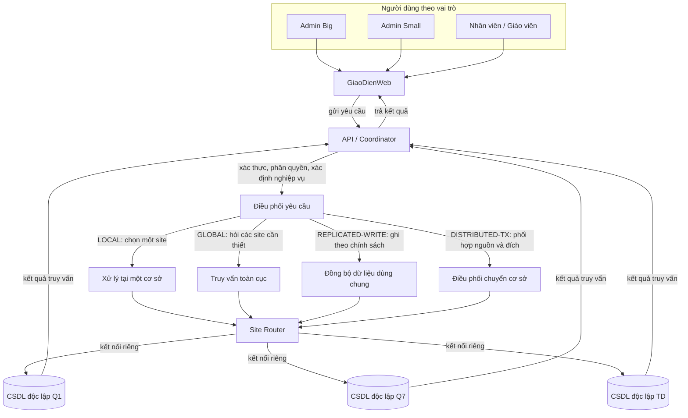

| Kiểu xử lý | Site Router làm gì? | Ví dụ trong dự án |
|---|---|---|
| `LOCAL` | Chọn đúng một CSDL theo phạm vi tài khoản hoặc site chứa dữ liệu | Nhân viên Q1 đăng ký học viên vào lớp tại Q1 |
| `GLOBAL` | Lấy danh sách site đang hoạt động, truy vấn riêng từng CSDL cần đọc; API kiểm tra và gộp kết quả | Admin Big mở hộp thư đề nghị chuyển hoặc xem thống kê toàn trung tâm |
| `REPLICATED-WRITE` | Gửi thay đổi tới mọi site đang hoạt động theo một chính sách đồng bộ tập trung | Cập nhật môn học hoặc khóa học dùng chung |
| `DISTRIBUTED-TX` | Điều phối các bước tại CSDL nguồn và CSDL đích, lưu trạng thái để có thể phục hồi | Chuyển học viên sau khi Admin Big hoặc Admin Small tại site nhận duyệt đề nghị do Tư vấn gửi |

**Quy trình chuyển cơ sở có hai giai đoạn nghiệp vụ:** chỉ Tư vấn & xếp lớp tạo đề nghị tại cơ sở mình phụ trách; đề nghị và trạng thái `cho_duyet` được lưu ở CSDL nguồn. Admin Big mở hộp thư bằng `GLOBAL`; Admin Small ở site nhận truy vấn các CSDL nguồn nhưng chỉ thấy đề nghị gửi tới site mình và đề nghị phát sinh tại site mình. Không có CSDL hộp thư trung tâm. Admin Big hoặc Admin Small tại site nhận có thể duyệt/từ chối; quyết định được ghi ở nguồn. Chỉ đề nghị đã duyệt mới được Coordinator thực hiện bằng `DISTRIBUTED-TX` giữa nguồn và đích. Khi hoàn tất, hệ thống ghi thông báo cục bộ ở site nhận cho Admin Small, Kế toán & Lễ tân và Tư vấn & xếp lớp để tư vấn chọn lớp/phòng thủ công. Hồ sơ đích giữ nguyên `ma_tai_khoan`; không tạo lại tài khoản hoặc mật khẩu. Nếu từ chối, hồ sơ học viên vẫn ở nguồn và không tạo dữ liệu tại đích. Xem chi tiết các bước và phục hồi tại [5.5. Chuyển học viên sang cơ sở khác](#55-chuyển-học-viên-sang-cơ-sở-khác).

Các nút Q1, Q7 và TD trong sơ đồ là ba CSDL riêng ban đầu, không phải ba phân vùng trong một CSDL chung. Danh sách site tham gia lấy từ dữ liệu cơ sở đang `hoat_dong` và cấu hình kết nối; khi thêm cơ sở, hệ thống không được giả định rằng luôn chỉ có ba site. Các mũi tên từ CSDL quay về API biểu diễn kết quả được trả qua ứng dụng, không phải JOIN hay khóa ngoại xuyên CSDL.

---

## 1. Bài toán trong 1 phút

Mỗi cơ sở cần vận hành học viên, giáo viên, lớp, đăng ký, học phí, điểm và lịch học tại chỗ. Ban quản lý vẫn cần tra cứu toàn trung tâm; một học viên có thể chuyển cơ sở; môn học, khóa học và tài khoản phải thống nhất ở mọi cơ sở. Nếu tất cả dữ liệu được đưa vào một CSDL duy nhất có cột `chi_nhanh`, đồ án sẽ không chứng minh được các kỹ thuật CSDL phân tán.

Thiết kế bắt buộc dùng **ba CSDL độc lập**, cùng cấu trúc bảng nhưng lưu các mảnh dữ liệu khác nhau. Next.js chỉ gửi yêu cầu tới Django API. Django kiểm tra quyền, chọn đúng kết nối qua Site Router, thực hiện truy vấn tại site và gộp kết quả khi cần. Không có kết nối SQL Server từ trình duyệt.

| Yêu cầu của đồ án | Cách hệ thống thể hiện |
|---|---|
| Nhiều CSDL độc lập | SQL Server có một CSDL riêng cho mỗi cơ sở; mỗi site có kết nối riêng |
| Phân mảnh ngang | Hồ sơ nghiệp vụ của học viên, nhân viên, giáo viên, phòng và lớp nằm ở site quản lý hồ sơ đó |
| Phân mảnh dẫn xuất | Đăng ký, học phí, điểm, buổi học và điểm danh nằm cùng site với bảng cha |
| Nhân bản dữ liệu dùng chung | Cơ sở, môn học, khóa học và tài khoản (gồm subject Google/Facebook đã liên kết) được giữ đồng nhất ở các site đang hoạt động |
| Truy vấn toàn cục | Django hỏi các site cần thiết rồi gộp kết quả ở tầng ứng dụng |
| Giao dịch phân tán | Chuyển cơ sở phối hợp site nguồn và site đích, có trạng thái phục hồi |
| Truy cập đồng thời | Hai phiên đăng ký tranh chỗ cuối; chỉ một yêu cầu thành công, không vượt sĩ số |
| Đồng bộ khi có lỗi | Site phục hồi nhận đúng thay đổi còn thiếu; retry không ghi trùng, không báo hoàn tất khi còn thiếu bản sao |

### Yêu cầu chung áp dụng cho mọi đề tài

Giảng viên yêu cầu **2–4 site**, triển khai tối thiểu **phân mảnh, replication, transaction và đồng bộ dữ liệu**. Đồ án chọn **3 site Q1, Q7, TD**; BT trong kịch bản mở rộng là site thứ tư. Không bắt buộc các nhóm dùng cùng kiểu phân mảnh, nhưng phải chứng minh ít nhất **1 phương pháp phân mảnh + 1 phương pháp replication + 1 distributed transaction + 1 tình huống concurrency + 1 distributed query**.

Các mục này là yêu cầu bắt buộc, không phải chức năng bổ sung. Mục 6 của README liệt kê các kịch bản demo và điều kiện cần chứng minh. Có ba DB, cùng dữ liệu seed hay có trang web chưa đủ chứng minh replication/giao dịch phân tán. Cơ chế replication ứng dụng cho `MonHoc` đã được chọn; các chi tiết vận hành, mức bảo đảm distributed transaction và môi trường triển khai còn phải thống nhất/kiểm chứng, không làm các yêu cầu trở thành tùy chọn.

### Sáu nghiệp vụ bắt buộc theo đề tài

| Nghiệp vụ được giao | Phần triển khai trong README | Dữ liệu cốt lõi liên quan | Cách thể hiện phân tán |
|---|---|---|---|
| Đăng ký khóa học | [5.1. Đăng ký khóa học](#51-đăng-ký-khóa-học) | `HocVien`, `LopHoc`, `DangKy`, `HocPhi`; đọc danh mục `MonHoc`/`KhoaHoc` | `LOCAL`: định tuyến tới cơ sở học viên/lớp; đăng ký và khoản học phí được lưu cùng site với lớp |
| Quản lý hồ sơ học viên (hỗ trợ vận hành) | [FS-STU-01](fs/Functional-Specification.md#fs-stu-01--quản-lý-hồ-sơ-học-viên-tại-cơ-sở) | `HocVien`, `Logs`; khi cấp tài khoản thêm `TaiKhoan` | Tạo/sửa/xóa hồ sơ và metadata ảnh Cloudinary là `LOCAL` tại một site; slug tạo từ họ tên, chỉ duy nhất trong site; cấp tài khoản theo thao tác riêng là `REPLICATED-WRITE` cho `TaiKhoan` và ghi liên kết cục bộ; không xóa lịch sử đã phát sinh |
| Xếp lớp | [5.2. Xếp hoặc đổi lớp](#52-xếp-hoặc-đổi-lớp) | `HocVien`, `LopHoc`, `DangKy` | `LOCAL`: kiểm tra học viên và lớp trong cùng site; không JOIN xuyên cơ sở |
| Chuyển cơ sở | [5.5. Chuyển học viên sang cơ sở khác](#55-chuyển-học-viên-sang-cơ-sở-khác) | `GiaoDichChuyenCoSo`, `HocVien`, `DangKy`, `LichSuChuyenCoSo`, `ThongBao` | Tư vấn đề nghị `LOCAL`; Admin Big xem `GLOBAL`, Admin Small site nhận xem hộp thư đã lọc; Big hoặc Small site nhận quyết định ghi `LOCAL` tại nguồn; sau đó chạy `DISTRIBUTED-TX` và ghi thông báo `LOCAL` tại đích |
| Đóng học phí | [5.3. Thu hoặc hoàn học phí](#53-thu-hoặc-hoàn-học-phí) | `DangKy`, `HocPhi`, `PhieuThu` | `LOCAL`: ghi nhận khoản thu tại site chứa đăng ký; kiểm tra số dư và quyền trước khi ghi |
| Quản lý điểm | [5.4. Nhập và sửa điểm](#54-nhập-và-sửa-điểm) | `DangKy`, `Diem`, `LopHoc`, `GiaoVien` | `LOCAL`: chỉ ghi điểm tại site của lớp, sau khi kiểm tra phân công và quyền |
| Thống kê học viên theo cơ sở | [5.6. Thống kê học viên theo cơ sở/toàn hệ thống](#56-thống-kê-học-viên-theo-cơ-sởtoàn-hệ-thống) | `HocVien` | `LOCAL` khi thống kê một site; `GLOBAL` khi thống kê nhiều site và gộp kết quả trong API |

Đây là phạm vi tối thiểu của đề tài. Các chức năng quản trị, tài khoản, điểm danh, danh mục và nhật ký chỉ hỗ trợ vận hành hoặc chứng minh cơ chế phân tán; không được làm mất hay thay thế sáu nghiệp vụ trên. Cấu trúc cột, khóa và phân mảnh của các bảng được quy định trong [`docs/DATABASE_SCHEMA.md`](docs/DATABASE_SCHEMA.md).

---

## 2. Sơ đồ kiến trúc hệ thống

### 2.1. Người dùng đi tới đúng CSDL như thế nào?

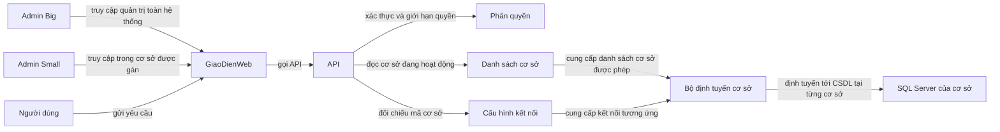

| Tầng | Công nghệ | Nhiệm vụ |
|---|---|---|
| Giao diện | Next.js | Hiển thị màn hình, nhận thao tác và gọi API; không chứa mật khẩu SQL Server |
| API và điều phối | Django | Xác thực, kiểm tra quyền, xử lý nghiệp vụ, điều phối giao dịch và chọn site |
| Định tuyến | Site Router trong Django | Ánh xạ mã site đang hoạt động tới kết nối SQL Server phù hợp |
| Lưu trữ | SQL Server | Chạy các CSDL site riêng, cùng schema nhưng chứa các mảnh dữ liệu tương ứng |
| Quản trị CSDL | SSMS | Tạo/kiểm tra CSDL, chạy script, xem kết quả truy vấn và cấu hình phục vụ đồ án |

Các thông tin kết nối chỉ được Django backend sử dụng và phải lấy từ cấu hình môi trường an toàn. Không đưa chuỗi kết nối, mật khẩu hay thông tin đăng nhập SQL vào mã Next.js gửi xuống trình duyệt. Người dùng cuối đăng nhập ứng dụng; SSMS dành cho thành viên có nhiệm vụ cài đặt và quản trị.

### 2.2. Django điều phối bốn kiểu truy cập phân tán

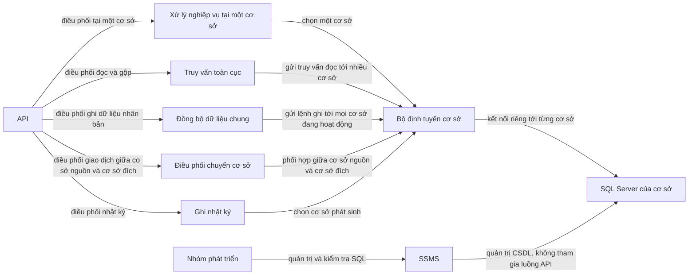

`SQLServer_CSDL_Site` là nút đại diện cho **mỗi CSDL riêng**. Ở cấu hình ban đầu có ba bản: Q1, Q7 và TD. Khi mở rộng, số site lấy từ dữ liệu `CoSo` có trạng thái `hoat_dong` và đối chiếu với cấu hình kết nối; không lặp cố định ba lần trong code.

### 2.3. Django phát hiện site và chọn kết nối

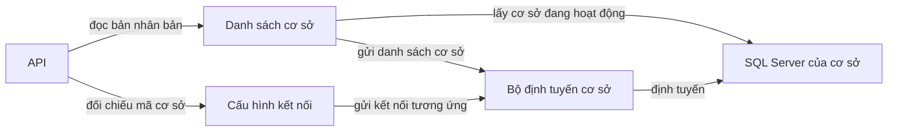

| Trạng thái cơ sở | Nhận truy vấn nghiệp vụ | Tham gia ghi dữ liệu dùng chung | Ý nghĩa |
|---|:---:|:---:|---|
| `chuan_bi` | Không | Không | Đang tạo CSDL, nạp schema và dữ liệu dùng chung |
| `hoat_dong` | Có | Có | Được Site Router đưa vào các thao tác phù hợp |
| `dong_cua` | Không | Không | Ngừng nhận nghiệp vụ mới nhưng vẫn giữ dữ liệu lịch sử |

Nếu cơ sở đang `hoat_dong` nhưng thiếu cấu hình kết nối, Django phải báo lỗi cấu hình rõ ràng. Không âm thầm bỏ qua site trong giao dịch ghi nhân bản. Khi triển khai một máy, vẫn tạo ba CSDL và ba kết nối riêng để kiểm chứng được định tuyến.

---

## 3. Ai được làm gì

### 3.1. Phân biệt Admin Big và Admin Small

**Admin Big** giữ quyền quản trị toàn hệ thống: tạo/đóng cơ sở, phân công Admin Small, quản lý dữ liệu dùng chung, xem thống kê toàn trung tâm và duyệt hoặc từ chối mọi đề nghị chuyển học viên. **Admin Small** điều hành site được giao; chỉ **Tư vấn & xếp lớp** có thể tạo đề nghị tại site nguồn. Admin Small tại site nhận xem đề nghị gửi tới site mình và có thể duyệt/từ chối chúng; retry giao dịch vẫn chỉ dành cho Admin Big. Sau khi được duyệt, Coordinator chạy giao dịch phân tán. Khi chuyển hoàn tất, site nhận thông báo cho Admin Small, Kế toán & Lễ tân và Tư vấn & xếp lớp để tư vấn chọn lớp/phòng thủ công. Hồ sơ học viên giữ nguyên liên kết tài khoản và mật khẩu. Các việc thường ngày khác gồm giám sát nhân sự, lớp/lịch, hồ sơ học viên, đăng ký, học phí, điểm danh, điểm và báo cáo tại cơ sở. Mỗi cơ sở phải có người phụ trách Admin Small.

Trong schema hiện tại, `TaiKhoan.vai_tro` gồm `admin_big`, `nhan_vien`, `giao_vien`, `hoc_vien`. Admin Small đăng nhập bằng tài khoản `nhan_vien`, nhưng hồ sơ quyền được xác định qua `Admin.loai_admin = admin_small` và `ma_co_so`; không nhầm hồ sơ Admin Small với hồ sơ nhân viên tại `NhanVien`. Nhân viên nghiệp vụ hiện dùng `NhanVien.chuc_vu` gồm `ke_toan` (hiển thị “Kế toán & Lễ tân”) và `tu_van` (hiển thị “Tư vấn & xếp lớp”); migration 41 chuyển dữ liệu `le_tan` cũ sang `ke_toan`.

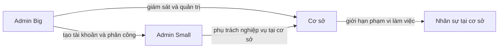

| Nhóm người dùng | Phạm vi | Quyền chính |
|---|---|---|
| Admin Big | Toàn hệ thống | Mặc định xem danh sách học viên, nhân viên, giáo viên, lớp và học phí qua Global Query; mỗi dòng nêu site và kết quả phải cảnh báo site thiếu. Có thể lọc về một site. Thao tác ghi hồ sơ/lớp chọn site cụ thể hoặc dùng site của bản ghi; quản trị cơ sở và dữ liệu dùng chung; phân công Admin Small; cấp tài khoản học viên theo thao tác riêng; xem thống kê/log và hộp thư đề nghị toàn cục, duyệt/từ chối đề nghị chuyển |
| Admin Small | Một site được phân công | Điều hành nghiệp vụ tại site mình; tạo/sửa/xóa hồ sơ học viên theo quy tắc giữ lịch sử; cấp tài khoản học viên sau thao tác riêng; xem đề nghị phát sinh tại site mình và đề nghị gửi tới site mình; duyệt/từ chối đề nghị có site đích là site mình; không tạo đề nghị, retry hoặc truy cập nghiệp vụ site khác |
| Kế toán & Lễ tân | Một site | Chỉ xem phòng, lớp/roster, hồ sơ học viên và công nợ tại site; gửi email nhắc phí; xem đề nghị chuyển cùng công nợ lịch sử ở nguồn. Kế toán vẫn xem phiếu thu và thu/hoàn; không tạo/sửa/hủy phòng/lớp/hồ sơ, đăng ký/xếp lớp hoặc sửa kế hoạch đóng |
| Tư vấn & xếp lớp | Một site | CRUD hồ sơ học viên tại site được giao nhưng không cấp tài khoản; mở lớp, phân công giáo viên, đăng ký/xếp lớp; sửa tên/sĩ số lớp và hủy mềm lớp đủ điều kiện; CRUD phòng; xem công nợ, gửi nhắc phí và sửa kế hoạch đóng; tạo đề nghị chuyển và xem công nợ lịch sử tại nguồn, không duyệt/từ chối/retry; nhận/phản hồi liên hệ và tạo/sửa/xuất bản bài Blog dùng chung |
| Giáo viên | Các lớp được phân công | Xem lớp/buổi học, nhập hoặc sửa điểm theo quyền, điểm danh |
| Học viên | Admin có thể tạo tài khoản theo thao tác riêng trong FS-STU-01; portal tự phục vụ/SePay chưa được chốt cho đồ án | Cấp tài khoản không đồng nghĩa bật portal; chỉ mở portal sau khi nhóm thống nhất và đồng bộ tài liệu |

Các danh sách toàn hệ thống của Admin Big là Global Query tại Django: API hỏi riêng từng CSDL site đang hoạt động rồi gộp kết quả trong bộ nhớ, không tạo database nghiệp vụ trung tâm hoặc JOIN xuyên site. Bộ chọn cơ sở mặc định là `Toàn hệ thống`; lọc một cơ sở chỉ đổi phạm vi đọc. Các thao tác ghi cần một site hợp lệ và quyền vẫn được xác thực ở API; tại trang lớp, Admin Big chọn site ngay trong biểu mẫu nghiệp vụ nếu đang xem toàn hệ thống, còn thao tác từ một lớp có sẵn định tuyến theo site của lớp. Nếu một site không đọc được, response/giao diện phải nêu `complete=false` và `missing_sites`, không báo danh sách là đầy đủ.

### 3.2. Backend luôn kiểm tra quyền trước khi truy cập dữ liệu

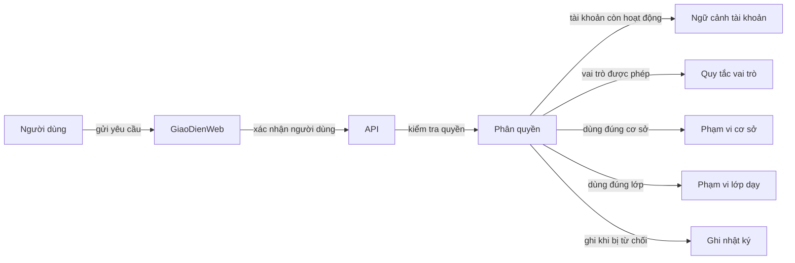

Với mỗi yêu cầu, Django phải kiểm tra lần lượt: tài khoản có hợp lệ và đang hoạt động không; chức năng có được phép không; tài khoản được thao tác ở site nào; nếu là giáo viên thì có được phân công lớp đó không. Ẩn nút trên Next.js chỉ cải thiện giao diện, không thay cho kiểm tra phía Django. Từ chối truy cập cũng cần ghi nhật ký phù hợp, không ghi mật khẩu hoặc token.

---

## 4. Dữ liệu và quy tắc phân tán

### 4.1. Mỗi nhóm dữ liệu được đặt ở đâu?

| Kiểu dữ liệu | Bảng chính | Vị trí và cách dùng |
|---|---|---|
| Nhân bản | `CoSo`, `MonHoc`, `KhoaHoc`, `TaiKhoan` (gồm `google_subject`, `facebook_subject`), `DanhMucBlog`, `BaiVietBlog` | Cùng schema và bản sao theo site. API có luồng ghi runtime cho tài khoản, `MonHoc`, `KhoaHoc` và CMS Blog; Blog dùng Coordinator ghi từng site, ACK trong `Logs`, retry idempotent. Seed không thay cho bằng chứng replication runtime |
| Phân mảnh ngang nguyên thủy | `HocVien`, `GiaoVien`, `NhanVien`, `PhongHoc`, `LopHoc` | Mỗi dòng nằm ở site quản lý dòng đó theo `ma_co_so` |
| Phân mảnh ngang dẫn xuất | `BuoiHoc`, `DangKy`, `DiemDanh`, `HocPhi`, `PhieuThu`, `Diem` | Nằm cùng site với lớp, buổi học hoặc đăng ký cha |
| Cục bộ | `GiaoDichChuyenCoSo`, `LichSuChuyenCoSo`, `TokenDatLaiMatKhau`, `Logs` | Trạng thái giao dịch chuyển chỉ lưu ở CSDL nguồn; sự kiện/log ghi tại site phát sinh; không nhân bản |

| Dữ liệu mẫu | Q1 | Q7 | TD |
|---|:---:|:---:|:---:|
| Khóa học IELTS dùng chung | Có | Có | Có |
| Hồ sơ học viên đang học ở Q1 | Có | Không | Không |
| Học phí và điểm thuộc đăng ký của học viên đó ở Q1 | Có | Không | Không |

Chi tiết cấu trúc cột, khóa và vị trí của từng bảng được định nghĩa tại [docs/DATABASE_SCHEMA.md](docs/DATABASE_SCHEMA.md). README mô tả nghiệp vụ và kiến trúc; không thay thế schema.

### 4.2. Bốn loại thao tác phải được phân biệt

| Loại | Cách Django truy cập | Ví dụ | Khi site lỗi |
|---|---|---|---|
| `LOCAL` | Chọn đúng một site qua Site Router | Đăng ký, đổi lớp, thu học phí, nhập điểm | Rollback thao tác cục bộ nếu một bước trong cùng CSDL thất bại |
| `GLOBAL` | Đọc các site cần thiết rồi gộp ở Django | Thống kê toàn trung tâm, tra cứu học viên hiện tại | Đánh dấu kết quả thiếu site là chưa đầy đủ |
| `REPLICATED-WRITE` | Ghi bảng dùng chung qua Coordinator vào các CSDL site riêng | `PATCH /api/v1/admin/shared/subjects/{slug}/` cập nhật `MonHoc`; tạo/sửa/xóa `KhoaHoc`; một số luồng tài khoản cũng có replication | Trả kết quả chưa hoàn tất nếu thiếu ACK; retry dùng lại `Idempotency-Key` và body |
| `DISTRIBUTED-TX` | Phối hợp nhiều CSDL cho một nghiệp vụ | Chuyển học viên từ Q1 sang Q7 | Lưu trạng thái tại nguồn và phục hồi; Global Query chọn một hồ sơ hiện hành dù tạm thời có thể có hai dòng vật lý `dang_hoc` |

### 4.3. Ghi dữ liệu dùng chung chỉ có một điểm vào

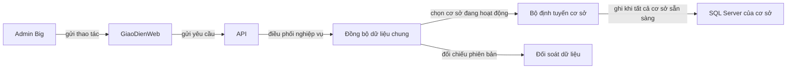

Môn học dùng SQL Server transactional Publication; API `publisher_subjects.py` chỉ ghi `MonHoc` và biên nhận `Logs` tại Publisher cấu hình bằng `MONHOC_PUBLISHER_SITE_CODE` (mặc định Q1). Sau commit API đọc từng site hoạt động để xác nhận, trả 202 nếu chưa đủ; retry cùng key/body chỉ đối soát, không ghi lại Subscriber. `AUTH_SESSION_SITE_CODE` chỉ chọn nơi lưu phiên/khóa điều phối hiện có, không chọn Publisher. `KhoaHoc` vẫn dùng fan-out riêng trong `course_services.py`, yêu cầu bản sao môn học đồng nhất trước khi ghi. Chi tiết và chuyển đổi: [MonHoc SQL replication](docs/MonHoc-SQL-Replication.md).

Trang `/admin/courses` hiển thị `KhoaHoc.so_buoi` là số buổi chuẩn riêng với số buổi đã tạo cho từng lớp. Endpoint quản trị `/api/v1/admin/courses/class-sessions/` đọc `LopHoc` và `BuoiHoc` riêng tại từng site rồi tổng hợp trong API cho Admin Big (`GLOBAL`); Tư vấn và Kế toán chỉ đọc cơ sở trong phiên (`LOCAL`). Không ghi số buổi lớp ngược lên bản sao `KhoaHoc`.

CMS Blog dùng cùng chính sách fan-out nhưng gói trong `src/api/core/blog/write_services.py`: Admin Big tạo/sửa/xóa danh mục và bài viết qua một writer, mỗi site ghi transaction cục bộ và ACK trong `Logs`. Nếu một site lỗi sau khi site khác commit, API trả incomplete để retry cùng key, route và payload; không hoàn tác các site đã commit và không cam kết ACID xuyên database.

YC-03/YC-07: người dùng đã cung cấp ảnh UPDATE và đồng bộ bù `MonHoc` Q1 → Q7 qua Publication; API mới, INSERT/DELETE và TD chưa có bằng chứng live. Không bật lại API fan-out môn học song song Publication. Các bảng dùng chung khác không tự chuyển sang SQL replication.

### 4.4. Các quy tắc không được phá vỡ

| Quy tắc | Vì sao cần giữ |
|---|---|
| Luôn truy cập SQL Server qua Site Router trong Django | Tránh gửi yêu cầu vào nhầm site hoặc dùng một kết nối mặc định |
| Không có khóa ngoại vật lý giữa hai CSDL; không JOIN xuyên site | Các site là CSDL độc lập; Django hỏi riêng từng nơi rồi gộp |
| Không gộp ba site vào một DB có cột `chi_nhanh` | Làm mất mục tiêu chứng minh phân mảnh và định vị dữ liệu |
| Mã có tiền tố site chỉ nơi tạo bản ghi | Học viên có thể chuyển cơ sở nhưng giữ mã cũ; tìm site hiện tại bằng truy vấn trạng thái |
| Không xóa học viên khi chuyển cơ sở | Giữ hồ sơ lịch sử tại nguồn với `da_chuyen_di` |
| Thống kê học viên đang học chỉ đếm bản `dang_hoc` | Tránh cộng cả bản lịch sử `da_chuyen_di` |
| Nhật ký chỉ thêm, không sửa/xóa | Bảo toàn dấu vết kiểm toán |
| Mật khẩu và token chỉ lưu dạng băm | Không ghi bí mật vào log, API response hoặc console |
| Không viết cứng `Q1`, `Q7`, `TD` như tập site cố định | Cho phép thêm cơ sở mới mà không phải sửa các luồng nghiệp vụ |

---

## 5. Các luồng nghiệp vụ

Mọi luồng bắt đầu ở giao diện web, gửi yêu cầu tới API, qua bước xác thực và kiểm tra quyền, rồi mới tới bộ định tuyến cơ sở và SQL Server. Các sơ đồ dưới đây dùng mũi tên để thể hiện chiều tương tác; bảng và khóa dữ liệu nằm trong schema.

### 5.1. Đăng ký khóa học

**Loại:** `LOCAL` · **Ai làm:** Admin Small hoặc Tư vấn & xếp lớp tại site của học viên. Kế toán & Lễ tân chỉ tra cứu, không đăng ký.

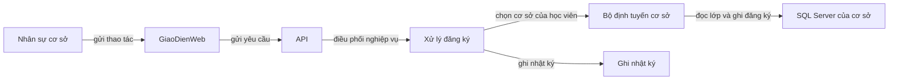

1. Chọn học viên đang thuộc cơ sở và khóa/lớp muốn đăng ký.
2. Django kiểm tra quyền, trạng thái học viên, lớp có cùng `ma_co_so`, trạng thái lớp cho phép đăng ký và còn chỗ.
3. Kiểm tra học viên chưa có đăng ký trùng còn hiệu lực.
4. Trong một giao dịch cục bộ, tạo `DangKy`, tạo `HocPhi`, cập nhật sĩ số lớp và ghi nhật ký.
5. Nếu bất kỳ bước ghi nào lỗi, rollback cả giao dịch cục bộ và trả lỗi rõ ràng cho Next.js.

Không gửi học viên sang site khác để đăng ký lớp; nếu học ở cơ sở khác, dùng nghiệp vụ chuyển cơ sở trước.

### 5.2. Xếp hoặc đổi lớp

**Loại:** `LOCAL` · **Ai làm:** Admin Small hoặc Tư vấn & xếp lớp. Kế toán & Lễ tân chỉ xem lớp và roster.

```mermaid
flowchart LR
    NhanSuCoSo["Nhân sự cơ sở"] -->|gửi thao tác| GiaoDienWeb["GiaoDienWeb"]
    GiaoDienWeb["GiaoDienWeb"] -->|gửi yêu cầu| API["API"]
    API["API"] -->|điều phối nghiệp vụ| XuLyDoiLop["Xử lý đổi lớp"]
    XuLyDoiLop["Xử lý đổi lớp"] -->|chọn cơ sở của đăng ký| SiteRouter["Bộ định tuyến cơ sở"]
    SiteRouter["Bộ định tuyến cơ sở"] -->|cập nhật đăng ký và sĩ số| SQLServer_CSDL_Site["SQL Server của cơ sở"]
```

Django đọc đăng ký hiện tại, lớp đích, sĩ số và lịch tại cùng site. Trên form, nhân viên chọn lớp hiện tại để xem phòng/lịch và roster học viên theo họ tên/mã; sau đó chọn lớp đích cùng khóa học, còn chỗ và thấy rõ phòng/lịch. Lớp đích phải thuộc cùng cơ sở; hệ thống cập nhật đăng ký, sĩ số lớp cũ/mới và nhật ký trong một giao dịch cục bộ. Không tự chuyển đăng ký hoặc lịch sử sang CSDL site khác.

### 5.3. Thu hoặc hoàn học phí

**Loại:** `LOCAL` · **Ai làm:** Kế toán & Lễ tân ghi nhận thu/hoàn; Admin Small giám sát theo quyền tại site được giao.

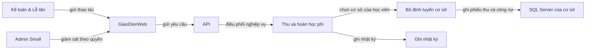

Trước khi thu hoặc hoàn, kiểm tra khoản phải thu, tổng đã thu/đã hoàn và số dư. Hoàn phải trỏ tới phiếu thu gốc; trong cùng transaction tại site, API tạo phiếu hoàn mới, đảo số tiền các kỳ, cập nhật trạng thái `HocPhi` và ghi nhật ký. Idempotency key ngăn ghi trùng khi retry. Không xóa hoặc sửa phiếu đã phát sinh; Admin Small giám sát, còn thao tác thu/hoàn do chức vụ Kế toán & Lễ tân thực hiện.

Báo cáo tài chính học phí cho Kế toán & Lễ tân xem dữ liệu `LOCAL` tại cơ sở được phân công; Admin Small chỉ xem site của mình, còn Admin Big có thể xem một site hoặc dùng Global Query. API hỏi từng CSDL site riêng và nêu site thiếu; các số liệu là tổng hiện tại từ `HocPhi`/`PhieuThu`, không phải báo cáo lọc theo kỳ ngày.

Màn Học phí mặc định lọc các khoản còn nợ, hiển thị từng học viên, lớp, tổng học phí, đã thu và còn lại; có thể tìm theo tên/mã học viên hoặc tên/mã lớp, đổi bộ lọc và chuyển trang. Các thẻ tổng quan lấy từ báo cáo tại site, không chỉ cộng trang đang xem. Nếu chưa có dòng học phí, cần kiểm tra đăng ký lớp: một khoản `HocPhi` được tạo khi đăng ký hợp lệ phát sinh.

### 5.4. Nhập và sửa điểm

**Loại:** `LOCAL` · **Ai làm:** Giáo viên được phân công; quản lý chỉ xem/kiểm tra theo quyền.

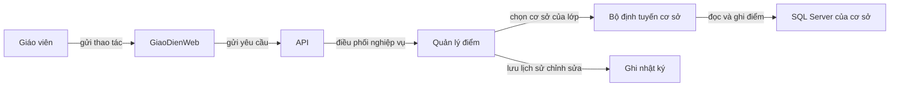

Django xác nhận giáo viên được dạy lớp đó, học viên có đăng ký hợp lệ và loại điểm thuộc môn/khóa. Lưu điểm tại site của lớp/đăng ký. Khi sửa điểm, ghi giá trị cũ, giá trị mới, người sửa và thời điểm vào nhật ký; không cho giáo viên sửa lớp ngoài phạm vi được giao.

### 5.5. Chuyển học viên sang cơ sở khác

**Loại:** tạo đề nghị `LOCAL` tại nguồn → hộp thư `GLOBAL` cho Admin Big và hộp thư lọc theo site nhận cho Admin Small → quyết định `LOCAL` tại nguồn → sau khi duyệt mới chạy `DISTRIBUTED-TX` · **Ai làm:** Tư vấn & xếp lớp đề nghị; Admin Big hoặc Admin Small tại site nhận duyệt/từ chối; Kế toán & Lễ tân chỉ xem đề nghị tại site được giao.

Kế toán & Lễ tân và Tư vấn & xếp lớp có quyền xem học viên đã chuyển, cơ sở nguồn/đích, trạng thái và tổng phải thu/đã thu/còn nợ tại CSDL nguồn. Chỉ Tư vấn có thể tạo đề nghị tại site được giao; Admin Small chỉ xem đề nghị tại site nguồn/đích được phép. Admin Small tại site nhận được duyệt/từ chối đề nghị gửi đến mình; chỉ Admin Big được retry. Số liệu học phí lấy cùng CSDL nguồn từ `DangKy`/`HocPhi`; không JOIN sang DB đích.

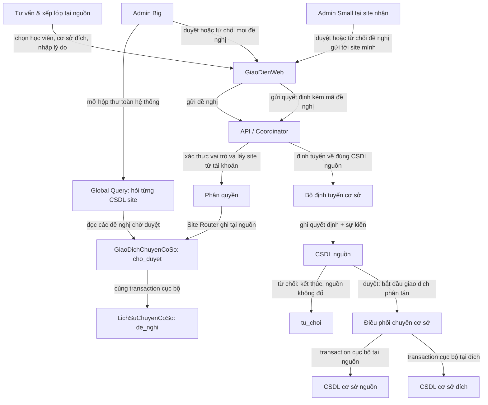

1. Tư vấn & xếp lớp tại cơ sở nguồn chọn học viên, cơ sở đích đang hoạt động và nhập lý do. Django lấy cơ sở nguồn từ phạm vi tài khoản đăng nhập; không tin `co_so_nguon` do trình duyệt gửi lên và không suy site từ tiền tố mã học viên.
2. API dùng Global Query xác định bản `dang_hoc` hiện hành, xác nhận bản đó thuộc site của người đề nghị, rồi kiểm tra không có đề nghị/giao dịch đang mở, không còn nợ, site đích khác nguồn và đang `hoat_dong`. Trong transaction cục bộ tại nguồn, tạo `GiaoDichChuyenCoSo` ở trạng thái `cho_duyet` cùng sự kiện append-only `de_nghi`. Học viên vẫn thuộc nguồn, chưa tạo bản đích và vẫn được tính ở thống kê nguồn. Unique index tại nguồn và bước định vị hiện hành toàn cục ngăn tạo đề nghị trùng ở các site khác nhau.
3. Admin Big mở hộp thư toàn hệ thống. Admin Small ở site nhận cũng đọc các CSDL nguồn qua API nhưng chỉ được trả đề nghị phát sinh tại site mình hoặc có site đích là site của phiên. Không có bảng hộp thư trung tâm. Nếu site nguồn không truy cập được, hộp thư báo chưa đầy đủ và không cho quyết định đề nghị chưa tải được.
4. Admin Big hoặc Admin Small tại site nhận duyệt; API định tuyến về CSDL nguồn theo mã đề nghị và xác thực lại quyền (Small phải đúng site đích), học viên còn đang học, công nợ, trạng thái site đích, kết nối hai site và không có giao dịch đang mở khác. Trong transaction cục bộ tại nguồn, đổi trạng thái sang `dang_xu_ly`, bước `da_tiep_nhan`, ghi tài khoản/thời điểm quyết định và sự kiện `duyet`. Việc kiểm tra lại là bắt buộc vì dữ liệu có thể đổi trong lúc chờ.
5. Admin Big hoặc Admin Small tại site nhận từ chối thì ghi `tu_choi`, tài khoản/thời điểm và lý do cùng sự kiện `tu_choi` tại nguồn. Hồ sơ học viên không đổi; đề nghị kết thúc và được giữ để tra cứu. Tư vấn tại nguồn có thể gửi đề nghị mới sau đó.
6. Chỉ sau quyết định duyệt, Coordinator mới tạo hồ sơ cùng mã ở site đích và sự kiện `tao_ho_so_dich` trong cùng transaction cục bộ tại đích. Giữ nguyên `ma_tai_khoan` để thông tin đăng nhập/mật khẩu không đổi. Metadata avatar Cloudinary (nếu có) được sao chép cùng hồ sơ; file không di chuyển khỏi Cloudinary và bản metadata nguồn vẫn được giữ cho lịch sử. Sau khi xác nhận đích đã commit, cập nhật `buoc_cuoi = da_tao_ho_so_dich` và thêm sự kiện `xac_nhan_ho_so_dich` ở nguồn.
7. Trong một transaction cục bộ tại nguồn, đánh dấu học viên `da_chuyen_di`, đóng đăng ký/lớp cũ, cập nhật `buoc_cuoi = da_cap_nhat_nguon` và thêm sự kiện `cap_nhat_ho_so_nguon`. Sau khi đối chiếu hai site, cập nhật trạng thái giao dịch `hoan_tat` và ghi sự kiện cuối ở nguồn. Trong transaction kích hoạt hồ sơ đích, ghi thông báo idempotent tại `ThongBao` với audience `site_staff`; Admin Small, Kế toán & Lễ tân và Tư vấn & xếp lớp ở site nhận đọc được thông báo và Tư vấn chọn lớp/phòng phù hợp thủ công.

Khi đề nghị còn `cho_duyet`, các nghiệp vụ tại nguồn vẫn có thể tiếp tục; vì vậy Admin Big phải kiểm tra lại điều kiện lúc duyệt. Sau khi đã duyệt và trạng thái là `dang_xu_ly`, API chặn đăng ký/thu phí/nhập điểm cho học viên ở cả hai site đến khi phục hồi hoàn tất. Không xóa bản nguồn. Vì hai CSDL commit riêng, sau khi tạo đích và trước khi cập nhật nguồn có thể tồn tại hai dòng vật lý `dang_hoc`; không tuyên bố đây là transaction ACID nguyên tử xuyên hai CSDL. Coordinator phục hồi tiến về phía trước sau khi đích đã commit. `LichSuChuyenCoSo` chỉ thêm sự kiện; chỉ `GiaoDichChuyenCoSo` là trạng thái hiện tại có thể cập nhật. Chi tiết lỗi, retry và kiểm chứng nằm trong [docs/QLTTNN-Giao-Dich-Phan-Tan.md](docs/QLTTNN-Giao-Dich-Phan-Tan.md).

#### Phục hồi nếu ứng dụng dừng giữa lúc chuyển

**Tình huống:** đích đã tạo hồ sơ nhưng ứng dụng dừng trước khi đánh dấu nguồn. Khi chạy lại, Django đọc `GiaoDichChuyenCoSo` ở nguồn, đối chiếu sự kiện `ma_chuyen` tại đích, rồi tiếp tục bước còn thiếu; không tạo hồ sơ đích lần hai và không xóa hồ sơ đích đã commit.

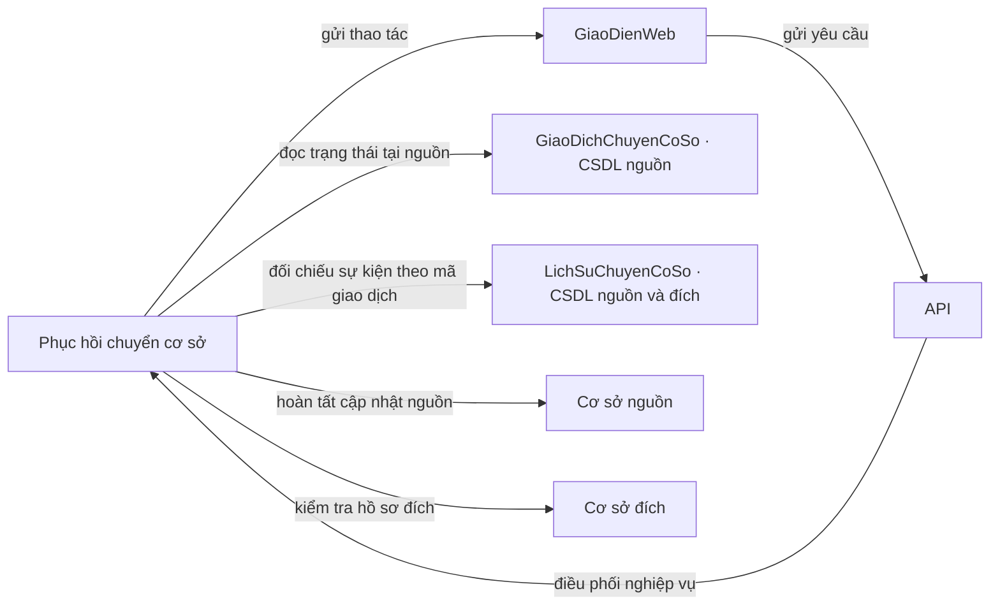

| Điểm dừng | Kết quả phải đảm bảo sau phục hồi |
|---|---|
| Đề nghị đang chờ duyệt (`trang_thai = cho_duyet`) | Chưa tạo bản đích; bản nguồn vẫn `dang_hoc`, tiếp tục được tính tại nguồn; Coordinator chỉ chạy sau khi Admin Big hoặc Admin Small site nhận duyệt |
| Trước khi tạo bản đích (`buoc_cuoi = da_tiep_nhan`) | Bản nguồn vẫn `dang_hoc`; lỗi nghiệp vụ dứt điểm có thể kết thúc `that_bai`; lỗi kết nối thì giữ giao dịch để thử lại |
| Đích đã commit, nguồn chưa cập nhật (`buoc_cuoi = da_tao_ho_so_dich`) | Giữ `dang_xu_ly` và phục hồi tiến về phía trước; Global Query tính bản nguồn, tạm ẩn bản đích |
| Nguồn đã cập nhật (`buoc_cuoi = da_cap_nhat_nguon`) | Transaction nguồn đã đổi nguồn thành `da_chuyen_di`; Global Query tính bản đích |
| Hoàn tất (`trang_thai = hoan_tat`) | Chỉ bản ở site đích còn `dang_hoc`; bản nguồn là `da_chuyen_di` |

### 5.6. Thống kê học viên theo cơ sở/toàn hệ thống

**Loại:** `GLOBAL` · **Ai làm:** Admin Big xem toàn trung tâm; Admin Small xem site được giao.

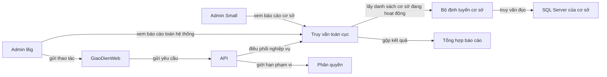

Django gửi truy vấn riêng tới các site trong phạm vi quyền, đọc đề nghị `cho_duyet` và trạng thái giao dịch ở từng CSDL nguồn, chuẩn hóa cấu trúc rồi gộp tại ứng dụng. Đề nghị `cho_duyet` chưa tạo bản đích nên bản nguồn tiếp tục được tính như bình thường. Với giao dịch `dang_xu_ly`, trước `da_cap_nhat_nguon` chỉ tính bản nguồn và ẩn bản đích; từ `da_cap_nhat_nguon` trở đi chỉ tính bản đích. Khi hoàn tất, đếm bản `dang_hoc` và loại bản `da_chuyen_di`. Nếu một site lỗi, hiển thị cảnh báo và đánh dấu số liệu thiếu; không gọi đó là tổng đầy đủ. Admin Small không được dùng tham số API để xem site khác.

### 5.7. Đăng nhập

**Loại:** `GLOBAL` để tìm tài khoản nhân bản, sau đó xác thực trong Django · **Ai làm:** Người dùng nội bộ.

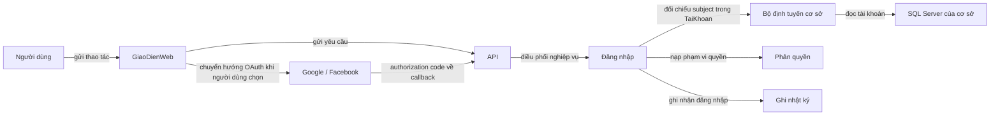

Đăng nhập bằng tên đăng nhập/email và mật khẩu, phiên có thể thu hồi, idle timeout và các route OAuth Google/Facebook đã có code. OAuth hiện chỉ cho học viên có subject liên kết trước; cấu hình provider và kiểm thử với app thật còn phụ thuộc môi trường. Tra cứu tài khoản/subject đọc các CSDL site riêng, liên kết subject cập nhật bản sao `TaiKhoan`; không tự tạo tài khoản hoặc tự ghép qua email. Admin có thể cấp tài khoản học viên theo thao tác riêng tại FS-STU-01; portal tự phục vụ và OAuth học viên vẫn chưa được tính là phạm vi đồ án. Không có CSDL identity trung tâm hay JOIN xuyên site. Xem [trạng thái triển khai](docs/Trang-Thai-Trien-Khai.md) và [API spec](specs/api.md).

Phiên đăng nhập hết hạn sau **60 phút không có hoạt động người dùng thật**. Backend kiểm tra hạn và thu hồi phiên; endpoint `/auth/activity/` là đường gia hạn tường minh, frontend không được gọi nó bằng polling/health check. Mỗi thiết bị có phiên riêng. Khi tải lại trang, frontend khôi phục danh tính qua `/auth/session/` mà không gia hạn phiên; bộ đếm dựa trên `expires_at` và hỏi API khi tới hạn. Trong bước phục hồi chỉ `401` kết thúc trạng thái đăng nhập; lỗi mạng/5xx cho phép thử xác minh lại. Trạng thái phiên hiện được lưu tại CSDL site cấu hình `AUTH_SESSION_SITE_CODE`, không phải CSDL nghiệp vụ trung tâm; site này ngừng hoạt động có thể ảnh hưởng đăng nhập và xác thực phiên toàn hệ thống. Đồng bộ hoạt động giữa các tab và cảnh báo trước hạn vẫn cần được kiểm chứng/hoàn thiện.

### 5.8. Quên và đặt lại mật khẩu

**Loại:** tra cứu tài khoản trên các site; lưu OTP/tiến trình ở database kỹ thuật được cấu hình; cập nhật bản sao mật khẩu theo service đồng bộ.

**Yêu cầu mã đặt lại:**

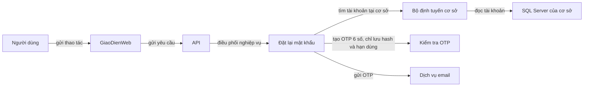

**Xác nhận OTP và đổi mật khẩu:**

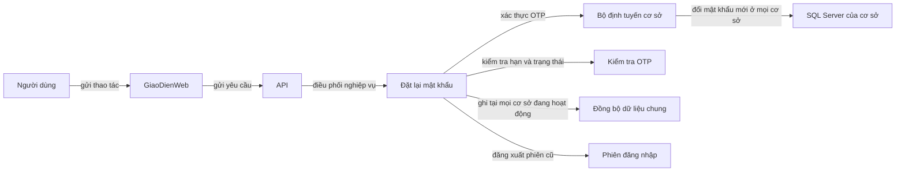

Luồng hiện có áp dụng cho Admin Big/Admin Small: API trả phản hồi chung, gửi OTP 6 số qua SMTP, chỉ lưu hash và hết hạn theo `PASSWORD_RESET_TIMEOUT` (mặc định 120 giây). OTP được kiểm tra một lần; khi hợp lệ, Coordinator lưu ledger phục hồi, cập nhật hash mật khẩu tới các bản `TaiKhoan` và vô hiệu hóa phiên cũ. Không ghi OTP/token hay mật khẩu vào log. Chưa xác nhận gửi email thật ở môi trường nhóm.

API có route quên/đặt lại mật khẩu và luồng gửi thư, nhưng việc gửi thật phụ thuộc SMTP secrets cục bộ. Không ghi email/password SMTP hoặc secret vào README, Git, log hay chat; `.env.example` chỉ giữ placeholder.

### 5.9. Quản lý nhân viên và cấp tài khoản nội bộ

**Loại:** tạo/xóa tài khoản `REPLICATED-WRITE`; đọc/sửa hồ sơ và ghi trạng thái gửi mật khẩu `LOCAL`; gửi mật khẩu qua SMTP theo thao tác người quản lý; ngưng đăng nhập `REPLICATED-WRITE` · **Ai làm:** Admin Big và Admin Small theo phạm vi site.

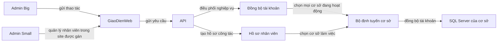

Admin Big cấp tài khoản Admin Small và giáo viên theo quy trình riêng. API nhân viên cho Admin Big chọn một site đang hoạt động; Admin Small chỉ được xem/tạo/sửa/ngưng/xóa nhân viên trong site của mình. Form tạo nhân viên có hai chức vụ `ke_toan` (“Kế toán & Lễ tân”) và `tu_van` (“Tư vấn & xếp lớp”); migration 41 chuyển các hồ sơ `le_tan` hiện có sang `ke_toan`. Không nhầm chức vụ nhân viên với hồ sơ Admin Small (`Admin.loai_admin=admin_small`). Kế toán & Lễ tân chỉ xem phòng, lớp/roster, hồ sơ học viên và công nợ tại site; có thể gửi nhắc phí, xem báo cáo tài chính/phiếu thu và thu/hoàn; không ghi phòng/lớp/hồ sơ, không đăng ký/xếp lớp hoặc đổi kế hoạch đóng. Tư vấn được CRUD hồ sơ học viên và phòng tại site được giao nhưng không cấp tài khoản; mở lớp, phân công giáo viên, đăng ký/xếp lớp; sửa tên/sĩ số và hủy mềm lớp đủ điều kiện; xem/nhắc công nợ và chỉ đổi kế hoạch đóng; tạo đề nghị chuyển, xem công nợ lịch sử tại nguồn nhưng không duyệt/từ chối/retry. Cả hai vai trò chỉ dùng dữ liệu của site được giao cho nghiệp vụ cục bộ. Tư vấn có hộp thư liên hệ và được tạo/sửa/xuất bản bài Blog dùng chung, nhưng không xóa bài hoặc sửa danh mục. Blog article write là `REPLICATED-WRITE` đến mọi site hoạt động, không giới hạn theo cơ sở nhân viên.

Tạo nhân viên ghi `NhanVien` ở site công tác và nhân bản `TaiKhoan`; ảnh tùy chọn được tải trực tiếp lên Cloudinary, còn metadata ảnh cập nhật trong các bản sao `TaiKhoan`. Email cấp tài khoản dùng email làm thông tin đăng nhập chính; người nhận không cần username được sinh tự động, dù API vẫn nhận username thay thế. Danh sách nhân viên là `LOCAL` theo cơ sở đang chọn và hiển thị email, username, số điện thoại cùng `site_code`; sau khi tạo, giao diện chọn đúng site vừa tạo và tải lại danh sách. API dùng mật khẩu khởi tạo trong cấu hình backend, chỉ lưu hash, không trả mật khẩu và buộc đổi ở lần đăng nhập đầu; tạo nhân viên chỉ ghi trạng thái chờ gửi vào `Logs`, còn Admin Big/Admin Small bấm `Gửi mật khẩu` để chủ động gửi email một lần. Gửi thành công hoặc kết quả SMTP chưa rõ thì khóa gửi lại; chỉ SMTP xác nhận thất bại mới cho thử lại. Sửa chỉ cập nhật họ tên, điện thoại, chức vụ và audit trong transaction cục bộ; email/tên đăng nhập thuộc danh tính tài khoản nhân bản, còn site là vị trí phân mảnh nên không đổi tại đây. Nút trạng thái chỉ cho `active` → `inactive`; thao tác `Ngưng` thu hồi phiên nhưng không đổi tình trạng làm việc `NhanVien`, và không có nút kích hoạt lại. Nút `Xóa vĩnh viễn` xóa tài khoản, phiên, token reset và ảnh ở các bản sao; nếu hồ sơ đã được phiếu thu tham chiếu thì gỡ liên kết tài khoản, giữ hồ sơ nghỉ việc để bảo toàn chứng từ, còn hồ sơ chưa có phiếu thu được xóa vật lý. Logs và phiếu thu được giữ; site lỗi thì không báo hoàn tất và gọi lại cùng slug để tiếp tục. Các CSDL commit riêng, không phải ACID xuyên site. Chi tiết hợp đồng nằm trong [FS](fs/Functional-Specification.md), [API spec](specs/api.md) và [schema](docs/DATABASE_SCHEMA.md).

### 5.10. Mở lớp và sinh lịch học

**Loại:** `LOCAL` · **Ai làm:** Admin Big chọn site thao tác; Admin Small tại cơ sở.

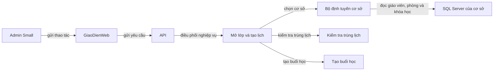

Admin Big có thể mở lớp khi danh sách đang ở phạm vi `Toàn hệ thống`; biểu mẫu yêu cầu chọn cơ sở cụ thể và tải khóa học, giáo viên/phòng theo site đã chọn. Khóa học được chọn từ `GET /api/v1/admin/classes/course-options/`, đọc `KhoaHoc` và `MonHoc` tại site; danh sách và thông tin sau khi chọn hiển thị tên khóa, môn, trình độ, thời lượng, số buổi chương trình và học phí chuẩn. Khi chọn ngày bắt đầu hoặc đổi khóa, giao diện tự điền ngày kết thúc đúng theo toàn bộ thời lượng khóa; tháng lẻ được quy đổi theo tỷ lệ ngày của tháng kế tiếp và ngày cuối được tính bao gồm. API kiểm tra lại ngày kết thúc chính xác trước khi ghi. Sau khi chọn đủ ngày bắt đầu/kết thúc, giờ bắt đầu/kết thúc và các thứ học, giao diện đếm và hiện tổng số buổi dự kiến trong thời lượng khóa; nếu khóa có `so_buoi`, lịch phải khớp chính xác số buổi đó. Admin Small và Tư vấn mở lớp tại site được giao; danh sách giáo viên phân công đọc `LOCAL` tại site trong phiên qua `/api/v1/admin/teachers/assignment-options/` và chỉ trả mã, họ tên của giáo viên đang dạy. Kế toán & Lễ tân chỉ xem lớp và roster. Lịch cho chọn đủ ngày từ Thứ 2 đến Chủ nhật; giờ bắt đầu/kết thúc dùng `HH:mm` theo giờ Việt Nam (`Asia/Ho_Chi_Minh`), không chuyển múi giờ trên trình duyệt. Phòng được quản lý riêng tại `/admin/rooms`; trang lớp chỉ chọn phòng đang hoạt động. Các thao tác ghi vẫn chỉ tác động một CSDL site. API tự xác minh thời lượng, số buổi, khóa học, giáo viên, phòng, sức chứa và lịch định mở thuộc cùng cơ sở. Không cho trùng giáo viên/phòng trong cùng khung giờ. Khi hợp lệ, tạo lớp và sinh danh sách buổi học theo lịch.

Tư vấn được sửa tên lớp hoặc sĩ số tối đa tại đúng site; API từ chối lớp đã kết thúc/hủy, sĩ số thấp hơn số đăng ký, hoặc vượt sức chứa phòng. Tư vấn có thể hủy mềm lớp `sap_mo` khi chưa có đăng ký và mọi buổi vẫn ở tương lai, trạng thái `du_kien`; `LopHoc`, `BuoiHoc` và `Logs` được giữ lại. Kế toán & Lễ tân chỉ đọc và không dùng các thao tác lớp/đăng ký.

### 5.10.1. Quản lý phòng học

**Đọc:** Admin Big dùng `GLOBAL` để truy vấn từng CSDL site hoạt động rồi tổng hợp tại API; có thể lọc một site. Admin Small, Kế toán & Lễ tân và Tư vấn & xếp lớp chỉ đọc site được phân công (`LOCAL`). Danh sách có số lớp đang mở và số học viên duy nhất; mở rộng một phòng để xem roster theo lớp, trạng thái học phí (chưa có khoản phí/chưa đóng/đóng một phần/đã đóng) và số phải thu/đã thu/còn nợ. Nếu Global Query thiếu site, API/UI trả và hiển thị `missing_sites`; không coi danh sách là đầy đủ.

Từ roster, người có quyền gửi email nhắc học phí theo lớp cho các học viên còn nợ. API tính dư nợ tại site, yêu cầu SMTP và dùng `Logs` để không gửi lặp cùng lớp/học viên trong ngày Việt Nam. SMTP chấp nhận không chứng minh thư đã tới inbox.

**Ghi:** trang `/admin/rooms` cho Admin Big/Admin Small và Tư vấn & xếp lớp thêm, sửa tên/sức chứa/trạng thái hoặc xóa phòng tại đúng một site (`LOCAL`). Kế toán & Lễ tân chỉ xem. `PhongHoc` và `Logs` commit trong transaction của CSDL site đó. Tên phòng duy nhất trong site; sức chứa không được giảm dưới sĩ số tối đa của lớp đang tham chiếu. Chỉ xóa vật lý khi `LopHoc` và `BuoiHoc` không còn tham chiếu; nếu còn, API trả `409`. Mô hình dùng các cột `PhongHoc` hiện có, không tạo DB trung tâm, bảng mới hoặc khóa ngoại xuyên site.

### 5.11. Điểm danh buổi học

**Loại:** `LOCAL` · **Ai làm:** Giáo viên được phân công.

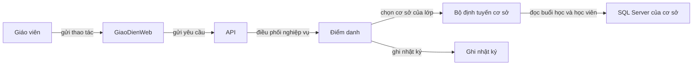

Giáo viên chỉ điểm danh buổi học của lớp mình tại site đó. Mỗi đăng ký chỉ có một trạng thái điểm danh cho một buổi; sửa điểm danh phải lưu nhật ký. Không tạo điểm danh cho học viên không có đăng ký hợp lệ hoặc buổi học không thuộc lớp được phân công.

### 5.12. Nhật ký hệ thống

**Loại:** ghi tại site phát sinh; `GLOBAL` khi Admin Big tra cứu nhiều site.

```mermaid
flowchart LR
    NghiepVu["Nhân sự nghiệp vụ"] -->|gửi thao tác| GiaoDienWeb["GiaoDienWeb"]
    GiaoDienWeb["GiaoDienWeb"] -->|gửi yêu cầu| API["API"]
    API["API"] -->|điều phối nghiệp vụ| GhiNhatKy["Ghi nhật ký"]
    GhiNhatKy["Ghi nhật ký"] -->|chọn cơ sở phát sinh| SiteRouter["Bộ định tuyến cơ sở"]
    SiteRouter["Bộ định tuyến cơ sở"] -->|chỉ ghi thêm nhật ký| SQLServer_CSDL_Site["SQL Server của cơ sở"]
    Admin_Small["Admin Small"] -->|xem nhật ký cơ sở| GiaoDienWeb["GiaoDienWeb"]
    Admin_Big["Admin Big"] -->|xem nhật ký toàn hệ thống| GiaoDienWeb["GiaoDienWeb"]
    API["API"] -->|gộp nhật ký| TruyVanToanCuc["Truy vấn toàn cục"]
    TruyVanToanCuc["Truy vấn toàn cục"] -->|đọc nhiều cơ sở| SQLServer_CSDL_Site["SQL Server của cơ sở"]
```

Nhật ký chỉ thêm, không cập nhật/xóa. Ghi người thao tác, site, thời điểm, hành động, bản ghi tác động và kết quả. Lọc trường nhạy cảm khỏi dữ liệu cũ/mới; không lưu mật khẩu, token hoặc chuỗi kết nối. Admin Small xem log trong phạm vi cơ sở; Admin Big có thể yêu cầu tổng hợp toàn trung tâm.

### 5.13. Quản lý môn học/khóa học/danh mục dùng chung

**Loại:** `REPLICATED-WRITE` · **Ai làm:** Admin Big.

```mermaid
flowchart LR
    Admin_Big["Admin Big"] -->|gửi thao tác| GiaoDienWeb["GiaoDienWeb"]
    GiaoDienWeb["GiaoDienWeb"] -->|gửi yêu cầu| API["API"]
    API["API"] -->|điều phối nghiệp vụ| QuanLyDanhMuc["Quản lý danh mục"]
    QuanLyDanhMuc["Quản lý danh mục"] -->|chọn mọi cơ sở đang hoạt động| SiteRouter["Bộ định tuyến cơ sở"]
    SiteRouter["Bộ định tuyến cơ sở"] -->|đồng bộ danh mục| SQLServer_CSDL_Site["SQL Server của cơ sở"]
    QuanLyDanhMuc["Quản lý danh mục"] -->|dùng chung quy tắc ghi| DongBoDuLieuChung["Đồng bộ dữ liệu chung"]
```

Môn học và khóa học là dữ liệu dùng chung. Django đi qua một điểm vào đồng bộ, xác định các site hoạt động, ghi dữ liệu kèm phiên bản và đối soát. Chỉ xác nhận thành công sau khi chính sách ghi đủ site được thỏa mãn. Nếu một nơi lỗi, lưu site đã thành công/thất bại để phục hồi; không để từng màn hình tự thực hiện vòng lặp ghi riêng.

### 5.14. Thêm cơ sở mới

**Loại:** điều phối cấu hình và `REPLICATED-WRITE` · **Ai làm:** Admin Big/nhóm triển khai.

```mermaid
flowchart LR
    Admin_Big["Admin Big"] -->|gửi thao tác| GiaoDienWeb["GiaoDienWeb"]
    GiaoDienWeb["GiaoDienWeb"] -->|gửi yêu cầu| API["API"]
    API["API"] -->|điều phối nghiệp vụ| ThemCoSo["Thêm cơ sở"]
    ThemCoSo["Thêm cơ sở"] -->|tạo CSDL và nạp dữ liệu| SQLServer_CSDL_Site["SQL Server của cơ sở"]
    ThemCoSo["Thêm cơ sở"] -->|thêm cấu hình kết nối| CauHinhKetNoi["Cấu hình kết nối"]
    ThemCoSo["Thêm cơ sở"] -->|nạp dữ liệu dùng chung| DongBoDuLieuChung["Đồng bộ dữ liệu chung"]
    ThemCoSo["Thêm cơ sở"] -->|kích hoạt cơ sở| DanhSachCoSo["Danh sách cơ sở"]
    ThemCoSo["Thêm cơ sở"] -->|phân công quản lý cơ sở| HoSoNhanVien["Hồ sơ nhân viên"]
    HoSoNhanVien["Hồ sơ nhân viên"] -->|ghi hồ sơ người quản lý tại cơ sở| SQLServer_CSDL_Site["SQL Server của cơ sở"]
```

1. Tạo CSDL SQL Server mới với cùng schema và thêm cấu hình kết nối an toàn cho Django.
2. Đưa cơ sở vào trạng thái `chuan_bi`; cơ sở này chưa nhận truy vấn nghiệp vụ và chưa nằm trong tập ghi nhân bản.
3. Nạp các bảng dùng chung, kiểm tra phiên bản và đối soát dữ liệu với các site hiện hữu.
4. Chỉ sau khi kiểm tra đủ mới đổi trạng thái sang `hoat_dong` qua quy trình đồng bộ đã thống nhất.
5. Tạo hồ sơ Admin Small/nhân sự ở site mới, rồi mới nhận nghiệp vụ.

Thêm site không được yêu cầu sửa vòng lặp “3 lần” hoặc viết thêm nhánh riêng cho `BT`. Khi đóng site, hoàn tất hoặc xử lý rõ mọi đề nghị `cho_duyet` và giao dịch `dang_xu_ly`, chuyển học viên đang học theo nghiệp vụ, rồi đánh dấu site `dong_cua`; ngừng nhận thao tác mới nhưng giữ dữ liệu lịch sử.

---

### 5.15. Đọc và quản trị Blog

**Loại:** public `GLOBAL`; CMS `REPLICATED-WRITE` · **Ai làm:** khách đọc công khai; Admin Big quản trị toàn bộ; Tư vấn & xếp lớp tạo/sửa/xuất bản bài.

- `GET /api/v1/blog/categories/` đọc danh mục và số bài đã xuất bản.
- `GET /api/v1/blog/{slug}/` đọc chi tiết bài theo slug; chỉ trả bài đã xuất bản, danh mục đang hoạt động và đã đến thời điểm xuất bản.
- API hỏi riêng từng CSDL site qua Site Router, đối chiếu các bản sao `DanhMucBlog`/`BaiVietBlog` rồi trả kết quả ở tầng ứng dụng. Không tạo DB trung tâm hoặc JOIN xuyên site. Danh sách báo `complete`, `missing_sites`, `inconsistent_sites`; chi tiết trả 404 khi không có slug, 409 khi bản sao khác nhau, 503 khi không đọc đủ site.
- Admin Big dùng các route `/api/v1/admin/blog/` để đọc, tạo, sửa, xóa danh mục/bài viết. Tư vấn & xếp lớp được đọc danh mục/bài viết và tạo/sửa/xuất bản bài; không được sửa/xóa danh mục hoặc xóa bài. Các thao tác bài viết của Tư vấn ghi `REPLICATED-WRITE` tới mọi site hoạt động. API yêu cầu phiên hợp lệ và `Idempotency-Key`; danh mục đang được bài viết dùng không thể xóa.
- CMS ghi theo `REPLICATED-WRITE` tới từng site đang hoạt động, mỗi site dùng transaction cục bộ và lưu ACK trong `Logs`. Nếu lỗi sau khi một phần đã commit, API trả `202` với site thiếu; retry phải dùng cùng key/payload. Không có cam kết ACID nguyên tử xuyên database; bản sao lệch trả conflict để đối soát.
- Mục Blog trên sidebar mở CMS tại `/admin/blog` cho Admin Big và Tư vấn & xếp lớp. Admin Big có thể tạo/sửa/xóa danh mục và bài viết; Tư vấn có thể tạo/sửa/xuất bản bài nhưng không xóa bài hoặc sửa danh mục. Cả hai xem trạng thái bản nháp/đã xuất bản/đã ẩn, soạn nội dung Markdown giới hạn với bảng/danh sách đánh số tùy chọn, xem trước và retry cùng yêu cầu khi một site chưa ghi xong. Trang chi tiết `/blog/{slug}` đọc bài đã xuất bản qua API; danh sách `/blog` vẫn là nội dung tĩnh nên bài mới chưa tự xuất hiện trong danh sách.

Blog là chức năng hỗ trợ, không thay thế sáu nghiệp vụ bắt buộc của đề tài. Xem [hợp đồng API](specs/api.md), [schema](docs/DATABASE_SCHEMA.md) và [ma trận trạng thái](docs/Trang-Thai-Trien-Khai.md).

### 5.16. Tiếp nhận và phản hồi liên hệ website

Khách gửi form tại `/contact`, chọn một cơ sở đang hoạt động và nhập tên, email, tiêu đề, nội dung cùng số điện thoại tùy chọn. API kiểm tra site và ghi `YeuCauLienHe` cùng `Logs` trong một transaction `LOCAL` tại CSDL của cơ sở đó; gửi form không tự gửi email. `Idempotency-Key` chống ghi trùng; rate limit theo IP/email dùng Django cache, mặc định là LocMemCache theo worker.

Admin Big xem hộp thư toàn hệ thống bằng `GLOBAL` qua truy vấn riêng từng CSDL site; có thể lọc một site. Admin Small và Tư vấn & xếp lớp chỉ xem yêu cầu tại cơ sở được phân công (`LOCAL`). Ba vai trò này có thể phản hồi bằng thao tác trong `/admin/contacts`; API gửi plain-text email đến địa chỉ trong yêu cầu rồi cập nhật trạng thái, nội dung phản hồi và nhật ký tại site sở hữu. Hộp thư cảnh báo rõ site thiếu; không có CSDL trung tâm, JOIN xuyên site hoặc cam kết giao thư chỉ từ phản hồi SMTP. SMTP và commit SQL không nguyên tử: nếu SMTP chấp nhận thư nhưng commit lỗi, trạng thái có thể còn chờ xử lý và lần gửi lại có thể gửi trùng; dùng transactional outbox nếu cần loại bỏ khoảng hở này. Trước khi chạy, áp dụng `db/39_add_contact_inbox.sql` riêng cho mỗi database site và cấu hình SMTP.

Đây là nghiệp vụ hỗ trợ website, không thay thế sáu nghiệp vụ bắt buộc hoặc được tính là minh chứng replication/distributed transaction. Xem [FS-CONTACT-01](fs/Functional-Specification.md#fs-contact-01--tiếp-nhận-và-phản-hồi-yêu-cầu-liên-hệ), [API spec](specs/api.md) và [schema](docs/DATABASE_SCHEMA.md).

## 6. Kịch bản demo

| # | Kịch bản | Điều cần kiểm chứng |
|---|---|---|
| 1 | Kiểm tra dữ liệu mẫu riêng ở Q1/Q7/TD | Học viên và lớp nằm ở site sở hữu; bảng dùng chung có bản sao tại các site |
| 2 | Đăng ký học viên Q1 vào lớp Q1 rồi thu học phí | `LOCAL`; các bảng phát sinh cùng nằm ở CSDL Q1 |
| 3 | Đăng nhập Admin Small Q1 và thử gọi API với mã site Q7 | Django từ chối truy cập ngoài phạm vi dù request được gửi trực tiếp |
| 4 | Admin Big xem thống kê học viên toàn hệ thống | Django gọi từng CSDL, gộp kết quả; chỉ tính `dang_hoc` |
| 5 | Thêm/sửa một khóa học dùng chung khi mọi site sẵn sàng | Bản sao ở mọi site hoạt động có cùng dữ liệu/phiên bản |
| 6 | Làm một site không khả dụng rồi thử ghi dữ liệu dùng chung | Hệ thống không báo thành công khi chưa ghi đủ site theo chính sách |
| 7 | Tư vấn Q1 tạo đề nghị chuyển học viên sang Q7 | Đề nghị `cho_duyet` và sự kiện `de_nghi` nằm ở CSDL Q1; học viên vẫn `dang_hoc` tại Q1; chưa có hồ sơ Q7 |
| 8 | Admin Small thử tạo đề nghị hoặc Admin Small Q1 thử duyệt đề nghị Q1→Q7 | API từ chối; chỉ Tư vấn tạo, Admin Small chỉ quyết định khi site phiên trùng site đích |
| 9 | Admin Big mở hộp thư, duyệt đề nghị Q1→Q7 | Global Query đọc từng CSDL site; quyết định và sự kiện `duyet` lưu ở Q1; giao dịch phân tán sau đó hoàn tất đúng hai site |
| 10 | Admin Big từ chối một đề nghị chuyển | Trạng thái `tu_choi`, người duyệt/thời điểm/lý do và sự kiện được lưu tại nguồn; hồ sơ học viên không đổi |
| 11 | Đặt Q7 thành `dong_cua` trước khi duyệt đề nghị | API không cho duyệt; đề nghị vẫn `cho_duyet` để Big quyết định sau hoặc từ chối; hồ sơ Q1 vẫn `dang_hoc` |
| 12 | Mất kết nối Q7 trước khi transaction tạo hồ sơ đích commit | Không báo thành công; giữ hồ sơ nguồn và giao dịch đã duyệt có thể retry; khi Q7 kết nối lại, retry không tạo trùng |
| 13 | Dừng ứng dụng sau khi hồ sơ đích đã commit rồi chạy recovery | Recovery đọc trạng thái nguồn và sự kiện đích, hoàn tất nguồn; không tạo hồ sơ đích lần hai |
| 14 | Gửi đồng thời hai đề nghị hoặc duyệt đồng thời cho cùng một học viên | Chỉ một đề nghị/giao dịch mở được chấp nhận; yêu cầu còn lại nhận trạng thái đang mở hoặc bị từ chối rõ ràng |
| 15 | Đặt lại mật khẩu và dùng lại cùng liên kết | Token chỉ dùng một lần; mật khẩu mới đồng bộ ở mọi site hoạt động |
| 16 | Đăng nhập sai và kiểm tra nhật ký | Có sự kiện từ chối, không có mật khẩu/token trong log |
| 17 | Thêm cơ sở BT, nạp dữ liệu dùng chung rồi kích hoạt | BT được đưa vào truy vấn/ghi sau khi hoạt động mà không sửa code nghiệp vụ |
| 18 | Hai phiên đăng ký hai học viên khác nhau vào lớp còn một chỗ | Chạy thực sự đồng thời; đúng một yêu cầu thành công; sĩ số tăng một, yêu cầu còn lại không để `DangKy`/`HocPhi` dở dang (TC-CON-01) |
| 19 | Gây lỗi giữa lúc ghi bản sao, khôi phục site và retry/đối soát | Không báo hoàn tất sớm; bản sao nhận đúng phiên bản, không ghi lặp thay đổi đã nhận (TC-SYNC-01) |
| 20 | Kiểm tra các mảnh lớp và đăng ký, hợp kết quả đọc tại ứng dụng | Chứng minh đầy đủ, không giao nhau và tái thiết được tập lớp logic; bản ghi con ở đúng site (TC-FRAG-01) |
| 21 | Ngắt một site khi thống kê toàn hệ thống rồi khôi phục | `complete=false` và `missing_sites` đúng khi lỗi; sau phục hồi đối chiếu lại đủ số liệu (TC-DQ-01) |

Chạy các kịch bản nghiệp vụ này cùng TC-SITE-01, TC-FRAG-01, TC-REP-01, TC-DTX-01, TC-CON-01, TC-DQ-01 và TC-SYNC-01. Một bộ bằng chứng có thể phục vụ nhiều kịch bản nếu ghi rõ tiêu chí tương ứng; không đánh dấu đạt khi mới mô tả kế hoạch.

---

## 7. Ngoài phạm vi

- Không dùng một CSDL duy nhất có cột `chi_nhanh` để giả lập phân tán.
- Không thiết kế khóa ngoại hoặc JOIN xuyên qua hai CSDL site.
- Không để Next.js truy cập trực tiếp SQL Server.
- Không coi SSMS là frontend cho người dùng nghiệp vụ.
- Không tuyên bố đã cài VPN, Linked Server, SQL Server Agent, Publication/Replication hoặc nhiều máy chủ khi chưa triển khai và lưu bằng chứng.
- Không tự chọn thêm framework frontend/backend hoặc thay đổi stack khi chưa được nhóm thống nhất.
- Không chuyển cấu trúc sang MongoDB; thiết kế hiện tại là mô hình quan hệ trên SQL Server.

---

## 8. Danh sách chức năng

| Nhóm | Chức năng | Loại chính | Vai trò |
|---|---|---|---|
| Tài khoản | Đăng nhập, đăng xuất, quên/đặt lại mật khẩu | `GLOBAL`, `REPLICATED-WRITE` | Người dùng nội bộ |
| Quản trị | Tạo tài khoản, khóa/mở tài khoản, phân công Admin Small | `REPLICATED-WRITE` + `LOCAL` | Admin Big |
| Học viên | Quản lý hồ sơ, đăng ký khóa học, đổi lớp | `LOCAL` | Admin Small/Tư vấn CRUD hồ sơ tại site; Kế toán & Lễ tân chỉ đọc; cấp tài khoản dành cho Admin; Tư vấn đăng ký/xếp lớp, Kế toán không đăng ký |
| Phòng, lớp và roster | Xem phòng/lớp/học viên/công nợ; quản lý phòng; sửa/hủy lớp an toàn; gửi nhắc phí | `LOCAL` đọc/ghi đúng site; email ghi `Logs` tại site | Kế toán & Lễ tân chỉ đọc; Tư vấn CRUD phòng, mở/sửa/hủy lớp theo điều kiện, xem roster/công nợ |
| Học phí | Xem công nợ, nhắc phí, kế hoạch đóng; thu/hoàn | `LOCAL` | Kế toán thu/hoàn và xem phiếu; Tư vấn chỉ xem/nhắc và sửa kế hoạch đóng |
| Học tập | Mở lớp, sinh lịch, điểm danh, nhập/sửa điểm | `LOCAL` | Admin Small, giáo viên |
| Chuyển cơ sở | Tư vấn tạo đề nghị `LOCAL`; Admin Big xem/ra quyết định `GLOBAL`; Admin Big hoặc Admin Small site nhận duyệt/từ chối; Coordinator chỉ chuyển sau khi duyệt bằng `DISTRIBUTED-TX`; Kế toán chỉ đọc tại site nguồn kèm công nợ lịch sử | Tư vấn đề nghị; Admin Big hoặc Admin Small đúng site nhận duyệt/từ chối; Kế toán xem read-only |
| Liên hệ website | Khách gửi form tại cơ sở đã chọn; hộp thư và phản hồi `LOCAL` tại cơ sở | Admin Big xem `GLOBAL`; Admin Small và Tư vấn & xếp lớp xem/phản hồi site được giao |
| Danh mục | Quản lý cơ sở, môn học, khóa học | `REPLICATED-WRITE` | Admin Big quản lý cơ sở/môn; Admin Big, Tư vấn & xếp lớp, Kế toán & Lễ tân quản lý khóa học |
| Báo cáo | Thống kê theo site/toàn trung tâm, tra cứu log | `GLOBAL` | Admin Small, Admin Big |

---

## 9. Stack và quyết định còn mở

### 9.1. Công nghệ đã thống nhất

| Phần | Lựa chọn | Vai trò trong dự án |
|---|---|---|
| Frontend | Next.js | Giao diện người dùng và gọi API |
| API/backend | Django | Xử lý API, quyền, nghiệp vụ, Site Router và điều phối truy cập phân tán |
| DBMS | Microsoft SQL Server | Chạy CSDL riêng của từng cơ sở |
| Công cụ quản trị | SQL Server Management Studio (SSMS) | Tạo schema, chạy lệnh, xem dữ liệu và kiểm tra đồng bộ/giao dịch |

### 9.2. Cấu hình và kiểm chứng còn lại

| Quyết định còn mở | Câu hỏi cần thống nhất |
|---|---|
| Cách đặt các site | Ba SQL Server trên ba máy/VM hay ba CSDL riêng trên một máy trong giai đoạn demo? |
| Phiên bản/cấu hình SQL Server | Phiên bản, edition, authentication, TCP/IP, backup và quyền tài khoản dịch vụ là gì? |
| Tự động retry chuyển cơ sở | Source có route để Admin Big retry; nhóm cần quyết định có thêm worker/lịch tự động không, nhịp quét, timeout/backoff và cảnh báo giao dịch `dang_xu_ly` quá lâu |
| Replication và đồng bộ | `MonHoc`: SQL Server Publication, API chỉ ghi Publisher và đối soát sau commit; ảnh người dùng chứng minh UPDATE/phục hồi Q1 → Q7. API/UI sau chuyển đổi, TD, INSERT/DELETE còn cần kiểm chứng. `KhoaHoc` giữ fan-out tầng ứng dụng |
| Cơ chế distributed transaction bắt buộc | Coordinator phục hồi hiện tại đáp ứng tiêu chí đánh giá nào? Nếu giảng viên yêu cầu giao dịch do DBMS quản lý, cần bổ sung cơ chế gì và kiểm thử ra sao? Không ghi đã có ACID/MSDTC/2PC khi chưa chứng minh |
| Kiểm soát concurrency | Source có khóa/transaction cho sức chứa; TC-CON-01 vẫn cần hai phiên SQL Server đồng thời tranh một chỗ cuối và kiểm tra không để dữ liệu dở dang |
| Công cụ triển khai vật lý | Cấu hình VPN/Remote Desktop, SQL Server Agent, Linked Server và Publication theo tài liệu cài đặt giảng viên; ghi phần đã cấu hình, phần cần xác nhận và bằng chứng thực tế |
| Kiểm chứng tích hợp ngoài | Cấu hình và kiểm tra SMTP, OAuth, Cloudinary; SePay chỉ bật sau khi nhóm chốt phạm vi, merchant/webhook và kịch bản đối soát. Bí mật chỉ nằm trong secret store hoặc `.env` cục bộ |

`MonHoc` và `KhoaHoc` có service ghi nhân bản trong source; bằng chứng runtime được ghi riêng trong [ma trận kiểm chứng](docs/QLTTNN-Yeu-Cau-Chung-Va-Kiem-Chung.md). Chưa có bằng chứng outage/recovery qua mạng thật, chuyển cơ sở chạy lỗi giữa hai site hoặc hai phiên SQL Server tranh chỗ cuối. Q1/Q7/TD được xác minh là ba CSDL riêng trên cùng một SQL Server instance trong môi trường kiểm tra trước đây; điều này không chứng minh ba máy chủ vật lý hay trạng thái hiện tại. Xem [trạng thái triển khai](docs/Trang-Thai-Trien-Khai.md) và ma trận YC/TC để phân biệt source với kết quả kiểm chứng.

---

## 10. Tiến độ

| Hạng mục | Trạng thái | Bằng chứng cần có |
|---|---|---|
| Nghiệp vụ, phân quyền, các kiểu truy cập | Mô tả trong README/FS; đối chiếu source ở [trạng thái triển khai](docs/Trang-Thai-Trien-Khai.md) | Review của nhóm và kiểm tra theo role/site |
| Schema và phân loại dữ liệu | Có schema khởi tạo, migration và hướng dẫn SQL trong `docs/DATABASE_SCHEMA.md`/`db/README.md` | Script và kết quả áp dụng trên từng CSDL đang dùng |
| Frontend Next.js / Django API | Có source frontend và API cho nhiều luồng nghiệp vụ; trạng thái tích hợp ở ma trận triển khai | Lệnh chạy, kiểm tra API/UI và bằng chứng môi trường |
| Ba CSDL SQL Server | Kiến trúc yêu cầu DB riêng Q1/Q7/TD; không kết luận cài đặt hiện tại chỉ từ tài liệu | Kết quả truy vấn xác nhận từng site và kết nối riêng |
| VPN/Linked Server/Agent/Publication | Chỉ ghi nhận nếu thực tế được yêu cầu và cài | Ảnh cấu hình, script và kết quả thử |
| YC-01–YC-07 của môn học | Đã bổ sung tiêu chí; chưa kiểm chứng trong đợt cập nhật tài liệu này | Kết quả bảy kịch bản TC, dữ liệu từng site, lỗi/phục hồi và concurrency thực tế |
| Phục hồi giao dịch chuyển cơ sở | Coordinator và route retry có trong source; lịch chạy retry tự động chưa được xác nhận | Fault-injection trước/sau commit đích, trạng thái hai site và retry/đối soát |

Khi cập nhật bảng này, chỉ đánh dấu hoàn thành khi có source hoặc bằng chứng chạy được. Không ghi kế hoạch thành kết quả đã triển khai.

---

## 11. Hướng dẫn cho người triển khai

Trước khi sửa code, tự trả lời các câu hỏi sau:

1. Dữ liệu đang đọc/ghi là nhân bản, phân mảnh ngang, dẫn xuất hay cục bộ?
2. Nghiệp vụ là `LOCAL`, `GLOBAL`, `REPLICATED-WRITE` hay `DISTRIBUTED-TX`?
3. Request có đi qua Site Router trong Django không? Có lỡ JOIN hai site trong một câu lệnh không?
4. Backend đã kiểm tra vai trò, site và phạm vi lớp chưa?
5. Nếu một site lỗi giữa chừng, kết quả trả về và trạng thái phục hồi là gì?
6. Nhật ký đã ghi đủ mà không chứa mật khẩu, token hoặc chuỗi kết nối chưa?

Quy tắc khi viết source:

- Mọi truy cập CSDL xuất phát từ Django API; Next.js chỉ gọi API.
- Luôn chọn kết nối theo site qua Site Router; không dùng kết nối mặc định cho mọi thao tác.
- Lấy site đang hoạt động từ dữ liệu/cấu hình; không hard-code mảng `Q1`, `Q7`, `TD`.
- Không tạo FK hoặc JOIN giữa CSDL site; truy vấn toàn cục phải gộp tại Django.
- ID mang tiền tố nơi tạo; không dùng tiền tố để xác định site hiện tại của học viên.
- Chuyển cơ sở không xóa lịch sử nguồn; thống kê đang học loại `da_chuyen_di`.
- Ghi dữ liệu dùng chung chỉ qua một dịch vụ đồng bộ; thiếu site phải được xử lý đúng chính sách và ghi nhận.
- Không ghi mật khẩu/token thô vào CSDL hoặc log; chỉ lưu bản băm.
- Mọi thay đổi schema cập nhật `docs/DATABASE_SCHEMA.md`; mọi thay đổi nghiệp vụ/kiến trúc cập nhật README và tài liệu con liên quan.
- Kiểm thử từng DB site riêng, kiểm tra quyền Admin Big/Admin Small và thử ít nhất một tình huống mất kết nối cho luồng phân tán.

---

## 12. Tốc độ tải trang và dữ liệu

Các quy tắc dưới đây áp dụng khi thành viên hoặc AI thêm/sửa trang có dữ liệu. Mục tiêu là người dùng thấy cấu trúc trang và trạng thái chờ ngay, không phải đợi toàn bộ API hoặc CSDL phản hồi mới nhìn thấy nội dung. Đây là yêu cầu triển khai, **không phải xác nhận source hiện tại đã có đủ trang nghiệp vụ hoặc đã đạt một mức tốc độ cụ thể**.

### 12.1. Xác định đúng nơi gây chậm

Đo từng đoạn bằng millisecond; không mặc định quy mọi độ trễ cho SQL Server.

| Dấu hiệu | Kiểm tra trước |
|---|---|
| Mở route đầu tiên sau `npm run dev` chậm, lần sau nhanh hơn | Next.js có thể đang biên dịch route khi truy cập trong chế độ phát triển. So sánh log terminal và lần mở lại; không dùng riêng số đo `dev` để kết luận tốc độ production. |
| Khung trang hiện ngay nhưng bảng/số liệu tới muộn | DevTools → Network để tìm API chậm; sau đó đo thời gian xử lý Django và truy vấn SQL/site tương ứng. |
| Cả trang trắng hoặc bị khóa tới khi dữ liệu xong | Kiểm tra page/Server Component có đang chờ toàn bộ request trước khi render hay chưa có loading boundary. |
| Trang toàn hệ thống chậm hơn trang tại một cơ sở | Đo riêng từng site; kiểm tra số site được hỏi, lời gọi tuần tự, timeout và site không phản hồi. |

Phân biệt thời gian nhận HTML/route, tải JavaScript, từng request API, xử lý Django và truy vấn SQL Server. Có thể ghi `request_id` cùng thời lượng từng bước; không ghi mật khẩu, token, chuỗi kết nối hoặc dữ liệu nhạy cảm vào log.

### 12.2. Hiển thị trang trong lúc tải

- Render layout, tiêu đề, điều hướng và phần nội dung ổn định trước; không đợi dữ liệu của mọi section rồi mới hiển thị toàn trang.
- Với route cần chờ dữ liệu, dùng `loading.tsx`; với từng section độc lập, đặt Suspense boundary và skeleton cho riêng section. Kích thước skeleton gần với nội dung thật để hạn chế layout nhảy.
- Hiện loading ngay khi thao tác bắt đầu. Không chờ response mới bật spinner; không thay toàn trang bằng spinner nếu chỉ một bảng đang tải.
- Phân biệt rõ `loading`, `empty`, `error` và `partial`. Khi lỗi, giữ dữ liệu người dùng đã nhập. Chỉ đưa ra nút thử lại khi thao tác có thể retry an toàn.
- Animation không được trì hoãn nội dung và phải tôn trọng `prefers-reduced-motion`.

### 12.3. Gọi API và truy vấn dữ liệu

- Không `await` nối tiếp các request độc lập. Khởi chạy song song khi dữ liệu không phụ thuộc nhau; chỉ chờ tuần tự khi có phụ thuộc nghiệp vụ. Tránh để page và component con tải trùng cùng một dữ liệu.
- Không lấy toàn bộ học viên/lớp/phiếu thu về trình duyệt để lọc. Tìm kiếm, lọc và phân trang danh sách lớn phải được giới hạn tại API/Django và SQL Server.
- Tránh truy vấn N+1. Dùng `select_related`/`prefetch_related` khi phù hợp; chỉ đọc trường cần hiển thị. Chỉ thêm index sau khi xem truy vấn và query plan thực tế.
- Không thêm cache để che truy vấn chậm khi chưa xác định thời hạn và cách vô hiệu hóa. Không phục vụ trạng thái cũ cho quyền tài khoản, hồ sơ học viên, học phí, điểm, giao dịch hoặc chuyển cơ sở. Dữ liệu dùng chung chỉ cache theo chính sách đồng bộ đã thống nhất.
- Không tự retry thao tác ghi, thu/hoàn học phí hoặc chuyển cơ sở khi timeout; trước tiên phải đọc trạng thái/idempotency theo hợp đồng API.

### 12.4. Giữ nguyên kiến trúc CSDL phân tán

- `LOCAL`: chỉ truy vấn CSDL của site hợp lệ thông qua Site Router. Trình duyệt không kết nối SQL Server.
- `GLOBAL`: Django hỏi các site cần thiết qua kết nối riêng rồi tổng hợp tại tầng API. Không tạo DB trung tâm, không JOIN hoặc đặt khóa ngoại xuyên site.
- Khi các truy vấn site độc lập, tránh chờ tuần tự từng site. Chỉ dùng fan-out song song có giới hạn và timeout sau khi xác nhận driver/kết nối an toàn.
- Site không phản hồi phải được thể hiện trong kết quả `GLOBAL` bằng trạng thái chưa đầy đủ và `missing_sites`; không biến lỗi site thành danh sách rỗng hoặc báo cáo thành công toàn phần.
- Không gọi truy vấn toàn cục nếu người dùng chỉ cần dữ liệu của site mình; không tải thêm dữ liệu nhạy cảm chỉ để giảm số request.

### 12.5. Cách kiểm tra trước khi hoàn tất

1. Ghi route, vai trò/site, lệnh chạy, môi trường và trạng thái cold start/cache khi đo.
2. Đo lần vào route đầu và lần vào lại; khi đánh giá production, so sánh với bản chạy bằng `npm run build` rồi `npm run start`, không kết luận từ `npm run dev` một mình.
3. Trong DevTools Network, ghi thời gian document, JavaScript và từng API. Với API có truy vấn DB, tách thời gian xử lý Django và từng site/query nếu có thể. Khi đo endpoint bằng nhiều request cùng điều kiện, ghi số lượt đo và p50/p95; một request đơn lẻ chỉ dùng để lần dấu nguyên nhân.
4. Với `GLOBAL`, kiểm tra cả lúc đủ site và lúc một site chậm/mất kết nối; xác nhận UI hiển thị dữ liệu một phần đúng quy ước.
5. Đo Core Web Vitals theo `specs/ui-ux.md` trên mobile và desktop. Ghi số đo, đơn vị `ms`, công cụ, viewport và môi trường; mục tiêu đặc tả không thay thế kết quả đo.
6. Ghi kiểm tra đã chạy và điểm còn mở trong mô tả PR. Không ghi “đã tối ưu”, “không còn chậm” hoặc cam kết thời gian tải nếu chưa có số đo có thể lặp lại.

**Điều kiện hoàn tất trang có dữ liệu:** phần giao diện ổn định hiện ra trước khi request kết thúc; loading/empty/error/partial khớp trạng thái API; không có request trùng hoặc truy vấn N+1 chưa giải thích; API kiểm tra đúng quyền/site; số đo route và API được ghi để nhóm so sánh về sau.
