# Quản lý trung tâm đào tạo ngoại ngữ

> Đề tài 10 · Môn Cơ sở dữ liệu phân tán · Ba cơ sở ban đầu: Quận 1 (Q1), Quận 7 (Q7), Thủ Đức (TD).
>
> Đây là README chính của dự án. Tài liệu giải thích kiến trúc, nghiệp vụ và cách nhóm tổ chức source. Cấu trúc bảng, khóa, ràng buộc và phân mảnh nằm tại [docs/DATABASE_SCHEMA.md](docs/DATABASE_SCHEMA.md).
>
> Stack đã chốt: **Next.js frontend → Django API/backend → SQL Server**. Dùng **SQL Server Management Studio (SSMS)** để quản trị, chạy lệnh SQL và kiểm tra các CSDL. SSMS không phải frontend của người dùng và không nằm trên luồng gọi API.
>
> README dành cho cả thành viên mới vào nhóm. Khi đổi nghiệp vụ hoặc kiến trúc, cập nhật README và tài liệu con liên quan; khi đổi bảng hoặc phân mảnh, cập nhật schema trong cùng thay đổi.

**Cách đọc sơ đồ:** đây là **sơ đồ kiến trúc luồng**, không phải ERD bảng. Mỗi nút là vai trò người dùng, `GiaoDienWeb`, `API`, dịch vụ điều phối hoặc CSDL tại cơ sở. Mũi tên cho biết chiều gửi yêu cầu, điều phối hoặc đọc/ghi dữ liệu; chúng không biểu diễn khóa ngoại giữa các CSDL. ERD bảng và quan hệ dữ liệu nằm trong `docs/DATABASE_SCHEMA.md`.

**Mục lục:** [Mô hình hoạt động tổng quát](#mô-hình-hoạt-động-tổng-quát) · [1. Bài toán](#1-bài-toán-trong-1-phút) · [2. Sơ đồ kiến trúc](#2-sơ-đồ-kiến-trúc-hệ-thống) · [3. Vai trò](#3-ai-được-làm-gì) · [4. Quy tắc phân tán](#4-dữ-liệu-và-quy-tắc-phân-tán) · [5. Luồng nghiệp vụ](#5-các-luồng-nghiệp-vụ) · [6. Demo](#6-kịch-bản-demo) · [7. Ngoài phạm vi](#7-ngoài-phạm-vi) · [8. Chức năng](#8-danh-sách-chức-năng) · [9. Stack và quyết định còn mở](#9-stack-và-quyết-định-còn-mở) · [10. Tiến độ](#10-tiến-độ) · [11. Hướng dẫn cho người triển khai](#11-hướng-dẫn-cho-người-triển-khai) · [12. Tốc độ tải trang và dữ liệu](#12-tốc-độ-tải-trang-và-dữ-liệu)

**Tài liệu theo chủ đề:**

- [Đặc tả chức năng và tiêu chí nghiệm thu](fs/README.md)
- [Đặc tả yêu cầu giao diện và API](specs/README.md)
- [Cấu trúc bảng và phân mảnh](docs/DATABASE_SCHEMA.md)
- [Script khởi tạo ba CSDL SQL Server](db/README.md)
- [Kiến trúc và định tuyến site](docs/QLTTNN-Kien-Truc.md)
- [Mô hình dữ liệu và vị trí lưu](docs/QLTTNN-Du-Lieu.md)
- [Hướng dẫn đọc và tổ chức source](docs/QLTTNN-Huong-Dan-Source.md)
- [Giao dịch phân tán và phục hồi](docs/QLTTNN-Giao-Dich-Phan-Tan.md)
- [Kế hoạch triển khai và kiểm chứng](docs/QLTTNN-Ke-Hoach-Trien-Khai.md)
- [Quy trình làm việc nhóm](docs/QLTTNN-Lam-Viec-Nhom.md)
- [Đề cương báo cáo cuối kỳ](docs/QLTTNN-De-Cuong-Bao-Cao.md)

---

## Mô hình hoạt động tổng quát

Sơ đồ dưới đây tóm tắt đường đi của một yêu cầu từ người dùng tới các CSDL site. Django API là nơi kiểm tra quyền và điều phối; Site Router chọn đúng một hoặc nhiều CSDL độc lập tùy nghiệp vụ. Kết quả nhiều site được gộp trong API, không gộp dữ liệu vật lý vào một CSDL trung tâm.

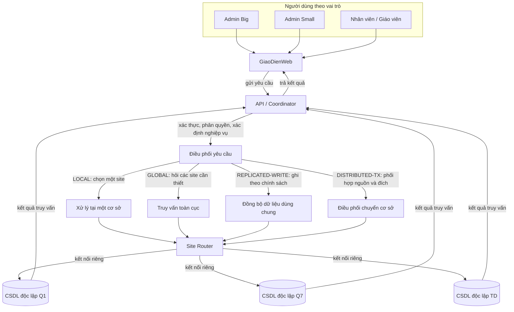

| Kiểu xử lý | Site Router làm gì? | Ví dụ trong dự án |
|---|---|---|
| `LOCAL` | Chọn đúng một CSDL theo phạm vi tài khoản hoặc site chứa dữ liệu | Nhân viên Q1 đăng ký học viên vào lớp tại Q1 |
| `GLOBAL` | Lấy danh sách site đang hoạt động, truy vấn riêng từng CSDL cần đọc; API kiểm tra và gộp kết quả | Admin Big mở hộp thư đề nghị chuyển hoặc xem thống kê toàn trung tâm |
| `REPLICATED-WRITE` | Gửi thay đổi tới mọi site đang hoạt động theo một chính sách đồng bộ tập trung | Cập nhật môn học hoặc khóa học dùng chung |
| `DISTRIBUTED-TX` | Điều phối các bước tại CSDL nguồn và CSDL đích, lưu trạng thái để có thể phục hồi | Chuyển học viên sau khi Admin Big duyệt đề nghị |

**Quy trình chuyển cơ sở có hai giai đoạn nghiệp vụ:** Admin Small tạo đề nghị tại cơ sở mình phụ trách; đề nghị và trạng thái `cho_duyet` được lưu ở CSDL nguồn. Admin Big mở hộp thư bằng `GLOBAL`: API hỏi từng CSDL site rồi tổng hợp danh sách, không có CSDL hộp thư trung tâm. Quyết định duyệt hoặc từ chối được ghi lại tại nguồn. Chỉ đề nghị đã duyệt mới được Coordinator thực hiện bằng `DISTRIBUTED-TX` giữa nguồn và đích. Nếu từ chối, hồ sơ học viên vẫn ở nguồn và không tạo dữ liệu tại đích. Xem chi tiết các bước và phục hồi tại [5.5. Chuyển học viên sang cơ sở khác](#55-chuyển-học-viên-sang-cơ-sở-khác).

Các nút Q1, Q7 và TD trong sơ đồ là ba CSDL riêng ban đầu, không phải ba phân vùng trong một CSDL chung. Danh sách site tham gia lấy từ dữ liệu cơ sở đang `hoat_dong` và cấu hình kết nối; khi thêm cơ sở, hệ thống không được giả định rằng luôn chỉ có ba site. Các mũi tên từ CSDL quay về API biểu diễn kết quả được trả qua ứng dụng, không phải JOIN hay khóa ngoại xuyên CSDL.

---

## 1. Bài toán trong 1 phút

Mỗi cơ sở cần vận hành học viên, giáo viên, lớp, đăng ký, học phí, điểm và lịch học tại chỗ. Ban quản lý vẫn cần tra cứu toàn trung tâm; một học viên có thể chuyển cơ sở; môn học, khóa học và tài khoản phải thống nhất ở mọi cơ sở. Nếu tất cả dữ liệu được đưa vào một CSDL duy nhất có cột `chi_nhanh`, đồ án sẽ không chứng minh được các kỹ thuật CSDL phân tán.

Thiết kế bắt buộc dùng **ba CSDL độc lập**, cùng cấu trúc bảng nhưng lưu các mảnh dữ liệu khác nhau. Next.js chỉ gửi yêu cầu tới Django API. Django kiểm tra quyền, chọn đúng kết nối qua Site Router, thực hiện truy vấn tại site và gộp kết quả khi cần. Không có kết nối SQL Server từ trình duyệt.

| Yêu cầu của đồ án | Cách hệ thống thể hiện |
|---|---|
| Nhiều CSDL độc lập | SQL Server có một CSDL riêng cho mỗi cơ sở; mỗi site có kết nối riêng |
| Phân mảnh ngang | Hồ sơ nghiệp vụ của học viên, nhân viên, giáo viên, phòng và lớp nằm ở site quản lý hồ sơ đó |
| Phân mảnh dẫn xuất | Đăng ký, học phí, điểm, buổi học và điểm danh nằm cùng site với bảng cha |
| Nhân bản dữ liệu dùng chung | Cơ sở, môn học, khóa học và tài khoản (gồm subject Google/Facebook đã liên kết) được giữ đồng nhất ở các site đang hoạt động |
| Truy vấn toàn cục | Django hỏi các site cần thiết rồi gộp kết quả ở tầng ứng dụng |
| Giao dịch phân tán | Chuyển cơ sở phối hợp site nguồn và site đích, có trạng thái phục hồi |
| Truy cập đồng thời | Hai phiên đăng ký tranh chỗ cuối; chỉ một yêu cầu thành công, không vượt sĩ số |
| Đồng bộ khi có lỗi | Site phục hồi nhận đúng thay đổi còn thiếu; retry không ghi trùng, không báo hoàn tất khi còn thiếu bản sao |

### Yêu cầu chung áp dụng cho mọi đề tài

Giảng viên yêu cầu **2–4 site**, triển khai tối thiểu **phân mảnh, replication, transaction và đồng bộ dữ liệu**. Đồ án chọn **3 site Q1, Q7, TD**; BT trong kịch bản mở rộng là site thứ tư. Không bắt buộc các nhóm dùng cùng kiểu phân mảnh, nhưng phải chứng minh ít nhất **1 phương pháp phân mảnh + 1 phương pháp replication + 1 distributed transaction + 1 tình huống concurrency + 1 distributed query**.

Các mục này là yêu cầu bắt buộc, không phải chức năng bổ sung. Mục 6 của README liệt kê các kịch bản demo và điều kiện cần chứng minh. Có ba DB, cùng dữ liệu seed hay có trang web chưa đủ chứng minh replication/giao dịch phân tán. Lựa chọn cơ chế còn mở ở mục 9 không làm các yêu cầu này trở thành tùy chọn.

### Sáu nghiệp vụ bắt buộc theo đề tài

| Nghiệp vụ được giao | Phần triển khai trong README | Dữ liệu cốt lõi liên quan | Cách thể hiện phân tán |
|---|---|---|---|
| Đăng ký khóa học | [5.1. Đăng ký khóa học](#51-đăng-ký-khóa-học) | `HocVien`, `LopHoc`, `DangKy`, `HocPhi`; đọc danh mục `MonHoc`/`KhoaHoc` | `LOCAL`: định tuyến tới cơ sở học viên/lớp; đăng ký và khoản học phí được lưu cùng site với lớp |
| Xếp lớp | [5.2. Xếp hoặc đổi lớp](#52-xếp-hoặc-đổi-lớp) | `HocVien`, `LopHoc`, `DangKy` | `LOCAL`: kiểm tra học viên và lớp trong cùng site; không JOIN xuyên cơ sở |
| Chuyển cơ sở | [5.5. Chuyển học viên sang cơ sở khác](#55-chuyển-học-viên-sang-cơ-sở-khác) | `GiaoDichChuyenCoSo`, `HocVien`, `DangKy`, `LichSuChuyenCoSo` | Admin Small đề nghị `LOCAL`; Admin Big xem/ra quyết định `GLOBAL`; chỉ sau duyệt mới chạy `DISTRIBUTED-TX` giữa nguồn và đích |
| Đóng học phí | [5.3. Thu hoặc hoàn học phí](#53-thu-hoặc-hoàn-học-phí) | `DangKy`, `HocPhi`, `PhieuThu` | `LOCAL`: ghi nhận khoản thu tại site chứa đăng ký; kiểm tra số dư và quyền trước khi ghi |
| Quản lý điểm | [5.4. Nhập và sửa điểm](#54-nhập-và-sửa-điểm) | `DangKy`, `Diem`, `LopHoc`, `GiaoVien` | `LOCAL`: chỉ ghi điểm tại site của lớp, sau khi kiểm tra phân công và quyền |
| Thống kê học viên theo cơ sở | [5.6. Thống kê học viên theo cơ sở/toàn hệ thống](#56-thống-kê-học-viên-theo-cơ-sởtoàn-hệ-thống) | `HocVien` | `LOCAL` khi thống kê một site; `GLOBAL` khi thống kê nhiều site và gộp kết quả trong API |

Đây là phạm vi tối thiểu của đề tài. Các chức năng quản trị, tài khoản, điểm danh, danh mục và nhật ký chỉ hỗ trợ vận hành hoặc chứng minh cơ chế phân tán; không được làm mất hay thay thế sáu nghiệp vụ trên. Cấu trúc cột, khóa và phân mảnh của các bảng được quy định trong [`docs/DATABASE_SCHEMA.md`](docs/DATABASE_SCHEMA.md).

---

## 2. Sơ đồ kiến trúc hệ thống

### 2.1. Người dùng đi tới đúng CSDL như thế nào?

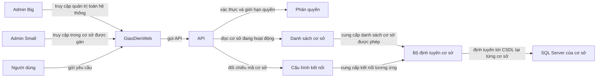

| Tầng | Công nghệ | Nhiệm vụ |
|---|---|---|
| Giao diện | Next.js | Hiển thị màn hình, nhận thao tác và gọi API; không chứa mật khẩu SQL Server |
| API và điều phối | Django | Xác thực, kiểm tra quyền, xử lý nghiệp vụ, điều phối giao dịch và chọn site |
| Định tuyến | Site Router trong Django | Ánh xạ mã site đang hoạt động tới kết nối SQL Server phù hợp |
| Lưu trữ | SQL Server | Chạy các CSDL site riêng, cùng schema nhưng chứa các mảnh dữ liệu tương ứng |
| Quản trị CSDL | SSMS | Tạo/kiểm tra CSDL, chạy script, xem kết quả truy vấn và cấu hình phục vụ đồ án |

Các thông tin kết nối chỉ được Django backend sử dụng và phải lấy từ cấu hình môi trường an toàn. Không đưa chuỗi kết nối, mật khẩu hay thông tin đăng nhập SQL vào mã Next.js gửi xuống trình duyệt. Người dùng cuối đăng nhập ứng dụng; SSMS dành cho thành viên có nhiệm vụ cài đặt và quản trị.

### 2.2. Django điều phối bốn kiểu truy cập phân tán

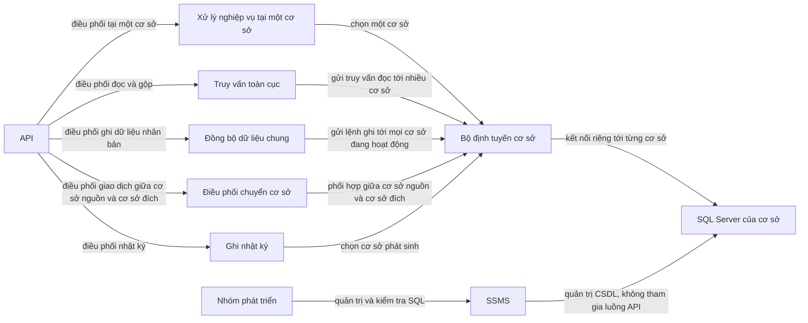

`SQLServer_CSDL_Site` là nút đại diện cho **mỗi CSDL riêng**. Ở cấu hình ban đầu có ba bản: Q1, Q7 và TD. Khi mở rộng, số site lấy từ dữ liệu `CoSo` có trạng thái `hoat_dong` và đối chiếu với cấu hình kết nối; không lặp cố định ba lần trong code.

### 2.3. Django phát hiện site và chọn kết nối

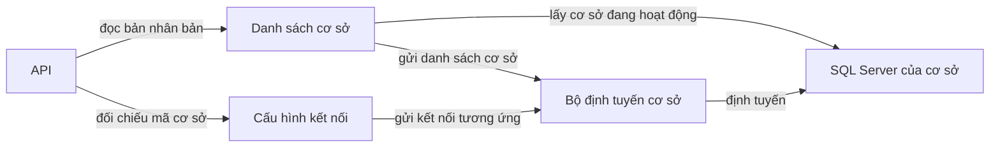

| Trạng thái cơ sở | Nhận truy vấn nghiệp vụ | Tham gia ghi dữ liệu dùng chung | Ý nghĩa |
|---|:---:|:---:|---|
| `chuan_bi` | Không | Không | Đang tạo CSDL, nạp schema và dữ liệu dùng chung |
| `hoat_dong` | Có | Có | Được Site Router đưa vào các thao tác phù hợp |
| `dong_cua` | Không | Không | Ngừng nhận nghiệp vụ mới nhưng vẫn giữ dữ liệu lịch sử |

Nếu cơ sở đang `hoat_dong` nhưng thiếu cấu hình kết nối, Django phải báo lỗi cấu hình rõ ràng. Không âm thầm bỏ qua site trong giao dịch ghi nhân bản. Khi triển khai một máy, vẫn tạo ba CSDL và ba kết nối riêng để kiểm chứng được định tuyến.

---

## 3. Ai được làm gì

### 3.1. Phân biệt Admin Big và Admin Small

**Admin Big** giữ quyền quản trị toàn hệ thống: tạo/đóng cơ sở, phân công Admin Small, quản lý dữ liệu dùng chung, xem thống kê toàn trung tâm và duyệt hoặc từ chối đề nghị chuyển học viên giữa các cơ sở. Sau khi duyệt, Coordinator mới chạy giao dịch phân tán. **Admin Small** điều hành cơ sở được giao và là người tạo đề nghị chuyển học viên từ cơ sở mình; Admin Small có thể theo dõi kết quả nhưng không thể tự duyệt đề nghị. Các việc thường ngày khác gồm giám sát nhân sự, lớp/lịch, hồ sơ học viên, đăng ký, học phí, điểm danh, điểm và báo cáo tại cơ sở. Mỗi cơ sở phải có người phụ trách Admin Small.

Trong schema hiện tại, `TaiKhoan.vai_tro` vẫn chỉ có `admin`, `nhan_vien`, `giao_vien`. Admin Small được biểu diễn bằng tài khoản `nhan_vien`, `TaiKhoan.ma_co_so` xác định site được giao và `NhanVien.chuc_vu = quan_ly_co_so`; không tự thêm một giá trị vai trò mới vào schema.

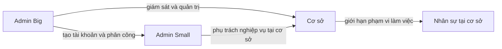

| Nhóm người dùng | Phạm vi | Quyền chính |
|---|---|---|
| Admin Big | Toàn hệ thống | Quản trị cơ sở và dữ liệu dùng chung; phân công Admin Small; xem thống kê/log toàn cục; xem hộp thư đề nghị toàn cục và duyệt/từ chối đề nghị chuyển |
| Admin Small | Một site được phân công | Điều hành nghiệp vụ tại site mình; tạo đề nghị chuyển học viên ra cơ sở khác và theo dõi đề nghị thuộc site mình; không duyệt đề nghị, không xem/sửa dữ liệu cơ sở khác |
| Lễ tân | Một site | Hồ sơ học viên, đăng ký, xếp/đổi lớp tại cơ sở |
| Kế toán | Một site | Thu/hoàn học phí, xem công nợ và biên nhận tại cơ sở |
| Giáo viên | Các lớp được phân công | Xem lớp/buổi học, nhập hoặc sửa điểm theo quyền, điểm danh |
| Học viên | Chưa có tài khoản trong phạm vi hiện tại | Hồ sơ do nhân viên quản lý; không đăng nhập trực tiếp trong phiên bản này |

### 3.2. Backend luôn kiểm tra quyền trước khi truy cập dữ liệu

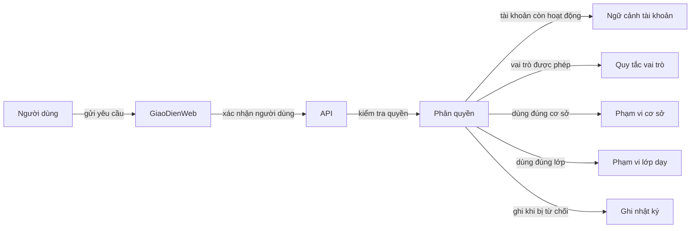

Với mỗi yêu cầu, Django phải kiểm tra lần lượt: tài khoản có hợp lệ và đang hoạt động không; chức năng có được phép không; tài khoản được thao tác ở site nào; nếu là giáo viên thì có được phân công lớp đó không. Ẩn nút trên Next.js chỉ cải thiện giao diện, không thay cho kiểm tra phía Django. Từ chối truy cập cũng cần ghi nhật ký phù hợp, không ghi mật khẩu hoặc token.

---

## 4. Dữ liệu và quy tắc phân tán

### 4.1. Mỗi nhóm dữ liệu được đặt ở đâu?

| Kiểu dữ liệu | Bảng chính | Vị trí và cách dùng |
|---|---|---|
| Nhân bản | `CoSo`, `MonHoc`, `KhoaHoc`, `TaiKhoan` (gồm `google_subject`, `facebook_subject`) | Cùng schema và bản sao theo site. Runtime replication hiện có luồng tài khoản và API cập nhật `MonHoc`; `CoSo`/`KhoaHoc` chưa có luồng ghi runtime đầy đủ |
| Phân mảnh ngang nguyên thủy | `HocVien`, `GiaoVien`, `NhanVien`, `PhongHoc`, `LopHoc` | Mỗi dòng nằm ở site quản lý dòng đó theo `ma_co_so` |
| Phân mảnh ngang dẫn xuất | `BuoiHoc`, `DangKy`, `DiemDanh`, `HocPhi`, `PhieuThu`, `Diem` | Nằm cùng site với lớp, buổi học hoặc đăng ký cha |
| Cục bộ | `GiaoDichChuyenCoSo`, `LichSuChuyenCoSo`, `TokenDatLaiMatKhau`, `Logs` | Trạng thái giao dịch chuyển chỉ lưu ở CSDL nguồn; sự kiện/log ghi tại site phát sinh; không nhân bản |

| Dữ liệu mẫu | Q1 | Q7 | TD |
|---|:---:|:---:|:---:|
| Khóa học IELTS dùng chung | Có | Có | Có |
| Hồ sơ học viên đang học ở Q1 | Có | Không | Không |
| Học phí và điểm thuộc đăng ký của học viên đó ở Q1 | Có | Không | Không |

Chi tiết cấu trúc cột, khóa và vị trí của từng bảng được định nghĩa tại [docs/DATABASE_SCHEMA.md](docs/DATABASE_SCHEMA.md). README mô tả nghiệp vụ và kiến trúc; không thay thế schema.

### 4.2. Bốn loại thao tác phải được phân biệt

| Loại | Cách Django truy cập | Ví dụ | Khi site lỗi |
|---|---|---|---|
| `LOCAL` | Chọn đúng một site qua Site Router | Đăng ký, đổi lớp, thu học phí, nhập điểm | Rollback thao tác cục bộ nếu một bước trong cùng CSDL thất bại |
| `GLOBAL` | Đọc các site cần thiết rồi gộp ở Django | Thống kê toàn trung tâm, tra cứu học viên hiện tại | Đánh dấu kết quả thiếu site là chưa đầy đủ |
| `REPLICATED-WRITE` | Ghi bảng dùng chung qua Coordinator vào các CSDL site riêng | `PATCH /api/v1/admin/shared/subjects/{slug}/` cập nhật `MonHoc`; một số luồng tài khoản cũng có replication | Trả kết quả chưa hoàn tất nếu thiếu ACK; retry dùng lại `Idempotency-Key` và body |
| `DISTRIBUTED-TX` | Phối hợp nhiều CSDL cho một nghiệp vụ | Chuyển học viên từ Q1 sang Q7 | Lưu trạng thái tại nguồn và phục hồi; Global Query chọn một hồ sơ hiện hành dù tạm thời có thể có hai dòng vật lý `dang_hoc` |

### 4.3. Ghi dữ liệu dùng chung chỉ có một điểm vào

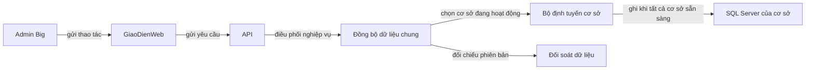

API runtime replication cho `MonHoc` hiện nằm trong `src/api/core/catalog/services.py`: Admin Big gửi một yêu cầu, Coordinator kiểm tra các site hoạt động, khóa thao tác cùng môn, cập nhật từng CSDL riêng và ghi ACK append-only vào `Logs` trong cùng transaction cục bộ. Nếu chưa đủ site, API không báo hoàn tất; gọi lại cùng key/body sẽ tiếp tục những site chưa ACK. Đây là replication ở tầng ứng dụng, không phải SQL Server Publication.

Phạm vi tối thiểu YC-03 đã có đường truyền thay đổi cho `MonHoc`. Chưa được hiểu là mọi bảng dùng chung đã có runtime replication: API ghi `CoSo`/`KhoaHoc` chưa hoàn chỉnh và một số luồng `TaiKhoan` còn tự thực hiện fan-out. Trước khi mở rộng chức năng ghi các bảng đó, cần gom chính sách đồng bộ vào một service chung và không bật song song SQL Server Publication trên cùng bảng.

### 4.4. Các quy tắc không được phá vỡ

| Quy tắc | Vì sao cần giữ |
|---|---|
| Luôn truy cập SQL Server qua Site Router trong Django | Tránh gửi yêu cầu vào nhầm site hoặc dùng một kết nối mặc định |
| Không có khóa ngoại vật lý giữa hai CSDL; không JOIN xuyên site | Các site là CSDL độc lập; Django hỏi riêng từng nơi rồi gộp |
| Không gộp ba site vào một DB có cột `chi_nhanh` | Làm mất mục tiêu chứng minh phân mảnh và định vị dữ liệu |
| Mã có tiền tố site chỉ nơi tạo bản ghi | Học viên có thể chuyển cơ sở nhưng giữ mã cũ; tìm site hiện tại bằng truy vấn trạng thái |
| Không xóa học viên khi chuyển cơ sở | Giữ hồ sơ lịch sử tại nguồn với `da_chuyen_di` |
| Thống kê học viên đang học chỉ đếm bản `dang_hoc` | Tránh cộng cả bản lịch sử `da_chuyen_di` |
| Nhật ký chỉ thêm, không sửa/xóa | Bảo toàn dấu vết kiểm toán |
| Mật khẩu và token chỉ lưu dạng băm | Không ghi bí mật vào log, API response hoặc console |
| Không viết cứng `Q1`, `Q7`, `TD` như tập site cố định | Cho phép thêm cơ sở mới mà không phải sửa các luồng nghiệp vụ |

---

## 5. Các luồng nghiệp vụ

Mọi luồng bắt đầu ở giao diện web, gửi yêu cầu tới API, qua bước xác thực và kiểm tra quyền, rồi mới tới bộ định tuyến cơ sở và SQL Server. Các sơ đồ dưới đây dùng mũi tên để thể hiện chiều tương tác; bảng và khóa dữ liệu nằm trong schema.

### 5.1. Đăng ký khóa học

**Loại:** `LOCAL` · **Ai làm:** Admin Small hoặc lễ tân tại site của học viên.

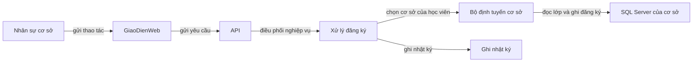

1. Chọn học viên đang thuộc cơ sở và khóa/lớp muốn đăng ký.
2. Django kiểm tra quyền, trạng thái học viên, lớp có cùng `ma_co_so`, trạng thái lớp cho phép đăng ký và còn chỗ.
3. Kiểm tra học viên chưa có đăng ký trùng còn hiệu lực.
4. Trong một giao dịch cục bộ, tạo `DangKy`, tạo `HocPhi`, cập nhật sĩ số lớp và ghi nhật ký.
5. Nếu bất kỳ bước ghi nào lỗi, rollback cả giao dịch cục bộ và trả lỗi rõ ràng cho Next.js.

Không gửi học viên sang site khác để đăng ký lớp; nếu học ở cơ sở khác, dùng nghiệp vụ chuyển cơ sở trước.

### 5.2. Xếp hoặc đổi lớp

**Loại:** `LOCAL` · **Ai làm:** Admin Small hoặc lễ tân.

```mermaid
flowchart LR
    NhanSuCoSo["Nhân sự cơ sở"] -->|gửi thao tác| GiaoDienWeb["GiaoDienWeb"]
    GiaoDienWeb["GiaoDienWeb"] -->|gửi yêu cầu| API["API"]
    API["API"] -->|điều phối nghiệp vụ| XuLyDoiLop["Xử lý đổi lớp"]
    XuLyDoiLop["Xử lý đổi lớp"] -->|chọn cơ sở của đăng ký| SiteRouter["Bộ định tuyến cơ sở"]
    SiteRouter["Bộ định tuyến cơ sở"] -->|cập nhật đăng ký và sĩ số| SQLServer_CSDL_Site["SQL Server của cơ sở"]
```

Django đọc đăng ký hiện tại, lớp đích, sĩ số và lịch tại cùng site. Lớp đích phải thuộc cùng cơ sở và còn chỗ; hệ thống cập nhật đăng ký, sĩ số lớp cũ/mới và nhật ký trong một giao dịch cục bộ. Không tự chuyển đăng ký hoặc lịch sử sang CSDL site khác.

### 5.3. Thu hoặc hoàn học phí

**Loại:** `LOCAL` · **Ai làm:** Kế toán; Admin Small có quyền giám sát/hoàn theo phân quyền.

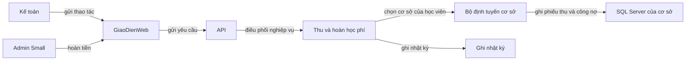

Trước khi thu, kiểm tra đăng ký, khoản phải thu, tổng đã thu/đã hoàn và số dư. Ghi phiếu thu hoặc hoàn, cập nhật trạng thái `HocPhi` và ghi nhật ký trong cùng giao dịch. Không xóa phiếu đã phát sinh; khi sửa sai, dùng nghiệp vụ hoàn/điều chỉnh để giữ lịch sử.

### 5.4. Nhập và sửa điểm

**Loại:** `LOCAL` · **Ai làm:** Giáo viên được phân công; quản lý chỉ xem/kiểm tra theo quyền.

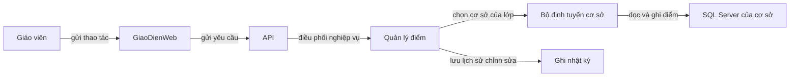

Django xác nhận giáo viên được dạy lớp đó, học viên có đăng ký hợp lệ và loại điểm thuộc môn/khóa. Lưu điểm tại site của lớp/đăng ký. Khi sửa điểm, ghi giá trị cũ, giá trị mới, người sửa và thời điểm vào nhật ký; không cho giáo viên sửa lớp ngoài phạm vi được giao.

### 5.5. Chuyển học viên sang cơ sở khác

**Loại:** tạo đề nghị `LOCAL` tại nguồn → hộp thư và quyết định `GLOBAL` → sau khi duyệt mới chạy `DISTRIBUTED-TX` · **Ai làm:** Admin Small đề nghị; Admin Big duyệt hoặc từ chối.

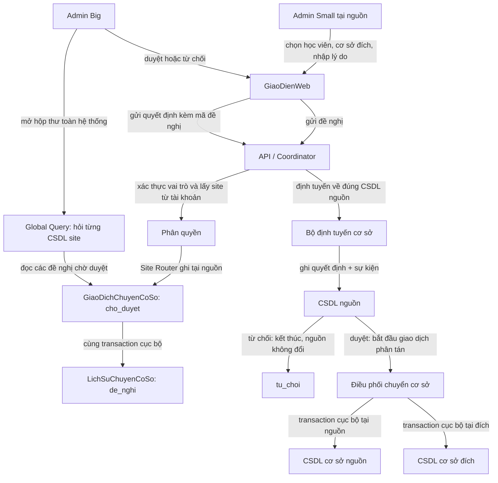

1. Admin Small tại cơ sở nguồn chọn học viên, cơ sở đích và nhập lý do. Django lấy cơ sở nguồn từ phạm vi tài khoản đăng nhập; không tin `co_so_nguon` do trình duyệt gửi lên và không suy site từ tiền tố mã học viên.
2. API dùng Global Query xác định bản `dang_hoc` hiện hành, xác nhận bản đó thuộc site của Admin Small, rồi kiểm tra không có đề nghị/giao dịch đang mở, không còn nợ, site đích khác nguồn và đang `hoat_dong`. Trong transaction cục bộ tại nguồn, tạo `GiaoDichChuyenCoSo` ở trạng thái `cho_duyet` cùng sự kiện append-only `de_nghi`. Học viên vẫn thuộc nguồn, chưa tạo bản đích và vẫn được tính ở thống kê nguồn. Unique index tại nguồn và bước định vị hiện hành toàn cục ngăn tạo đề nghị trùng ở các site khác nhau.
3. Admin Big mở hộp thư đề nghị. Django dùng Global Query đọc các CSDL site riêng rồi gộp danh sách ở tầng ứng dụng; không có bảng hộp thư trung tâm. Nếu một site không truy cập được, hộp thư phải báo kết quả chưa đầy đủ; không thể duyệt đề nghị của site nguồn đang mất kết nối.
4. Khi Admin Big duyệt, API định tuyến về CSDL nguồn theo mã đề nghị và kiểm tra lại học viên còn đang học, công nợ, trạng thái cơ sở đích, kết nối hai site và không có giao dịch đang mở khác. Trong transaction cục bộ tại nguồn, đổi trạng thái sang `dang_xu_ly`, bước `da_tiep_nhan`, ghi tài khoản/thời điểm quyết định và sự kiện `duyet`. Việc kiểm tra lại là bắt buộc vì dữ liệu có thể đổi trong lúc chờ.
5. Nếu Admin Big từ chối, ghi `tu_choi`, tài khoản/thời điểm và lý do từ chối cùng sự kiện `tu_choi` tại nguồn. Hồ sơ học viên không đổi; đề nghị kết thúc và được giữ để tra cứu. Admin Small có thể gửi một đề nghị mới sau đó.
6. Chỉ sau quyết định duyệt, Coordinator mới tạo hồ sơ cùng mã ở site đích và sự kiện `tao_ho_so_dich` trong cùng transaction cục bộ tại đích. Sau khi xác nhận đích đã commit, cập nhật `buoc_cuoi = da_tao_ho_so_dich` và thêm sự kiện `xac_nhan_ho_so_dich` ở nguồn.
7. Trong một transaction cục bộ tại nguồn, đánh dấu học viên `da_chuyen_di`, đóng đăng ký/lớp cũ, cập nhật `buoc_cuoi = da_cap_nhat_nguon` và thêm sự kiện `cap_nhat_ho_so_nguon`. Sau khi đối chiếu hai site, cập nhật trạng thái giao dịch `hoan_tat` và ghi sự kiện cuối ở nguồn.

Khi đề nghị còn `cho_duyet`, các nghiệp vụ tại nguồn vẫn có thể tiếp tục; vì vậy Admin Big phải kiểm tra lại điều kiện lúc duyệt. Sau khi đã duyệt và trạng thái là `dang_xu_ly`, API chặn đăng ký/thu phí/nhập điểm cho học viên ở cả hai site đến khi phục hồi hoàn tất. Không xóa bản nguồn. Vì hai CSDL commit riêng, sau khi tạo đích và trước khi cập nhật nguồn có thể tồn tại hai dòng vật lý `dang_hoc`; không tuyên bố đây là transaction ACID nguyên tử xuyên hai CSDL. Coordinator phục hồi tiến về phía trước sau khi đích đã commit. `LichSuChuyenCoSo` chỉ thêm sự kiện; chỉ `GiaoDichChuyenCoSo` là trạng thái hiện tại có thể cập nhật. Chi tiết lỗi, retry và kiểm chứng nằm trong [docs/QLTTNN-Giao-Dich-Phan-Tan.md](docs/QLTTNN-Giao-Dich-Phan-Tan.md).

#### Phục hồi nếu ứng dụng dừng giữa lúc chuyển

**Tình huống:** đích đã tạo hồ sơ nhưng ứng dụng dừng trước khi đánh dấu nguồn. Khi chạy lại, Django đọc `GiaoDichChuyenCoSo` ở nguồn, đối chiếu sự kiện `ma_chuyen` tại đích, rồi tiếp tục bước còn thiếu; không tạo hồ sơ đích lần hai và không xóa hồ sơ đích đã commit.

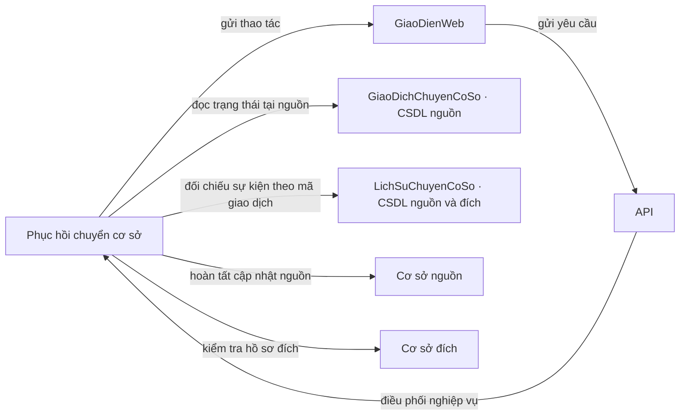

| Điểm dừng | Kết quả phải đảm bảo sau phục hồi |
|---|---|
| Đề nghị đang chờ duyệt (`trang_thai = cho_duyet`) | Chưa tạo bản đích; bản nguồn vẫn `dang_hoc`, tiếp tục được tính tại nguồn; worker chuyển cơ sở không xử lý trạng thái này |
| Trước khi tạo bản đích (`buoc_cuoi = da_tiep_nhan`) | Bản nguồn vẫn `dang_hoc`; lỗi nghiệp vụ dứt điểm có thể kết thúc `that_bai`; lỗi kết nối thì giữ giao dịch để thử lại |
| Đích đã commit, nguồn chưa cập nhật (`buoc_cuoi = da_tao_ho_so_dich`) | Giữ `dang_xu_ly` và phục hồi tiến về phía trước; Global Query tính bản nguồn, tạm ẩn bản đích |
| Nguồn đã cập nhật (`buoc_cuoi = da_cap_nhat_nguon`) | Transaction nguồn đã đổi nguồn thành `da_chuyen_di`; Global Query tính bản đích |
| Hoàn tất (`trang_thai = hoan_tat`) | Chỉ bản ở site đích còn `dang_hoc`; bản nguồn là `da_chuyen_di` |

### 5.6. Thống kê học viên theo cơ sở/toàn hệ thống

**Loại:** `GLOBAL` · **Ai làm:** Admin Big xem toàn trung tâm; Admin Small xem site được giao.

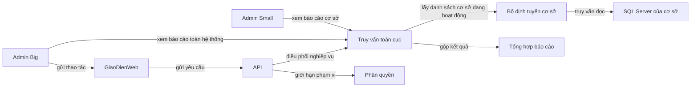

Django gửi truy vấn riêng tới các site trong phạm vi quyền, đọc đề nghị `cho_duyet` và trạng thái giao dịch ở từng CSDL nguồn, chuẩn hóa cấu trúc rồi gộp tại ứng dụng. Đề nghị `cho_duyet` chưa tạo bản đích nên bản nguồn tiếp tục được tính như bình thường. Với giao dịch `dang_xu_ly`, trước `da_cap_nhat_nguon` chỉ tính bản nguồn và ẩn bản đích; từ `da_cap_nhat_nguon` trở đi chỉ tính bản đích. Khi hoàn tất, đếm bản `dang_hoc` và loại bản `da_chuyen_di`. Nếu một site lỗi, hiển thị cảnh báo và đánh dấu số liệu thiếu; không gọi đó là tổng đầy đủ. Admin Small không được dùng tham số API để xem site khác.

### 5.7. Đăng nhập

**Loại:** `GLOBAL` để tìm tài khoản nhân bản, sau đó xác thực trong Django · **Ai làm:** Người dùng nội bộ.

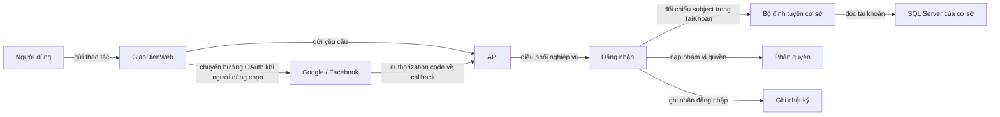

Đăng nhập bằng tên đăng nhập/email và mật khẩu đã có API; API tìm tài khoản qua các CSDL site riêng, kiểm tra vai trò/trạng thái rồi tạo phiên có thể thu hồi. OAuth Google/Facebook hiện chưa có endpoint/callback hoạt động, dù schema có chỗ lưu subject đã liên kết. Khi bổ sung OAuth, backend phải xác minh danh tính với provider rồi tra cứu subject trong các CSDL site; không tự tạo tài khoản, không tự ghép qua email và không dùng danh tính provider để cấp quyền. Liên kết/thu hồi subject dùng `REPLICATED-WRITE`; tra cứu đăng nhập dùng `GLOBAL`. Mỗi site giữ dữ liệu tài khoản theo chính sách hiện hành; không có CSDL identity trung tâm hay JOIN xuyên site. Chi tiết endpoint và kiểm tra bảo mật nằm trong [`specs/api.md`](specs/api.md).

Phiên đăng nhập hết hạn sau **60 phút không có hoạt động người dùng thật**. Backend kiểm tra hạn và thu hồi phiên; endpoint `/auth/activity/` là đường gia hạn tường minh, frontend không được gọi nó bằng polling/health check. Mỗi thiết bị có phiên riêng. Trạng thái phiên hiện được lưu tại CSDL site cấu hình `AUTH_SESSION_SITE_CODE`, không phải CSDL nghiệp vụ trung tâm; site này ngừng hoạt động có thể ảnh hưởng đăng nhập và xác thực phiên toàn hệ thống. Việc đồng bộ hoạt động giữa các tab, cảnh báo trước hạn và chuyển hướng giao diện sau khi hết phiên cần được kiểm chứng/hoàn thiện ở frontend.

### 5.8. Quên và đặt lại mật khẩu

**Loại:** yêu cầu tra cứu nhiều site; cập nhật tài khoản dùng chung bằng `REPLICATED-WRITE`.

**Yêu cầu liên kết đặt lại:**

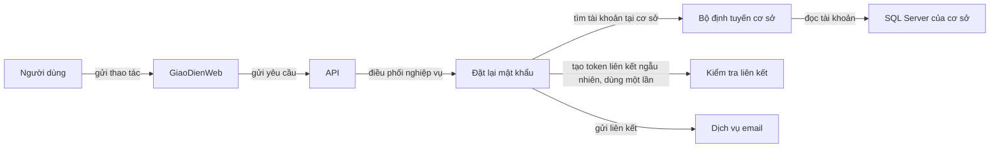

**Xác nhận liên kết và đổi mật khẩu:**

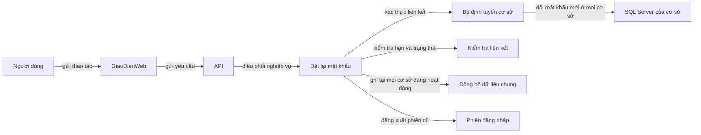

Phản hồi yêu cầu quên mật khẩu không tiết lộ email có tồn tại hay không. Token có hạn dùng và chỉ dùng một lần; CSDL lưu `token_bam`, email chỉ nhận liên kết cần thiết. Khi đổi mật khẩu, cập nhật `TaiKhoan` tới mọi site đang hoạt động bằng cùng bộ đồng bộ dữ liệu dùng chung, vô hiệu hóa token và đăng xuất phiên cũ. Không ghi token thô vào log.

API đã có cấu hình nền Gmail SMTP trong `src/api/.env` (máy cá nhân); dùng địa chỉ Gmail gửi thư và App Password riêng, không phải OAuth Client Secret. Nếu App Password cũ đã bị lộ, hãy thu hồi trước khi điền mật khẩu mới. Các luồng gửi thư/đặt lại mật khẩu trong README là thiết kế nghiệp vụ, chưa chạy được vì API hiện chưa có endpoint xác thực; trang phục hồi cũng chưa thể gửi email thật.

### 5.9. Tạo tài khoản nhân viên/giáo viên và phân công Admin Small

**Loại:** tạo tài khoản `REPLICATED-WRITE`; tạo hồ sơ làm việc `LOCAL` tại site được giao · **Ai làm:** Admin Big.

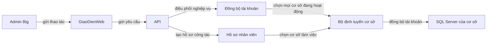

Admin Big tạo tài khoản dùng chung và hồ sơ nhân viên/giáo viên tại đúng cơ sở làm việc. Với Admin Small, tài khoản có `vai_tro = nhan_vien`, gắn `ma_co_so` của cơ sở được phân công và hồ sơ có `chuc_vu = quan_ly_co_so`. Không để Admin Big đặt hoặc gửi mật khẩu thay người nhận: sau khi hồ sơ và dữ liệu phân tán sẵn sàng, API sẽ gửi liên kết kích hoạt dùng một lần để người nhận tự đặt mật khẩu. Kiểm tra email/tên đăng nhập toàn hệ thống trước khi ghi. Nếu tạo hồ sơ site thất bại sau khi tài khoản đã được nhân bản, phải vô hiệu hóa/khôi phục theo trạng thái lưu; không để tài khoản hoạt động mà thiếu phạm vi cơ sở. Hiện schema chưa có trạng thái/token kích hoạt và API chưa có endpoint tạo tài khoản hay gửi email, nên luồng này chưa được bật.

### 5.10. Mở lớp và sinh lịch học

**Loại:** `LOCAL` · **Ai làm:** Admin Small tại cơ sở.

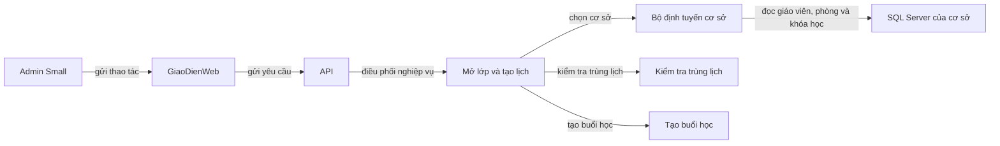

Kiểm tra khóa học, giáo viên, phòng, sức chứa và lịch định mở thuộc cùng cơ sở. Không cho trùng giáo viên/phòng trong cùng khung giờ. Khi hợp lệ, tạo lớp và sinh danh sách buổi học theo lịch. Thử các trường hợp trùng lịch, vượt sức chứa và thiếu giáo viên trước khi demo.

### 5.11. Điểm danh buổi học

**Loại:** `LOCAL` · **Ai làm:** Giáo viên được phân công.

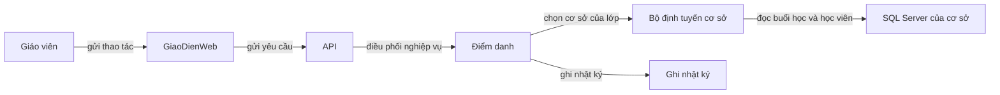

Giáo viên chỉ điểm danh buổi học của lớp mình tại site đó. Mỗi đăng ký chỉ có một trạng thái điểm danh cho một buổi; sửa điểm danh phải lưu nhật ký. Không tạo điểm danh cho học viên không có đăng ký hợp lệ hoặc buổi học không thuộc lớp được phân công.

### 5.12. Nhật ký hệ thống

**Loại:** ghi tại site phát sinh; `GLOBAL` khi Admin Big tra cứu nhiều site.

```mermaid
flowchart LR
    NghiepVu["Nhân sự nghiệp vụ"] -->|gửi thao tác| GiaoDienWeb["GiaoDienWeb"]
    GiaoDienWeb["GiaoDienWeb"] -->|gửi yêu cầu| API["API"]
    API["API"] -->|điều phối nghiệp vụ| GhiNhatKy["Ghi nhật ký"]
    GhiNhatKy["Ghi nhật ký"] -->|chọn cơ sở phát sinh| SiteRouter["Bộ định tuyến cơ sở"]
    SiteRouter["Bộ định tuyến cơ sở"] -->|chỉ ghi thêm nhật ký| SQLServer_CSDL_Site["SQL Server của cơ sở"]
    Admin_Small["Admin Small"] -->|xem nhật ký cơ sở| GiaoDienWeb["GiaoDienWeb"]
    Admin_Big["Admin Big"] -->|xem nhật ký toàn hệ thống| GiaoDienWeb["GiaoDienWeb"]
    API["API"] -->|gộp nhật ký| TruyVanToanCuc["Truy vấn toàn cục"]
    TruyVanToanCuc["Truy vấn toàn cục"] -->|đọc nhiều cơ sở| SQLServer_CSDL_Site["SQL Server của cơ sở"]
```

Nhật ký chỉ thêm, không cập nhật/xóa. Ghi người thao tác, site, thời điểm, hành động, bản ghi tác động và kết quả. Lọc trường nhạy cảm khỏi dữ liệu cũ/mới; không lưu mật khẩu, token hoặc chuỗi kết nối. Admin Small xem log trong phạm vi cơ sở; Admin Big có thể yêu cầu tổng hợp toàn trung tâm.

### 5.13. Quản lý môn học/khóa học/danh mục dùng chung

**Loại:** `REPLICATED-WRITE` · **Ai làm:** Admin Big.

```mermaid
flowchart LR
    Admin_Big["Admin Big"] -->|gửi thao tác| GiaoDienWeb["GiaoDienWeb"]
    GiaoDienWeb["GiaoDienWeb"] -->|gửi yêu cầu| API["API"]
    API["API"] -->|điều phối nghiệp vụ| QuanLyDanhMuc["Quản lý danh mục"]
    QuanLyDanhMuc["Quản lý danh mục"] -->|chọn mọi cơ sở đang hoạt động| SiteRouter["Bộ định tuyến cơ sở"]
    SiteRouter["Bộ định tuyến cơ sở"] -->|đồng bộ danh mục| SQLServer_CSDL_Site["SQL Server của cơ sở"]
    QuanLyDanhMuc["Quản lý danh mục"] -->|dùng chung quy tắc ghi| DongBoDuLieuChung["Đồng bộ dữ liệu chung"]
```

Môn học và khóa học là dữ liệu dùng chung. Django đi qua một điểm vào đồng bộ, xác định các site hoạt động, ghi dữ liệu kèm phiên bản và đối soát. Chỉ xác nhận thành công sau khi chính sách ghi đủ site được thỏa mãn. Nếu một nơi lỗi, lưu site đã thành công/thất bại để phục hồi; không để từng màn hình tự thực hiện vòng lặp ghi riêng.

### 5.14. Thêm cơ sở mới

**Loại:** điều phối cấu hình và `REPLICATED-WRITE` · **Ai làm:** Admin Big/nhóm triển khai.

```mermaid
flowchart LR
    Admin_Big["Admin Big"] -->|gửi thao tác| GiaoDienWeb["GiaoDienWeb"]
    GiaoDienWeb["GiaoDienWeb"] -->|gửi yêu cầu| API["API"]
    API["API"] -->|điều phối nghiệp vụ| ThemCoSo["Thêm cơ sở"]
    ThemCoSo["Thêm cơ sở"] -->|tạo CSDL và nạp dữ liệu| SQLServer_CSDL_Site["SQL Server của cơ sở"]
    ThemCoSo["Thêm cơ sở"] -->|thêm cấu hình kết nối| CauHinhKetNoi["Cấu hình kết nối"]
    ThemCoSo["Thêm cơ sở"] -->|nạp dữ liệu dùng chung| DongBoDuLieuChung["Đồng bộ dữ liệu chung"]
    ThemCoSo["Thêm cơ sở"] -->|kích hoạt cơ sở| DanhSachCoSo["Danh sách cơ sở"]
    ThemCoSo["Thêm cơ sở"] -->|phân công quản lý cơ sở| HoSoNhanVien["Hồ sơ nhân viên"]
    HoSoNhanVien["Hồ sơ nhân viên"] -->|ghi hồ sơ người quản lý tại cơ sở| SQLServer_CSDL_Site["SQL Server của cơ sở"]
```

1. Tạo CSDL SQL Server mới với cùng schema và thêm cấu hình kết nối an toàn cho Django.
2. Đưa cơ sở vào trạng thái `chuan_bi`; cơ sở này chưa nhận truy vấn nghiệp vụ và chưa nằm trong tập ghi nhân bản.
3. Nạp các bảng dùng chung, kiểm tra phiên bản và đối soát dữ liệu với các site hiện hữu.
4. Chỉ sau khi kiểm tra đủ mới đổi trạng thái sang `hoat_dong` qua quy trình đồng bộ đã thống nhất.
5. Tạo hồ sơ Admin Small/nhân sự ở site mới, rồi mới nhận nghiệp vụ.

Thêm site không được yêu cầu sửa vòng lặp “3 lần” hoặc viết thêm nhánh riêng cho `BT`. Khi đóng site, hoàn tất hoặc xử lý rõ mọi đề nghị `cho_duyet` và giao dịch `dang_xu_ly`, chuyển học viên đang học theo nghiệp vụ, rồi đánh dấu site `dong_cua`; ngừng nhận thao tác mới nhưng giữ dữ liệu lịch sử.

---

## 6. Kịch bản demo

| # | Kịch bản | Điều cần kiểm chứng |
|---|---|---|
| 1 | Kiểm tra dữ liệu mẫu riêng ở Q1/Q7/TD | Học viên và lớp nằm ở site sở hữu; bảng dùng chung có bản sao tại các site |
| 2 | Đăng ký học viên Q1 vào lớp Q1 rồi thu học phí | `LOCAL`; các bảng phát sinh cùng nằm ở CSDL Q1 |
| 3 | Đăng nhập Admin Small Q1 và thử gọi API với mã site Q7 | Django từ chối truy cập ngoài phạm vi dù request được gửi trực tiếp |
| 4 | Admin Big xem thống kê học viên toàn hệ thống | Django gọi từng CSDL, gộp kết quả; chỉ tính `dang_hoc` |
| 5 | Thêm/sửa một khóa học dùng chung khi mọi site sẵn sàng | Bản sao ở mọi site hoạt động có cùng dữ liệu/phiên bản |
| 6 | Làm một site không khả dụng rồi thử ghi dữ liệu dùng chung | Hệ thống không báo thành công khi chưa ghi đủ site theo chính sách |
| 7 | Admin Small Q1 tạo đề nghị chuyển học viên sang Q7 | Đề nghị `cho_duyet` và sự kiện `de_nghi` nằm ở CSDL Q1; học viên vẫn `dang_hoc` tại Q1; chưa có hồ sơ Q7 |
| 8 | Admin Small thử duyệt đề nghị hoặc gửi đề nghị cho học viên ngoài Q1 | API từ chối; quyền được kiểm tra ở Django dù gọi endpoint trực tiếp |
| 9 | Admin Big mở hộp thư, duyệt đề nghị Q1→Q7 | Global Query đọc từng CSDL site; quyết định và sự kiện `duyet` lưu ở Q1; giao dịch phân tán sau đó hoàn tất đúng hai site |
| 10 | Admin Big từ chối một đề nghị chuyển | Trạng thái `tu_choi`, người duyệt/thời điểm/lý do và sự kiện được lưu tại nguồn; hồ sơ học viên không đổi |
| 11 | Đặt Q7 thành `dong_cua` trước khi duyệt đề nghị | API không cho duyệt; đề nghị vẫn `cho_duyet` để Big quyết định sau hoặc từ chối; hồ sơ Q1 vẫn `dang_hoc` |
| 12 | Mất kết nối Q7 trước khi transaction tạo hồ sơ đích commit | Không báo thành công; giữ hồ sơ nguồn và giao dịch đã duyệt có thể retry; khi Q7 kết nối lại, retry không tạo trùng |
| 13 | Dừng ứng dụng sau khi hồ sơ đích đã commit rồi chạy recovery | Recovery đọc trạng thái nguồn và sự kiện đích, hoàn tất nguồn; không tạo hồ sơ đích lần hai |
| 14 | Gửi đồng thời hai đề nghị hoặc duyệt đồng thời cho cùng một học viên | Chỉ một đề nghị/giao dịch mở được chấp nhận; yêu cầu còn lại nhận trạng thái đang mở hoặc bị từ chối rõ ràng |
| 15 | Đặt lại mật khẩu và dùng lại cùng liên kết | Token chỉ dùng một lần; mật khẩu mới đồng bộ ở mọi site hoạt động |
| 16 | Đăng nhập sai và kiểm tra nhật ký | Có sự kiện từ chối, không có mật khẩu/token trong log |
| 17 | Thêm cơ sở BT, nạp dữ liệu dùng chung rồi kích hoạt | BT được đưa vào truy vấn/ghi sau khi hoạt động mà không sửa code nghiệp vụ |
| 18 | Hai phiên đăng ký hai học viên khác nhau vào lớp còn một chỗ | Chạy thực sự đồng thời; đúng một yêu cầu thành công; sĩ số tăng một, yêu cầu còn lại không để `DangKy`/`HocPhi` dở dang (TC-CON-01) |
| 19 | Gây lỗi giữa lúc ghi bản sao, khôi phục site và retry/đối soát | Không báo hoàn tất sớm; bản sao nhận đúng phiên bản, không ghi lặp thay đổi đã nhận (TC-SYNC-01) |
| 20 | Kiểm tra các mảnh lớp và đăng ký, hợp kết quả đọc tại ứng dụng | Chứng minh đầy đủ, không giao nhau và tái thiết được tập lớp logic; bản ghi con ở đúng site (TC-FRAG-01) |
| 21 | Ngắt một site khi thống kê toàn hệ thống rồi khôi phục | `complete=false` và `missing_sites` đúng khi lỗi; sau phục hồi đối chiếu lại đủ số liệu (TC-DQ-01) |

Chạy các kịch bản nghiệp vụ này cùng TC-SITE-01, TC-FRAG-01, TC-REP-01, TC-DTX-01, TC-CON-01, TC-DQ-01 và TC-SYNC-01. Một bộ bằng chứng có thể phục vụ nhiều kịch bản nếu ghi rõ tiêu chí tương ứng; không đánh dấu đạt khi mới mô tả kế hoạch.

---

## 7. Ngoài phạm vi

- Không dùng một CSDL duy nhất có cột `chi_nhanh` để giả lập phân tán.
- Không thiết kế khóa ngoại hoặc JOIN xuyên qua hai CSDL site.
- Không để Next.js truy cập trực tiếp SQL Server.
- Không coi SSMS là frontend cho người dùng nghiệp vụ.
- Không tuyên bố đã cài VPN, Linked Server, SQL Server Agent, Publication/Replication hoặc nhiều máy chủ khi chưa triển khai và lưu bằng chứng.
- Không tự chọn thêm framework frontend/backend hoặc thay đổi stack khi chưa được nhóm thống nhất.
- Không chuyển cấu trúc sang MongoDB; thiết kế hiện tại là mô hình quan hệ trên SQL Server.

---

## 8. Danh sách chức năng

| Nhóm | Chức năng | Loại chính | Vai trò |
|---|---|---|---|
| Tài khoản | Đăng nhập, đăng xuất, quên/đặt lại mật khẩu | `GLOBAL`, `REPLICATED-WRITE` | Người dùng nội bộ |
| Quản trị | Tạo tài khoản, khóa/mở tài khoản, phân công Admin Small | `REPLICATED-WRITE` + `LOCAL` | Admin Big |
| Học viên | Tạo/sửa hồ sơ, đăng ký khóa học, đổi lớp | `LOCAL` | Admin Small, lễ tân |
| Học phí | Thu/hoàn, xem số dư và biên nhận | `LOCAL` | Kế toán, Admin Small |
| Học tập | Mở lớp, sinh lịch, điểm danh, nhập/sửa điểm | `LOCAL` | Admin Small, giáo viên |
| Chuyển cơ sở | Admin Small tạo đề nghị `LOCAL`; Admin Big xem/ra quyết định `GLOBAL`; Coordinator chỉ chuyển sau khi duyệt bằng `DISTRIBUTED-TX` | Admin Small đề nghị; Admin Big duyệt/từ chối |
| Danh mục | Quản lý cơ sở, môn học, khóa học | `REPLICATED-WRITE` | Admin Big |
| Báo cáo | Thống kê theo site/toàn trung tâm, tra cứu log | `GLOBAL` | Admin Small, Admin Big |

---

## 9. Stack và quyết định còn mở

### 9.1. Công nghệ đã thống nhất

| Phần | Lựa chọn | Vai trò trong dự án |
|---|---|---|
| Frontend | Next.js | Giao diện người dùng và gọi API |
| API/backend | Django | Xử lý API, quyền, nghiệp vụ, Site Router và điều phối truy cập phân tán |
| DBMS | Microsoft SQL Server | Chạy CSDL riêng của từng cơ sở |
| Công cụ quản trị | SQL Server Management Studio (SSMS) | Tạo schema, chạy lệnh, xem dữ liệu và kiểm tra đồng bộ/giao dịch |

### 9.2. Những việc nhóm vẫn phải chốt trước khi triển khai thật

| Quyết định còn mở | Câu hỏi cần thống nhất |
|---|---|
| Cách đặt các site | Ba SQL Server trên ba máy/VM hay ba CSDL riêng trên một máy trong giai đoạn demo? |
| Phiên bản/cấu hình SQL Server | Phiên bản, edition, authentication, TCP/IP, backup và quyền tài khoản dịch vụ là gì? |
| Worker phục hồi chuyển cơ sở | Nhịp quét, timeout/backoff, cảnh báo giao dịch `dang_xu_ly` quá lâu và cách vận hành worker được cấu hình thế nào? |
| Phương pháp replication bắt buộc | YC-03 dùng replication tầng ứng dụng cho `MonHoc`: Admin Big là điểm vào ghi, từng site cập nhật bản riêng và ghi ACK trong `Logs`. Chưa bật SQL Server Publication; không dùng hai cơ chế ghi trùng cùng bảng |
| Trạng thái bền vững của đồng bộ | Với `MonHoc`, `Logs.ma_log` xác định thao tác/site, `du_lieu_cu` và `du_lieu_moi` ghi phiên bản trước/sau; ACK commit cùng cập nhật từng site. Không cần thêm bảng cho luồng này; các bảng dùng chung khác chưa được bao phủ đầy đủ |
| Cơ chế distributed transaction bắt buộc | Coordinator phục hồi hiện tại đáp ứng tiêu chí đánh giá nào? Nếu giảng viên yêu cầu giao dịch do DBMS quản lý, cần bổ sung cơ chế gì và kiểm thử ra sao? Không ghi đã có ACID/MSDTC/2PC khi chưa chứng minh |
| Kiểm soát concurrency | Cách bảo vệ kiểm tra/cập nhật chỗ cuối trong một transaction và cách tạo cạnh tranh giữa hai phiên ở TC-CON-01 là gì? |
| Công cụ triển khai vật lý | Cấu hình VPN/Remote Desktop, SQL Server Agent, Linked Server và Publication theo tài liệu cài đặt giảng viên; ghi phần đã cấu hình, phần cần xác nhận và bằng chứng thực tế |
| Giao diện API và bảo mật | Hợp đồng endpoint, cơ chế lưu/thu hồi phiên phù hợp CSDL riêng từng site, CORS, cookie/CSRF và cách thực thi idle timeout 60 phút được thống nhất thế nào? |
| Cấu hình môi trường | Tên biến môi trường và nơi lưu chuỗi kết nối/bí mật; tuyệt đối không commit bí mật vào Git |

Việc đã chọn SQL Server **không** có nghĩa toàn bộ yêu cầu phân tán đã đạt. `MonHoc` đã có replication tầng ứng dụng; luồng này đã chạy kiểm tra runtime trên ba site trong transaction rollback và retry cùng key. Chưa có bằng chứng outage/recovery qua mạng thật, chuyển cơ sở chạy lỗi giữa hai site hoặc hai phiên SQL Server tranh chỗ cuối. Hiện Q1/Q7/TD là ba CSDL riêng trên cùng một SQL Server instance; đây là topology demo logic, chưa phải ba máy chủ vật lý. Xem [ma trận kiểm chứng](docs/QLTTNN-Yeu-Cau-Chung-Va-Kiem-Chung.md) để biết trạng thái từng YC/TC.

---

## 10. Tiến độ

| Hạng mục | Trạng thái | Bằng chứng cần có |
|---|---|---|
| Nghiệp vụ, phân quyền, các kiểu truy cập | Đã mô tả trong README | Review của nhóm |
| Schema và phân loại dữ liệu | Mô tả trong `docs/DATABASE_SCHEMA.md` | Script tạo và kiểm tra trên từng CSDL |
| Frontend Next.js / Django API | Stack đã chọn; tình trạng source cần cập nhật theo repo | Source, lệnh chạy và kiểm thử API/UI |
| Ba CSDL SQL Server | Thiết kế yêu cầu ba DB độc lập; tình trạng cài đặt cần cập nhật | Ảnh SSMS, truy vấn xác nhận từng site |
| VPN/Linked Server/Agent/Publication | Chỉ ghi nhận nếu thực tế được yêu cầu và cài | Ảnh cấu hình, script và kết quả thử |
| YC-01–YC-07 của môn học | Đã bổ sung tiêu chí; chưa kiểm chứng trong đợt cập nhật tài liệu này | Kết quả bảy kịch bản TC, dữ liệu từng site, lỗi/phục hồi và concurrency thực tế |
| Phục hồi giao dịch chuyển cơ sở | Schema và quy tắc phục hồi đã thiết kế; code worker và bằng chứng fault-injection còn cần thực hiện | Kịch bản lỗi trước/sau từng bước, trạng thái từng site, thống kê và kết quả phục hồi |

Khi cập nhật bảng này, chỉ đánh dấu hoàn thành khi có source hoặc bằng chứng chạy được. Không ghi kế hoạch thành kết quả đã triển khai.

---

## 11. Hướng dẫn cho người triển khai

Trước khi sửa code, tự trả lời các câu hỏi sau:

1. Dữ liệu đang đọc/ghi là nhân bản, phân mảnh ngang, dẫn xuất hay cục bộ?
2. Nghiệp vụ là `LOCAL`, `GLOBAL`, `REPLICATED-WRITE` hay `DISTRIBUTED-TX`?
3. Request có đi qua Site Router trong Django không? Có lỡ JOIN hai site trong một câu lệnh không?
4. Backend đã kiểm tra vai trò, site và phạm vi lớp chưa?
5. Nếu một site lỗi giữa chừng, kết quả trả về và trạng thái phục hồi là gì?
6. Nhật ký đã ghi đủ mà không chứa mật khẩu, token hoặc chuỗi kết nối chưa?

Quy tắc khi viết source:

- Mọi truy cập CSDL xuất phát từ Django API; Next.js chỉ gọi API.
- Luôn chọn kết nối theo site qua Site Router; không dùng kết nối mặc định cho mọi thao tác.
- Lấy site đang hoạt động từ dữ liệu/cấu hình; không hard-code mảng `Q1`, `Q7`, `TD`.
- Không tạo FK hoặc JOIN giữa CSDL site; truy vấn toàn cục phải gộp tại Django.
- ID mang tiền tố nơi tạo; không dùng tiền tố để xác định site hiện tại của học viên.
- Chuyển cơ sở không xóa lịch sử nguồn; thống kê đang học loại `da_chuyen_di`.
- Ghi dữ liệu dùng chung chỉ qua một dịch vụ đồng bộ; thiếu site phải được xử lý đúng chính sách và ghi nhận.
- Không ghi mật khẩu/token thô vào CSDL hoặc log; chỉ lưu bản băm.
- Mọi thay đổi schema cập nhật `docs/DATABASE_SCHEMA.md`; mọi thay đổi nghiệp vụ/kiến trúc cập nhật README và tài liệu con liên quan.
- Kiểm thử từng DB site riêng, kiểm tra quyền Admin Big/Admin Small và thử ít nhất một tình huống mất kết nối cho luồng phân tán.

---

## 12. Tốc độ tải trang và dữ liệu

Các quy tắc dưới đây áp dụng khi thành viên hoặc AI thêm/sửa trang có dữ liệu. Mục tiêu là người dùng thấy cấu trúc trang và trạng thái chờ ngay, không phải đợi toàn bộ API hoặc CSDL phản hồi mới nhìn thấy nội dung. Đây là yêu cầu triển khai, **không phải xác nhận source hiện tại đã có đủ trang nghiệp vụ hoặc đã đạt một mức tốc độ cụ thể**.

### 12.1. Xác định đúng nơi gây chậm

Đo từng đoạn bằng millisecond; không mặc định quy mọi độ trễ cho SQL Server.

| Dấu hiệu | Kiểm tra trước |
|---|---|
| Mở route đầu tiên sau `npm run dev` chậm, lần sau nhanh hơn | Next.js có thể đang biên dịch route khi truy cập trong chế độ phát triển. So sánh log terminal và lần mở lại; không dùng riêng số đo `dev` để kết luận tốc độ production. |
| Khung trang hiện ngay nhưng bảng/số liệu tới muộn | DevTools → Network để tìm API chậm; sau đó đo thời gian xử lý Django và truy vấn SQL/site tương ứng. |
| Cả trang trắng hoặc bị khóa tới khi dữ liệu xong | Kiểm tra page/Server Component có đang chờ toàn bộ request trước khi render hay chưa có loading boundary. |
| Trang toàn hệ thống chậm hơn trang tại một cơ sở | Đo riêng từng site; kiểm tra số site được hỏi, lời gọi tuần tự, timeout và site không phản hồi. |

Phân biệt thời gian nhận HTML/route, tải JavaScript, từng request API, xử lý Django và truy vấn SQL Server. Có thể ghi `request_id` cùng thời lượng từng bước; không ghi mật khẩu, token, chuỗi kết nối hoặc dữ liệu nhạy cảm vào log.

### 12.2. Hiển thị trang trong lúc tải

- Render layout, tiêu đề, điều hướng và phần nội dung ổn định trước; không đợi dữ liệu của mọi section rồi mới hiển thị toàn trang.
- Với route cần chờ dữ liệu, dùng `loading.tsx`; với từng section độc lập, đặt Suspense boundary và skeleton cho riêng section. Kích thước skeleton gần với nội dung thật để hạn chế layout nhảy.
- Hiện loading ngay khi thao tác bắt đầu. Không chờ response mới bật spinner; không thay toàn trang bằng spinner nếu chỉ một bảng đang tải.
- Phân biệt rõ `loading`, `empty`, `error` và `partial`. Khi lỗi, giữ dữ liệu người dùng đã nhập. Chỉ đưa ra nút thử lại khi thao tác có thể retry an toàn.
- Animation không được trì hoãn nội dung và phải tôn trọng `prefers-reduced-motion`.

### 12.3. Gọi API và truy vấn dữ liệu

- Không `await` nối tiếp các request độc lập. Khởi chạy song song khi dữ liệu không phụ thuộc nhau; chỉ chờ tuần tự khi có phụ thuộc nghiệp vụ. Tránh để page và component con tải trùng cùng một dữ liệu.
- Không lấy toàn bộ học viên/lớp/phiếu thu về trình duyệt để lọc. Tìm kiếm, lọc và phân trang danh sách lớn phải được giới hạn tại API/Django và SQL Server.
- Tránh truy vấn N+1. Dùng `select_related`/`prefetch_related` khi phù hợp; chỉ đọc trường cần hiển thị. Chỉ thêm index sau khi xem truy vấn và query plan thực tế.
- Không thêm cache để che truy vấn chậm khi chưa xác định thời hạn và cách vô hiệu hóa. Không phục vụ trạng thái cũ cho quyền tài khoản, hồ sơ học viên, học phí, điểm, giao dịch hoặc chuyển cơ sở. Dữ liệu dùng chung chỉ cache theo chính sách đồng bộ đã thống nhất.
- Không tự retry thao tác ghi, thu/hoàn học phí hoặc chuyển cơ sở khi timeout; trước tiên phải đọc trạng thái/idempotency theo hợp đồng API.

### 12.4. Giữ nguyên kiến trúc CSDL phân tán

- `LOCAL`: chỉ truy vấn CSDL của site hợp lệ thông qua Site Router. Trình duyệt không kết nối SQL Server.
- `GLOBAL`: Django hỏi các site cần thiết qua kết nối riêng rồi tổng hợp tại tầng API. Không tạo DB trung tâm, không JOIN hoặc đặt khóa ngoại xuyên site.
- Khi các truy vấn site độc lập, tránh chờ tuần tự từng site. Chỉ dùng fan-out song song có giới hạn và timeout sau khi xác nhận driver/kết nối an toàn.
- Site không phản hồi phải được thể hiện trong kết quả `GLOBAL` bằng trạng thái chưa đầy đủ và `missing_sites`; không biến lỗi site thành danh sách rỗng hoặc báo cáo thành công toàn phần.
- Không gọi truy vấn toàn cục nếu người dùng chỉ cần dữ liệu của site mình; không tải thêm dữ liệu nhạy cảm chỉ để giảm số request.

### 12.5. Cách kiểm tra trước khi hoàn tất

1. Ghi route, vai trò/site, lệnh chạy, môi trường và trạng thái cold start/cache khi đo.
2. Đo lần vào route đầu và lần vào lại; khi đánh giá production, so sánh với bản chạy bằng `npm run build` rồi `npm run start`, không kết luận từ `npm run dev` một mình.
3. Trong DevTools Network, ghi thời gian document, JavaScript và từng API. Với API có truy vấn DB, tách thời gian xử lý Django và từng site/query nếu có thể. Khi đo endpoint bằng nhiều request cùng điều kiện, ghi số lượt đo và p50/p95; một request đơn lẻ chỉ dùng để lần dấu nguyên nhân.
4. Với `GLOBAL`, kiểm tra cả lúc đủ site và lúc một site chậm/mất kết nối; xác nhận UI hiển thị dữ liệu một phần đúng quy ước.
5. Đo Core Web Vitals theo `specs/ui-ux.md` trên mobile và desktop. Ghi số đo, đơn vị `ms`, công cụ, viewport và môi trường; mục tiêu đặc tả không thay thế kết quả đo.
6. Ghi kiểm tra đã chạy và điểm còn mở trong mô tả PR. Không ghi “đã tối ưu”, “không còn chậm” hoặc cam kết thời gian tải nếu chưa có số đo có thể lặp lại.

**Điều kiện hoàn tất trang có dữ liệu:** phần giao diện ổn định hiện ra trước khi request kết thúc; loading/empty/error/partial khớp trạng thái API; không có request trùng hoặc truy vấn N+1 chưa giải thích; API kiểm tra đúng quyền/site; số đo route và API được ghi để nhóm so sánh về sau.
