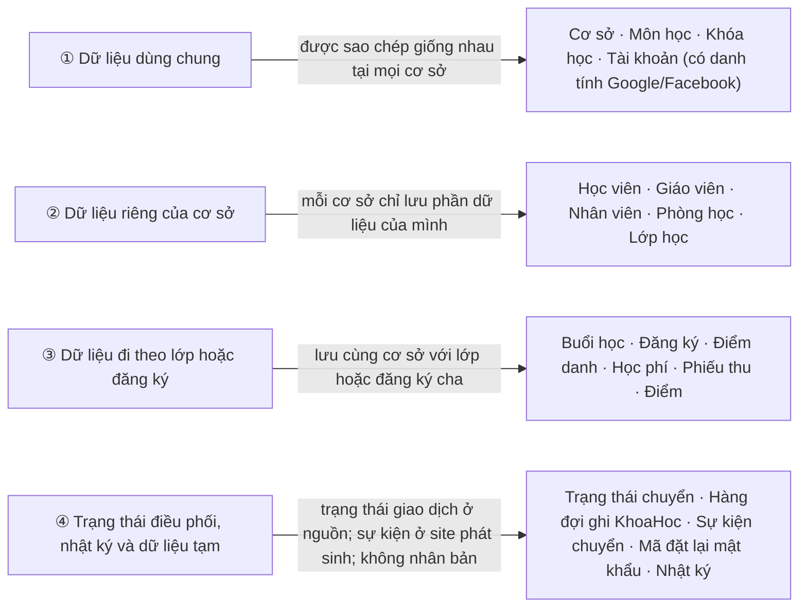
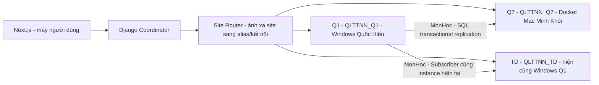
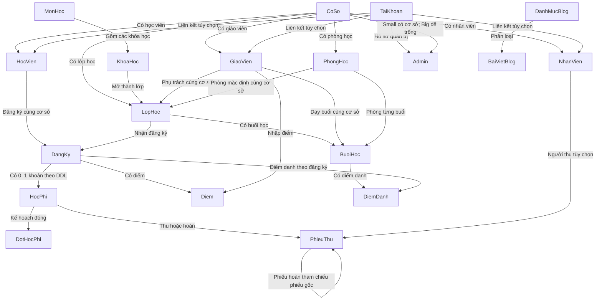
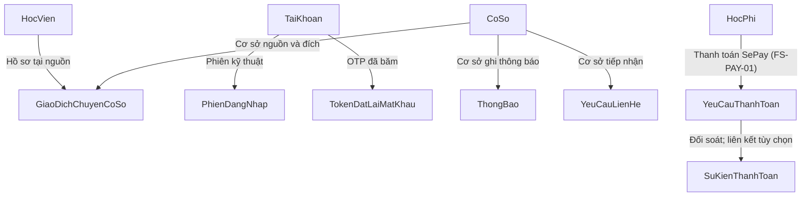

# Cấu trúc cơ sở dữ liệu

Sửa 21/11/2026 không đổi schema: dùng `sp_getapplock` theo tài khoản cùng transaction coordinator để bảo vệ `GiaoDichDatLaiMatKhau` và đọc lại job trước áp `TaiKhoan` tại từng site. `UX_GiaoDichDatLaiMatKhau_dang_xu_ly` vẫn giới hạn một job pending/tài khoản. Khi chuyển quay lại site cũ, tái sử dụng `HocVien` đã `da_chuyen_di` đúng danh tính và có sự kiện rời site, giữ slug, ghi metadata/trạng thái staging cùng sự kiện mới trong `LichSuChuyenCoSo`. Không đổi mã học viên/tài khoản, không xóa các bảng con/lịch sử, không thêm CSDL trung tâm hoặc JOIN xuyên site.

Sửa nghiệp vụ 20/11/2026 không đổi schema: `PhieuThu.ma_phieu` vẫn tối đa 24 ký tự, mã `{site}-PT-{key}` phải tính cả tiền tố; hoàn đối chiếu `ma_phieu_goc`. `DangKy` đã có `DiemDanh`/`Diem` không đổi `ma_lop`. Khi thay giáo viên, giữ nguyên `BuoiHoc.ma_giao_vien` lịch sử; quyền đọc theo giáo viên hiện tại của `LopHoc`, quyền ghi điểm danh vẫn yêu cầu cả lớp và buổi. Tất cả đọc/ghi trong đúng CSDL site qua Site Router.

> Quản lý trung tâm đào tạo ngoại ngữ · CSDL phân tán · 3 cơ sở (Q1, Q7, TD)
>
> File này tập trung **mô hình dữ liệu, ERD, bảng/cột, phân mảnh, ánh xạ, định vị và ràng buộc**.
> Luồng nghiệp vụ và ví dụ ở [README.md](../README.md).
> DBMS đã chọn: **SQL Server**. Mỗi site là một CSDL SQL Server độc lập; file này mô tả schema logic và phân mảnh, không khẳng định các CSDL đã được cài vật lý.
> **Đổi schema → cập nhật file này trong cùng commit.**

Yêu cầu chung là **2–4 site**, có phân mảnh, replication, transaction và đồng bộ; phải chứng minh ít nhất một phương pháp phân mảnh, một phương pháp replication, một distributed transaction, một tình huống concurrency và một distributed query. Đồ án dùng 3 site Q1/Q7/TD. [Ma trận YC-01–YC-07](QLTTNN-Yeu-Cau-Chung-Va-Kiem-Chung.md) quy định minh chứng; schema là thiết kế, không tự chứng minh đã chạy các cơ chế này.

**Mục lục:** [1. Quy ước mã](#1-quy-ước-mã) · [2. Bốn kiểu bảng](#2-bốn-kiểu-bảng) · [3. Dữ liệu nằm ở đâu](#3-dữ-liệu-nằm-ở-đâu) · [4. Ràng buộc phân tán](#4-ràng-buộc-phân-tán-bắt-buộc) · [5. Quan hệ giữa các bảng](#5-các-bảng-liên-quan-với-nhau-thế-nào) · [6. Chi tiết từng bảng](#6-chi-tiết-từng-bảng) · [7. Dữ liệu mẫu](#7-dữ-liệu-mẫu-cho-các-ví-dụ) · [8. Phân mảnh và ánh xạ](#phan-manh)

---

ERD, mô hình dữ liệu, phân mảnh và định vị được tập trung trong file này. Áp dụng bài giảng theo [phụ lục đề cương báo cáo](QLTTNN-De-Cuong-Bao-Cao.md#tai-lieu-giang-vien); không sao chép schema ví dụ khác vào đồ án.

## 1. Quy ước mã

Khóa chính của **bản ghi nghiệp vụ/cục bộ được tạo tại một site** có dạng **`<SITE>-<LOẠI>-<SỐ THỨ TỰ 6 CHỮ SỐ>`**, ví dụ `Q1-HV-000001`. Mã site trong khóa là nơi tạo bản ghi và không đổi khi học viên chuyển cơ sở.

Các bảng danh mục dùng chung có mã ổn định giống nhau ở mọi site: `CoSo.ma_co_so` dùng `Q1`, `Q7`, `TD`; `MonHoc.ma_mon` dùng mã như `MH-ENG`; `KhoaHoc.ma_khoa_hoc` tối đa 30 ký tự, bắt đầu bằng chữ in hoa và gồm chữ in hoa/chữ số, có thể chia thành các đoạn bằng dấu gạch nối đơn (ví dụ `FG`, `HK-TOEIC-450-550`, `ABC1-TOEIC-450-550`). Giao diện chuẩn hóa mã nhập thành chữ in hoa. Không tạo lại mã danh mục theo từng site. `TaiKhoan` vẫn dùng mã có tiền tố site tạo tài khoản và được nhân bản cùng mã đó.

| Phần | Ví dụ | Ý nghĩa |
|------|-------|---------|
| Site | `Q1`, `BT` | Mã cơ sở đã **tạo** bản ghi: 2–3 chữ cái hoặc số viết hoa, duy nhất, **không đổi** sau khi tạo (vd `BT` = Bình Thạnh) |
| Loại | `HV` | Loại đối tượng (bảng dưới) |
| Số thứ tự | `000001` | Tăng dần trong từng site, nên không trùng giữa các site |

| Loại | Đối tượng | Loại | Đối tượng |
|------|-----------|------|-----------|
| `HV` | Học viên | `HP` | Học phí |
| `GV` | Giáo viên | `PT` | Phiếu thu |
| `NV` | Nhân viên | `DM` | Điểm |
| `PH` | Phòng học | `DD` | Điểm danh |
| `LH` | Lớp học | `TK` | Tài khoản |
| `BH` | Buổi học | `NK` | Nhật ký hệ thống |
| `DK` | Đăng ký | `CC` | Chuyển cơ sở |
| `TOKEN` | Token đặt lại mật khẩu | `DB` | Nhật ký đồng bộ |
| `LS` | Sự kiện lịch sử chuyển cơ sở | | |
| `LH` | Yêu cầu liên hệ | | |

> ⚠️ **Tiền tố là nơi TẠO, không phải nơi HIỆN TẠI.**
> Các bản ghi không bao giờ di chuyển (lớp, đăng ký, học phí, điểm...) thì tiền tố luôn trùng site chứa nó.
> **Riêng `HocVien` có thể chuyển cơ sở**: `Q1-HV-000001` sau khi chuyển sang Q7 vẫn giữ mã đó nhưng nằm ở Q7.
> Vì vậy muốn biết học viên đang ở site nào phải xem cột `ma_co_so` của bản ghi `dang_hoc`, **không** dựa vào tiền tố.

---

## 2. Bốn kiểu bảng

| Kiểu | Nhóm (mục 3) | Ý nghĩa | Bảng |
|------|:---------------:|---------|------|
| **Nhân bản** | ① Dùng chung | Mục tiêu bản sao thống nhất tại mọi site hoạt động; MonHoc truyền bất đồng bộ nên có khoảng trễ trước đối soát | `CoSo` `MonHoc` `KhoaHoc` `TaiKhoan` (gồm danh tính Google/Facebook nếu đã liên kết) `DanhMucBlog` `BaiVietBlog` |
| **Phân mảnh nguyên thủy** | ② Riêng của cơ sở | Mỗi dòng có site sở hữu theo `ma_co_so`; HocVien giữ cả bản lịch sử nguồn sau chuyển, không yêu cầu mã học viên duy nhất xuyên các mảnh lịch sử | `HocVien` `GiaoVien` `NhanVien` `Admin` (hồ sơ Admin Small) `PhongHoc` `LopHoc` `YeuCauLienHe` |
| **Phân mảnh dẫn xuất** | ③ Đi theo lớp / đăng ký | Dòng nằm **cùng site với dòng cha** | `BuoiHoc` `DangKy` `DiemDanh` `HocPhi` `DotHocPhi` `PhieuThu` `Diem` |
| **Cục bộ** | ④ Trạng thái điều phối, xác thực, thanh toán theo site, nhật ký và dữ liệu tạm | Không nhân bản; mỗi dòng được lưu tại site có trách nhiệm xử lý | `GiaoDichChuyenCoSo` `LichSuChuyenCoSo` `PhienDangNhap` `TokenDatLaiMatKhau` `GiaoDichDatLaiMatKhau` `YeuCauThanhToan` `SuKienThanhToan` `ThongBao` `Logs` |

Bảng nhân bản có thêm 2 cột để **đối soát** khi 3 site bị lệch: `phien_ban` (số nguyên, tăng 1 mỗi lần sửa) và `cap_nhat_luc` (thời điểm sửa gần nhất).

### Kiểm chứng phương pháp phân mảnh và nhân bản

- **YC-02 / TC-FRAG-01:** dùng `LopHoc` làm ví dụ mảnh ngang: mảnh tại site S gồm các dòng `ma_co_so = S`; `DangKy` dẫn xuất theo site của lớp cha. Đọc riêng từng DB để kiểm tra không có dòng sai site/thiếu cha; hợp kết quả tại công cụ kiểm thử hoặc API phải đúng tập lớp dự kiến, không thiếu/thừa và không trùng khóa giữa các mảnh. Không tạo JOIN/FK xuyên DB hoặc lưu hợp các mảnh vào DB trung tâm.
- Các bảng phân mảnh được định vị theo site, nhưng `HocVien` có bản lịch sử sau chuyển và có thể tạm có hai dòng vật lý cùng mã (bản đích `bao_luu` đến khi kích hoạt, nên không có hai dòng `dang_hoc` cùng lúc). Chứng minh không giao nhau bằng mảnh lớp; thống kê học viên phải chọn bản hiện hành theo trạng thái giao dịch, không đòi xóa bản lịch sử để đạt tiêu chí.
- **YC-03 / TC-REP-01:** `MonHoc` dùng SQL Server transactional Publication, chỉ Publisher được ghi qua API; các site khác nhận bản sao. Mặc định Publisher Q1, cấu hình độc lập session. `KhoaHoc` giữ cơ chế fan-out riêng. [Chính sách và bằng chứng](MonHoc-SQL-Replication.md).
- **YC-07 / TC-SYNC-01:** lỗi/đang chờ được trả `complete=false`/HTTP 202 với `missing_sites` theo endpoint. MonHoc retry cùng key/body chỉ đọc biên nhận Publisher và đối soát Subscriber, không phát lại DML; writer fan-out của bảng khác tiếp tục site chưa ACK theo hợp đồng riêng. Cùng key khác body hoặc bản sao xung đột bị từ chối. Xem bằng chứng đã có và phạm vi outage còn thiếu trong chính sách MonHoc; không suy ra toàn bộ bảng đã kiểm chứng.
- `db/30_enforce_site_fragment_boundaries.sql` thêm 16 ràng buộc `CHECK` cho từng CSDL site để SQL Server chặn ghi nhầm mảnh. Script kiểm tra dữ liệu hiện có trước khi thêm ràng buộc, chạy riêng trên từng DB và không tạo database/bảng.

---

## 3. Dữ liệu nằm ở đâu

Mỗi cơ sở (Q1, Q7, TD) có **cùng cấu trúc bảng** nhưng **chứa dữ liệu khác nhau**. Mỗi cơ sở đều có đủ 4 nhóm dữ liệu:

**Ví dụ:**

| Dữ liệu | Có ở Q1? | Có ở Q7? | Có ở TD? |
|---------|:--------:|:--------:|:--------:|
| Khóa học "IELTS 6.5" (nhóm ①) | ✔ | ✔ | ✔ |
| Học viên Nguyễn Văn An, đang học ở Q1 (nhóm ②) | ✔ | ✘ | ✘ |
| Học phí của An (nhóm ③) | ✔ | ✘ | ✘ |

### Bảng tổng hợp

| Bảng | Kiểu | Tiêu chí phân mảnh | Vị trí |
|------|------|--------------------|--------|
| `CoSo`, `MonHoc`, `KhoaHoc`, `TaiKhoan`, `DanhMucBlog`, `BaiVietBlog` | Nhân bản theo schema | – | Tất cả site đang hoạt động (ban đầu Q1, Q7, TD) |
| `HocVien` | Nguyên thủy | `ma_co_so` (cơ sở hiện tại) | Site tương ứng |
| `GiaoVien` | Nguyên thủy | `ma_co_so` (cơ sở công tác) | Site tương ứng |
| `NhanVien` | Nguyên thủy | `ma_co_so` | Site tương ứng |
| `Admin` | Nguyên thủy | `ma_co_so` với hồ sơ Admin Small | Site được gán |
| `PhongHoc` | Nguyên thủy | `ma_co_so` | Site tương ứng |
| `LopHoc` | Nguyên thủy | `ma_co_so` | Site tương ứng |
| `BuoiHoc` | Dẫn xuất | theo `LopHoc` | Cùng site với lớp |
| `DangKy` | Dẫn xuất | theo `LopHoc` | Cùng site với lớp |
| `DiemDanh` | Dẫn xuất | theo `BuoiHoc` | Cùng site với buổi học |
| `HocPhi` | Dẫn xuất | theo `DangKy` | Cùng site với đăng ký |
| `PhieuThu` | Dẫn xuất | theo `HocPhi` | Cùng site với học phí |
| `Diem` | Dẫn xuất | theo `DangKy` | Cùng site với đăng ký |
| `DotHocPhi` | Dẫn xuất | theo `HocPhi` | Cùng site với học phí |
| `YeuCauThanhToan`, `SuKienThanhToan` | Cục bộ theo nghiệp vụ học phí | theo `HocPhi`/`CoSo` | Cùng site chứa học phí; chỉ phục vụ SePay |
| `GiaoDichChuyenCoSo` | Cục bộ | trạng thái hiện tại của một lần chuyển | Chỉ CSDL site nguồn; Coordinator cập nhật để phục hồi |
| `LichSuChuyenCoSo` | Cục bộ | sự kiện append-only của lần chuyển | Site thực hiện sự kiện (thường nguồn và đích) |
| `PhienDangNhap`, `TokenDatLaiMatKhau`, `GiaoDichDatLaiMatKhau` | Cục bộ kỹ thuật | session/OTP/ledger xác thực | Database site cấu hình `AUTH_SESSION_SITE_CODE` |
| `GiaoDichXoaHocVien` | Cục bộ kỹ thuật, legacy | dấu tiến trình cho luồng purge học viên cũ | Database site cấu hình của Coordinator; chỉ xuất hiện sau migration 22. DELETE hiện hành không dùng bảng này và không purge lịch sử |
| `ThongBao` | Cục bộ | Thông báo quản trị phát sinh tại site; Admin Big có thể yêu cầu ghi đồng bộ tới các site hoạt động | CSDL của từng site; không có bảng trung tâm |
| `YeuCauLienHe` | Phân mảnh ngang theo yêu cầu | `ma_co_so` do khách chọn và API xác nhận | Chỉ CSDL của site được chọn; Admin Big đọc GLOBAL bằng cách hỏi từng site, Admin Small chỉ đọc site được giao |
| `Logs` | Cục bộ | audit, ý định đồng bộ khóa học, ACK và trạng thái hoàn tất phát sinh tại một site | Ý định ở `AUTH_SESSION_SITE_CODE`; ACK ở từng site đích; mỗi CSDL giữ log riêng và chỉ ghi thêm, không cập nhật/xóa |

### Chính sách ghi và bố trí vật lý

| Quan hệ | Nơi được ghi | Nơi lưu bản sao/mảnh | Cơ chế |
|---|---|---|---|
| `MonHoc` | Publisher `MONHOC_PUBLISHER_SITE_CODE` (mặc định Q1) | Mọi site hoạt động | SQL Server transactional push, bất đồng bộ; API chỉ đọc lại Subscriber để xác nhận |
| `KhoaHoc` | `course_services.py`, sau khi ghi ý định append-only vào `Logs` tại `AUTH_SESSION_SITE_CODE` | Các site hoạt động trong ý định; bản ghi nghiệp vụ ở DB riêng từng site | Tạo/sửa ghi vào các site đang kết nối, lưu ACK idempotent trong `Logs` và trả 202 khi còn site chờ; API đối soát qua `/admin/courses/sync/`. Xóa chưa ghi site nào cho tới khi đủ site để kiểm tra lớp tham chiếu. Mỗi site có transaction riêng; không phải ACID xuyên CSDL |
| `DanhMucBlog`, `BaiVietBlog` | Service có quyền theo từng chức năng | Mọi site hoạt động | Fan-out transaction cục bộ/ACK theo service hiện có; site chưa nhận được ghi vào hàng đợi bền trong `Logs` tại authority (`BLINT-`/`BLFIN-`/`BLREV-`) và worker `sync_blog` phát lại cùng khóa idempotent; không phải cùng Publication MonHoc |
| `TaiKhoan` | Authority và site tạo hồ sơ theo quy trình cấp tài khoản | Mọi site hoạt động | Trigger/outbox tại authority, worker chuyển snapshot hiện tại; không dùng replica cũ để xác thực |
| `DongBoTaiKhoan`, `DatChoEmailHocVien`, `TrangThaiKhoEmail` | Authority `AUTH_SESSION_SITE_CODE` | Chỉ authority | Trạng thái kỹ thuật theo migration 45; không chứa hợp hồ sơ nghiệp vụ; xem [quy trình khởi tạo](Auth-Site-Isolation.md) |
| `CoSo` | Metadata vận hành theo quy trình provisioning | Bản sao các site | Chưa có API CRUD/provision runtime đầy đủ; không tuyên bố thêm site tự động |
| Bảng nghiệp vụ phân mảnh/dẫn xuất | Site sở hữu bản ghi | Chính site đó | Transaction cục bộ; chuyển học viên là ngoại lệ được Coordinator điều phối |
| `GiaoDichChuyenCoSo` | Nguồn | Nguồn | Trạng thái có thể cập nhật để phục hồi |
| `LichSuChuyenCoSo`, `Logs`, `ThongBao`, liên hệ | Site phát sinh/xử lý theo schema | Site tương ứng | Nhật ký cục bộ; không nhân bản toàn bộ lịch sử |
| `PhienDangNhap`, OTP/ledger xác thực | Site chọn bởi `AUTH_SESSION_SITE_CODE` | Một site cấu hình | Trạng thái kỹ thuật, không chứa hợp dữ liệu nghiệp vụ |

`Logs` hiện có giữ ý định append-only cùng snapshot và danh sách site đích; ACK riêng tại mỗi site cho biết site nào đã áp dụng. Operation id là SHA-256 của idempotency key. Khi một site khác offline, API xác nhận phần đã ghi và giữ phần còn thiếu; worker `manage.py sync_courses` thử lại nền mỗi 5 giây, UI cũng đối soát khi trang mở và mỗi 10 giây khi còn việc chờ. `run-local.ps1` khởi động worker này; môi trường chạy API bằng cách khác phải chạy worker như một tiến trình được giám sát. Nếu site authority trong `AUTH_SESSION_SITE_CODE` offline, API không thể nhận yêu cầu mới. Migration 46 chỉ dùng một lần để chuyển dữ liệu khỏi bảng outbox tạm nếu bảng đó còn tồn tại; hệ thống không cần tạo bảng mới.

Ảnh trạng thái lab đã ghi nhận ngày 20/11/2026: Q1 và TD là hai DB trên **cùng** instance Windows `DESKTOP-CK4K90F`; Q7 là DB `QLTTNN_Q7` trên instance Linux `sql-q7` trong Docker của Mac Intel. Mục tiêu cuối phân công TD sang Windows Minh Đức; cấu hình cuối phải đo và ghi lại khi chuyển xong. SSMS trên Windows và VS Code mssql trên Mac chỉ là công cụ khách, không quyết định dữ liệu nằm ở máy nào.

Không có mũi tên nhân bản mọi bảng học viên/phiếu thu. Distributor giữ dữ liệu kỹ thuật replication, không phải kho nghiệp vụ tổng hợp cho Admin Big.

---

## 4. Ràng buộc phân tán (BẮT BUỘC)

| # | Quy tắc | Hệ quả khi code |
|---|---------|-----------------|
| R1 | Học viên chỉ đăng ký lớp **cùng cơ sở** với mình | Muốn học cơ sở khác → phải Chuyển cơ sở trước |
| R2 | Bảng dẫn xuất luôn nằm cùng site với bảng cha | Mọi JOIN nghiệp vụ hằng ngày đều là JOIN cục bộ |
| R3 | Bảng nhân bản chỉ được sửa qua writer được phép của bảng | Tiền kiểm thiếu site thì từ chối trước ghi; lỗi/độ trễ sau commit trả chưa hoàn tất. MonHoc chỉ ghi Publisher, không ghi bù Subscriber; đọc đủ bản sao mới báo hoàn tất |
| R4 | `TaiKhoan.ten_dang_nhap` và `email` duy nhất **toàn hệ thống** | Giữ namespace bằng khóa transaction ở authority khi tạo tài khoản; bản sao nhận qua outbox, xung đột phải đối soát |
| R5 | **Không** có khóa ngoại vật lý xuyên site | Toàn vẹn xuyên site do tầng ứng dụng đảm bảo. FK tới bảng nhân bản vẫn kiểm tra cục bộ được |
| R6 | **Không** JOIN trực tiếp giữa 2 site | Cần dữ liệu nhiều site → dùng Global Query, gộp ở tầng ứng dụng |
| R7 | Đề nghị/trạng thái chuyển (`GiaoDichChuyenCoSo`) chỉ lưu tại CSDL nguồn; nhật ký (`Logs`, `LichSuChuyenCoSo`) chỉ **thêm**, không sửa/xóa trong luồng nghiệp vụ | Chỉ Tư vấn tạo đề nghị ở nguồn; Admin Big hoặc Admin Small tại site nhận quyết định qua Coordinator; chỉ giao dịch đã duyệt mới chạy giữa nguồn và đích |
| R8 | Mật khẩu và token chỉ lưu **bản băm** | Không bao giờ ghi vào nhật ký, không trả ra API |
| R9 | `HocVien` là bảng **duy nhất** được di chuyển giữa các site | Chỉ di chuyển qua nghiệp vụ Chuyển cơ sở |

**YC-05 / TC-CON-01 — ràng buộc sức chứa dưới cạnh tranh:** kiểm tra lớp còn chỗ, tăng `si_so_hien_tai`, tạo `DangKy`, `HocPhi` và nhật ký phải cùng transaction tại site, có cơ chế bảo vệ cập nhật cạnh tranh. Unique đăng ký theo học viên/lớp không ngăn hai học viên khác nhau lấy chỗ cuối. Đọc lại dữ liệu sau hai phiên cạnh tranh: đúng một đăng ký/học phí mới, sĩ số tăng một và không vượt `si_so_toi_da`; giao dịch thất bại không để nghiệp vụ dở dang. Cơ chế khóa/mức cô lập/cập nhật có điều kiện phải được ghi và kiểm thử; đây không phải thay đổi cột trong đợt cập nhật tài liệu này.

**YC-04 / TC-DTX-01:** `GiaoDichChuyenCoSo` và `LichSuChuyenCoSo` hỗ trợ điều phối/phục hồi, không tự tạo transaction ACID xuyên site. Phải kiểm chứng cả nguồn và đích theo [tài liệu giao dịch](QLTTNN-Giao-Dich-Phan-Tan.md). **YC-06 / TC-DQ-01:** đọc các mảnh riêng để thống kê tại API, xử lý bản học viên hiện hành và báo site thiếu.

---

## 5. Các bảng liên quan với nhau thế nào

### 5.1. ERD nghiệp vụ tại từng site

Sơ đồ đối chiếu DDL và migration trong [hướng dẫn DB](../db/README.md). Chỉ có quan hệ trong một database, tham chiếu bảng nhân bản qua bản sao cục bộ. Dùng mũi tên thường từ bảng được tham chiếu tới bảng tham chiếu; nhãn mô tả quan hệ, bội số và trường hợp tùy chọn được giải thích bên dưới.

- Bảy bảng đề tài giao: `HocVien`, `LopHoc`, `GiaoVien`, `MonHoc`, `DangKy`, `HocPhi`, `Diem` đều có trong sơ đồ.
- FK ghép `(mã cha, ma_co_so)` ở lớp/buổi/đăng ký/học phí/điểm/phiếu thu bảo vệ cha–con cùng cơ sở. `MonHoc`/`KhoaHoc`/`TaiKhoan` được tham chiếu qua **bản sao cục bộ**.
- DDL cho phép đăng ký có **0 hoặc 1** khoản học phí (unique ở `HocPhi.ma_dang_ky`); service đăng ký phải tạo đúng một khoản cùng transaction. ERD không biến yêu cầu của service thành FK bắt buộc hai chiều.
- `HocVien`, `GiaoVien`, `NhanVien` có `ma_tai_khoan` nullable và unique index có lọc khi khác NULL. Trong từng bảng tại một site, một tài khoản chỉ gắn tối đa một hồ sơ; các index riêng không tự chặn một tài khoản xuất hiện ở hai loại hồ sơ hoặc ở database khác, nên service vẫn phải kiểm tra quy tắc toàn hệ thống.
- `Logs` vẫn append-only. Đồng bộ `KhoaHoc` dùng event `KHINT-<hash>` tại `AUTH_SESSION_SITE_CODE` để lưu người thao tác, hành động, snapshot JSON và site đích; ACK `KHREP-*`/`KHDEL-*` ở site đích và event hoàn tất/đối soát giữ tiến trình retry. Đây là metadata cục bộ trong bảng nhật ký hiện có, không thay `KhoaHoc` làm bảng nghiệp vụ và không tạo bảng mới. Migration `db/46_move_course_queue_to_logs.sql` chỉ chuyển dữ liệu khỏi bảng outbox tạm đã thử nghiệm rồi xóa bảng đó nếu còn.
- `PhieuThu.ma_nhan_vien` và `ma_phieu_goc` có thể NULL; phiếu hoàn tham chiếu phiếu gốc tại cùng site. Không xóa chứng từ khi chuyển học viên.

### 5.2. Điều phối, xác thực và dữ liệu phụ trợ

`LichSuChuyenCoSo.ma_chuyen` là mã tương quan được ghi tại site phát sinh, **không có FK tới giao dịch ở database khác**. `Logs` lưu audit/biên nhận cục bộ, không nối FK tới mọi đối tượng trong JSON. Các ledger phục hồi (`GiaoDichDatLaiMatKhau`, luồng purge legacy) tra schema, không diễn giải thành bảng nghiệp vụ trung tâm. Portal/SePay có source/schema không đồng nghĩa đã được duyệt vào phạm vi môn học.

### 5.3. Đọc nhanh các quan hệ

Bảng sau tóm tắt ý nghĩa nghiệp vụ; bội số và ngoại lệ DDL được ghi trong ERD và chi tiết cột:

| Bảng cha | Bảng con | Ý nghĩa |
|----------|----------|---------|
| Cơ sở (`CoSo`) | `HocVien` `GiaoVien` `NhanVien` `PhongHoc` `LopHoc` | Mỗi cơ sở có nhiều học viên, giáo viên, nhân viên, phòng học, lớp |
| Môn học (`MonHoc`) | `KhoaHoc` | Một môn có nhiều khóa |
| Khóa học (`KhoaHoc`) | `LopHoc` | Một khóa mở thành nhiều lớp |
| Giáo viên (`GiaoVien`) | `LopHoc` · `BuoiHoc` · `Diem` | Phụ trách lớp · dạy buổi học (kể cả dạy thay) · nhập điểm |
| Phòng học (`PhongHoc`) | `LopHoc` · `BuoiHoc` | Phòng mặc định của lớp · phòng của từng buổi |
| Tài khoản (`TaiKhoan`) | `GiaoVien` · `NhanVien` | Liên kết tùy chọn; mỗi bảng có unique index tài khoản khi khác NULL tại site; service kiểm tra thêm giữa các loại hồ sơ/site |
| Tài khoản (`TaiKhoan`) | `TokenDatLaiMatKhau` · `PhienDangNhap` | Token đặt lại mật khẩu và phiên kỹ thuật có FK cục bộ; `Logs` chỉ ghi mã tương quan, không có FK tài khoản |
| Cơ sở (`CoSo`) | `ThongBao` | Mỗi thông báo được lưu tại đúng CSDL site và tham chiếu cơ sở cục bộ |
| Lớp học (`LopHoc`) | `BuoiHoc` · `DangKy` | Các buổi học · các lượt đăng ký |
| Học viên (`HocVien`) | `DangKy` | Một học viên đăng ký nhiều lớp |
| Học viên (`HocVien`) | `GiaoDichChuyenCoSo` | Hồ sơ ở nguồn được tham chiếu bởi các lần chuyển; mỗi học viên tối đa một giao dịch đang xử lý tại cùng site nguồn |
| Đăng ký (`DangKy`) | `HocPhi` (0–1 theo DDL) · `Diem` · `DiemDanh` | Service tạo đúng một khoản học phí cùng transaction đăng ký; nhiều điểm/lượt điểm danh |
| Buổi học (`BuoiHoc`) | `DiemDanh` | Mỗi buổi có nhiều lượt điểm danh |
| Học phí (`HocPhi`) | `PhieuThu` | Mỗi khoản học phí có nhiều lần thu / hoàn |
| Nhân viên (`NhanVien`) | `PhieuThu` | Nhân viên là người thu tiền |

`GiaoDichChuyenCoSo` được tạo và cập nhật tại CSDL nguồn; khóa ngoại của nó chỉ tới bản `HocVien`, `CoSo` và `TaiKhoan` có ngay trong cùng CSDL đó. `LichSuChuyenCoSo` là sự kiện append-only, được ghi tại site phát sinh; `ma_chuyen` chỉ là mã tương quan giữa các CSDL, **không** có khóa ngoại tới `GiaoDichChuyenCoSo` vì bản ghi trạng thái chỉ nằm ở nguồn. Không có khóa ngoại xuyên site.

---

## 6. Chi tiết từng bảng

Ký hiệu: **PK** khóa chính · **FK** khóa ngoại · **UQ** duy nhất · *null* được để trống.

### 6.1. Danh mục (nhân bản)

**`CoSo`**

| Cột | Ràng buộc | Mô tả |
|-----|-----------|-------|
| `ma_co_so` | PK | `Q1`, `Q7`, `TD` |
| `ten_co_so` | | Tên cơ sở |
| `dia_chi`, `sdt` | | Liên hệ |
| `trang_thai` | | `chuan_bi` (đang chép dữ liệu) · `hoat_dong` · `dong_cua` (đóng cửa, vẫn giữ dữ liệu). Chi tiết ở `README.md` mục 2 |

**`MonHoc`**

| Cột | Ràng buộc | Mô tả |
|-----|-----------|-------|
| `ma_mon` | PK | |
| `ten_mon` | | Tiếng Anh, Tiếng Nhật, Tiếng Hàn... |
| `mo_ta` | | |

**`KhoaHoc`**

| Cột | Ràng buộc | Mô tả |
|-----|-----------|-------|
| `ma_khoa_hoc` | PK | |
| `ma_mon` | FK → `MonHoc` | |
| `ten_khoa_hoc` | | |
| `trinh_do` | | A1..C2 / N5..N1 / ... |
| `so_buoi` | | Tổng số buổi chuẩn theo chương trình khóa học; lưu riêng, không suy ra chỉ từ số tháng. Khi mở lớp, API đối chiếu tổng này với số ngày học tính từ khoảng ngày và các thứ đã chọn. Không ghi đè bằng số buổi đã tạo của một lớp; số buổi từng lớp được đếm từ `BuoiHoc` tại site sở hữu lớp |
| `thoi_luong_so` | `DECIMAL(7,2)`, nullable | Số tháng (cho phép tối đa 2 chữ số thập phân, ví dụ 3,5) hoặc số ngày nguyên |
| `thoi_luong_don_vi` | `VARCHAR(10)`, nullable | `thang` hoặc `ngay`; nếu là ngày thì số lượng phải nguyên |
| `hoc_phi_chuan` | | Số tiền |

**`DanhMucBlog` và `BaiVietBlog`**

Hai bảng có bản sao tại từng database site. Migration `36_add_blog_tables.sql` tạo cấu trúc và nạp ba bài mẫu ban đầu giống nhau; seed không phải bằng chứng replication runtime. API public đọc/đối chiếu qua `GLOBAL`; CMS Admin Big ghi qua Coordinator theo `REPLICATED-WRITE`. Mỗi site dùng transaction cục bộ; `Logs` lưu ACK và ảnh chụp trước/sau để retry an toàn. Không có transaction ACID nguyên tử xuyên database. Slug là khóa định danh liên site; khóa `IDENTITY` chỉ có ý nghĩa trong database cục bộ và không được gửi sang site khác.

| Bảng/cột | Ràng buộc | Mô tả |
|-----|-----------|-------|
| `DanhMucBlog.ma_danh_muc_blog` | PK, `BIGINT IDENTITY` | Khóa nội bộ riêng của từng database |
| `DanhMucBlog.slug` | UQ, `VARCHAR(120)` | Slug danh mục ổn định để trả qua API |
| `DanhMucBlog.ten_danh_muc` | `NVARCHAR(100)` | Tên danh mục công khai |
| `DanhMucBlog.mo_ta` | `NVARCHAR(500)`, nullable | Mô tả ngắn |
| `DanhMucBlog.trang_thai` | `hoat_dong` / `ngung` | Chỉ danh mục hoạt động được trả ra |
| `BaiVietBlog.ma_bai_viet_blog` | PK, `BIGINT IDENTITY` | Khóa nội bộ riêng của từng database |
| `BaiVietBlog.ma_danh_muc_blog` | FK → `DanhMucBlog` | Chỉ tham chiếu trong cùng database site |
| `BaiVietBlog.slug` | UQ, `VARCHAR(160)` | Slug duy nhất trong từng bản sao; API đối chiếu slug trên mọi site |
| `BaiVietBlog.tieu_de`, `tom_tat` | `NVARCHAR(200)`, `NVARCHAR(500)` | Tiêu đề và mô tả công khai |
| `BaiVietBlog.noi_dung` | `NVARCHAR(MAX)` | Lưu nguồn Markdown giới hạn dạng văn bản thường; hỗ trợ đoạn văn, tiêu đề `##`/`###`, danh sách đánh số và bảng. HTML thô không được render hoặc thực thi; không cần đổi schema |
| `BaiVietBlog.so_phut_doc` | `SMALLINT`, 1–240 | Thời lượng đọc ước tính |
| `BaiVietBlog.trang_thai` | `nhap` / `da_xuat_ban` / `an` | API chỉ đọc bài đã xuất bản và tới thời điểm xuất bản |
| `BaiVietBlog.anh_bia_public_id`, `anh_bia_url` | `NVARCHAR(255)` / `NVARCHAR(1024)`, nullable, cùng null hoặc cùng có | Ảnh bìa Cloudinary, thư mục `<root>/blog/bia/<slug>-dd-mm-yyyy`; ảnh chèn trong bài nằm ở `<root>/blog/noi-dung/<slug>-HHMMSS-dd-mm-yyyy` và chỉ được tham chiếu bằng Markdown `` trong `noi_dung` |
| `BaiVietBlog.ngay_xuat_ban_utc` | `DATETIME2(0)`, nullable | `NULL` nghĩa là bài đã xuất bản ngay; thời điểm tương lai được ẩn đến hạn |

### 6.2. Tài khoản và phương thức đăng nhập (nhân bản, dùng chung các vai trò)

**`TaiKhoan`**

| Cột | Ràng buộc | Mô tả |
|-----|-----------|-------|
| `ma_tai_khoan` | PK | Tiền tố = site tạo |
| `slug` | UQ | Định danh thân thiện của tài khoản |
| `ten_dang_nhap` | UQ | Duy nhất toàn hệ thống |
| `email` | UQ | Duy nhất toàn hệ thống |
| `mat_khau` | | Chuỗi bcrypt; không lưu mật khẩu gốc |
| `google_subject` | UQ có lọc, *null* | Google `sub` ổn định; null khi chưa liên kết Google |
| `facebook_subject` | UQ có lọc, *null* | Facebook app-scoped user ID; null khi chưa liên kết Facebook |
| `vai_tro` | | `admin_big` · `nhan_vien` · `giao_vien` · `hoc_vien` |
| `ma_co_so` | FK, *null* | `NULL` với Admin Big; bắt buộc với các vai trò còn lại |
| `trang_thai` | BIT | `1` = active · `0` = inactive |
| `bat_buoc_doi_mat_khau` | BIT | Bắt buộc đổi mật khẩu ở lần đăng nhập kế tiếp |
| `ngay_tao`, `ngay_doi_mat_khau_cuoi` | | |
| `phien_ban`, `cap_nhat_luc` | | Đối soát đồng bộ (mục 2) |
| `avatar_public_id`, `avatar_secure_url` | *null* được phép | Metadata ảnh đại diện Cloudinary; không lưu bytes ảnh trong SQL Server |

Admin Small đăng nhập bằng role `nhan_vien` và hồ sơ `Admin.loai_admin = admin_small`; không dùng `NhanVien.chuc_vu` để biểu diễn Admin Small. Chức vụ nhân viên hiện tại là `tu_van` (hiển thị “Tư vấn & xếp lớp”) hoặc `ke_toan` (hiển thị “Kế toán & Lễ tân”). Migration 41 chuyển hồ sơ `le_tan` cũ thành `ke_toan`; không thêm bảng/cột.

Danh tính ngoài được lưu ngay trên dòng `TaiKhoan`, không có bảng OAuth riêng. Mỗi subject có chỉ mục duy nhất riêng trong từng CSDL. Liên kết subject chỉ ghi bản `TaiKhoan` tại authority `AUTH_SESSION_SITE_CODE` (unique index lọc tại authority chặn trùng), tăng `phien_ban` và để trigger/outbox cùng worker `sync_accounts` chuyển sang các bản sao (`REPLICATED-WRITE` bất đồng bộ). Sửa email/tên đăng nhập/slug của Admin Big đi cùng đường này. Thay đổi danh tính không phải thao tác thu hồi quyền nên các phiên còn hiệu lực được chuyển sang phiên bản mới trong cùng transaction. Không dùng email provider làm định danh, không tự tạo tài khoản hoặc tự liên kết theo email trùng nhau. Không lưu access token, refresh token, client secret hoặc email provider trong `TaiKhoan`; chỉ lưu metadata avatar Cloudinary nêu trên.

**`Admin` — hồ sơ quản trị tại site**

| Cột | Ràng buộc | Mô tả |
|-----|-----------|-------|
| `ma_admin` | PK | |
| `ma_tai_khoan` | FK, UQ → `TaiKhoan` | |
| `ma_co_so` | FK, *null* | Bắt buộc cho Admin Small; null cho Admin Big |
| `loai_admin` | CHECK | `admin_big` · `admin_small` |
| `ho_ten`, `sdt` | | Hồ sơ quản trị |
| `trang_thai` | BIT | Trạng thái hồ sơ |

**Phiên đăng nhập:** mỗi phiên hết hạn sau 3600 giây không có tương tác thật và có thể bị thu hồi phía server. `PhienDangNhap` lưu `ma_phien`, tài khoản/phiên bản tài khoản, `token_bam`, thời điểm tạo/hoạt động/hết hạn và thời điểm thu hồi. Bảng này là trạng thái kỹ thuật cục bộ trong database site cấu hình `AUTH_SESSION_SITE_CODE`; `DATABASES['default']` vẫn là dummy và không có database nghiệp vụ trung tâm. `SuKienDangNhap` có trong schema nền nhưng migration 26 chuyển sự kiện vào `Logs` rồi xóa bảng riêng.

### 6.3. Con người (phân mảnh)

**`HocVien`**

| Cột | Ràng buộc | Mô tả |
|-----|-----------|-------|
| `ma_hoc_vien` | PK | |
| `slug` | UQ trong từng site | Định danh hồ sơ dùng trong API; mặc định chuẩn hóa từ họ tên, cho phép chỉnh khi tạo và thêm hậu tố số nếu trùng trong site; không dùng để suy site |
| `ma_co_so` | FK | **Site chứa** bản ghi (quyết định phân mảnh) |
| `co_so_goc` | FK | Cơ sở đăng ký lần đầu, **không đổi** |
| `ma_tai_khoan` | FK, UQ có lọc, *null* | Liên kết tài khoản học viên được cấp riêng sau khi hồ sơ đủ điều kiện |
| `ho_ten`, `ngay_sinh` | | |
| `gioi_tinh` | NULL | API chuẩn hóa giá trị và chỉ chấp nhận `Nam`, `Nữ` hoặc `Khác`; trường có thể để trống |
| `sdt`, `email`, `dia_chi` | | |
| `avatar_public_id`, `avatar_secure_url` | *null* được phép | Metadata ảnh Cloudinary riêng tại site chứa hồ sơ; bytes không lưu trong SQL Server |
| `ngay_nhap_hoc` | | |
| `trang_thai` | | `dang_hoc` · `bao_luu` · `da_chuyen_di` · `nghi_hoc` |

Ảnh học viên là metadata site-local, không phải bản sao tài khoản. Luồng chuyển cơ sở chép hai trường avatar vào hồ sơ đích trong transaction cục bộ tại đích và giữ nguyên metadata nguồn. Hai hồ sơ có thể cùng tham chiếu asset Cloudinary; vì chưa có sổ tham chiếu toàn site, thay ảnh hoặc xóa hồ sơ không tự xóa asset cũ.

**`GiaoVien`**

| Cột | Ràng buộc | Mô tả |
|-----|-----------|-------|
| `ma_giao_vien` | PK | |
| `ma_co_so` | FK | Cơ sở công tác |
| `ma_tai_khoan` | FK, UQ, *null* | → `TaiKhoan` |
| `ho_ten`, `sdt`, `email`, `chuyen_mon` | | |
| `trang_thai` | | `dang_day` · `tam_nghi` · `nghi_viec` |

**`NhanVien`**

| Cột | Ràng buộc | Mô tả |
|-----|-----------|-------|
| `ma_nhan_vien` | PK | |
| `ma_co_so` | FK | |
| `ma_tai_khoan` | FK, UQ, *null* | → `TaiKhoan` |
| `ho_ten`, `sdt`, `email` | | |
| `chuc_vu` | | `tu_van` (tư vấn và xếp lớp) · `ke_toan` (kế toán và lễ tân; hợp nhất từ `le_tan` cũ) |
| `trang_thai` | | `dang_lam` · `nghi_viec` |

**Tài khoản `nguoi_dung` và bảng `NguoiDung` (migration 48 và 49):** người đăng ký để xem website, chưa thuộc cơ sở nào nên `TaiKhoan.ma_co_so` rỗng (giống `admin_big`) và chưa có `HocVien`. Hồ sơ cá nhân của họ nằm ở bảng riêng `NguoiDung`, giống cách `HocVien`, `GiaoVien`, `NhanVien` là hồ sơ của các vai trò khác. `NguoiDung` chỉ tồn tại tại site authority (`AUTH_SESSION_SITE_CODE`) và **không nhân bản**: `ma_nguoi_dung` (PK, dạng `Q1-ND-000009`, suy ra từ mã tài khoản), `ma_tai_khoan` (UNIQUE, FK → `TaiKhoan`), `ho_ten`, `ngay_sinh`, `gioi_tinh`, `sdt`, `dia_chi`, `ngay_tao`, `cap_nhat_luc`. Khi tư vấn tạo hồ sơ học viên ở một site và Admin cấp tài khoản, `TaiKhoan` được gắn vào hồ sơ đó (`vai_tro` đổi thành `hoc_vien`, `ma_co_so` được gán), thông tin còn trống được chép sang `HocVien` rồi dòng `NguoiDung` bị xóa.

Trong API quản lý nhân viên, `NhanVien` là mảnh ngang nằm tại site công tác. Họ tên, điện thoại và chức vụ là hồ sơ cục bộ; `email` được ghi cùng lúc tạo hồ sơ nhưng danh tính đăng nhập chuẩn (email/tên đăng nhập) nằm ở `TaiKhoan` đã nhân bản. Ảnh dùng `TaiKhoan.avatar_public_id` và `avatar_secure_url`; bytes nằm trên Cloudinary và metadata được đồng bộ cùng tài khoản. API sửa hồ sơ không cho đổi email/tên đăng nhập hoặc `ma_co_so`; cần một luồng đồng bộ danh tính/điều chuyển riêng nếu nghiệp vụ đó được duyệt. Trạng thái đăng nhập `TaiKhoan.trang_thai` độc lập với trạng thái công việc `NhanVien.trang_thai`; endpoint nhân viên chỉ chuyển `active` → `inactive` và thu hồi phiên, không có kích hoạt lại. Mật khẩu chỉ được gửi sau thao tác của Admin Big/Admin Small; các trạng thái `employee_credential_email_*` được ghi vào `Logs` tại site hồ sơ để khóa gửi trùng/không rõ kết quả, không cần thêm bảng hoặc cột. Khi xóa vĩnh viễn tài khoản, xóa hồ sơ `NhanVien` nếu không có phiếu thu tham chiếu; nếu có `PhieuThu`, đặt `ma_tai_khoan=NULL`, `trang_thai=nghi_viec` và giữ hồ sơ để bảo toàn khóa ngoại/chứng từ. Danh sách quản lý chỉ hiển thị hồ sơ còn gắn tài khoản. `Logs` và phiếu thu không bị xóa. Migration 37 chuyển dữ liệu `xep_lop` cũ thành `tu_van`; migration 41 chuyển dữ liệu `le_tan` cũ thành `ke_toan`. Không thêm bảng/cột cho thay đổi chức vụ hoặc ảnh nhân viên.

### 6.4. Lớp học

**`PhongHoc`** (phân mảnh)

| Cột | Ràng buộc | Mô tả |
|-----|-----------|-------|
| `ma_phong` | PK | |
| `ma_co_so` | FK | |
| `ten_phong`, `suc_chua` | | |
| `trang_thai` | | `hoat_dong` · `bao_tri` |

**`LopHoc`** (phân mảnh)

| Cột | Ràng buộc | Mô tả |
|-----|-----------|-------|
| `ma_lop` | PK | |
| `ma_co_so` | FK | |
| `ma_khoa_hoc` | FK → `KhoaHoc` | |
| `ma_giao_vien` | FK → `GiaoVien` | Cùng site |
| `ma_phong` | FK → `PhongHoc` | Phòng mặc định |
| `ten_lop` | | |
| `si_so_toi_da`, `si_so_hien_tai` | | |
| `ngay_khai_giang`, `ngay_ket_thuc` | | |
| `lich_hoc` | | Mẫu lặp, vd `T2-T4-T6` |
| `gio_bat_dau`, `gio_ket_thuc` | | |
| `trang_thai` | | `sap_mo` · `dang_hoc` · `ket_thuc` · `huy` |

Hủy lớp là hủy mềm: chỉ cho phép lớp `sap_mo` chưa có đăng ký và mọi buổi còn ở tương lai với trạng thái `du_kien`; cập nhật `trang_thai='huy'`, giữ `LopHoc`, `BuoiHoc` và `Logs`. Không xóa dữ liệu lớp hoặc lịch sử học tập.

> `lich_hoc` + giờ chỉ là **mẫu** để sinh ra các dòng `BuoiHoc` khi mở lớp.

**`BuoiHoc`** (dẫn xuất, cha: `LopHoc`)

| Cột | Ràng buộc | Mô tả |
|-----|-----------|-------|
| `ma_buoi` | PK | |
| `ma_co_so` | FK → `CoSo` | Site lấy từ lớp cha; dùng kiểm tra khóa ngoại cùng site |
| `ma_lop` | FK → `LopHoc` | |
| `so_thu_tu` | | Buổi thứ mấy của khóa |
| `ngay_hoc`, `gio_bat_dau`, `gio_ket_thuc` | | |
| `ma_phong` | FK → `PhongHoc` | |
| `ma_giao_vien` | FK → `GiaoVien` | Người dạy **thực tế** (cho phép dạy thay) |
| `trang_thai` | | `du_kien` · `da_hoc` · `nghi` · `doi_lich` |
| `ghi_chu` | | |

### 6.5. Đăng ký, học phí, điểm (dẫn xuất)

**`DangKy`** (cha: `LopHoc`)

| Cột | Ràng buộc | Mô tả |
|-----|-----------|-------|
| `ma_dang_ky` | PK | |
| `ma_co_so` | FK → `CoSo` | Site lấy từ lớp; phải trùng site của học viên và lớp |
| `ma_hoc_vien` | FK → `HocVien` | Cùng site |
| `ma_lop` | FK → `LopHoc` | |
| `ngay_dang_ky` | | |
| `trang_thai` | | Xem bảng dưới |
| | UQ (`ma_hoc_vien`, `ma_lop`) | Mỗi học viên chỉ đăng ký 1 lần / lớp |

| `trang_thai` | Ý nghĩa |
|--------------|---------|
| `da_dang_ky` | Lớp chưa khai giảng |
| `dang_hoc` | Lớp đã khai giảng |
| `hoan_thanh` | Học xong |
| `huy` | Hủy đăng ký |
| `chuyen_di` | Bị đóng do chuyển cơ sở |

**`HocPhi`** (cha: `DangKy`) – *một dòng cho mỗi đăng ký*

| Cột | Ràng buộc | Mô tả |
|-----|-----------|-------|
| `ma_hoc_phi` | PK | |
| `ma_co_so` | FK → `CoSo` | Site lấy từ đăng ký cha; dùng kiểm tra khóa ngoại cùng site |
| `ma_dang_ky` | FK, UQ → `DangKy` | |
| `so_tien_phai_dong` | | `hoc_phi_chuan − giam_gia` |
| `giam_gia` | | |
| `so_tien_da_dong` | | Cộng dồn từ `PhieuThu` |
| `trang_thai` | | `chua_dong` · `dong_mot_phan` · `da_dong` · `hoan_tien` |

**`PhieuThu`** (cha: `HocPhi`) – *một dòng cho mỗi lần thu hoặc hoàn tiền*

| Cột | Ràng buộc | Mô tả |
|-----|-----------|-------|
| `ma_phieu` | PK | |
| `ma_co_so` | FK → `CoSo` | Site lấy từ học phí cha; người thu phải thuộc site này |
| `ma_hoc_phi` | FK → `HocPhi` | |
| `ma_phieu_goc` | FK ghép → `PhieuThu` cùng site, *null* | Phiếu thu gốc của bút toán `hoan`; phiếu gốc không bị sửa |
| `khoa_idempotency` | UQ có lọc, *null* | UUID chống ghi lặp bút toán hoàn; lưu cùng transaction |
| `loai` | | `thu` · `hoan` |
| `so_tien` | | Luôn > 0; dấu do `loai` quyết định |
| `hinh_thuc` | | `tien_mat` · `chuyen_khoan` · `the` |
| `ngay_thu` | | |
| `ma_nhan_vien` | FK → `NhanVien` | Người thu |
| `ma_yeu_cau` | FK ghép, *null* → `YeuCauThanhToan` | Chỉ có khi phiếu được tạo từ thanh toán SePay; thu tại quầy để trống |
| `ghi_chu` | | |

`ma_phieu_goc` tham chiếu `(ma_phieu, ma_co_so)` nên SQL Server chặn liên kết phiếu hoàn sang site khác. API chỉ tạo `loai='hoan'` sau khi kiểm tra số còn có thể hoàn; `khoa_idempotency` có unique index lọc trên từng CSDL site. Phiếu hoàn lịch sử chưa gắn phiếu gốc được giữ nguyên; API chặn hoàn tiếp cho khoản đó đến khi đối soát.

**`DotHocPhi`** (cha: `HocPhi`) là các kỳ thu phí được lưu cùng site với khoản học phí. Có mã kỳ, mã site, thứ tự kỳ, ngày đến hạn, số phải thu, số đã thu và trạng thái `chua_dong`/`dong_mot_phan`/`da_dong`.

**`YeuCauThanhToan`** — yêu cầu SePay lưu tại database đang giữ `HocPhi`; không có database thanh toán trung tâm.

| Cột | Ràng buộc | Mô tả |
|-----|-----------|-------|
| `ma_yeu_cau` | PK | Mã yêu cầu |
| `ma_co_so`, `ma_hoc_phi`, `ma_dot_hoc_phi` | FK | Cùng site với khoản học phí và kỳ đóng |
| `ma_tai_khoan` | FK → `TaiKhoan` | Tài khoản yêu cầu thanh toán |
| `so_tien` | CHECK > 0 | Do API lấy từ dữ liệu học phí |
| `ma_tham_chieu` | UQ | Mã tham chiếu gửi qua SePay |
| `khoa_idempotency` | UQ | Chống tạo trùng yêu cầu thanh toán |
| `trang_thai` | CHECK | `cho_thanh_toan` · `da_thanh_toan` · `het_han` · `can_doi_soat` · `da_huy` |
| `tao_luc_utc`, `het_han_utc`, `cap_nhat_luc_utc`, `thanh_toan_luc_utc` | | Mốc thời gian xử lý |

**`SuKienThanhToan`** — sự kiện SePay theo site, có unique `ma_giao_dich_sepay` và trigger append-only. Với Cổng thanh toán SePay, `ma_giao_dich_sepay` là số âm suy ra từ mã hóa đơn (`ma_tham_chieu`) để IPN và tra cứu `order/detail` cùng ghi một dòng; mã giao dịch SePay lưu ở `ma_tham_chieu_ngan_hang`. `YeuCauThanhToan.ma_dot_hoc_phi` là kỳ chưa đóng sớm nhất lúc tạo; số tiền (một kỳ, một nửa hoặc toàn bộ) được trừ dần vào các kỳ khi ghi phiếu. Lưu mã yêu cầu/tham chiếu, số tiền, tài khoản nhận, tham chiếu ngân hàng, thời điểm giao dịch/nhận và kết quả (`da_ghi_nhan`, `can_doi_soat`, `khong_tim_thay`); không lưu secret, chữ ký hay payload thô.

**`Diem`** (cha: `DangKy`)

| Cột | Ràng buộc | Mô tả |
|-----|-----------|-------|
| `ma_diem` | PK | |
| `ma_co_so` | FK → `CoSo` | Site lấy từ đăng ký cha; giáo viên nhập điểm phải thuộc site này |
| `ma_dang_ky` | FK → `DangKy` | |
| `loai_diem` | | `giua_ky` · `cuoi_ky` · `nghe` · `noi` · `doc` · `viet` |
| `diem_so` | | 0 – 10 |
| `ngay_nhap` | | |
| `ma_giao_vien_nhap` | FK → `GiaoVien` | |
| | UQ (`ma_dang_ky`, `loai_diem`) | Mỗi loại điểm 1 dòng |

**`DiemDanh`** (cha: `BuoiHoc`)

| Cột | Ràng buộc | Mô tả |
|-----|-----------|-------|
| `ma_diem_danh` | PK | |
| `ma_co_so` | FK → `CoSo` | Site lấy từ buổi học; buổi học và đăng ký phải cùng site |
| `ma_buoi` | FK → `BuoiHoc` | |
| `ma_dang_ky` | FK → `DangKy` | |
| `trang_thai` | | `co_mat` · `tre` · `vang_co_phep` · `vang_khong_phep` |
| `ghi_chu` | | |
| `ma_tai_khoan_ghi` | Mã tài khoản lịch sử, không FK | Người ghi; giữ được dấu vết khi tài khoản bị xóa |
| | UQ (`ma_buoi`, `ma_dang_ky`) | |

### 6.6. Log và bảo mật (cục bộ)

**`ThongBao`** — thông báo quản trị lưu riêng tại từng CSDL site. Không có bảng trung tâm và không lưu trạng thái từng người đã đọc.

| Cột | Ràng buộc | Mô tả |
|-----|-----------|-------|
| `slug` | PK | Mã thông báo ổn định trong site |
| `event_key` | UQ | Khóa idempotency sự kiện trong site; retry không tạo bản ghi trùng |
| `ma_co_so` | FK → `CoSo` cục bộ | Site phát sinh thông báo |
| `danh_muc` | CHECK | `system`, `tuition`, `account`, `teacher`, `enrollment`, `class`, `grade`, `transfer`, `payment`, `security` |
| `muc_do` | CHECK | `info`, `success`, `warning`, `critical` |
| `doi_tuong` | CHECK | `admin_all`, `admin_big`, `admin_small`, `site_staff` (thông báo nội bộ site; đọc cục bộ bởi Admin Small, Kế toán & Lễ tân, Tư vấn & xếp lớp) |
| `tieu_de`, `noi_dung` | | Tối đa 160 và 500 ký tự |
| `duong_dan` | *null* được phép | Chỉ là đường dẫn nội bộ trong khu vực admin |
| `tao_luc_utc` | mặc định UTC | Thời điểm tạo thông báo |

Admin Small chỉ ghi tại site được gán. Admin Big gửi cùng sự kiện qua các site đang hoạt động theo `REPLICATED-WRITE`; mỗi site ghi `ThongBao` và `Logs` trong transaction cục bộ. Khi có site thiếu, API báo rõ và cho retry cùng key; đây không phải transaction ACID xuyên site. Migration `db/26_consolidate_logs_and_remove_notification_reads.sql` đã bỏ bảng `TrangThaiDocThongBao`; không theo dõi ai đã đọc.

Audience `site_staff` chỉ dành cho thông báo do nghiệp vụ phát sinh tại một site, hiện dùng sau khi học viên chuyển đến để báo Admin Small, Kế toán & Lễ tân và Tư vấn & xếp lớp tại site nhận. Bản ghi thông báo được thêm idempotent trong transaction kích hoạt hồ sơ đích; API tạo thông báo thủ công không chấp nhận audience này. Migration `db/42_add_site_staff_notification_audience.sql` mở rộng CHECK tại từng site; phải áp dụng trên mọi site hoạt động trước khi triển khai code.

**`GiaoDichChuyenCoSo`** — đề nghị, quyết định duyệt/từ chối và trạng thái hiện tại; mỗi lần chuyển chỉ có một dòng ở CSDL nguồn. Đây là bảng trạng thái cập nhật được, không phải nhật ký append-only.

| Cột | Ràng buộc | Mô tả |
|-----|-----------|-------|
| `ma_chuyen` | PK | Mã giao dịch dạng `<SITE>-CC-000001`; tạo tại nguồn |
| `ma_hoc_vien`, `co_so_nguon` | FK ghép → `HocVien` tại nguồn | Hồ sơ cần chuyển và site đang giữ bản `dang_hoc` |
| `co_so_dich` | FK → `CoSo` | Site đích; phải khác site nguồn |
| `trang_thai` | | `cho_duyet` · `dang_xu_ly` · `tu_choi` · `hoan_tat` · `that_bai` |
| `buoc_cuoi` | | `cho_duyet` · `da_tiep_nhan` · `da_tao_ho_so_dich` · `da_cap_nhat_nguon` · `hoan_tat` · `tu_choi` |
| `khoa_chong_lap` | UQ nếu khác *null* | Khóa idempotency của API; gửi lại cùng yêu cầu không tạo đề nghị thứ hai |
| `ma_tai_khoan_de_nghi` | Mã tài khoản lịch sử, không FK | Tư vấn & xếp lớp gửi đề nghị; API xác minh tài khoản và site tại thời điểm thao tác |
| `ly_do_de_nghi` | | Lý do do người đề nghị nhập; không chứa bí mật hoặc dữ liệu không cần thiết |
| `ma_tai_khoan_quyet_dinh` | Mã tài khoản lịch sử, *null* khi chờ duyệt, không FK | Admin Big hoặc Admin Small tại site nhận đã duyệt/từ chối |
| `ngay_tao`, `ngay_quyet_dinh`, `cap_nhat_luc` | | Thời điểm gửi đề nghị, quyết định và cập nhật trạng thái |
| `ly_do_tu_choi` | *null* trừ khi `tu_choi` | Admin Big phải ghi lý do khi từ chối |
| `khoa_chong_trung_chuyen` | Cột tính toán; UQ | Khi đang mở, khóa là `HV:<ma_hoc_vien>`; khi đã kết thúc, khóa là `CC:<ma_chuyen>`. Unique index ngăn hai đề nghị/giao dịch mở cho cùng học viên mà không cần index lọc trên cột tính toán |
| `loi_cuoi` | *null* | Lỗi gần nhất để điều tra/phục hồi; không chứa mật khẩu, token hay bí mật kết nối |
| `phien_ban` | `rowversion` | Phát hiện hai yêu cầu đồng thời sửa cùng trạng thái |

Chỉ Tư vấn & xếp lớp gửi đề nghị bằng tài khoản thuộc site nguồn; API tự lấy nguồn từ phạm vi tài khoản, không nhận nguồn do trình duyệt tự chọn. Khi tạo đề nghị, trạng thái là `cho_duyet`, bước là `cho_duyet`, chưa tạo hồ sơ ở đích và học viên vẫn `dang_hoc` tại nguồn. Admin Big xem hộp thư toàn cục bằng Global Query: Django hỏi các CSDL site riêng rồi tổng hợp tại ứng dụng; Admin Small tại site nhận cũng truy vấn các nguồn nhưng chỉ được thấy đề nghị phát sinh tại site mình hoặc gửi tới site mình. Không có database trung tâm hay bảng đề nghị trung tâm. Site nguồn lỗi khiến hộp thư liên quan được đánh dấu chưa đầy đủ.

Admin Big hoặc Admin Small tại site nhận có thể quyết định; API định tuyến về CSDL nguồn và kiểm tra lại trạng thái học viên, công nợ, cơ sở đích đang hoạt động, kết nối hai site và không có yêu cầu mở khác. Admin Small chỉ được quyết định khi site trong phiên khớp site đích; Admin Small ở site nguồn không thể tự duyệt đề nghị của mình. Nếu hợp lệ, tại nguồn chuyển sang `dang_xu_ly / da_tiep_nhan`, lưu người/thời điểm quyết định và ghi sự kiện `duyet` trong cùng transaction cục bộ. Khi từ chối, lưu `tu_choi`, người/thời điểm, lý do và sự kiện `tu_choi`; hồ sơ học viên không đổi. Những trường hợp chờ duyệt được phép phát sinh thay đổi nghiệp vụ tại nguồn, do đó việc xác nhận lại điều kiện khi duyệt là bắt buộc.

`GiaoDichChuyenCoSo` là nguồn trạng thái chuẩn cho Coordinator. Chỉ dòng `dang_xu_ly` đủ điều kiện chạy; dòng `cho_duyet` không được chuyển. Source hiện thực hiện sau quyết định của Admin Big hoặc Admin Small tại site nhận; route retry chỉ dành cho Admin Big. Khi kích hoạt hồ sơ đích, API giữ nguyên `HocVien.ma_tai_khoan` và ghi thông báo `site_staff` trong cùng transaction tại đích; nhân viên site nhận tự chọn lớp/phòng sau đó. Worker/lịch chạy nền tự động chưa được xác nhận. Khi ứng dụng dừng, Coordinator cần đối chiếu trạng thái nguồn với hồ sơ/sự kiện tại hai site rồi phục hồi. Lỗi nghiệp vụ dứt điểm trước khi hồ sơ đích commit có thể kết thúc `that_bai` và giữ nguyên nguồn; lỗi kết nối tạm thời được retry. Source hiện chưa tự đặt trạng thái `that_bai`: lỗi được giữ `dang_xu_ly` cùng `loi_cuoi` và sự kiện `that_bai` (một lần chạy lỗi, còn retry được). Trạng thái `that_bai` là kết thúc; retry không mở lại để tránh trùng `khoa_chong_trung_chuyen` với đề nghị mới. Sau khi đích đã commit, giao dịch phải tiếp tục tiến về phía trước, không xóa hồ sơ đích.

**`LichSuChuyenCoSo`**

| Cột | Ràng buộc | Mô tả |
|-----|-----------|-------|
| `ma_su_kien` | PK | Mã sự kiện dạng `<SITE>-LS-000001`, cấp tại site ghi sự kiện |
| `ma_chuyen` | Mã tương quan, không FK | Cùng mã giao dịch ở site nguồn và đích; có thể lặp qua nhiều sự kiện |
| `ma_hoc_vien` | | Học viên của giao dịch |
| `co_so_nguon`, `co_so_dich` | FK → `CoSo` cục bộ | Hai site của giao dịch |
| `site_ghi` | FK → `CoSo` cục bộ | CSDL site đã ghi sự kiện |
| `su_kien` | | `de_nghi` · `duyet` · `tu_choi` · `tao_ho_so_dich` · `xac_nhan_ho_so_dich` · `cap_nhat_ho_so_nguon` · `hoan_tat` · `that_bai` · `phuc_hoi` |
| `thoi_diem` | | Thời điểm ghi sự kiện |
| `ma_tai_khoan_thuc_hien` | Mã tài khoản lịch sử, *null*, không FK | Tài khoản thao tác nếu xác định được |
| `chi_tiet` | *null* | Chi tiết không nhạy cảm, không ghi mật khẩu/token/credential |

Sự kiện được thêm tại site nơi hành động xảy ra. `de_nghi`, `duyet` và `tu_choi` được ghi ở nguồn; `tao_ho_so_dich` ghi cùng transaction cục bộ với hồ sơ tại đích; sau khi xác nhận commit đích, nguồn ghi `xac_nhan_ho_so_dich`; sự kiện cập nhật nguồn ghi tại nguồn. Bảng này không được UPDATE/DELETE; trạng thái hiện tại chỉ nằm trong `GiaoDichChuyenCoSo`.

**`TokenDatLaiMatKhau`**

| Cột | Ràng buộc | Mô tả |
|-----|-----------|-------|
| `ma_token` | PK | Có tiền tố site nhận yêu cầu |
| `ma_tai_khoan` | FK → `TaiKhoan` | |
| `token_bam` | | **Chỉ lưu bản băm** của token gửi cho người dùng |
| `ngay_tao`, `het_han` | | |
| `da_dung` | | `true` / `false` |
| `ip_yeu_cau` | | |

Source dùng bảng này cho OTP reset mật khẩu quản trị: mã 6 số chỉ lưu dạng hash, một lần, hạn mặc định 120 giây. `SuKienQuenMatKhau` có trong schema nền nhưng migration 26 chuyển sự kiện sang `Logs` rồi xóa bảng.

**`GiaoDichDatLaiMatKhau`** lưu tiến trình cập nhật mật khẩu nhân bản để API có thể phục hồi khi một site lỗi giữa chừng. Các trường chính: `ma_giao_dich`, `ma_tai_khoan`, `mat_khau_moi_bam` chỉ khi `dang_xu_ly`, trạng thái `dang_xu_ly`/`hoan_tat` và mốc tạo/cập nhật/hoàn tất. Đây là trạng thái kỹ thuật ở database cấu hình `AUTH_SESSION_SITE_CODE`; không phải giao dịch ACID xuyên các database site.

**`Logs`** (schema sau migration `db/26_consolidate_logs_and_remove_notification_reads.sql`)

| Cột | Ràng buộc | Mô tả |
|-----|-----------|-------|
| `ma_log` | PK | Mã log duy nhất trong site; với replication môn học là mã xác định từ key/site |
| `loai_log` | CHECK | `login` · `password_reset` · `system` · `sync` |
| `thoi_diem_utc` | mặc định UTC | Thời điểm ghi log |
| `ma_co_so`, `ma_tai_khoan` | *null* được phép | Site phát sinh và tài khoản liên quan; không dùng để liên kết xuyên DB |
| `hanh_dong`, `bang_tac_dong`, `ma_ban_ghi` | | Hành động, bảng và mã bản ghi |
| `du_lieu_cu`, `du_lieu_moi` | JSON, *null* được phép | Thông tin tối thiểu để audit/ACK; **không** chứa mật khẩu, hash mật khẩu, token hay bí mật |
| `ip`, `dinh_danh_bam`, `ip_bam`, `ma_token` | *null* được phép | Metadata bảo mật theo loại log; chỉ lưu digest phù hợp, không lưu token gốc |
| `ket_qua`, `site_dich` | CHECK / *null* | `thanh_cong` · `that_bai`; site ACK đích khi `loai_log='sync'` |
| `ghi_chu`, `thong_bao_loi` | *null* được phép | Ghi chú/lỗi đã lọc dữ liệu nhạy cảm |

| Nhóm `hanh_dong` | Giá trị |
|------------------|---------|
| Tài khoản | `dang_nhap` `dang_nhap_that_bai` `dang_xuat` `yeu_cau_quen_mat_khau` `dat_lai_mat_khau` `doi_mat_khau` `tao_tai_khoan` `khoa_tai_khoan` |
| Nghiệp vụ | `dang_ky_khoa_hoc` `xep_lop` `huy_dang_ky` `dong_hoc_phi` `hoan_hoc_phi` `nhap_diem` `sua_diem` `diem_danh` `mo_lop` `doi_lich_buoi_hoc` |
| Hệ thống | `chuyen_co_so` `sua_danh_muc` |

`db/26_consolidate_logs_and_remove_notification_reads.sql` gộp log hệ thống, đăng nhập, quên mật khẩu và đồng bộ vào `Logs`; sau migration, `NhatKyHeThong` và `NhatKyDongBo` không còn là bảng runtime. Trigger append-only chặn UPDATE; DELETE chỉ được phép trong luồng purge legacy có bật cờ phiên. CRUD học viên hiện hành không xóa `Logs`.

**Xóa vĩnh viễn Admin Small:** Admin Big có thể xóa vật lý dòng `Admin`, các bản sao `TaiKhoan`, phiên, token/giao dịch đặt lại mật khẩu còn gắn tài khoản và ảnzh Cloudinary. Chạy `db/32_allow_admin_small_hard_delete.sql` riêng tại từng site trước khi bật thao tác này. Migration bỏ FK tới `TaiKhoan` ở các cột người thao tác của `GiaoDichChuyenCoSo`, `LichSuChuyenCoSo`, `DiemDanh` và bảng log cũ để giữ nguyên mã người thao tác trong lịch sử; không xóa các dòng lịch sử. FK `YeuCauThanhToan_TaiKhoan` vẫn được giữ; nếu còn yêu cầu thanh toán tham chiếu tài khoản thì API từ chối xóa. Hồ sơ `HocVien`/`GiaoVien`/`NhanVien` hoặc giao dịch chuyển cơ sở đang mở cũng khiến thao tác bị từ chối. Mỗi site commit độc lập, có dấu retry trong `Logs`; đây là `REPLICATED-WRITE`, không phải ACID xuyên CSDL.

Với `MonHoc`, chỉ Publisher ghi biên nhận `Logs` (`ma_log = MHSQL-<SHA256(key)>`, `loai_log=sync`, JSON chứa `mechanism=sql-publication`, action, request hash và after; `du_lieu_cu` chứa before). Biên nhận và thay đổi `MonHoc` commit trong cùng transaction cục bộ. Không nhân bản `Logs`, không tạo ACK tại Subscriber; complete được xác định bằng cách đọc bản sao sau commit. Retry cùng người dùng/key/route/body chỉ đối soát. Không thêm bảng/cột; các ACK fan-out cũ được giữ làm lịch sử, không dùng để retry writer mới.

---

### 6.7. Yêu cầu liên hệ website (phân mảnh ngang theo cơ sở)

`YeuCauLienHe` lưu trong CSDL của site mà người gửi chọn; không nhân bản và không có database inbox trung tâm. API kiểm tra site có trong danh sách hoạt động, ghi yêu cầu và log tại cùng site trong một transaction cục bộ. Admin Big dùng Global Query để tổng hợp kết quả từ từng CSDL; Admin Small chỉ đọc site được phân công. Site lỗi phải xuất hiện trong `missing_sites`.

| Cột | Ràng buộc | Mô tả |
|-----|-----------|-------|
| `ma_yeu_cau` | PK | Mã dạng `<SITE>-LH-000001`; sequence `Seq_LH` riêng tại từng site |
| `ma_co_so` | FK → `CoSo` cục bộ | Site sở hữu và nhận yêu cầu |
| `ho_ten`, `email` | Bắt buộc | Thông tin để quản trị viên liên hệ lại; email được chuẩn hóa chữ thường |
| `so_dien_thoai` | *null* được phép | Kênh liên hệ thêm do người gửi cung cấp |
| `tieu_de`, `noi_dung` | Bắt buộc | Nội dung form; tối đa 160 và 5.000 ký tự |
| `trang_thai` | CHECK | `cho_xu_ly` hoặc `da_phan_hoi` |
| `khoa_chong_lap`, `payload_hash` | UQ (`ma_co_so`, `khoa_chong_lap`) | Chống ghi trùng khi khách retry; key dùng lại với body khác bị từ chối |
| `noi_dung_phan_hoi` | *null* khi chưa phản hồi | Phản hồi plain text đã gửi qua SMTP |
| `ma_nguoi_phan_hoi` | Mã tài khoản lịch sử, không FK | Quản trị viên đã phản hồi; giữ dấu vết kể cả khi tài khoản bị xóa |
| `phan_hoi_luc_utc` | *null* khi chưa phản hồi | Thời điểm SMTP chấp nhận email phản hồi |
| `tao_luc_utc`, `cap_nhat_luc_utc` | Mặc định UTC | Thời điểm nhận yêu cầu và cập nhật trạng thái |

Migration `db/39_add_contact_inbox.sql` cần chạy riêng tại từng CSDL site trước khi bật form/API. Migration `db/43_enforce_contact_site_boundary.sql` bổ sung `CK_YeuCauLienHe_site_local`: `ma_co_so` phải đúng site của database, kể cả ghi SQL trực tiếp. Migration dừng khi gặp dòng sai và không di chuyển dữ liệu. Tổng CHECK site sau migration 30/43 là 17; migration 44 xác nhận lại FK `KhoaHoc` → `MonHoc` sau khi kiểm tra không thiếu cha. Không tạo FK xuyên database. `Logs` chỉ lưu mã yêu cầu, site, hành động và trạng thái; không lưu email hoặc nội dung liên hệ. API gọi SMTP khi transaction site đang mở rồi cập nhật bản ghi; SMTP không tham gia transaction SQL. Nếu SMTP đã nhận thư nhưng commit DB lỗi, bản ghi có thể còn `cho_xu_ly` và lần gửi lại có thể gửi trùng; cần transactional outbox để loại bỏ khoảng hở. SMTP chấp nhận thư cũng chưa bảo đảm thư đã tới inbox.

## 7. Dữ liệu mẫu cho các ví dụ

> Chỉ để minh họa luồng trong `README.md`. Dữ liệu thật phải lấy từ CSDL, **không hard-code vào code**. Vai trò mẫu dưới đây mô tả trạng thái sau migration 41; hồ sơ `le_tan` cũ được chuyển thành `ke_toan`.

### Danh mục và tài khoản (nhân bản – có ở cả 3 site)

| Bảng | Mã | Nội dung |
|------|----|----------|
| `CoSo` | `Q1` · `Q7` · `TD` | Cơ sở Quận 1 · Quận 7 · Thủ Đức |
| `KhoaHoc` | `KH-IELTS-65` | "IELTS 6.5" · 24 buổi · học phí chuẩn **12.000.000** |
| `KhoaHoc` | `KH-JP-N5` | "Tiếng Nhật N5" · 30 buổi · học phí chuẩn **6.000.000** |
| `TaiKhoan` | `Q1-TK-000001` | `admin.tong` · admin · `ma_co_so = NULL` |
| `TaiKhoan` | `Q1-TK-000004` | `lan.le` · nhân viên · Q1 (Kế toán & Lễ tân) |
| `TaiKhoan` | `Q1-TK-000005` | `minh.kt` · nhân viên · Q1 (Kế toán & Lễ tân) |
| `TaiKhoan` | `Q1-TK-000007` | `ha.pham` · giáo viên · Q1 · `ha.pham@example.com` |

### Site Q1

| Bảng | Mã | Nội dung |
|------|----|----------|
| `NhanVien` | `Q1-NV-000001` | Lê Thị Lan · Kế toán & Lễ tân · tài khoản `Q1-TK-000004` |
| `NhanVien` | `Q1-NV-000002` | Đỗ Quang Minh · Kế toán & Lễ tân · tài khoản `Q1-TK-000005` |
| `GiaoVien` | `Q1-GV-000003` | Phạm Thu Hà · tài khoản `Q1-TK-000007` |
| `GiaoVien` | `Q1-GV-000004` | Ngô Bảo Châu |
| `PhongHoc` | `Q1-PH-02`, `Q1-PH-03` | Phòng 02, Phòng 03 (20 chỗ) |
| `HocVien` | `Q1-HV-000001` | Nguyễn Văn An |
| `HocVien` | `Q1-HV-000002` | Trần Thị Bình |
| `LopHoc` | `Q1-LH-000005` | IELTS 6.5 · **Sáng** T2-4-6 · 08:00–10:00 · GV Hà · phòng `Q1-PH-02` · sĩ số **19/20** |
| `LopHoc` | `Q1-LH-000006` | IELTS 6.5 · **Chiều** T3-5-7 · 14:00–16:00 · GV Châu · sĩ số **20/20 (đầy)** |
| `LopHoc` | `Q1-LH-000007` | IELTS 6.5 · **Tối** T3-5-7 · 18:30–20:30 · GV Hà · phòng `Q1-PH-03` · sĩ số **12/20** |

### Site Q7 và TD

| Site | Bảng | Mã | Nội dung |
|------|------|----|----------|
| Q7 | `HocVien` | `Q7-HV-000001` | Lê Minh Cường |
| Q7 | `LopHoc` | `Q7-LH-000002` | IELTS 6.5 Tối · sĩ số 10/20 |
| TD | – | – | Chưa có dữ liệu mẫu |

---

## 8. Lược đồ phân mảnh và ánh xạ truy cập

Phục vụ mục thiết kế báo cáo theo GV-01/GV-02/GV-06. ERD ở mục 5 mô tả quan hệ cục bộ; bảng cấp phát và bố trí máy ở mục 3.

### 8.1. Tập site và lược đồ toàn cục

- `S_alloc`: các site được cấp phát dữ liệu trong phạm vi báo cáo, gồm cả site giữ lịch sử đã đóng nếu đang xét toàn bộ lịch sử.
- `S_active`: site `CoSo.trang_thai = hoat_dong`, đối chiếu cấu hình Site Router; dùng cho Global Query vận hành và các bản sao bắt buộc.
- Không thay `S_alloc` bằng `S_active` để kết luận đã tái thiết **toàn bộ lịch sử** khi còn dữ liệu tại site đóng. Kết quả chỉ của site hoạt động phải ghi rõ phạm vi.
- Tên toàn cục là quan hệ logic, không phải database vật lý chứa hợp tất cả dữ liệu. Danh sách Q1/Q7/TD là cấu hình lab hiện tại, không phải vòng lặp cố định trong code.

### 8.2. Phân mảnh ngang nguyên thủy

Với `s ∈ S_alloc`, `R_s = σ(ma_co_so = s)(R)` cho `R` thuộc `LopHoc`, `PhongHoc`, `GiaoVien`, `NhanVien`, `HocVien`. Hồ sơ `Admin Small` tương tự; Admin Big có phạm vi NULL theo schema. `YeuCauLienHe` đặt ở site khách chọn sau khi API xác nhận site hoạt động.

Ví dụ chọn `LopHoc` để chứng minh ba tính chất:

| Tính chất | Biểu thức/đối chiếu |
|---|---|
| Đầy đủ | Mỗi mã lớp trong tập kỳ vọng của kịch bản nằm tại một mảnh; đối chiếu danh sách mã đã tạo, không chỉ cộng số dòng |
| Tái thiết | `LopHoc = ⋃(LopHoc_s)` với `s ∈ S_alloc`; union/projection thực hiện trong công cụ kiểm chứng hoặc tại API, không ghi hợp vào DB trung tâm |
| Không giao nhau | `LopHoc_s ∩ LopHoc_t = ∅` khi `s ≠ t`; so mã lớp giữa các kết quả và kiểm tra `ma_co_so` đúng database |

Các phép kiểm tra trên cần dữ liệu có lớp thật tại từng site. Ba bảng rỗng không đủ minh họa khả năng phân mảnh/tái thiết. Tiền tố mã là nơi tạo; không dùng nó để định vị học viên đã chuyển.

### 8.3. Phân mảnh ngang dẫn xuất

`⋉` là semi-join theo khóa ghi trong bảng sau, **thực hiện cục bộ**. Mỗi quan hệ con có `ma_co_so` cùng cha, được bảo vệ bằng FK ghép và CHECK site.

| Mảnh | Bảng cha/mảnh cha | Điều kiện dẫn xuất |
|---|---|---|
| `BuoiHoc_s` | `LopHoc_s` | `ma_lop` và `ma_co_so` |
| `DangKy_s` | `LopHoc_s` | `ma_lop` và `ma_co_so`; đồng thời học viên cùng site |
| `HocPhi_s` | `DangKy_s` | `ma_dang_ky` và `ma_co_so` |
| `DotHocPhi_s`, `PhieuThu_s` | `HocPhi_s` | `ma_hoc_phi` và `ma_co_so` |
| `Diem_s` | `DangKy_s` | `ma_dang_ky` và `ma_co_so` |
| `DiemDanh_s` | `BuoiHoc_s`, `DangKy_s` | `ma_buoi`/`ma_dang_ky` và `ma_co_so`; service còn kiểm tra cùng lớp |

Source không dùng Publication join-filter để sinh các mảnh này; dữ liệu được ghi tại đúng site ngay từ nghiệp vụ. Migration 30 chặn sai site, DDL giữ FK cục bộ. Đây là khác biệt triển khai cần nêu so với wizard lọc cha–con của GV-02, không gắn nhãn “đã chạy filtered replication” cho dữ liệu lớp.

`HocVien` có bản nguồn `da_chuyen_di` và bản đích sau chuyển; không xóa lịch sử để ép mã học viên chỉ tồn tại một DB. Tập hồ sơ hiện hành là kết quả nghiệp vụ chọn một bản theo trạng thái/bước chuyển, không phải `UNION DISTINCT` tùy tiện loại lịch sử. Khi đang phục hồi, áp dụng [quy tắc chuyển cơ sở](QLTTNN-Giao-Dich-Phan-Tan.md).

### 8.4. Ánh xạ truy cập và tích hợp logic

| Loại | Ánh xạ | Trả kết quả/lỗi |
|---|---|---|
| `LOCAL` | Danh tính server xác định site, Router chọn alias riêng; SQL JOIN chỉ trong DB đó | Commit/rollback tại một DB |
| `GLOBAL` | Phân yêu cầu thành truy vấn từng site; mỗi phần kết quả giữ site nguồn | Tổng hợp tại Django, trả `complete`/site thiếu theo endpoint; không biến timeout thành số 0 |
| `REPLICATED-WRITE` MonHoc | Ghi Publisher + biên nhận trong một local transaction → SQL Agent truyền → đọc bản sao | 202 khi chưa khớp đủ; retry cùng key/body chỉ đối soát; 200/201 khi đã quan sát đủ bản sao |
| `REPLICATED-WRITE` khác | Writer của bảng ghi từng DB, giữ ACK cùng local transaction | Thiếu site sau một phần commit không được nhận là rollback toàn bộ; retry theo hợp đồng service |
| `DISTRIBUTED-TX` | Tư vấn tạo đề nghị nguồn → Big/Small đích duyệt → Coordinator tác động nguồn/đích | Lưu bước, giữ lịch sử, tiến về phía trước sau commit đích; không có bảo đảm 2PC/MSDTC hiện hành |

Giống mô hình mediator/wrapper trong GV-05 ở mức giải thích: API điều phối, Site Router/driver kết nối các lược đồ cục bộ đồng nhất. Source chưa triển khai hệ tích hợp dị thể hoặc optimizer phân tán tổng quát. COUNT/filter được chạy cục bộ trước tổng hợp là hướng giảm dữ liệu truyền; không ghi con số hiệu năng khi chưa đo.

### 8.5. Đọc dữ liệu để kiểm chứng

Chạy [script cục bộ chỉ đọc](../db/README.md#kiem-chung-csdl) tại từng DB để lấy danh tính/constraint/tập lớp và đăng ký. Gắn kết quả với danh sách lớp/đăng ký kỳ vọng trong TC-FRAG-01; so lớp không trùng và đăng ký có đúng cha. Khi thử site lỗi, báo phạm vi thiếu và đo lại sau phục hồi. Báo cáo ghi rõ thời điểm lấy mẫu; các SELECT ở nhiều site không phải snapshot nguyên tử toàn cục.

Thử CHECK/FK/trigger từ chối dữ liệu sai, lỗi chuyển và tranh chỗ cần fixture riêng có thể dọn an toàn. Không tắt trigger/CHECK trên dữ liệu thật để lấy ảnh, không dùng test tuần tự thay truy cập đồng thời.

Khi đổi schema, cập nhật file này cùng script/migration, FS/API/UI và luồng README liên quan; mỗi site phải nhận cùng phiên bản. Không sửa riêng một DB rồi để cấu trúc lệch. Nhật ký và bí mật theo mục 6.6; uniqueness toàn hệ thống theo R4, không suy từ unique cục bộ.
