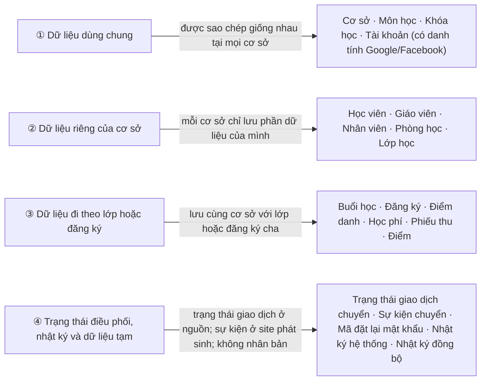
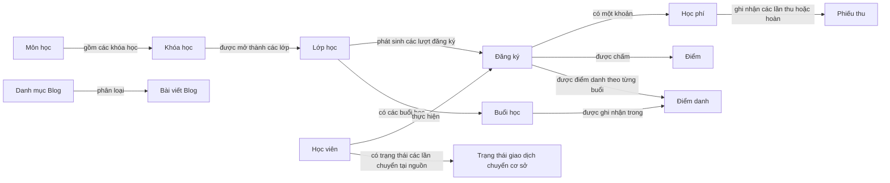

# Cấu trúc cơ sở dữ liệu

> Quản lý trung tâm đào tạo ngoại ngữ · CSDL phân tán · 3 cơ sở (Q1, Q7, TD)
>
> File này chỉ nói về **bảng, phân mảnh và ràng buộc dữ liệu**.
> Luồng nghiệp vụ và ví dụ ở [README.md](../README.md).
> DBMS đã chọn: **SQL Server**. Mỗi site là một CSDL SQL Server độc lập; file này mô tả schema logic và phân mảnh, không khẳng định các CSDL đã được cài vật lý.
> **Đổi schema → cập nhật file này trong cùng commit.**

Yêu cầu chung là **2–4 site**, có phân mảnh, replication, transaction và đồng bộ; phải chứng minh ít nhất một phương pháp phân mảnh, một phương pháp replication, một distributed transaction, một tình huống concurrency và một distributed query. Đồ án dùng 3 site Q1/Q7/TD. [Ma trận YC-01–YC-07](QLTTNN-Yeu-Cau-Chung-Va-Kiem-Chung.md) quy định minh chứng; schema là thiết kế, không tự chứng minh đã chạy các cơ chế này.

**Mục lục:** [1. Quy ước mã](#1-quy-ước-mã) · [2. Bốn kiểu bảng](#2-bốn-kiểu-bảng) · [3. Dữ liệu nằm ở đâu](#3-dữ-liệu-nằm-ở-đâu) · [4. Ràng buộc phân tán](#4-ràng-buộc-phân-tán-bắt-buộc) · [5. Quan hệ giữa các bảng](#5-các-bảng-liên-quan-với-nhau-thế-nào) · [6. Chi tiết từng bảng](#6-chi-tiết-từng-bảng) · [7. Dữ liệu mẫu](#7-dữ-liệu-mẫu-cho-các-ví-dụ)

---

## 1. Quy ước mã

Khóa chính của **bản ghi nghiệp vụ/cục bộ được tạo tại một site** có dạng **`<SITE>-<LOẠI>-<SỐ THỨ TỰ 6 CHỮ SỐ>`**, ví dụ `Q1-HV-000001`. Mã site trong khóa là nơi tạo bản ghi và không đổi khi học viên chuyển cơ sở.

Các bảng danh mục dùng chung có mã ổn định giống nhau ở mọi site: `CoSo.ma_co_so` dùng `Q1`, `Q7`, `TD`; `MonHoc.ma_mon` dùng mã như `MH-ENG`; `KhoaHoc.ma_khoa_hoc` tối đa 30 ký tự, bắt đầu bằng chữ in hoa và gồm chữ in hoa/chữ số, có thể chia thành các đoạn bằng dấu gạch nối đơn (ví dụ `FG`, `HK-TOEIC-450-550`, `ABC1-TOEIC-450-550`). Giao diện chuẩn hóa mã nhập thành chữ in hoa. Không tạo lại mã danh mục theo từng site. `TaiKhoan` vẫn dùng mã có tiền tố site tạo tài khoản và được nhân bản cùng mã đó.

| Phần | Ví dụ | Ý nghĩa |
|------|-------|---------|
| Site | `Q1`, `BT` | Mã cơ sở đã **tạo** bản ghi: 2–3 chữ cái hoặc số viết hoa, duy nhất, **không đổi** sau khi tạo (vd `BT` = Bình Thạnh) |
| Loại | `HV` | Loại đối tượng (bảng dưới) |
| Số thứ tự | `000001` | Tăng dần trong từng site, nên không trùng giữa các site |

| Loại | Đối tượng | Loại | Đối tượng |
|------|-----------|------|-----------|
| `HV` | Học viên | `HP` | Học phí |
| `GV` | Giáo viên | `PT` | Phiếu thu |
| `NV` | Nhân viên | `DM` | Điểm |
| `PH` | Phòng học | `DD` | Điểm danh |
| `LH` | Lớp học | `TK` | Tài khoản |
| `BH` | Buổi học | `NK` | Nhật ký hệ thống |
| `DK` | Đăng ký | `CC` | Chuyển cơ sở |
| `TOKEN` | Token đặt lại mật khẩu | `DB` | Nhật ký đồng bộ |
| `LS` | Sự kiện lịch sử chuyển cơ sở | | |

> ⚠️ **Tiền tố là nơi TẠO, không phải nơi HIỆN TẠI.**
> Các bản ghi không bao giờ di chuyển (lớp, đăng ký, học phí, điểm...) thì tiền tố luôn trùng site chứa nó.
> **Riêng `HocVien` có thể chuyển cơ sở**: `Q1-HV-000001` sau khi chuyển sang Q7 vẫn giữ mã đó nhưng nằm ở Q7.
> Vì vậy muốn biết học viên đang ở site nào phải xem cột `ma_co_so` của bản ghi `dang_hoc`, **không** dựa vào tiền tố.

---

## 2. Bốn kiểu bảng

| Kiểu | Nhóm (mục 3) | Ý nghĩa | Bảng |
|------|:---------------:|---------|------|
| **Nhân bản** | ① Dùng chung | Cả 3 site có bản sao **giống hệt nhau**; ghi đồng bộ theo chính sách của từng bảng | `CoSo` `MonHoc` `KhoaHoc` `TaiKhoan` (gồm danh tính Google/Facebook nếu đã liên kết) `DanhMucBlog` `BaiVietBlog` |
| **Phân mảnh nguyên thủy** | ② Riêng của cơ sở | Mỗi dòng nằm ở **đúng 1 site**, quyết định bởi cột `ma_co_so` | `HocVien` `GiaoVien` `NhanVien` `Admin` (hồ sơ Admin Small) `PhongHoc` `LopHoc` |
| **Phân mảnh dẫn xuất** | ③ Đi theo lớp / đăng ký | Dòng nằm **cùng site với dòng cha** | `BuoiHoc` `DangKy` `DiemDanh` `HocPhi` `DotHocPhi` `PhieuThu` `Diem` |
| **Cục bộ** | ④ Trạng thái điều phối, xác thực, thanh toán theo site, nhật ký và dữ liệu tạm | Không nhân bản; mỗi dòng được lưu tại site có trách nhiệm xử lý | `GiaoDichChuyenCoSo` `LichSuChuyenCoSo` `PhienDangNhap` `TokenDatLaiMatKhau` `GiaoDichDatLaiMatKhau` `YeuCauThanhToan` `SuKienThanhToan` `ThongBao` `Logs` |

Bảng nhân bản có thêm 2 cột để **đối soát** khi 3 site bị lệch: `phien_ban` (số nguyên, tăng 1 mỗi lần sửa) và `cap_nhat_luc` (thời điểm sửa gần nhất).

### Kiểm chứng phương pháp phân mảnh và nhân bản

- **YC-02 / TC-FRAG-01:** dùng `LopHoc` làm ví dụ mảnh ngang: mảnh tại site S gồm các dòng `ma_co_so = S`; `DangKy` dẫn xuất theo site của lớp cha. Đọc riêng từng DB để kiểm tra không có dòng sai site/thiếu cha; hợp kết quả tại công cụ kiểm thử hoặc API phải đúng tập lớp dự kiến, không thiếu/thừa và không trùng khóa giữa các mảnh. Không tạo JOIN/FK xuyên DB hoặc lưu hợp các mảnh vào DB trung tâm.
- Các bảng phân mảnh được định vị theo site, nhưng `HocVien` có bản lịch sử sau chuyển và có thể tạm có hai dòng vật lý `dang_hoc`. Chứng minh không giao nhau bằng mảnh lớp; thống kê học viên phải chọn bản hiện hành theo trạng thái giao dịch, không đòi xóa bản lịch sử để đạt tiêu chí.
- **YC-03 / TC-REP-01:** phương pháp tối thiểu được chọn là replication tầng ứng dụng cho `MonHoc` qua route source `PATCH /api/v1/admin/shared/subjects/{slug}/`. Source cũng có service tạo/sửa/xóa `KhoaHoc`. Mỗi DB site giữ bản riêng; mỗi cập nhật ghi ACK `Logs` trong transaction cục bộ. Seed giống nhau không phải bằng chứng replication; TC-REP-01 cần đọc từng bản sao sau thay đổi thật.
- **YC-07 / TC-SYNC-01:** lỗi được trả `complete=false`/HTTP 202 với `missing_sites`; retry cùng key và body chỉ ghi site chưa có ACK. Cùng key khác body hoặc bản sao lệch trả conflict để đối soát. Cơ chế không cần thêm bảng; kiểm tra outage qua mạng thật vẫn là bước chưa hoàn tất.
- `db/30_enforce_site_fragment_boundaries.sql` thêm 16 ràng buộc `CHECK` cho từng CSDL site để SQL Server chặn ghi nhầm mảnh. Script kiểm tra dữ liệu hiện có trước khi thêm ràng buộc, chạy riêng trên từng DB và không tạo database/bảng.

---

## 3. Dữ liệu nằm ở đâu

Mỗi cơ sở (Q1, Q7, TD) có **cùng cấu trúc bảng** nhưng **chứa dữ liệu khác nhau**. Mỗi cơ sở đều có đủ 4 nhóm dữ liệu:

**Ví dụ:**

| Dữ liệu | Có ở Q1? | Có ở Q7? | Có ở TD? |
|---------|:--------:|:--------:|:--------:|
| Khóa học "IELTS 6.5" (nhóm ①) | ✔ | ✔ | ✔ |
| Học viên Nguyễn Văn An, đang học ở Q1 (nhóm ②) | ✔ | ✘ | ✘ |
| Học phí của An (nhóm ③) | ✔ | ✘ | ✘ |

### Bảng tổng hợp

| Bảng | Kiểu | Tiêu chí phân mảnh | Vị trí |
|------|------|--------------------|--------|
| `CoSo`, `MonHoc`, `KhoaHoc`, `TaiKhoan`, `DanhMucBlog`, `BaiVietBlog` | Nhân bản theo schema | – | Tất cả site đang hoạt động (ban đầu Q1, Q7, TD) |
| `HocVien` | Nguyên thủy | `ma_co_so` (cơ sở hiện tại) | Site tương ứng |
| `GiaoVien` | Nguyên thủy | `ma_co_so` (cơ sở công tác) | Site tương ứng |
| `NhanVien` | Nguyên thủy | `ma_co_so` | Site tương ứng |
| `Admin` | Nguyên thủy | `ma_co_so` với hồ sơ Admin Small | Site được gán |
| `PhongHoc` | Nguyên thủy | `ma_co_so` | Site tương ứng |
| `LopHoc` | Nguyên thủy | `ma_co_so` | Site tương ứng |
| `BuoiHoc` | Dẫn xuất | theo `LopHoc` | Cùng site với lớp |
| `DangKy` | Dẫn xuất | theo `LopHoc` | Cùng site với lớp |
| `DiemDanh` | Dẫn xuất | theo `BuoiHoc` | Cùng site với buổi học |
| `HocPhi` | Dẫn xuất | theo `DangKy` | Cùng site với đăng ký |
| `PhieuThu` | Dẫn xuất | theo `HocPhi` | Cùng site với học phí |
| `Diem` | Dẫn xuất | theo `DangKy` | Cùng site với đăng ký |
| `DotHocPhi` | Dẫn xuất | theo `HocPhi` | Cùng site với học phí |
| `YeuCauThanhToan`, `SuKienThanhToan` | Cục bộ theo nghiệp vụ học phí | theo `HocPhi`/`CoSo` | Cùng site chứa học phí; chỉ phục vụ SePay |
| `GiaoDichChuyenCoSo` | Cục bộ | trạng thái hiện tại của một lần chuyển | Chỉ CSDL site nguồn; Coordinator cập nhật để phục hồi |
| `LichSuChuyenCoSo` | Cục bộ | sự kiện append-only của lần chuyển | Site thực hiện sự kiện (thường nguồn và đích) |
| `PhienDangNhap`, `TokenDatLaiMatKhau`, `GiaoDichDatLaiMatKhau` | Cục bộ kỹ thuật | session/OTP/ledger xác thực | Database site cấu hình `AUTH_SESSION_SITE_CODE` |
| `GiaoDichXoaHocVien` | Cục bộ kỹ thuật, legacy | dấu tiến trình cho luồng purge học viên cũ | Database site cấu hình của Coordinator; chỉ xuất hiện sau migration 22. DELETE hiện hành không dùng bảng này và không purge lịch sử |
| `ThongBao` | Cục bộ | Thông báo quản trị phát sinh tại site; Admin Big có thể yêu cầu ghi đồng bộ tới các site hoạt động | CSDL của từng site; không có bảng trung tâm |
| `Logs` | Cục bộ | audit hoặc ACK đồng bộ phát sinh tại một site | Site phát sinh; mỗi CSDL giữ log riêng |

---

## 4. Ràng buộc phân tán (BẮT BUỘC)

| # | Quy tắc | Hệ quả khi code |
|---|---------|-----------------|
| R1 | Học viên chỉ đăng ký lớp **cùng cơ sở** với mình | Muốn học cơ sở khác → phải Chuyển cơ sở trước |
| R2 | Bảng dẫn xuất luôn nằm cùng site với bảng cha | Mọi JOIN nghiệp vụ hằng ngày đều là JOIN cục bộ |
| R3 | Bảng nhân bản chỉ được sửa qua thủ tục **Ghi nhân bản** | Thiếu 1 site → **từ chối** thay đổi |
| R4 | `TaiKhoan.ten_dang_nhap` và `email` duy nhất **toàn hệ thống** | Lúc ghi phải kiểm tra lại trên mọi site đang hoạt động |
| R5 | **Không** có khóa ngoại vật lý xuyên site | Toàn vẹn xuyên site do tầng ứng dụng đảm bảo. FK tới bảng nhân bản vẫn kiểm tra cục bộ được |
| R6 | **Không** JOIN trực tiếp giữa 2 site | Cần dữ liệu nhiều site → dùng Global Query, gộp ở tầng ứng dụng |
| R7 | Đề nghị/trạng thái chuyển (`GiaoDichChuyenCoSo`) chỉ lưu tại CSDL nguồn; nhật ký (`Logs`, `LichSuChuyenCoSo`) chỉ **thêm**, không sửa/xóa trong luồng nghiệp vụ | Admin Small tạo đề nghị ở nguồn; Admin Big quyết định qua Coordinator; chỉ giao dịch đã duyệt mới chạy giữa nguồn và đích |
| R8 | Mật khẩu và token chỉ lưu **bản băm** | Không bao giờ ghi vào nhật ký, không trả ra API |
| R9 | `HocVien` là bảng **duy nhất** được di chuyển giữa các site | Chỉ di chuyển qua nghiệp vụ Chuyển cơ sở |

**YC-05 / TC-CON-01 — ràng buộc sức chứa dưới cạnh tranh:** kiểm tra lớp còn chỗ, tăng `si_so_hien_tai`, tạo `DangKy`, `HocPhi` và nhật ký phải cùng transaction tại site, có cơ chế bảo vệ cập nhật cạnh tranh. Unique đăng ký theo học viên/lớp không ngăn hai học viên khác nhau lấy chỗ cuối. Đọc lại dữ liệu sau hai phiên cạnh tranh: đúng một đăng ký/học phí mới, sĩ số tăng một và không vượt `si_so_toi_da`; giao dịch thất bại không để nghiệp vụ dở dang. Cơ chế khóa/mức cô lập/cập nhật có điều kiện phải được ghi và kiểm thử; đây không phải thay đổi cột trong đợt cập nhật tài liệu này.

**YC-04 / TC-DTX-01:** `GiaoDichChuyenCoSo` và `LichSuChuyenCoSo` hỗ trợ điều phối/phục hồi, không tự tạo transaction ACID xuyên site. Phải kiểm chứng cả nguồn và đích theo [tài liệu giao dịch](QLTTNN-Giao-Dich-Phan-Tan.md). **YC-06 / TC-DQ-01:** đọc các mảnh riêng để thống kê tại API, xử lý bản học viên hiện hành và báo site thiếu.

---

## 5. Các bảng liên quan với nhau thế nào

Sơ đồ dưới đây thể hiện các liên kết nghiệp vụ chính giữa những bảng. Bội số và quy tắc khóa được ghi cụ thể trong bảng quan hệ ngay bên dưới.

Mỗi dòng dưới đây đọc là "**một** bảng cha có **nhiều** bảng con":

| Bảng cha | Bảng con | Ý nghĩa |
|----------|----------|---------|
| Cơ sở (`CoSo`) | `HocVien` `GiaoVien` `NhanVien` `PhongHoc` `LopHoc` | Mỗi cơ sở có nhiều học viên, giáo viên, nhân viên, phòng học, lớp |
| Môn học (`MonHoc`) | `KhoaHoc` | Một môn có nhiều khóa |
| Khóa học (`KhoaHoc`) | `LopHoc` | Một khóa mở thành nhiều lớp |
| Giáo viên (`GiaoVien`) | `LopHoc` · `BuoiHoc` · `Diem` | Phụ trách lớp · dạy buổi học (kể cả dạy thay) · nhập điểm |
| Phòng học (`PhongHoc`) | `LopHoc` · `BuoiHoc` | Phòng mặc định của lớp · phòng của từng buổi |
| Tài khoản (`TaiKhoan`) | `GiaoVien` · `NhanVien` | 1 tài khoản ứng với tối đa 1 hồ sơ (có thể chưa có tài khoản) |
| Tài khoản (`TaiKhoan`) | `TokenDatLaiMatKhau` · `Logs` | Mã đặt lại mật khẩu · log liên quan đến thao tác của tài khoản |
| Cơ sở (`CoSo`) | `ThongBao` | Mỗi thông báo được lưu tại đúng CSDL site và tham chiếu cơ sở cục bộ |
| Lớp học (`LopHoc`) | `BuoiHoc` · `DangKy` | Các buổi học · các lượt đăng ký |
| Học viên (`HocVien`) | `DangKy` | Một học viên đăng ký nhiều lớp |
| Học viên (`HocVien`) | `GiaoDichChuyenCoSo` | Hồ sơ ở nguồn được tham chiếu bởi các lần chuyển; mỗi học viên tối đa một giao dịch đang xử lý tại cùng site nguồn |
| Đăng ký (`DangKy`) | `HocPhi` (1–1) · `Diem` · `DiemDanh` | Mỗi đăng ký có 1 khoản học phí, nhiều điểm, nhiều lượt điểm danh |
| Buổi học (`BuoiHoc`) | `DiemDanh` | Mỗi buổi có nhiều lượt điểm danh |
| Học phí (`HocPhi`) | `PhieuThu` | Mỗi khoản học phí có nhiều lần thu / hoàn |
| Nhân viên (`NhanVien`) | `PhieuThu` | Nhân viên là người thu tiền |

`GiaoDichChuyenCoSo` được tạo và cập nhật tại CSDL nguồn; khóa ngoại của nó chỉ tới bản `HocVien`, `CoSo` và `TaiKhoan` có ngay trong cùng CSDL đó. `LichSuChuyenCoSo` là sự kiện append-only, được ghi tại site phát sinh; `ma_chuyen` chỉ là mã tương quan giữa các CSDL, **không** có khóa ngoại tới `GiaoDichChuyenCoSo` vì bản ghi trạng thái chỉ nằm ở nguồn. Không có khóa ngoại xuyên site.

---

## 6. Chi tiết từng bảng

Ký hiệu: **PK** khóa chính · **FK** khóa ngoại · **UQ** duy nhất · *null* được để trống.

### 6.1. Danh mục (nhân bản)

**`CoSo`**

| Cột | Ràng buộc | Mô tả |
|-----|-----------|-------|
| `ma_co_so` | PK | `Q1`, `Q7`, `TD` |
| `ten_co_so` | | Tên cơ sở |
| `dia_chi`, `sdt` | | Liên hệ |
| `trang_thai` | | `chuan_bi` (đang chép dữ liệu) · `hoat_dong` · `dong_cua` (đóng cửa, vẫn giữ dữ liệu). Chi tiết ở `README.md` mục 2 |

**`MonHoc`**

| Cột | Ràng buộc | Mô tả |
|-----|-----------|-------|
| `ma_mon` | PK | |
| `ten_mon` | | Tiếng Anh, Tiếng Nhật, Tiếng Hàn... |
| `mo_ta` | | |

**`KhoaHoc`**

| Cột | Ràng buộc | Mô tả |
|-----|-----------|-------|
| `ma_khoa_hoc` | PK | |
| `ma_mon` | FK → `MonHoc` | |
| `ten_khoa_hoc` | | |
| `trinh_do` | | A1..C2 / N5..N1 / ... |
| `so_buoi` | | Tổng số buổi theo chương trình khóa học; lưu riêng, không suy ra từ số tháng |
| `thoi_luong_so` | `DECIMAL(7,2)`, nullable | Số tháng (cho phép tối đa 2 chữ số thập phân, ví dụ 3,5) hoặc số ngày nguyên |
| `thoi_luong_don_vi` | `VARCHAR(10)`, nullable | `thang` hoặc `ngay`; nếu là ngày thì số lượng phải nguyên |
| `hoc_phi_chuan` | | Số tiền |

**`DanhMucBlog` và `BaiVietBlog`**

Hai bảng có bản sao tại từng database site. Migration `36_add_blog_tables.sql` tạo cấu trúc và nạp ba bài mẫu ban đầu giống nhau; seed không phải bằng chứng replication runtime. API public đọc/đối chiếu qua `GLOBAL`; CMS Admin Big ghi qua Coordinator theo `REPLICATED-WRITE`. Mỗi site dùng transaction cục bộ; `Logs` lưu ACK và ảnh chụp trước/sau để retry an toàn. Không có transaction ACID nguyên tử xuyên database. Slug là khóa định danh liên site; khóa `IDENTITY` chỉ có ý nghĩa trong database cục bộ và không được gửi sang site khác.

| Bảng/cột | Ràng buộc | Mô tả |
|-----|-----------|-------|
| `DanhMucBlog.ma_danh_muc_blog` | PK, `BIGINT IDENTITY` | Khóa nội bộ riêng của từng database |
| `DanhMucBlog.slug` | UQ, `VARCHAR(120)` | Slug danh mục ổn định để trả qua API |
| `DanhMucBlog.ten_danh_muc` | `NVARCHAR(100)` | Tên danh mục công khai |
| `DanhMucBlog.mo_ta` | `NVARCHAR(500)`, nullable | Mô tả ngắn |
| `DanhMucBlog.trang_thai` | `hoat_dong` / `ngung` | Chỉ danh mục hoạt động được trả ra |
| `BaiVietBlog.ma_bai_viet_blog` | PK, `BIGINT IDENTITY` | Khóa nội bộ riêng của từng database |
| `BaiVietBlog.ma_danh_muc_blog` | FK → `DanhMucBlog` | Chỉ tham chiếu trong cùng database site |
| `BaiVietBlog.slug` | UQ, `VARCHAR(160)` | Slug duy nhất trong từng bản sao; API đối chiếu slug trên mọi site |
| `BaiVietBlog.tieu_de`, `tom_tat` | `NVARCHAR(200)`, `NVARCHAR(500)` | Tiêu đề và mô tả công khai |
| `BaiVietBlog.noi_dung` | `NVARCHAR(MAX)` | Lưu nguồn Markdown giới hạn dạng văn bản thường; hỗ trợ đoạn văn, tiêu đề `##`/`###`, danh sách đánh số và bảng. HTML thô không được render hoặc thực thi; không cần đổi schema |
| `BaiVietBlog.so_phut_doc` | `SMALLINT`, 1–240 | Thời lượng đọc ước tính |
| `BaiVietBlog.trang_thai` | `nhap` / `da_xuat_ban` / `an` | API chỉ đọc bài đã xuất bản và tới thời điểm xuất bản |
| `BaiVietBlog.ngay_xuat_ban_utc` | `DATETIME2(0)`, nullable | `NULL` nghĩa là bài đã xuất bản ngay; thời điểm tương lai được ẩn đến hạn |

### 6.2. Tài khoản và phương thức đăng nhập (nhân bản, dùng chung các vai trò)

**`TaiKhoan`**

| Cột | Ràng buộc | Mô tả |
|-----|-----------|-------|
| `ma_tai_khoan` | PK | Tiền tố = site tạo |
| `slug` | UQ | Định danh thân thiện của tài khoản |
| `ten_dang_nhap` | UQ | Duy nhất toàn hệ thống |
| `email` | UQ | Duy nhất toàn hệ thống |
| `mat_khau` | | Chuỗi bcrypt; không lưu mật khẩu gốc |
| `google_subject` | UQ có lọc, *null* | Google `sub` ổn định; null khi chưa liên kết Google |
| `facebook_subject` | UQ có lọc, *null* | Facebook app-scoped user ID; null khi chưa liên kết Facebook |
| `vai_tro` | | `admin_big` · `nhan_vien` · `giao_vien` · `hoc_vien` |
| `ma_co_so` | FK, *null* | `NULL` với Admin Big; bắt buộc với các vai trò còn lại |
| `trang_thai` | BIT | `1` = active · `0` = inactive |
| `bat_buoc_doi_mat_khau` | BIT | Bắt buộc đổi mật khẩu ở lần đăng nhập kế tiếp |
| `ngay_tao`, `ngay_doi_mat_khau_cuoi` | | |
| `phien_ban`, `cap_nhat_luc` | | Đối soát đồng bộ (mục 2) |
| `avatar_public_id`, `avatar_secure_url` | *null* được phép | Metadata ảnh đại diện Cloudinary; không lưu bytes ảnh trong SQL Server |

Admin Small đăng nhập bằng role `nhan_vien` và hồ sơ `Admin.loai_admin = admin_small`; không dùng `NhanVien.chuc_vu` để biểu diễn Admin Small. Nhân viên nghiệp vụ có hồ sơ `NhanVien` với chức vụ `le_tan`, `tu_van` (hiển thị “Tư vấn & xếp lớp”) hoặc `ke_toan`.

Danh tính ngoài được lưu ngay trên dòng `TaiKhoan`, không có bảng OAuth riêng. Mỗi subject có chỉ mục duy nhất riêng trong từng CSDL. Coordinator phải kiểm tra các bản sao trước khi liên kết/thu hồi subject (`REPLICATED-WRITE`). Không dùng email provider làm định danh, không tự tạo tài khoản hoặc tự liên kết theo email trùng nhau. Không lưu access token, refresh token, client secret hoặc email provider trong `TaiKhoan`; chỉ lưu metadata avatar Cloudinary nêu trên.

**`Admin` — hồ sơ quản trị tại site**

| Cột | Ràng buộc | Mô tả |
|-----|-----------|-------|
| `ma_admin` | PK | |
| `ma_tai_khoan` | FK, UQ → `TaiKhoan` | |
| `ma_co_so` | FK, *null* | Bắt buộc cho Admin Small; null cho Admin Big |
| `loai_admin` | CHECK | `admin_big` · `admin_small` |
| `ho_ten`, `sdt` | | Hồ sơ quản trị |
| `trang_thai` | BIT | Trạng thái hồ sơ |

**Phiên đăng nhập:** mỗi phiên hết hạn sau 3600 giây không có tương tác thật và có thể bị thu hồi phía server. `PhienDangNhap` lưu `ma_phien`, tài khoản/phiên bản tài khoản, `token_bam`, thời điểm tạo/hoạt động/hết hạn và thời điểm thu hồi. Bảng này là trạng thái kỹ thuật cục bộ trong database site cấu hình `AUTH_SESSION_SITE_CODE`; `DATABASES['default']` vẫn là dummy và không có database nghiệp vụ trung tâm. `SuKienDangNhap` có trong schema nền nhưng migration 26 chuyển sự kiện vào `Logs` rồi xóa bảng riêng.

### 6.3. Con người (phân mảnh)

**`HocVien`**

| Cột | Ràng buộc | Mô tả |
|-----|-----------|-------|
| `ma_hoc_vien` | PK | |
| `slug` | UQ trong từng site | Định danh hồ sơ dùng trong API; mặc định chuẩn hóa từ họ tên, cho phép chỉnh khi tạo và thêm hậu tố số nếu trùng trong site; không dùng để suy site |
| `ma_co_so` | FK | **Site chứa** bản ghi (quyết định phân mảnh) |
| `co_so_goc` | FK | Cơ sở đăng ký lần đầu, **không đổi** |
| `ma_tai_khoan` | FK, UQ có lọc, *null* | Liên kết tài khoản học viên được cấp riêng sau khi hồ sơ đủ điều kiện |
| `ho_ten`, `ngay_sinh` | | |
| `gioi_tinh` | NULL | API chuẩn hóa giá trị và chỉ chấp nhận `Nam`, `Nữ` hoặc `Khác`; trường có thể để trống |
| `sdt`, `email`, `dia_chi` | | |
| `avatar_public_id`, `avatar_secure_url` | *null* được phép | Metadata ảnh Cloudinary riêng tại site chứa hồ sơ; bytes không lưu trong SQL Server |
| `ngay_nhap_hoc` | | |
| `trang_thai` | | `dang_hoc` · `bao_luu` · `da_chuyen_di` · `nghi_hoc` |

Ảnh học viên là metadata site-local, không phải bản sao tài khoản. Luồng chuyển cơ sở chép hai trường avatar vào hồ sơ đích trong transaction cục bộ tại đích và giữ nguyên metadata nguồn. Hai hồ sơ có thể cùng tham chiếu asset Cloudinary; vì chưa có sổ tham chiếu toàn site, thay ảnh hoặc xóa hồ sơ không tự xóa asset cũ.

**`GiaoVien`**

| Cột | Ràng buộc | Mô tả |
|-----|-----------|-------|
| `ma_giao_vien` | PK | |
| `ma_co_so` | FK | Cơ sở công tác |
| `ma_tai_khoan` | FK, UQ, *null* | → `TaiKhoan` |
| `ho_ten`, `sdt`, `email`, `chuyen_mon` | | |
| `trang_thai` | | `dang_day` · `tam_nghi` · `nghi_viec` |

**`NhanVien`**

| Cột | Ràng buộc | Mô tả |
|-----|-----------|-------|
| `ma_nhan_vien` | PK | |
| `ma_co_so` | FK | |
| `ma_tai_khoan` | FK, UQ, *null* | → `TaiKhoan` |
| `ho_ten`, `sdt`, `email` | | |
| `chuc_vu` | | `le_tan` · `tu_van` (tư vấn và xếp lớp) · `ke_toan` |
| `trang_thai` | | `dang_lam` · `nghi_viec` |

Trong API quản lý nhân viên, `NhanVien` là mảnh ngang nằm tại site công tác. Họ tên, điện thoại và chức vụ là hồ sơ cục bộ; `email` được ghi cùng lúc tạo hồ sơ nhưng danh tính đăng nhập chuẩn (email/tên đăng nhập) nằm ở `TaiKhoan` đã nhân bản. Ảnh dùng `TaiKhoan.avatar_public_id` và `avatar_secure_url`; bytes nằm trên Cloudinary và metadata được đồng bộ cùng tài khoản. API sửa hồ sơ không cho đổi email/tên đăng nhập hoặc `ma_co_so`; cần một luồng đồng bộ danh tính/điều chuyển riêng nếu nghiệp vụ đó được duyệt. Trạng thái đăng nhập `TaiKhoan.trang_thai` độc lập với trạng thái công việc `NhanVien.trang_thai`; endpoint nhân viên chỉ chuyển `active` → `inactive` và thu hồi phiên, không có kích hoạt lại. Mật khẩu chỉ được gửi sau thao tác của Admin Big/Admin Small; các trạng thái `employee_credential_email_*` được ghi vào `Logs` tại site hồ sơ để khóa gửi trùng/không rõ kết quả, không cần thêm bảng hoặc cột. Khi xóa vĩnh viễn tài khoản, xóa hồ sơ `NhanVien` nếu không có phiếu thu tham chiếu; nếu có `PhieuThu`, đặt `ma_tai_khoan=NULL`, `trang_thai=nghi_viec` và giữ hồ sơ để bảo toàn khóa ngoại/chứng từ. Danh sách quản lý chỉ hiển thị hồ sơ còn gắn tài khoản. `Logs` và phiếu thu không bị xóa. Migration 37 chuyển dữ liệu `xep_lop` cũ thành `tu_van`; không thêm bảng/cột cho ảnh nhân viên.

### 6.4. Lớp học

**`PhongHoc`** (phân mảnh)

| Cột | Ràng buộc | Mô tả |
|-----|-----------|-------|
| `ma_phong` | PK | |
| `ma_co_so` | FK | |
| `ten_phong`, `suc_chua` | | |
| `trang_thai` | | `hoat_dong` · `bao_tri` |

**`LopHoc`** (phân mảnh)

| Cột | Ràng buộc | Mô tả |
|-----|-----------|-------|
| `ma_lop` | PK | |
| `ma_co_so` | FK | |
| `ma_khoa_hoc` | FK → `KhoaHoc` | |
| `ma_giao_vien` | FK → `GiaoVien` | Cùng site |
| `ma_phong` | FK → `PhongHoc` | Phòng mặc định |
| `ten_lop` | | |
| `si_so_toi_da`, `si_so_hien_tai` | | |
| `ngay_khai_giang`, `ngay_ket_thuc` | | |
| `lich_hoc` | | Mẫu lặp, vd `T2-T4-T6` |
| `gio_bat_dau`, `gio_ket_thuc` | | |
| `trang_thai` | | `sap_mo` · `dang_hoc` · `ket_thuc` · `huy` |

> `lich_hoc` + giờ chỉ là **mẫu** để sinh ra các dòng `BuoiHoc` khi mở lớp.

**`BuoiHoc`** (dẫn xuất, cha: `LopHoc`)

| Cột | Ràng buộc | Mô tả |
|-----|-----------|-------|
| `ma_buoi` | PK | |
| `ma_co_so` | FK → `CoSo` | Site lấy từ lớp cha; dùng kiểm tra khóa ngoại cùng site |
| `ma_lop` | FK → `LopHoc` | |
| `so_thu_tu` | | Buổi thứ mấy của khóa |
| `ngay_hoc`, `gio_bat_dau`, `gio_ket_thuc` | | |
| `ma_phong` | FK → `PhongHoc` | |
| `ma_giao_vien` | FK → `GiaoVien` | Người dạy **thực tế** (cho phép dạy thay) |
| `trang_thai` | | `du_kien` · `da_hoc` · `nghi` · `doi_lich` |
| `ghi_chu` | | |

### 6.5. Đăng ký, học phí, điểm (dẫn xuất)

**`DangKy`** (cha: `LopHoc`)

| Cột | Ràng buộc | Mô tả |
|-----|-----------|-------|
| `ma_dang_ky` | PK | |
| `ma_co_so` | FK → `CoSo` | Site lấy từ lớp; phải trùng site của học viên và lớp |
| `ma_hoc_vien` | FK → `HocVien` | Cùng site |
| `ma_lop` | FK → `LopHoc` | |
| `ngay_dang_ky` | | |
| `trang_thai` | | Xem bảng dưới |
| | UQ (`ma_hoc_vien`, `ma_lop`) | Mỗi học viên chỉ đăng ký 1 lần / lớp |

| `trang_thai` | Ý nghĩa |
|--------------|---------|
| `da_dang_ky` | Lớp chưa khai giảng |
| `dang_hoc` | Lớp đã khai giảng |
| `hoan_thanh` | Học xong |
| `huy` | Hủy đăng ký |
| `chuyen_di` | Bị đóng do chuyển cơ sở |

**`HocPhi`** (cha: `DangKy`) – *một dòng cho mỗi đăng ký*

| Cột | Ràng buộc | Mô tả |
|-----|-----------|-------|
| `ma_hoc_phi` | PK | |
| `ma_co_so` | FK → `CoSo` | Site lấy từ đăng ký cha; dùng kiểm tra khóa ngoại cùng site |
| `ma_dang_ky` | FK, UQ → `DangKy` | |
| `so_tien_phai_dong` | | `hoc_phi_chuan − giam_gia` |
| `giam_gia` | | |
| `so_tien_da_dong` | | Cộng dồn từ `PhieuThu` |
| `trang_thai` | | `chua_dong` · `dong_mot_phan` · `da_dong` · `hoan_tien` |

**`PhieuThu`** (cha: `HocPhi`) – *một dòng cho mỗi lần thu hoặc hoàn tiền*

| Cột | Ràng buộc | Mô tả |
|-----|-----------|-------|
| `ma_phieu` | PK | |
| `ma_co_so` | FK → `CoSo` | Site lấy từ học phí cha; người thu phải thuộc site này |
| `ma_hoc_phi` | FK → `HocPhi` | |
| `loai` | | `thu` · `hoan` |
| `so_tien` | | Luôn > 0; dấu do `loai` quyết định |
| `hinh_thuc` | | `tien_mat` · `chuyen_khoan` · `the` |
| `ngay_thu` | | |
| `ma_nhan_vien` | FK → `NhanVien` | Người thu |
| `ma_yeu_cau` | FK ghép, *null* → `YeuCauThanhToan` | Chỉ có khi phiếu được tạo từ thanh toán SePay; thu tại quầy để trống |
| `ghi_chu` | | |

**`DotHocPhi`** (cha: `HocPhi`) là các kỳ thu phí được lưu cùng site với khoản học phí. Có mã kỳ, mã site, thứ tự kỳ, ngày đến hạn, số phải thu, số đã thu và trạng thái `chua_dong`/`dong_mot_phan`/`da_dong`.

**`YeuCauThanhToan`** — yêu cầu SePay lưu tại database đang giữ `HocPhi`; không có database thanh toán trung tâm.

| Cột | Ràng buộc | Mô tả |
|-----|-----------|-------|
| `ma_yeu_cau` | PK | Mã yêu cầu |
| `ma_co_so`, `ma_hoc_phi`, `ma_dot_hoc_phi` | FK | Cùng site với khoản học phí và kỳ đóng |
| `ma_tai_khoan` | FK → `TaiKhoan` | Tài khoản yêu cầu thanh toán |
| `so_tien` | CHECK > 0 | Do API lấy từ dữ liệu học phí |
| `ma_tham_chieu` | UQ | Mã tham chiếu gửi qua SePay |
| `khoa_idempotency` | UQ | Chống tạo trùng yêu cầu thanh toán |
| `trang_thai` | CHECK | `cho_thanh_toan` · `da_thanh_toan` · `het_han` · `can_doi_soat` · `da_huy` |
| `tao_luc_utc`, `het_han_utc`, `cap_nhat_luc_utc`, `thanh_toan_luc_utc` | | Mốc thời gian xử lý |

**`SuKienThanhToan`** — sự kiện SePay theo site, có unique `ma_giao_dich_sepay` và trigger append-only. Lưu mã yêu cầu/tham chiếu, số tiền, tài khoản nhận, tham chiếu ngân hàng, thời điểm giao dịch/nhận và kết quả (`da_ghi_nhan`, `can_doi_soat`, `khong_tim_thay`); không lưu secret, chữ ký hay payload thô.

**`Diem`** (cha: `DangKy`)

| Cột | Ràng buộc | Mô tả |
|-----|-----------|-------|
| `ma_diem` | PK | |
| `ma_co_so` | FK → `CoSo` | Site lấy từ đăng ký cha; giáo viên nhập điểm phải thuộc site này |
| `ma_dang_ky` | FK → `DangKy` | |
| `loai_diem` | | `giua_ky` · `cuoi_ky` · `nghe` · `noi` · `doc` · `viet` |
| `diem_so` | | 0 – 10 |
| `ngay_nhap` | | |
| `ma_giao_vien_nhap` | FK → `GiaoVien` | |
| | UQ (`ma_dang_ky`, `loai_diem`) | Mỗi loại điểm 1 dòng |

**`DiemDanh`** (cha: `BuoiHoc`)

| Cột | Ràng buộc | Mô tả |
|-----|-----------|-------|
| `ma_diem_danh` | PK | |
| `ma_co_so` | FK → `CoSo` | Site lấy từ buổi học; buổi học và đăng ký phải cùng site |
| `ma_buoi` | FK → `BuoiHoc` | |
| `ma_dang_ky` | FK → `DangKy` | |
| `trang_thai` | | `co_mat` · `tre` · `vang_co_phep` · `vang_khong_phep` |
| `ghi_chu` | | |
| `ma_tai_khoan_ghi` | Mã tài khoản lịch sử, không FK | Người ghi; giữ được dấu vết khi tài khoản bị xóa |
| | UQ (`ma_buoi`, `ma_dang_ky`) | |

### 6.6. Log và bảo mật (cục bộ)

**`ThongBao`** — thông báo quản trị lưu riêng tại từng CSDL site. Không có bảng trung tâm và không lưu trạng thái từng người đã đọc.

| Cột | Ràng buộc | Mô tả |
|-----|-----------|-------|
| `slug` | PK | Mã thông báo ổn định trong site |
| `event_key` | UQ | Khóa idempotency sự kiện trong site; retry không tạo bản ghi trùng |
| `ma_co_so` | FK → `CoSo` cục bộ | Site phát sinh thông báo |
| `danh_muc` | CHECK | `system`, `tuition`, `account`, `teacher`, `enrollment`, `class`, `grade`, `transfer`, `payment`, `security` |
| `muc_do` | CHECK | `info`, `success`, `warning`, `critical` |
| `doi_tuong` | CHECK | `admin_all`, `admin_big`, `admin_small` |
| `tieu_de`, `noi_dung` | | Tối đa 160 và 500 ký tự |
| `duong_dan` | *null* được phép | Chỉ là đường dẫn nội bộ trong khu vực admin |
| `tao_luc_utc` | mặc định UTC | Thời điểm tạo thông báo |

Admin Small chỉ ghi tại site được gán. Admin Big gửi cùng sự kiện qua các site đang hoạt động theo `REPLICATED-WRITE`; mỗi site ghi `ThongBao` và `Logs` trong transaction cục bộ. Khi có site thiếu, API báo rõ và cho retry cùng key; đây không phải transaction ACID xuyên site. Migration `db/26_consolidate_logs_and_remove_notification_reads.sql` đã bỏ bảng `TrangThaiDocThongBao`; không theo dõi ai đã đọc.

**`GiaoDichChuyenCoSo`** — đề nghị, quyết định duyệt/từ chối và trạng thái hiện tại; mỗi lần chuyển chỉ có một dòng ở CSDL nguồn. Đây là bảng trạng thái cập nhật được, không phải nhật ký append-only.

| Cột | Ràng buộc | Mô tả |
|-----|-----------|-------|
| `ma_chuyen` | PK | Mã giao dịch dạng `<SITE>-CC-000001`; tạo tại nguồn |
| `ma_hoc_vien`, `co_so_nguon` | FK ghép → `HocVien` tại nguồn | Hồ sơ cần chuyển và site đang giữ bản `dang_hoc` |
| `co_so_dich` | FK → `CoSo` | Site đích; phải khác site nguồn |
| `trang_thai` | | `cho_duyet` · `dang_xu_ly` · `tu_choi` · `hoan_tat` · `that_bai` |
| `buoc_cuoi` | | `cho_duyet` · `da_tiep_nhan` · `da_tao_ho_so_dich` · `da_cap_nhat_nguon` · `hoan_tat` · `tu_choi` |
| `khoa_chong_lap` | UQ nếu khác *null* | Khóa idempotency của API; gửi lại cùng yêu cầu không tạo đề nghị thứ hai |
| `ma_tai_khoan_de_nghi` | Mã tài khoản lịch sử, không FK | Admin Small gửi đề nghị; API xác minh tài khoản và site tại thời điểm thao tác |
| `ly_do_de_nghi` | | Lý do do Admin Small nhập; không chứa bí mật hoặc dữ liệu không cần thiết |
| `ma_tai_khoan_quyet_dinh` | Mã tài khoản lịch sử, *null* khi chờ duyệt, không FK | Admin Big đã duyệt hoặc từ chối |
| `ngay_tao`, `ngay_quyet_dinh`, `cap_nhat_luc` | | Thời điểm gửi đề nghị, quyết định và cập nhật trạng thái |
| `ly_do_tu_choi` | *null* trừ khi `tu_choi` | Admin Big phải ghi lý do khi từ chối |
| `khoa_chong_trung_chuyen` | Cột tính toán; UQ | Khi đang mở, khóa là `HV:<ma_hoc_vien>`; khi đã kết thúc, khóa là `CC:<ma_chuyen>`. Unique index ngăn hai đề nghị/giao dịch mở cho cùng học viên mà không cần index lọc trên cột tính toán |
| `loi_cuoi` | *null* | Lỗi gần nhất để điều tra/phục hồi; không chứa mật khẩu, token hay bí mật kết nối |
| `phien_ban` | `rowversion` | Phát hiện hai yêu cầu đồng thời sửa cùng trạng thái |

Admin Small gửi đề nghị bằng tài khoản thuộc site nguồn; API tự lấy nguồn từ phạm vi tài khoản, không nhận nguồn do trình duyệt tự chọn. Khi tạo đề nghị, trạng thái là `cho_duyet`, bước là `cho_duyet`, chưa tạo hồ sơ ở đích và học viên vẫn `dang_hoc` tại nguồn. Admin Big xem hộp thư bằng Global Query: Django hỏi các CSDL site riêng rồi tổng hợp tại ứng dụng; không có database trung tâm hay bảng đề nghị trung tâm. Site lỗi khiến hộp thư được đánh dấu chưa đầy đủ.

Khi duyệt, API định tuyến về CSDL nguồn và kiểm tra lại trạng thái học viên, công nợ, cơ sở đích đang hoạt động, kết nối hai site và không có yêu cầu mở khác. Nếu hợp lệ, tại nguồn chuyển sang `dang_xu_ly / da_tiep_nhan`, lưu người/thời điểm quyết định và ghi sự kiện `duyet` trong cùng transaction cục bộ. Khi từ chối, lưu `tu_choi`, người/thời điểm, lý do và sự kiện `tu_choi`; hồ sơ học viên không đổi. Những trường hợp chờ duyệt được phép phát sinh thay đổi nghiệp vụ tại nguồn, do đó việc xác nhận lại điều kiện khi duyệt là bắt buộc.

`GiaoDichChuyenCoSo` là nguồn trạng thái chuẩn cho Coordinator. Chỉ dòng `dang_xu_ly` đủ điều kiện chạy; dòng `cho_duyet` không được chuyển. Source hiện thực hiện qua quyết định của Admin Big và có route retry; worker/lịch chạy nền tự động chưa được xác nhận. Khi ứng dụng dừng, Coordinator cần đối chiếu trạng thái nguồn với hồ sơ/sự kiện tại hai site rồi phục hồi. Lỗi nghiệp vụ dứt điểm trước khi hồ sơ đích commit có thể kết thúc `that_bai` và giữ nguyên nguồn; lỗi kết nối tạm thời được retry. Sau khi đích đã commit, giao dịch phải tiếp tục tiến về phía trước, không xóa hồ sơ đích.

**`LichSuChuyenCoSo`**

| Cột | Ràng buộc | Mô tả |
|-----|-----------|-------|
| `ma_su_kien` | PK | Mã sự kiện dạng `<SITE>-LS-000001`, cấp tại site ghi sự kiện |
| `ma_chuyen` | Mã tương quan, không FK | Cùng mã giao dịch ở site nguồn và đích; có thể lặp qua nhiều sự kiện |
| `ma_hoc_vien` | | Học viên của giao dịch |
| `co_so_nguon`, `co_so_dich` | FK → `CoSo` cục bộ | Hai site của giao dịch |
| `site_ghi` | FK → `CoSo` cục bộ | CSDL site đã ghi sự kiện |
| `su_kien` | | `de_nghi` · `duyet` · `tu_choi` · `tao_ho_so_dich` · `xac_nhan_ho_so_dich` · `cap_nhat_ho_so_nguon` · `hoan_tat` · `that_bai` · `phuc_hoi` |
| `thoi_diem` | | Thời điểm ghi sự kiện |
| `ma_tai_khoan_thuc_hien` | Mã tài khoản lịch sử, *null*, không FK | Tài khoản thao tác nếu xác định được |
| `chi_tiet` | *null* | Chi tiết không nhạy cảm, không ghi mật khẩu/token/credential |

Sự kiện được thêm tại site nơi hành động xảy ra. `de_nghi`, `duyet` và `tu_choi` được ghi ở nguồn; `tao_ho_so_dich` ghi cùng transaction cục bộ với hồ sơ tại đích; sau khi xác nhận commit đích, nguồn ghi `xac_nhan_ho_so_dich`; sự kiện cập nhật nguồn ghi tại nguồn. Bảng này không được UPDATE/DELETE; trạng thái hiện tại chỉ nằm trong `GiaoDichChuyenCoSo`.

**`TokenDatLaiMatKhau`**

| Cột | Ràng buộc | Mô tả |
|-----|-----------|-------|
| `ma_token` | PK | Có tiền tố site nhận yêu cầu |
| `ma_tai_khoan` | FK → `TaiKhoan` | |
| `token_bam` | | **Chỉ lưu bản băm** của token gửi cho người dùng |
| `ngay_tao`, `het_han` | | |
| `da_dung` | | `true` / `false` |
| `ip_yeu_cau` | | |

Source dùng bảng này cho OTP reset mật khẩu quản trị: mã 6 số chỉ lưu dạng hash, một lần, hạn mặc định 120 giây. `SuKienQuenMatKhau` có trong schema nền nhưng migration 26 chuyển sự kiện sang `Logs` rồi xóa bảng.

**`GiaoDichDatLaiMatKhau`** lưu tiến trình cập nhật mật khẩu nhân bản để API có thể phục hồi khi một site lỗi giữa chừng. Các trường chính: `ma_giao_dich`, `ma_tai_khoan`, `mat_khau_moi_bam` chỉ khi `dang_xu_ly`, trạng thái `dang_xu_ly`/`hoan_tat` và mốc tạo/cập nhật/hoàn tất. Đây là trạng thái kỹ thuật ở database cấu hình `AUTH_SESSION_SITE_CODE`; không phải giao dịch ACID xuyên các database site.

**`Logs`** (schema sau migration `db/26_consolidate_logs_and_remove_notification_reads.sql`)

| Cột | Ràng buộc | Mô tả |
|-----|-----------|-------|
| `ma_log` | PK | Mã log duy nhất trong site; với replication môn học là mã xác định từ key/site |
| `loai_log` | CHECK | `login` · `password_reset` · `system` · `sync` |
| `thoi_diem_utc` | mặc định UTC | Thời điểm ghi log |
| `ma_co_so`, `ma_tai_khoan` | *null* được phép | Site phát sinh và tài khoản liên quan; không dùng để liên kết xuyên DB |
| `hanh_dong`, `bang_tac_dong`, `ma_ban_ghi` | | Hành động, bảng và mã bản ghi |
| `du_lieu_cu`, `du_lieu_moi` | JSON, *null* được phép | Thông tin tối thiểu để audit/ACK; **không** chứa mật khẩu, hash mật khẩu, token hay bí mật |
| `ip`, `dinh_danh_bam`, `ip_bam`, `ma_token` | *null* được phép | Metadata bảo mật theo loại log; chỉ lưu digest phù hợp, không lưu token gốc |
| `ket_qua`, `site_dich` | CHECK / *null* | `thanh_cong` · `that_bai`; site ACK đích khi `loai_log='sync'` |
| `ghi_chu`, `thong_bao_loi` | *null* được phép | Ghi chú/lỗi đã lọc dữ liệu nhạy cảm |

| Nhóm `hanh_dong` | Giá trị |
|------------------|---------|
| Tài khoản | `dang_nhap` `dang_nhap_that_bai` `dang_xuat` `yeu_cau_quen_mat_khau` `dat_lai_mat_khau` `doi_mat_khau` `tao_tai_khoan` `khoa_tai_khoan` |
| Nghiệp vụ | `dang_ky_khoa_hoc` `xep_lop` `huy_dang_ky` `dong_hoc_phi` `hoan_hoc_phi` `nhap_diem` `sua_diem` `diem_danh` `mo_lop` `doi_lich_buoi_hoc` |
| Hệ thống | `chuyen_co_so` `sua_danh_muc` |

`db/26_consolidate_logs_and_remove_notification_reads.sql` gộp log hệ thống, đăng nhập, quên mật khẩu và đồng bộ vào `Logs`; sau migration, `NhatKyHeThong` và `NhatKyDongBo` không còn là bảng runtime. Trigger append-only chặn UPDATE; DELETE chỉ được phép trong luồng purge legacy có bật cờ phiên. CRUD học viên hiện hành không xóa `Logs`.

**Xóa vĩnh viễn Admin Small:** Admin Big có thể xóa vật lý dòng `Admin`, các bản sao `TaiKhoan`, phiên, token/giao dịch đặt lại mật khẩu còn gắn tài khoản và ảnh Cloudinary. Chạy `db/32_allow_admin_small_hard_delete.sql` riêng tại từng site trước khi bật thao tác này. Migration bỏ FK tới `TaiKhoan` ở các cột người thao tác của `GiaoDichChuyenCoSo`, `LichSuChuyenCoSo`, `DiemDanh` và bảng log cũ để giữ nguyên mã người thao tác trong lịch sử; không xóa các dòng lịch sử. FK `YeuCauThanhToan_TaiKhoan` vẫn được giữ; nếu còn yêu cầu thanh toán tham chiếu tài khoản thì API từ chối xóa. Hồ sơ `HocVien`/`GiaoVien`/`NhanVien` hoặc giao dịch chuyển cơ sở đang mở cũng khiến thao tác bị từ chối. Mỗi site commit độc lập, có dấu retry trong `Logs`; đây là `REPLICATED-WRITE`, không phải ACID xuyên CSDL.

Với `MonHoc`, mỗi site ghi một dòng `Logs` có `loai_log='sync'`, `bang_tac_dong='MonHoc'`, `ma_ban_ghi`, `site_dich`, `ket_qua='thanh_cong'`, JSON trước/sau và tài khoản Admin Big. `ma_log` xác định theo khóa idempotency và site. Dòng ACK và cập nhật `MonHoc` nằm trong cùng transaction cục bộ, nên một site không thể có ACK thành công nếu update ở site đó rollback. `Logs` là nơi ghi ACK của từng bản sao, không phải database trung tâm.

---

## 7. Dữ liệu mẫu cho các ví dụ

> Chỉ để minh họa luồng trong `README.md`. Dữ liệu thật phải lấy từ CSDL, **không hard-code vào code**.

### Danh mục và tài khoản (nhân bản – có ở cả 3 site)

| Bảng | Mã | Nội dung |
|------|----|----------|
| `CoSo` | `Q1` · `Q7` · `TD` | Cơ sở Quận 1 · Quận 7 · Thủ Đức |
| `KhoaHoc` | `KH-IELTS-65` | "IELTS 6.5" · 24 buổi · học phí chuẩn **12.000.000** |
| `KhoaHoc` | `KH-JP-N5` | "Tiếng Nhật N5" · 30 buổi · học phí chuẩn **6.000.000** |
| `TaiKhoan` | `Q1-TK-000001` | `admin.tong` · admin · `ma_co_so = NULL` |
| `TaiKhoan` | `Q1-TK-000004` | `lan.le` · nhân viên · Q1 (lễ tân) |
| `TaiKhoan` | `Q1-TK-000005` | `minh.kt` · nhân viên · Q1 (kế toán) |
| `TaiKhoan` | `Q1-TK-000007` | `ha.pham` · giáo viên · Q1 · `ha.pham@example.com` |

### Site Q1

| Bảng | Mã | Nội dung |
|------|----|----------|
| `NhanVien` | `Q1-NV-000001` | Lê Thị Lan · lễ tân · tài khoản `Q1-TK-000004` |
| `NhanVien` | `Q1-NV-000002` | Đỗ Quang Minh · kế toán · tài khoản `Q1-TK-000005` |
| `GiaoVien` | `Q1-GV-000003` | Phạm Thu Hà · tài khoản `Q1-TK-000007` |
| `GiaoVien` | `Q1-GV-000004` | Ngô Bảo Châu |
| `PhongHoc` | `Q1-PH-02`, `Q1-PH-03` | Phòng 02, Phòng 03 (20 chỗ) |
| `HocVien` | `Q1-HV-000001` | Nguyễn Văn An |
| `HocVien` | `Q1-HV-000002` | Trần Thị Bình |
| `LopHoc` | `Q1-LH-000005` | IELTS 6.5 · **Sáng** T2-4-6 · 08:00–10:00 · GV Hà · phòng `Q1-PH-02` · sĩ số **19/20** |
| `LopHoc` | `Q1-LH-000006` | IELTS 6.5 · **Chiều** T3-5-7 · 14:00–16:00 · GV Châu · sĩ số **20/20 (đầy)** |
| `LopHoc` | `Q1-LH-000007` | IELTS 6.5 · **Tối** T3-5-7 · 18:30–20:30 · GV Hà · phòng `Q1-PH-03` · sĩ số **12/20** |

### Site Q7 và TD

| Site | Bảng | Mã | Nội dung |
|------|------|----|----------|
| Q7 | `HocVien` | `Q7-HV-000001` | Lê Minh Cường |
| Q7 | `LopHoc` | `Q7-LH-000002` | IELTS 6.5 Tối · sĩ số 10/20 |
| TD | – | – | Chưa có dữ liệu mẫu |
