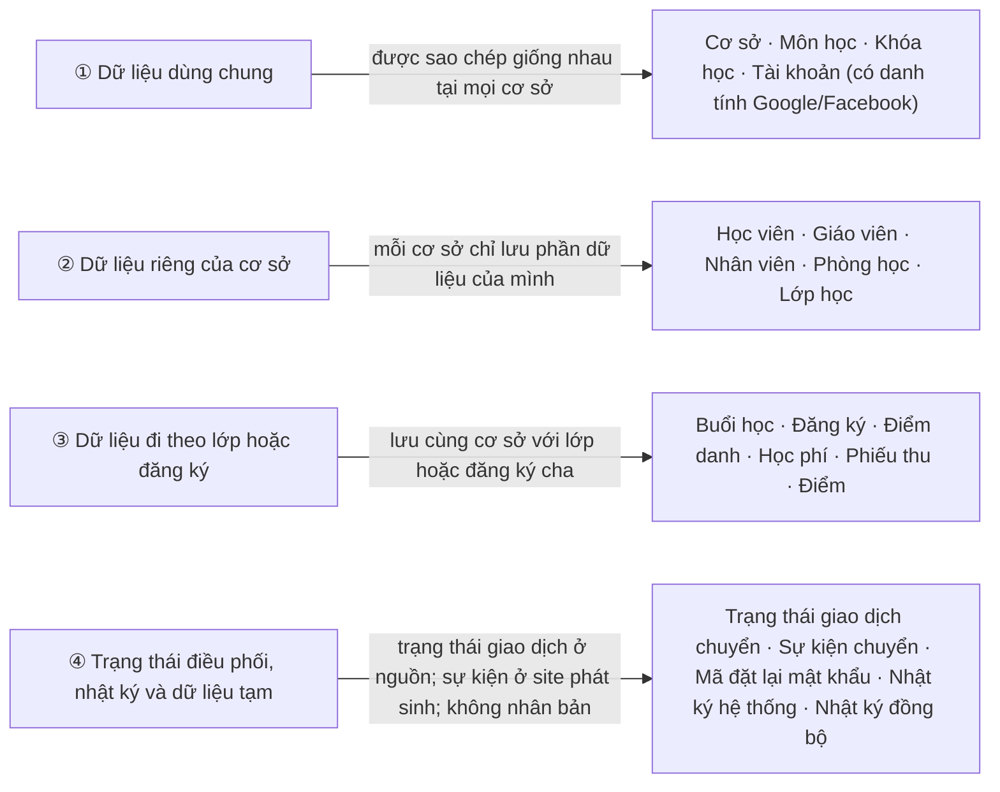
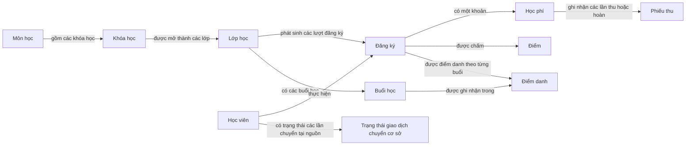

# Cấu trúc cơ sở dữ liệu

> Quản lý trung tâm đào tạo ngoại ngữ · CSDL phân tán · 3 cơ sở (Q1, Q7, TD)
>
> File này chỉ nói về **bảng, phân mảnh và ràng buộc dữ liệu**.
> Luồng nghiệp vụ và ví dụ ở [README.md](../README.md).
> DBMS đã chọn: **SQL Server**. Mỗi site là một CSDL SQL Server độc lập; file này mô tả schema logic và phân mảnh, không khẳng định các CSDL đã được cài vật lý.
> **Đổi schema → cập nhật file này trong cùng commit.**

Yêu cầu chung là **2–4 site**, có phân mảnh, replication, transaction và đồng bộ; phải chứng minh ít nhất một phương pháp phân mảnh, một phương pháp replication, một distributed transaction, một tình huống concurrency và một distributed query. Đồ án dùng 3 site Q1/Q7/TD. [Ma trận YC-01–YC-07](QLTTNN-Yeu-Cau-Chung-Va-Kiem-Chung.md) quy định minh chứng; schema là thiết kế, không tự chứng minh đã chạy các cơ chế này.

**Mục lục:** [1. Quy ước mã](#1-quy-ước-mã) · [2. Bốn kiểu bảng](#2-bốn-kiểu-bảng) · [3. Dữ liệu nằm ở đâu](#3-dữ-liệu-nằm-ở-đâu) · [4. Ràng buộc phân tán](#4-ràng-buộc-phân-tán-bắt-buộc) · [5. Quan hệ giữa các bảng](#5-các-bảng-liên-quan-với-nhau-thế-nào) · [6. Chi tiết từng bảng](#6-chi-tiết-từng-bảng) · [7. Dữ liệu mẫu](#7-dữ-liệu-mẫu-cho-các-ví-dụ)

---

## 1. Quy ước mã

Khóa chính của **bản ghi nghiệp vụ/cục bộ được tạo tại một site** có dạng **`<SITE>-<LOẠI>-<SỐ THỨ TỰ 6 CHỮ SỐ>`**, ví dụ `Q1-HV-000001`. Mã site trong khóa là nơi tạo bản ghi và không đổi khi học viên chuyển cơ sở.

Các bảng danh mục dùng chung có mã ổn định giống nhau ở mọi site: `CoSo.ma_co_so` dùng `Q1`, `Q7`, `TD`; `MonHoc.ma_mon` và `KhoaHoc.ma_khoa_hoc` dùng mã danh mục như `MH-ENG`, `KH-IELTS-65`. Không tạo lại mã danh mục theo từng site. `TaiKhoan` vẫn dùng mã có tiền tố site tạo tài khoản và được nhân bản cùng mã đó.

| Phần | Ví dụ | Ý nghĩa |
|------|-------|---------|
| Site | `Q1`, `BT` | Mã cơ sở đã **tạo** bản ghi: 2–3 chữ cái hoặc số viết hoa, duy nhất, **không đổi** sau khi tạo (vd `BT` = Bình Thạnh) |
| Loại | `HV` | Loại đối tượng (bảng dưới) |
| Số thứ tự | `000001` | Tăng dần trong từng site, nên không trùng giữa các site |

| Loại | Đối tượng | Loại | Đối tượng |
|------|-----------|------|-----------|
| `HV` | Học viên | `HP` | Học phí |
| `GV` | Giáo viên | `PT` | Phiếu thu |
| `NV` | Nhân viên | `DM` | Điểm |
| `PH` | Phòng học | `DD` | Điểm danh |
| `LH` | Lớp học | `TK` | Tài khoản |
| `BH` | Buổi học | `NK` | Nhật ký hệ thống |
| `DK` | Đăng ký | `CC` | Chuyển cơ sở |
| `TOKEN` | Token đặt lại mật khẩu | `DB` | Nhật ký đồng bộ |
| `LS` | Sự kiện lịch sử chuyển cơ sở | | |

> ⚠️ **Tiền tố là nơi TẠO, không phải nơi HIỆN TẠI.**
> Các bản ghi không bao giờ di chuyển (lớp, đăng ký, học phí, điểm...) thì tiền tố luôn trùng site chứa nó.
> **Riêng `HocVien` có thể chuyển cơ sở**: `Q1-HV-000001` sau khi chuyển sang Q7 vẫn giữ mã đó nhưng nằm ở Q7.
> Vì vậy muốn biết học viên đang ở site nào phải xem cột `ma_co_so` của bản ghi `dang_hoc`, **không** dựa vào tiền tố.

---

## 2. Bốn kiểu bảng

| Kiểu | Nhóm (mục 3) | Ý nghĩa | Bảng |
|------|:---------------:|---------|------|
| **Nhân bản** | ① Dùng chung | Cả 3 site có bản sao **giống hệt nhau**; ghi đồng bộ | `CoSo` `MonHoc` `KhoaHoc` `TaiKhoan` (gồm danh tính Google/Facebook nếu đã liên kết) |
| **Phân mảnh nguyên thủy** | ② Riêng của cơ sở | Mỗi dòng nằm ở **đúng 1 site**, quyết định bởi cột `ma_co_so` | `HocVien` `GiaoVien` `NhanVien` `PhongHoc` `LopHoc` |
| **Phân mảnh dẫn xuất** | ③ Đi theo lớp / đăng ký | Dòng nằm **cùng site với dòng cha** | `BuoiHoc` `DangKy` `DiemDanh` `HocPhi` `PhieuThu` `Diem` |
| **Cục bộ** | ④ Trạng thái điều phối, nhật ký và dữ liệu tạm | Không nhân bản; mỗi dòng được lưu tại site có trách nhiệm xử lý | `GiaoDichChuyenCoSo` `LichSuChuyenCoSo` `TokenDatLaiMatKhau` `NhatKyHeThong` `NhatKyDongBo` |

Bảng nhân bản có thêm 2 cột để **đối soát** khi 3 site bị lệch: `phien_ban` (số nguyên, tăng 1 mỗi lần sửa) và `cap_nhat_luc` (thời điểm sửa gần nhất).

### Kiểm chứng phương pháp phân mảnh và nhân bản

- **YC-02 / TC-FRAG-01:** dùng `LopHoc` làm ví dụ mảnh ngang: mảnh tại site S gồm các dòng `ma_co_so = S`; `DangKy` dẫn xuất theo site của lớp cha. Đọc riêng từng DB để kiểm tra không có dòng sai site/thiếu cha; hợp kết quả tại công cụ kiểm thử hoặc API phải đúng tập lớp dự kiến, không thiếu/thừa và không trùng khóa giữa các mảnh. Không tạo JOIN/FK xuyên DB hoặc lưu hợp các mảnh vào DB trung tâm.
- Các bảng phân mảnh được định vị theo site, nhưng `HocVien` có bản lịch sử sau chuyển và có thể tạm có hai dòng vật lý `dang_hoc`. Chứng minh không giao nhau bằng mảnh lớp; thống kê học viên phải chọn bản hiện hành theo trạng thái giao dịch, không đòi xóa bản lịch sử để đạt tiêu chí.
- **YC-03 / TC-REP-01:** bản sao bảng dùng chung phải nhận được một thay đổi thực tế theo phương pháp replication đã chốt. Đối chiếu cùng khóa, nội dung, `phien_ban` và dấu vết đồng bộ; nạp cùng seed ở ba DB không phải bằng chứng replication.
- **YC-07 / TC-SYNC-01:** kiểm tra bản sao sau lỗi và retry. Hai cột đối soát không tự tạo cơ chế truyền dữ liệu hay lưu toàn bộ tiến trình; nếu cơ chế cần thêm bảng/cột, cập nhật schema/script trước khi triển khai. Không đánh dấu đã đồng bộ khi một site bắt buộc chưa nhận thay đổi.

---

## 3. Dữ liệu nằm ở đâu

Mỗi cơ sở (Q1, Q7, TD) có **cùng cấu trúc bảng** nhưng **chứa dữ liệu khác nhau**. Mỗi cơ sở đều có đủ 4 nhóm dữ liệu:

**Ví dụ:**

| Dữ liệu | Có ở Q1? | Có ở Q7? | Có ở TD? |
|---------|:--------:|:--------:|:--------:|
| Khóa học "IELTS 6.5" (nhóm ①) | ✔ | ✔ | ✔ |
| Học viên Nguyễn Văn An, đang học ở Q1 (nhóm ②) | ✔ | ✘ | ✘ |
| Học phí của An (nhóm ③) | ✔ | ✘ | ✘ |

### Bảng tổng hợp

| Bảng | Kiểu | Tiêu chí phân mảnh | Vị trí |
|------|------|--------------------|--------|
| `CoSo`, `MonHoc`, `KhoaHoc`, `TaiKhoan` | Nhân bản | – | Cả 3 site |
| `HocVien` | Nguyên thủy | `ma_co_so` (cơ sở hiện tại) | Site tương ứng |
| `GiaoVien` | Nguyên thủy | `ma_co_so` (cơ sở công tác) | Site tương ứng |
| `NhanVien` | Nguyên thủy | `ma_co_so` | Site tương ứng |
| `PhongHoc` | Nguyên thủy | `ma_co_so` | Site tương ứng |
| `LopHoc` | Nguyên thủy | `ma_co_so` | Site tương ứng |
| `BuoiHoc` | Dẫn xuất | theo `LopHoc` | Cùng site với lớp |
| `DangKy` | Dẫn xuất | theo `LopHoc` | Cùng site với lớp |
| `DiemDanh` | Dẫn xuất | theo `BuoiHoc` | Cùng site với buổi học |
| `HocPhi` | Dẫn xuất | theo `DangKy` | Cùng site với đăng ký |
| `PhieuThu` | Dẫn xuất | theo `HocPhi` | Cùng site với học phí |
| `Diem` | Dẫn xuất | theo `DangKy` | Cùng site với đăng ký |
| `GiaoDichChuyenCoSo` | Cục bộ | trạng thái hiện tại của một lần chuyển | Chỉ CSDL site nguồn; Coordinator cập nhật để phục hồi |
| `LichSuChuyenCoSo` | Cục bộ | sự kiện append-only của lần chuyển | Site thực hiện sự kiện (thường nguồn và đích) |
| `TokenDatLaiMatKhau` | Cục bộ | site nhận yêu cầu | Site nhận yêu cầu |
| `NhatKyHeThong` | Cục bộ | site phát sinh hành động | Site phát sinh |
| `NhatKyDongBo` | Cục bộ | site xử lý yêu cầu ghi | Site phát sinh |

---

## 4. Ràng buộc phân tán (BẮT BUỘC)

| # | Quy tắc | Hệ quả khi code |
|---|---------|-----------------|
| R1 | Học viên chỉ đăng ký lớp **cùng cơ sở** với mình | Muốn học cơ sở khác → phải Chuyển cơ sở trước |
| R2 | Bảng dẫn xuất luôn nằm cùng site với bảng cha | Mọi JOIN nghiệp vụ hằng ngày đều là JOIN cục bộ |
| R3 | Bảng nhân bản chỉ được sửa qua thủ tục **Ghi nhân bản** | Thiếu 1 site → **từ chối** thay đổi |
| R4 | `TaiKhoan.ten_dang_nhap` và `email` duy nhất **toàn hệ thống** | Lúc ghi phải kiểm tra lại trên cả 3 site |
| R5 | **Không** có khóa ngoại vật lý xuyên site | Toàn vẹn xuyên site do tầng ứng dụng đảm bảo. FK tới bảng nhân bản vẫn kiểm tra cục bộ được |
| R6 | **Không** JOIN trực tiếp giữa 2 site | Cần dữ liệu nhiều site → dùng Global Query, gộp ở tầng ứng dụng |
| R7 | Đề nghị/trạng thái chuyển (`GiaoDichChuyenCoSo`) chỉ lưu tại CSDL nguồn; nhật ký (`NhatKyHeThong`, `NhatKyDongBo`, `LichSuChuyenCoSo`) chỉ **thêm**, không sửa, không xóa | Admin Small tạo đề nghị ở nguồn; Admin Big quyết định qua Coordinator; chỉ giao dịch đã duyệt mới chạy giữa nguồn và đích |
| R8 | Mật khẩu và token chỉ lưu **bản băm** | Không bao giờ ghi vào nhật ký, không trả ra API |
| R9 | `HocVien` là bảng **duy nhất** được di chuyển giữa các site | Chỉ di chuyển qua nghiệp vụ Chuyển cơ sở |

**YC-05 / TC-CON-01 — ràng buộc sức chứa dưới cạnh tranh:** kiểm tra lớp còn chỗ, tăng `si_so_hien_tai`, tạo `DangKy`, `HocPhi` và nhật ký phải cùng transaction tại site, có cơ chế bảo vệ cập nhật cạnh tranh. Unique đăng ký theo học viên/lớp không ngăn hai học viên khác nhau lấy chỗ cuối. Đọc lại dữ liệu sau hai phiên cạnh tranh: đúng một đăng ký/học phí mới, sĩ số tăng một và không vượt `si_so_toi_da`; giao dịch thất bại không để nghiệp vụ dở dang. Cơ chế khóa/mức cô lập/cập nhật có điều kiện phải được ghi và kiểm thử; đây không phải thay đổi cột trong đợt cập nhật tài liệu này.

**YC-04 / TC-DTX-01:** `GiaoDichChuyenCoSo` và `LichSuChuyenCoSo` hỗ trợ điều phối/phục hồi, không tự tạo transaction ACID xuyên site. Phải kiểm chứng cả nguồn và đích theo [tài liệu giao dịch](QLTTNN-Giao-Dich-Phan-Tan.md). **YC-06 / TC-DQ-01:** đọc các mảnh riêng để thống kê tại API, xử lý bản học viên hiện hành và báo site thiếu.

---

## 5. Các bảng liên quan với nhau thế nào

Sơ đồ dưới đây thể hiện các liên kết nghiệp vụ chính giữa những bảng. Bội số và quy tắc khóa được ghi cụ thể trong bảng quan hệ ngay bên dưới.

Mỗi dòng dưới đây đọc là "**một** bảng cha có **nhiều** bảng con":

| Bảng cha | Bảng con | Ý nghĩa |
|----------|----------|---------|
| Cơ sở (`CoSo`) | `HocVien` `GiaoVien` `NhanVien` `PhongHoc` `LopHoc` | Mỗi cơ sở có nhiều học viên, giáo viên, nhân viên, phòng học, lớp |
| Môn học (`MonHoc`) | `KhoaHoc` | Một môn có nhiều khóa |
| Khóa học (`KhoaHoc`) | `LopHoc` | Một khóa mở thành nhiều lớp |
| Giáo viên (`GiaoVien`) | `LopHoc` · `BuoiHoc` · `Diem` | Phụ trách lớp · dạy buổi học (kể cả dạy thay) · nhập điểm |
| Phòng học (`PhongHoc`) | `LopHoc` · `BuoiHoc` | Phòng mặc định của lớp · phòng của từng buổi |
| Tài khoản (`TaiKhoan`) | `GiaoVien` · `NhanVien` | 1 tài khoản ứng với tối đa 1 hồ sơ (có thể chưa có tài khoản) |
| Tài khoản (`TaiKhoan`) | `TokenDatLaiMatKhau` · `NhatKyHeThong` | Mã đặt lại mật khẩu · nhật ký người đó thực hiện |
| Lớp học (`LopHoc`) | `BuoiHoc` · `DangKy` | Các buổi học · các lượt đăng ký |
| Học viên (`HocVien`) | `DangKy` | Một học viên đăng ký nhiều lớp |
| Học viên (`HocVien`) | `GiaoDichChuyenCoSo` | Hồ sơ ở nguồn được tham chiếu bởi các lần chuyển; mỗi học viên tối đa một giao dịch đang xử lý tại cùng site nguồn |
| Đăng ký (`DangKy`) | `HocPhi` (1–1) · `Diem` · `DiemDanh` | Mỗi đăng ký có 1 khoản học phí, nhiều điểm, nhiều lượt điểm danh |
| Buổi học (`BuoiHoc`) | `DiemDanh` | Mỗi buổi có nhiều lượt điểm danh |
| Học phí (`HocPhi`) | `PhieuThu` | Mỗi khoản học phí có nhiều lần thu / hoàn |
| Nhân viên (`NhanVien`) | `PhieuThu` | Nhân viên là người thu tiền |

`GiaoDichChuyenCoSo` được tạo và cập nhật tại CSDL nguồn; khóa ngoại của nó chỉ tới bản `HocVien`, `CoSo` và `TaiKhoan` có ngay trong cùng CSDL đó. `LichSuChuyenCoSo` là sự kiện append-only, được ghi tại site phát sinh; `ma_chuyen` chỉ là mã tương quan giữa các CSDL, **không** có khóa ngoại tới `GiaoDichChuyenCoSo` vì bản ghi trạng thái chỉ nằm ở nguồn. Không có khóa ngoại xuyên site.

---

## 6. Chi tiết từng bảng

Ký hiệu: **PK** khóa chính · **FK** khóa ngoại · **UQ** duy nhất · *null* được để trống.

### 6.1. Danh mục (nhân bản)

**`CoSo`**

| Cột | Ràng buộc | Mô tả |
|-----|-----------|-------|
| `ma_co_so` | PK | `Q1`, `Q7`, `TD` |
| `ten_co_so` | | Tên cơ sở |
| `dia_chi`, `sdt` | | Liên hệ |
| `trang_thai` | | `chuan_bi` (đang chép dữ liệu) · `hoat_dong` · `dong_cua` (đóng cửa, vẫn giữ dữ liệu). Chi tiết ở `README.md` mục 2 |

**`MonHoc`**

| Cột | Ràng buộc | Mô tả |
|-----|-----------|-------|
| `ma_mon` | PK | |
| `ten_mon` | | Tiếng Anh, Tiếng Nhật, Tiếng Hàn... |
| `mo_ta` | | |

**`KhoaHoc`**

| Cột | Ràng buộc | Mô tả |
|-----|-----------|-------|
| `ma_khoa_hoc` | PK | |
| `ma_mon` | FK → `MonHoc` | |
| `ten_khoa_hoc` | | |
| `trinh_do` | | A1..C2 / N5..N1 / ... |
| `so_buoi` | | Số buổi của khóa |
| `hoc_phi_chuan` | | Số tiền |

### 6.2. Tài khoản và phương thức đăng nhập (nhân bản, dùng chung các vai trò)

**`TaiKhoan`**

| Cột | Ràng buộc | Mô tả |
|-----|-----------|-------|
| `ma_tai_khoan` | PK | Tiền tố = site tạo |
| `slug` | UQ | Định danh thân thiện của tài khoản |
| `ten_dang_nhap` | UQ | Duy nhất toàn hệ thống |
| `email` | UQ | Duy nhất toàn hệ thống |
| `mat_khau` | | Chuỗi bcrypt; không lưu mật khẩu gốc |
| `google_subject` | UQ có lọc, *null* | Google `sub` ổn định; null khi chưa liên kết Google |
| `facebook_subject` | UQ có lọc, *null* | Facebook app-scoped user ID; null khi chưa liên kết Facebook |
| `vai_tro` | | `admin_big` · `nhan_vien` · `giao_vien` · `hoc_vien` |
| `ma_co_so` | FK, *null* | `NULL` với Admin Big; bắt buộc với các vai trò còn lại |
| `trang_thai` | BIT | `1` = active · `0` = inactive |
| `bat_buoc_doi_mat_khau` | BIT | Bắt buộc đổi mật khẩu ở lần đăng nhập kế tiếp |
| `ngay_tao`, `ngay_doi_mat_khau_cuoi` | | |
| `phien_ban`, `cap_nhat_luc` | | Đối soát đồng bộ (mục 2) |

> Chức vụ chi tiết của `nhan_vien` (lễ tân / kế toán / quản lý cơ sở) nằm ở `NhanVien.chuc_vu`.

Danh tính ngoài được lưu ngay trên dòng `TaiKhoan`, không có bảng OAuth riêng. Mỗi subject có chỉ mục duy nhất riêng trong từng CSDL để ngăn cùng một danh tính Google hoặc Facebook gắn với hai tài khoản tại cùng site. Coordinator vẫn phải kiểm tra các bản sao ở mọi site trước khi liên kết và ghi thay đổi tới đủ site đang hoạt động (`REPLICATED-WRITE`). Có thể liên kết đồng thời Google và Facebook; đăng nhập mật khẩu tiếp tục dùng `mat_khau_bam`. Không dùng email provider làm định danh, không tự tạo tài khoản hoặc tự liên kết theo email trùng nhau. Không lưu access token, refresh token, client secret, email provider hoặc ảnh đại diện trong `TaiKhoan`.

**Phiên đăng nhập và idle timeout:** mỗi phiên phải hết hạn sau 3600 giây không có hoạt động người dùng và có thể bị thu hồi phía server. Schema hiện chưa có bảng phiên và API chưa có session backend. Trước khi triển khai đăng nhập, nhóm phải chốt nơi lưu trạng thái phiên (gồm mã phiên dạng băm, tài khoản, thời điểm hoạt động gần nhất, thời điểm hết hạn, trạng thái thu hồi); nếu chọn SQL Server thì phải định nghĩa vị trí sở hữu phiên, cập nhật lược đồ/script và triển khai riêng theo kiến trúc site. Không suy ra site từ tiền tố ID, không đặt mặc định trạng thái vào `default` dummy và không tạo CSDL nghiệp vụ trung tâm.

### 6.3. Con người (phân mảnh)

**`HocVien`**

| Cột | Ràng buộc | Mô tả |
|-----|-----------|-------|
| `ma_hoc_vien` | PK | |
| `ma_co_so` | FK | **Site chứa** bản ghi (quyết định phân mảnh) |
| `co_so_goc` | FK | Cơ sở đăng ký lần đầu, **không đổi** |
| `ho_ten`, `ngay_sinh`, `gioi_tinh` | | |
| `sdt`, `email`, `dia_chi` | | |
| `ngay_nhap_hoc` | | |
| `trang_thai` | | `dang_hoc` · `bao_luu` · `da_chuyen_di` · `nghi_hoc` |

**`GiaoVien`**

| Cột | Ràng buộc | Mô tả |
|-----|-----------|-------|
| `ma_giao_vien` | PK | |
| `ma_co_so` | FK | Cơ sở công tác |
| `ma_tai_khoan` | FK, UQ, *null* | → `TaiKhoan` |
| `ho_ten`, `sdt`, `email`, `chuyen_mon` | | |
| `trang_thai` | | `dang_day` · `tam_nghi` · `nghi_viec` |

**`NhanVien`**

| Cột | Ràng buộc | Mô tả |
|-----|-----------|-------|
| `ma_nhan_vien` | PK | |
| `ma_co_so` | FK | |
| `ma_tai_khoan` | FK, UQ, *null* | → `TaiKhoan` |
| `ho_ten`, `sdt`, `email` | | |
| `chuc_vu` | | `le_tan` · `ke_toan` · `quan_ly_co_so` |
| `trang_thai` | | `dang_lam` · `nghi_viec` |

### 6.4. Lớp học

**`PhongHoc`** (phân mảnh)

| Cột | Ràng buộc | Mô tả |
|-----|-----------|-------|
| `ma_phong` | PK | |
| `ma_co_so` | FK | |
| `ten_phong`, `suc_chua` | | |
| `trang_thai` | | `hoat_dong` · `bao_tri` |

**`LopHoc`** (phân mảnh)

| Cột | Ràng buộc | Mô tả |
|-----|-----------|-------|
| `ma_lop` | PK | |
| `ma_co_so` | FK | |
| `ma_khoa_hoc` | FK → `KhoaHoc` | |
| `ma_giao_vien` | FK → `GiaoVien` | Cùng site |
| `ma_phong` | FK → `PhongHoc` | Phòng mặc định |
| `ten_lop` | | |
| `si_so_toi_da`, `si_so_hien_tai` | | |
| `ngay_khai_giang`, `ngay_ket_thuc` | | |
| `lich_hoc` | | Mẫu lặp, vd `T2-T4-T6` |
| `gio_bat_dau`, `gio_ket_thuc` | | |
| `trang_thai` | | `sap_mo` · `dang_hoc` · `ket_thuc` · `huy` |

> `lich_hoc` + giờ chỉ là **mẫu** để sinh ra các dòng `BuoiHoc` khi mở lớp.

**`BuoiHoc`** (dẫn xuất, cha: `LopHoc`)

| Cột | Ràng buộc | Mô tả |
|-----|-----------|-------|
| `ma_buoi` | PK | |
| `ma_co_so` | FK → `CoSo` | Site lấy từ lớp cha; dùng kiểm tra khóa ngoại cùng site |
| `ma_lop` | FK → `LopHoc` | |
| `so_thu_tu` | | Buổi thứ mấy của khóa |
| `ngay_hoc`, `gio_bat_dau`, `gio_ket_thuc` | | |
| `ma_phong` | FK → `PhongHoc` | |
| `ma_giao_vien` | FK → `GiaoVien` | Người dạy **thực tế** (cho phép dạy thay) |
| `trang_thai` | | `du_kien` · `da_hoc` · `nghi` · `doi_lich` |
| `ghi_chu` | | |

### 6.5. Đăng ký, học phí, điểm (dẫn xuất)

**`DangKy`** (cha: `LopHoc`)

| Cột | Ràng buộc | Mô tả |
|-----|-----------|-------|
| `ma_dang_ky` | PK | |
| `ma_co_so` | FK → `CoSo` | Site lấy từ lớp; phải trùng site của học viên và lớp |
| `ma_hoc_vien` | FK → `HocVien` | Cùng site |
| `ma_lop` | FK → `LopHoc` | |
| `ngay_dang_ky` | | |
| `trang_thai` | | Xem bảng dưới |
| | UQ (`ma_hoc_vien`, `ma_lop`) | Mỗi học viên chỉ đăng ký 1 lần / lớp |

| `trang_thai` | Ý nghĩa |
|--------------|---------|
| `da_dang_ky` | Lớp chưa khai giảng |
| `dang_hoc` | Lớp đã khai giảng |
| `hoan_thanh` | Học xong |
| `huy` | Hủy đăng ký |
| `chuyen_di` | Bị đóng do chuyển cơ sở |

**`HocPhi`** (cha: `DangKy`) – *một dòng cho mỗi đăng ký*

| Cột | Ràng buộc | Mô tả |
|-----|-----------|-------|
| `ma_hoc_phi` | PK | |
| `ma_co_so` | FK → `CoSo` | Site lấy từ đăng ký cha; dùng kiểm tra khóa ngoại cùng site |
| `ma_dang_ky` | FK, UQ → `DangKy` | |
| `so_tien_phai_dong` | | `hoc_phi_chuan − giam_gia` |
| `giam_gia` | | |
| `so_tien_da_dong` | | Cộng dồn từ `PhieuThu` |
| `trang_thai` | | `chua_dong` · `dong_mot_phan` · `da_dong` · `hoan_tien` |

**`PhieuThu`** (cha: `HocPhi`) – *một dòng cho mỗi lần thu hoặc hoàn tiền*

| Cột | Ràng buộc | Mô tả |
|-----|-----------|-------|
| `ma_phieu` | PK | |
| `ma_co_so` | FK → `CoSo` | Site lấy từ học phí cha; người thu phải thuộc site này |
| `ma_hoc_phi` | FK → `HocPhi` | |
| `loai` | | `thu` · `hoan` |
| `so_tien` | | Luôn > 0; dấu do `loai` quyết định |
| `hinh_thuc` | | `tien_mat` · `chuyen_khoan` · `the` |
| `ngay_thu` | | |
| `ma_nhan_vien` | FK → `NhanVien` | Người thu |
| `ghi_chu` | | |

**`Diem`** (cha: `DangKy`)

| Cột | Ràng buộc | Mô tả |
|-----|-----------|-------|
| `ma_diem` | PK | |
| `ma_co_so` | FK → `CoSo` | Site lấy từ đăng ký cha; giáo viên nhập điểm phải thuộc site này |
| `ma_dang_ky` | FK → `DangKy` | |
| `loai_diem` | | `giua_ky` · `cuoi_ky` · `nghe` · `noi` · `doc` · `viet` |
| `diem_so` | | 0 – 10 |
| `ngay_nhap` | | |
| `ma_giao_vien_nhap` | FK → `GiaoVien` | |
| | UQ (`ma_dang_ky`, `loai_diem`) | Mỗi loại điểm 1 dòng |

**`DiemDanh`** (cha: `BuoiHoc`)

| Cột | Ràng buộc | Mô tả |
|-----|-----------|-------|
| `ma_diem_danh` | PK | |
| `ma_co_so` | FK → `CoSo` | Site lấy từ buổi học; buổi học và đăng ký phải cùng site |
| `ma_buoi` | FK → `BuoiHoc` | |
| `ma_dang_ky` | FK → `DangKy` | |
| `trang_thai` | | `co_mat` · `tre` · `vang_co_phep` · `vang_khong_phep` |
| `ghi_chu` | | |
| `ma_tai_khoan_ghi` | FK → `TaiKhoan` | Người ghi |
| | UQ (`ma_buoi`, `ma_dang_ky`) | |

### 6.6. Log và bảo mật (cục bộ)

**`GiaoDichChuyenCoSo`** — đề nghị, quyết định duyệt/từ chối và trạng thái hiện tại; mỗi lần chuyển chỉ có một dòng ở CSDL nguồn. Đây là bảng trạng thái cập nhật được, không phải nhật ký append-only.

| Cột | Ràng buộc | Mô tả |
|-----|-----------|-------|
| `ma_chuyen` | PK | Mã giao dịch dạng `<SITE>-CC-000001`; tạo tại nguồn |
| `ma_hoc_vien`, `co_so_nguon` | FK ghép → `HocVien` tại nguồn | Hồ sơ cần chuyển và site đang giữ bản `dang_hoc` |
| `co_so_dich` | FK → `CoSo` | Site đích; phải khác site nguồn |
| `trang_thai` | | `cho_duyet` · `dang_xu_ly` · `tu_choi` · `hoan_tat` · `that_bai` |
| `buoc_cuoi` | | `cho_duyet` · `da_tiep_nhan` · `da_tao_ho_so_dich` · `da_cap_nhat_nguon` · `hoan_tat` · `tu_choi` |
| `khoa_chong_lap` | UQ nếu khác *null* | Khóa idempotency của API; gửi lại cùng yêu cầu không tạo đề nghị thứ hai |
| `ma_tai_khoan_de_nghi` | FK → `TaiKhoan` | Admin Small đã đăng nhập; API phải xác nhận tài khoản được gán đúng `co_so_nguon` |
| `ly_do_de_nghi` | | Lý do do Admin Small nhập; không chứa bí mật hoặc dữ liệu không cần thiết |
| `ma_tai_khoan_quyet_dinh` | FK → `TaiKhoan`, *null* khi chờ duyệt | Admin Big đã duyệt hoặc từ chối |
| `ngay_tao`, `ngay_quyet_dinh`, `cap_nhat_luc` | | Thời điểm gửi đề nghị, quyết định và cập nhật trạng thái |
| `ly_do_tu_choi` | *null* trừ khi `tu_choi` | Admin Big phải ghi lý do khi từ chối |
| `khoa_chong_trung_chuyen` | Cột tính toán; UQ | Khi đang mở, khóa là `HV:<ma_hoc_vien>`; khi đã kết thúc, khóa là `CC:<ma_chuyen>`. Unique index ngăn hai đề nghị/giao dịch mở cho cùng học viên mà không cần index lọc trên cột tính toán |
| `loi_cuoi` | *null* | Lỗi gần nhất để điều tra/phục hồi; không chứa mật khẩu, token hay bí mật kết nối |
| `phien_ban` | `rowversion` | Phát hiện hai worker đồng thời sửa cùng trạng thái |

Admin Small gửi đề nghị bằng tài khoản thuộc site nguồn; API tự lấy nguồn từ phạm vi tài khoản, không nhận nguồn do trình duyệt tự chọn. Khi tạo đề nghị, trạng thái là `cho_duyet`, bước là `cho_duyet`, chưa tạo hồ sơ ở đích và học viên vẫn `dang_hoc` tại nguồn. Admin Big xem hộp thư bằng Global Query: Django hỏi các CSDL site riêng rồi tổng hợp tại ứng dụng; không có database trung tâm hay bảng đề nghị trung tâm. Site lỗi khiến hộp thư được đánh dấu chưa đầy đủ.

Khi duyệt, API định tuyến về CSDL nguồn và kiểm tra lại trạng thái học viên, công nợ, cơ sở đích đang hoạt động, kết nối hai site và không có yêu cầu mở khác. Nếu hợp lệ, tại nguồn chuyển sang `dang_xu_ly / da_tiep_nhan`, lưu người/thời điểm quyết định và ghi sự kiện `duyet` trong cùng transaction cục bộ. Khi từ chối, lưu `tu_choi`, người/thời điểm, lý do và sự kiện `tu_choi`; hồ sơ học viên không đổi. Những trường hợp chờ duyệt được phép phát sinh thay đổi nghiệp vụ tại nguồn, do đó việc xác nhận lại điều kiện khi duyệt là bắt buộc.

`GiaoDichChuyenCoSo` là nguồn trạng thái chuẩn cho Coordinator. Worker chỉ xử lý dòng `dang_xu_ly`, không xử lý dòng `cho_duyet`. Nếu dừng ứng dụng, worker đối chiếu trạng thái nguồn với hồ sơ/sự kiện tại hai site rồi phục hồi. Lỗi nghiệp vụ dứt điểm trước khi hồ sơ đích commit có thể kết thúc `that_bai` và giữ nguyên nguồn; lỗi kết nối tạm thời được retry. Sau khi đích đã commit, giao dịch phải tiếp tục tiến về phía trước, không xóa hồ sơ đích.

**`LichSuChuyenCoSo`**

| Cột | Ràng buộc | Mô tả |
|-----|-----------|-------|
| `ma_su_kien` | PK | Mã sự kiện dạng `<SITE>-LS-000001`, cấp tại site ghi sự kiện |
| `ma_chuyen` | Mã tương quan, không FK | Cùng mã giao dịch ở site nguồn và đích; có thể lặp qua nhiều sự kiện |
| `ma_hoc_vien` | | Học viên của giao dịch |
| `co_so_nguon`, `co_so_dich` | FK → `CoSo` cục bộ | Hai site của giao dịch |
| `site_ghi` | FK → `CoSo` cục bộ | CSDL site đã ghi sự kiện |
| `su_kien` | | `de_nghi` · `duyet` · `tu_choi` · `tao_ho_so_dich` · `xac_nhan_ho_so_dich` · `cap_nhat_ho_so_nguon` · `hoan_tat` · `that_bai` · `phuc_hoi` |
| `thoi_diem` | | Thời điểm ghi sự kiện |
| `ma_tai_khoan_thuc_hien` | FK → `TaiKhoan`, *null* | Tài khoản thao tác nếu xác định được |
| `chi_tiet` | *null* | Chi tiết không nhạy cảm, không ghi mật khẩu/token/credential |

Sự kiện được thêm tại site nơi hành động xảy ra. `de_nghi`, `duyet` và `tu_choi` được ghi ở nguồn; `tao_ho_so_dich` ghi cùng transaction cục bộ với hồ sơ tại đích; sau khi xác nhận commit đích, nguồn ghi `xac_nhan_ho_so_dich`; sự kiện cập nhật nguồn ghi tại nguồn. Bảng này không được UPDATE/DELETE; trạng thái hiện tại chỉ nằm trong `GiaoDichChuyenCoSo`.

**`TokenDatLaiMatKhau`**

| Cột | Ràng buộc | Mô tả |
|-----|-----------|-------|
| `ma_token` | PK | Có tiền tố site nhận yêu cầu |
| `ma_tai_khoan` | FK → `TaiKhoan` | |
| `token_bam` | | **Chỉ lưu bản băm** của token gửi cho người dùng |
| `ngay_tao`, `het_han` | | |
| `da_dung` | | `true` / `false` |
| `ip_yeu_cau` | | |

**`NhatKyHeThong`** (chỉ thêm)

| Cột | Ràng buộc | Mô tả |
|-----|-----------|-------|
| `ma_nhat_ky` | PK | |
| `thoi_diem` | | |
| `ma_co_so` | | Site phát sinh |
| `ma_tai_khoan` | FK, *null* | `null` khi không xác định (vd đăng nhập sai tên) |
| `hanh_dong` | | Xem bảng dưới |
| `bang_tac_dong`, `ma_ban_ghi` | | Bảng và bản ghi bị tác động |
| `du_lieu_cu`, `du_lieu_moi` | | JSON; **KHÔNG** chứa mật khẩu hay token |
| `ip` | | |
| `ket_qua` | | `thanh_cong` · `that_bai` |
| `ghi_chu` | | |

| Nhóm `hanh_dong` | Giá trị |
|------------------|---------|
| Tài khoản | `dang_nhap` `dang_nhap_that_bai` `dang_xuat` `yeu_cau_quen_mat_khau` `dat_lai_mat_khau` `doi_mat_khau` `tao_tai_khoan` `khoa_tai_khoan` |
| Nghiệp vụ | `dang_ky_khoa_hoc` `xep_lop` `huy_dang_ky` `dong_hoc_phi` `hoan_hoc_phi` `nhap_diem` `sua_diem` `diem_danh` `mo_lop` `doi_lich_buoi_hoc` |
| Hệ thống | `chuyen_co_so` `sua_danh_muc` |

**`NhatKyDongBo`** (chỉ thêm)

| Cột | Ràng buộc | Mô tả |
|-----|-----------|-------|
| `ma_dong_bo` | PK | |
| `thoi_diem` | | |
| `bang`, `ma_ban_ghi` | | Bảng nhân bản bị ghi |
| `hanh_dong` | | `them` · `sua` · `xoa` |
| `site_dich` | | `Q1` · `Q7` · `TD` |
| `trang_thai` | | `thanh_cong` · `that_bai` |
| `thong_bao_loi` | | |

`NhatKyDongBo` ghi sự kiện/kết quả ở một site đích và là nhật ký append-only; không mặc định rằng bảng này là outbox hay state machine đủ thông tin để retry một lần ghi nhiều site sau khi Coordinator mất phản hồi. Trước khi code YC-03/YC-07, nhóm phải đối chiếu trường dữ liệu với phương pháp replication đã chọn và quyết định có cần bảng/lược đồ tiến trình bền vững (mã thao tác, version, trạng thái/ACK theo từng site, retry) hay không. Nếu cần, thêm thiết kế vào schema và script cho tất cả site trước khi triển khai; không tự sửa riêng một CSDL.

---

## 7. Dữ liệu mẫu cho các ví dụ

> Chỉ để minh họa luồng trong `README.md`. Dữ liệu thật phải lấy từ CSDL, **không hard-code vào code**.

### Danh mục và tài khoản (nhân bản – có ở cả 3 site)

| Bảng | Mã | Nội dung |
|------|----|----------|
| `CoSo` | `Q1` · `Q7` · `TD` | Cơ sở Quận 1 · Quận 7 · Thủ Đức |
| `KhoaHoc` | `KH-IELTS-65` | "IELTS 6.5" · 24 buổi · học phí chuẩn **12.000.000** |
| `KhoaHoc` | `KH-JP-N5` | "Tiếng Nhật N5" · 30 buổi · học phí chuẩn **6.000.000** |
| `TaiKhoan` | `Q1-TK-000001` | `admin.tong` · admin · `ma_co_so = NULL` |
| `TaiKhoan` | `Q1-TK-000004` | `lan.le` · nhân viên · Q1 (lễ tân) |
| `TaiKhoan` | `Q1-TK-000005` | `minh.kt` · nhân viên · Q1 (kế toán) |
| `TaiKhoan` | `Q1-TK-000007` | `ha.pham` · giáo viên · Q1 · `ha.pham@example.com` |

### Site Q1

| Bảng | Mã | Nội dung |
|------|----|----------|
| `NhanVien` | `Q1-NV-000001` | Lê Thị Lan · lễ tân · tài khoản `Q1-TK-000004` |
| `NhanVien` | `Q1-NV-000002` | Đỗ Quang Minh · kế toán · tài khoản `Q1-TK-000005` |
| `GiaoVien` | `Q1-GV-000003` | Phạm Thu Hà · tài khoản `Q1-TK-000007` |
| `GiaoVien` | `Q1-GV-000004` | Ngô Bảo Châu |
| `PhongHoc` | `Q1-PH-02`, `Q1-PH-03` | Phòng 02, Phòng 03 (20 chỗ) |
| `HocVien` | `Q1-HV-000001` | Nguyễn Văn An |
| `HocVien` | `Q1-HV-000002` | Trần Thị Bình |
| `LopHoc` | `Q1-LH-000005` | IELTS 6.5 · **Sáng** T2-4-6 · 08:00–10:00 · GV Hà · phòng `Q1-PH-02` · sĩ số **19/20** |
| `LopHoc` | `Q1-LH-000006` | IELTS 6.5 · **Chiều** T3-5-7 · 14:00–16:00 · GV Châu · sĩ số **20/20 (đầy)** |
| `LopHoc` | `Q1-LH-000007` | IELTS 6.5 · **Tối** T3-5-7 · 18:30–20:30 · GV Hà · phòng `Q1-PH-03` · sĩ số **12/20** |

### Site Q7 và TD

| Site | Bảng | Mã | Nội dung |
|------|------|----|----------|
| Q7 | `HocVien` | `Q7-HV-000001` | Lê Minh Cường |
| Q7 | `LopHoc` | `Q7-LH-000002` | IELTS 6.5 Tối · sĩ số 10/20 |
| TD | – | – | Chưa có dữ liệu mẫu |
