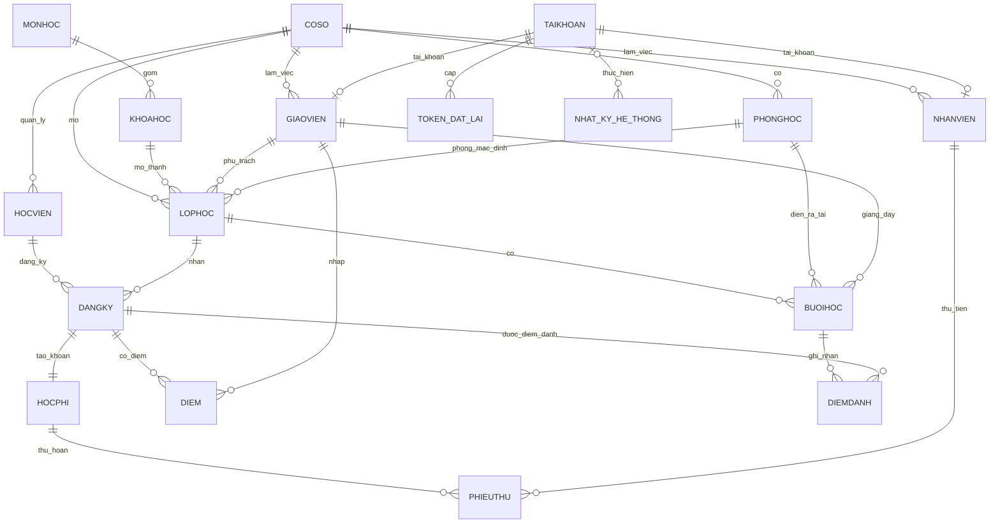
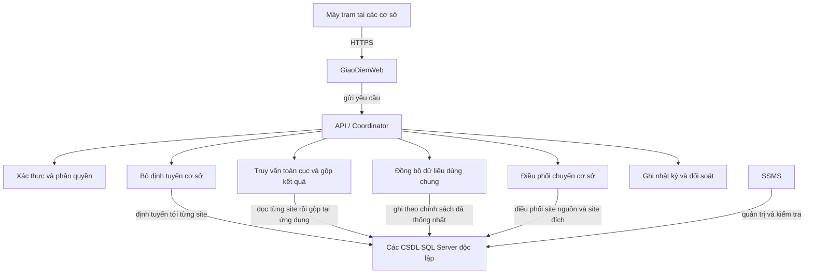

# Đề cương báo cáo đồ án CSDL phân tán

Tài liệu này biến yêu cầu báo cáo của giảng viên thành dàn ý và danh sách minh chứng cho đề tài **Quản lý trung tâm đào tạo ngoại ngữ**. Nội dung nghiệp vụ lấy từ [README chính](../README.md); cấu trúc bảng lấy từ [DATABASE_SCHEMA.md](DATABASE_SCHEMA.md). README/schema là nguồn chuẩn: nếu nhóm đổi nghiệp vụ hoặc phân mảnh, cập nhật hai nguồn đó rồi mới sửa đề cương này.

Đây là hướng dẫn soạn báo cáo và ghi nhận quá trình triển khai. Nhóm đã chọn **SQL Server** làm DBMS, **SSMS** để quản trị, **Next.js** cho frontend và **Django** cho API/backend. Chỗ chưa có kết quả đo, ảnh cài đặt hoặc cấu hình vật lý được đánh dấu để nhóm điền sau; không ghi kế hoạch thành kết quả đã làm.

## Cấu trúc báo cáo theo yêu cầu giảng viên

1. **Đề tài được giao**: tên đề tài và danh sách 5 thành viên theo danh sách giảng viên.
2. **Viết tài liệu**
   - 2.1 Đặt vấn đề
   - 2.2 Phân tích và thiết kế
   - 2.2.1 Phân tích
   - 2.2.2 Thiết kế
3. **Cài đặt vật lý thực tế**
   - 3.1 Mạng VPN/Remote Desktop
   - 3.2 Kết nối giữa server
   - 3.3 Cài hệ quản trị CSDL
   - 3.4 Kiểm tra Agent nếu DBMS có dịch vụ này
   - 3.5 Tạo và kiểm tra liên kết server nếu dùng
   - 3.6 Tạo Publication/Replication nếu dùng
   - 3.7 Thử quyền, dữ liệu, giao tác và truy vấn

## 2.1. Đặt vấn đề

### Nhu cầu và tầm quan trọng

Trung tâm có nhiều cơ sở, mỗi nơi tiếp nhận học viên, mở lớp, xếp lịch, thu học phí, điểm danh và quản lý điểm. Dữ liệu phát sinh thường xuyên tại từng cơ sở, trong khi admin cần xem tình hình toàn hệ thống và học viên có thể chuyển cơ sở. Nếu các nghiệp vụ này dùng một CSDL chung đặt tại một nơi, mọi truy cập phụ thuộc cùng máy chủ và khó thể hiện dữ liệu phân tán. Nếu tạo các CSDL riêng mà không có quy tắc định tuyến, đồng bộ và phục hồi, dữ liệu các cơ sở lại khó nhất quán và khó tổng hợp.

Đồ án dùng ba CSDL độc lập cho Q1, Q7, TD cùng một lớp điều phối ở ứng dụng. Dữ liệu nghiệp vụ được phân mảnh theo cơ sở; danh mục/tài khoản được nhân bản; truy vấn toàn cục hỏi từng site rồi gộp; chuyển cơ sở là giao dịch nhiều site. Cách tổ chức này giúp dữ liệu nghiệp vụ được quản lý tại nơi phát sinh và trình bày trực tiếp các kỹ thuật CSDL phân tán của môn học.

### Sơ lược dự án và nhiệm vụ chính

Hệ thống hỗ trợ đăng nhập và phân quyền; quản lý học viên, giáo viên, nhân viên; quản lý môn/khóa học; mở lớp, sinh buổi học và quản lý lịch; đăng ký/đổi lớp; thu/hoàn học phí; điểm danh; quản lý điểm; chuyển cơ sở; thống kê toàn cục; quản lý nhật ký; thêm/đóng cơ sở. Danh sách luồng và điều kiện nghiệp vụ chi tiết nằm trong README mục 5 và 8.

### Vì sao cần CSDL phân tán

- Mỗi cơ sở cần lưu dữ liệu riêng của học viên, nhân viên, phòng và lớp tại site của mình.
- Các danh mục và tài khoản cần hiện diện tại mọi cơ sở đang hoạt động.
- Admin cần báo cáo tổng hợp dù dữ liệu nằm ở nhiều CSDL.
- Chuyển học viên cần thay đổi tại site nguồn và site đích; khi sự cố xảy ra phải có thể phục hồi.
- Kiến trúc cần cho phép thêm site mới bằng cấu hình và dữ liệu, không sửa vòng lặp code cố định.

### Vị trí, nhiệm vụ và đối tượng sử dụng

| Vị trí/vai trò | Nhiệm vụ chính | Phạm vi dữ liệu |
|---|---|---|
| Admin Big | Quản lý tài khoản/danh mục/cơ sở; xem báo cáo/nhật ký toàn hệ thống; duyệt hoặc từ chối đề nghị chuyển học viên | Toàn hệ thống theo quyền |
| Admin Small | Quản lý lớp, phòng, lịch, học viên, học phí; tạo đề nghị chuyển học viên từ cơ sở mình; xem báo cáo tại cơ sở | Site được gán |
| Lễ tân | Hồ sơ học viên, đăng ký và đổi lớp | Site được gán |
| Kế toán | Thu học phí và xem danh sách lớp | Site được gán |
| Giáo viên | Xem lớp mình dạy, điểm danh, nhập điểm | Các lớp mình dạy |
| Máy trạm tại cơ sở | Giao diện người dùng, gửi yêu cầu tới ứng dụng | Không kết nối tùy tiện sang CSDL site khác |
| Coordinator/ứng dụng | Xác thực, phân quyền, định tuyến, gộp truy vấn, đồng bộ và điều phối giao dịch | Kết nối tới các site theo cấu hình |
| Máy chủ CSDL mỗi site | Lưu cùng bộ bảng; nhận đọc/ghi đúng site và phục vụ cơ chế đồng bộ đã chọn | CSDL riêng của site |

Vai trò chi tiết và chức năng được phép xem [README.md](../README.md), mục 3. Sơ đồ vật lý server cuối cùng phụ thuộc môi trường nhóm triển khai; không tự ghi số máy thật khi nhóm chưa cài đặt.

## 2.2. Phân tích và thiết kế

### 2.2.1. Phân tích

#### Chức năng và tần suất truy cập dự kiến

Do chưa có log vận hành của một trung tâm thật, bảng này là **ước lượng định tính để thiết kế**, không phải số đo thực tế. `Cao` nghĩa là dự kiến phát sinh hàng ngày/nhiều lần trong giờ làm việc; `Trung bình` là theo buổi học/đợt nghiệp vụ; `Thấp` là ít lần nhưng cần độ đúng cao. Sau khi demo, nhóm có thể bổ sung số lần chạy kịch bản và thời gian phản hồi đo được.

| Chức năng/truy vấn | Kiểu | Vị trí gọi | Site được truy cập | Tần suất dự kiến | Bảng đọc/ghi chính |
|---|---|---|---|---|---|
| Đăng nhập | `LOCAL` đọc tài khoản nhân bản | Máy trạm mọi cơ sở | Site đăng nhập; tài khoản có bản sao ở các site | Cao (đăng nhập mỗi phiên) | Đọc `TaiKhoan`; ghi `NhatKyHeThong` |
| Xem khóa học/lớp còn chỗ | `LOCAL` | Lễ tân/quản lý tại cơ sở | Site đang làm việc | Cao | Đọc `KhoaHoc`, `LopHoc`, `HocVien`, `DangKy` |
| Đăng ký khóa học | `LOCAL` | Lễ tân/quản lý | Site đang làm việc | Cao theo mùa tuyển sinh | Ghi `DangKy`, `HocPhi`, `LopHoc`, `NhatKyHeThong` |
| Đổi lớp | `LOCAL` | Lễ tân/quản lý | Site đang làm việc | Trung bình | Ghi `DangKy`, sĩ số `LopHoc`; đọc lịch và học phí |
| Mở lớp/sinh lịch | `LOCAL` | Quản lý cơ sở/admin | Site sở hữu lớp | Trung bình/theo khóa | Ghi `LopHoc`, `BuoiHoc`; đọc giáo viên/phòng/khóa |
| Thu hoặc hoàn học phí | `LOCAL` | Kế toán/quản lý/admin theo quyền | Site đăng ký | Cao, theo ngày | Ghi `PhieuThu`, cập nhật `HocPhi`, `NhatKyHeThong` |
| Điểm danh | `LOCAL` | Giáo viên | Site lớp/buổi học | Trung bình/cao vào ngày học | Ghi `DiemDanh`, cập nhật `BuoiHoc` |
| Nhập/sửa điểm | `LOCAL` | Giáo viên/admin | Site lớp/đăng ký | Trung bình/theo kỳ | Ghi `Diem`, `NhatKyHeThong` |
| Xem thống kê cơ sở | `LOCAL` | Quản lý/admin | Một site | Trung bình | Đọc `HocVien`, `DangKy`, `HocPhi`, `PhieuThu`, `Diem` |
| Thống kê/tra cứu toàn cục | `GLOBAL` | Admin | Mọi site `hoat_dong` | Thấp–trung bình | Đọc bảng nghiệp vụ tại từng site; Coordinator gộp |
| Xem nhật ký toàn hệ thống | `GLOBAL` | Admin | Mọi site `hoat_dong` | Thấp, chủ yếu kiểm tra/audit | Đọc `NhatKyHeThong`, `NhatKyDongBo` |
| Sửa danh mục/tài khoản | `REPLICATED-WRITE` | Admin | Mọi site `hoat_dong` | Thấp hơn đọc, nhưng cần nhất quán | Ghi `MonHoc`, `KhoaHoc`, `TaiKhoan`, `CoSo` |
| Đề nghị chuyển | `LOCAL` | Admin Small tại nguồn | CSDL nguồn | Theo nhu cầu | Ghi `GiaoDichChuyenCoSo` trạng thái `cho_duyet`, sự kiện `de_nghi` |
| Hộp thư/duyệt đề nghị | `GLOBAL` đọc; quyết định ghi cục bộ tại nguồn | Admin Big | Đọc các site; ghi CSDL nguồn của đề nghị | Thấp, cần độ đúng cao | Đọc `GiaoDichChuyenCoSo`; ghi quyết định và `LichSuChuyenCoSo` tại nguồn |
| Thực hiện chuyển sau duyệt | `DISTRIBUTED-TX` | Coordinator sau khi Admin Big duyệt | Site nguồn và site đích | Thấp, cần độ đúng cao | Đọc/ghi `HocVien`, đăng ký/lớp liên quan và lịch sử chuyển |

#### Phân quyền

Chép ma trận quyền từ README mục 3 vào báo cáo; không tự suy ra quyền mới. Tóm lược:

| Chức năng | Admin Big | Admin Small | Lễ tân | Kế toán | Giáo viên |
|---|:---:|:---:|:---:|:---:|:---:|
| Quản lý tài khoản và danh mục | ✓ |  |  |  |  |
| Tạo đề nghị chuyển từ cơ sở mình |  | ✓ |  |  |  |
| Duyệt/từ chối đề nghị chuyển toàn hệ thống | ✓ |  |  |  |  |
| Thống kê/nhật ký toàn hệ thống | ✓ |  |  |  |  |
| Thống kê/nhật ký cơ sở | ✓ | ✓ |  |  |  |
| Mở lớp, lịch và phòng | ✓ | ✓ |  |  |  |
| Học viên, đăng ký, đổi lớp | ✓ | ✓ | ✓ |  |  |
| Thu học phí | ✓ | ✓ |  | ✓ |  |
| Hoàn học phí | ✓ | ✓ |  |  |  |
| Xem danh sách lớp cơ sở | ✓ | ✓ | ✓ | ✓ |  |
| Điểm danh/nhập điểm lớp được dạy | ✓ |  |  |  | ✓ |
| Tự đổi mật khẩu | ✓ | ✓ | ✓ | ✓ | ✓ |

Kiểm tra quyền ở backend trước mọi truy cập; phạm vi cơ sở là một phần của quyền, quyền giáo viên còn phụ thuộc lớp được phân công. Bảng `TaiKhoan` phân biệt `admin`, `nhan_vien`, `giao_vien`; chức vụ nhân viên lưu ở `NhanVien.chuc_vu`.

Không đồng nhất vai trò ứng dụng với tài khoản đăng nhập DBMS. Người dùng cuối đăng nhập ứng dụng; Next.js không giữ thông tin kết nối CSDL. Django dùng tài khoản dịch vụ SQL Server riêng để kết nối các site, chỉ được cấp quyền tối thiểu cần cho ứng dụng. Tài khoản quản trị triển khai và tài khoản Agent/Replication (nếu có) phải tách riêng. Khi cài đặt SQL Server, ghi cụ thể principal, quyền `SELECT`/`INSERT`/`UPDATE`/`DELETE`/`EXECUTE` được cấp trên từng nhóm bảng và cách thu hồi quyền; không dùng tài khoản `sa` hoặc tài khoản quản trị toàn quyền cho kết nối chạy ứng dụng.

Trigger không thay thế phân quyền người dùng. Trigger chỉ nên bảo vệ quy tắc toàn vẹn cục bộ mà CSDL có thể kiểm tra, ví dụ từ chối `UPDATE`/`DELETE` trên các bảng nhật ký append-only. Quyền ai được thu tiền, nhập điểm hay xem dữ liệu cơ sở nào phải được backend kiểm tra theo vai trò và phạm vi cơ sở. Không viết trigger cần truy cập bảng của site khác.

#### Chức năng theo cơ sở triển khai

Các cơ sở Q1, Q7 và TD dùng cùng một bộ chức năng và cấu trúc CSDL; khác nhau ở dữ liệu phân mảnh được lưu tại site. Khi thêm cơ sở mới, chức năng không được phụ thuộc vào mã site viết cứng.

| Vị trí | Nhiệm vụ tại vị trí | Dữ liệu thường đọc/ghi | Phạm vi |
|---|---|---|---|
| Cơ sở Q1, Q7, TD | Lễ tân tiếp nhận hồ sơ, đăng ký và đổi lớp; kế toán thu/hoàn tiền theo quyền; giáo viên điểm danh và nhập điểm lớp được phân công; quản lý mở lớp, xếp lịch/phòng và xem báo cáo cơ sở | Hồ sơ học viên, lớp, buổi học, đăng ký, học phí, phiếu thu, điểm danh, điểm, nhật ký cơ sở | Ghi dữ liệu nghiệp vụ vào CSDL của chính cơ sở; không tự truy cập DB của cơ sở khác |
| Admin Big | Quản lý danh mục dùng chung, xem thống kê/nhật ký toàn cục, quản lý vòng đời cơ sở, duyệt/từ chối đề nghị chuyển | Bản sao danh mục/tài khoản; hộp thư đọc gộp; quyết định tại CSDL nguồn; dữ liệu nguồn/đích sau khi duyệt | Coordinator định tuyến tới đúng site; chỉ yêu cầu đã duyệt mới chạy module giao dịch phân tán |
| Admin Small | Điều hành site được giao, tạo đề nghị chuyển học viên ra site khác và theo dõi trạng thái | Dữ liệu nghiệp vụ của site mình; đề nghị chuyển tại CSDL nguồn | API tự lấy nguồn từ phạm vi tài khoản; không cho tự duyệt hoặc truy cập site khác |
| Nhóm vận hành/triển khai | Tạo CSDL, cấu hình kết nối, cấp quyền dịch vụ, kiểm tra backup, đồng bộ và phục hồi | Cấu hình môi trường, trạng thái site, phiên bản dữ liệu dùng chung, nhật ký đồng bộ | Không dùng quyền vận hành để thay quyền nghiệp vụ của người dùng |

Tên Q1/Q7/TD là ba site hiện tại. Trong lược đồ và mã nguồn, tập site được lấy từ `CoSo` có trạng thái `hoat_dong` rồi đối chiếu cấu hình kết nối, không xử lý bằng ba nhánh cố định.

#### Chức năng ở máy trạm, máy chủ và Coordinator

| Tầng/vị trí | Nhận | Thực hiện | Không thực hiện |
|---|---|---|---|
| Máy trạm/Frontend | Form, danh sách, báo cáo | Nhập dữ liệu, gọi API, hiển thị lỗi/thiếu site | Không tự quyết định kết nối CSDL hoặc thay quyền backend |
| Backend/Coordinator | Yêu cầu đã xác thực từ frontend | Kiểm tra quyền, phân loại `LOCAL/GLOBAL/REPLICATED-WRITE/DISTRIBUTED-TX`, chọn site, gộp hoặc điều phối | Không JOIN trực tiếp giữa hai CSDL |
| DB server Q1/Q7/TD | Truy vấn được định tuyến | Thực thi truy vấn trên CSDL độc lập của mình, giữ bảng nhân bản/phân mảnh theo thiết kế | Không chứa dữ liệu nghiệp vụ của site khác để giả làm CSDL chung |
| Tác vụ đồng bộ/đối soát | Yêu cầu ghi chung hoặc kiểm tra phiên bản | Ghi qua một điểm đồng bộ; so `phien_ban`, `cap_nhat_luc` | Không để nhiều module ghi bảng nhân bản theo cách riêng |

Đây là phân rã logic. Frontend tại các cơ sở có thể là cùng một ứng dụng được truy cập qua mạng; Backend/Coordinator là tầng duy nhất chọn kết nối CSDL. Máy chủ ứng dụng và DBMS có thể đặt trên máy khác nhau; sơ đồ vật lý, địa chỉ IP, cổng, tên instance và đường VPN phải điền từ lab thực tế.

#### Phân tích CSDL và ERD

Sơ đồ dưới đây là ERD rút gọn để đưa vào phần phân tích; khóa/cột và quan hệ đầy đủ ở [DATABASE_SCHEMA.md](DATABASE_SCHEMA.md), mục 5–6. Các quan hệ thể hiện trong từng CSDL site. `LichSuChuyenCoSo` là lịch sử liên site nên không có FK xuyên cơ sở.



Lưu ý vẽ ERD cuối: tài khoản, danh mục và `CoSo` được nhân bản; quan hệ trong hình không có nghĩa được JOIN qua site. `HocVien` có thể có bản lịch sử ở nguồn và bản `dang_hoc` ở đích sau chuyển. Báo cáo phải ghi rõ mã học viên có thể lặp giữa các site do lịch sử; thống kê hiện tại lọc `trang_thai = dang_hoc`.

### 2.2.2. Thiết kế

#### CSDL quan hệ

Thiết kế gồm các bảng sau (bộ cột chi tiết xem trực tiếp schema để tránh sai lệch khi copy):

| Nhóm | Bảng |
|---|---|
| Danh mục/tài khoản nhân bản | `CoSo`, `MonHoc`, `KhoaHoc`, `TaiKhoan` |
| Hồ sơ phân mảnh nguyên thủy | `HocVien`, `GiaoVien`, `NhanVien`, `PhongHoc`, `LopHoc` |
| Bảng dẫn xuất | `BuoiHoc`, `DangKy`, `DiemDanh`, `HocPhi`, `PhieuThu`, `Diem` |
| Trạng thái giao dịch và nhật ký cục bộ | `GiaoDichChuyenCoSo`, `LichSuChuyenCoSo`, `TokenDatLaiMatKhau`, `NhatKyHeThong`, `NhatKyDongBo` |

Danh sách cột logic, khóa chính/ngoại, duy nhất và ý nghĩa nghiệp vụ của từng bảng nằm tại [DATABASE_SCHEMA.md, mục 6](DATABASE_SCHEMA.md#6-chi-tiết-từng-bảng); các quan hệ nằm tại [mục 5](DATABASE_SCHEMA.md#5-các-bảng-liên-quan-với-nhau-thế-nào). Vì nhóm đã chọn SQL Server, khi triển khai schema cần ghi kiểu dữ liệu, độ dài, `NULL/NOT NULL`, giá trị mặc định, `CHECK`, chỉ mục và script tạo bảng phù hợp với SQL Server. Không ghi rằng schema đã cài vật lý nếu chưa có script và kết quả chạy trên từng CSDL site.

Quy tắc khóa và quan hệ quan trọng: không FK xuyên site; `DangKy` nối `HocVien`–`LopHoc` cùng site; một đăng ký có một `HocPhi`; một `HocPhi` có nhiều `PhieuThu`; `DiemDanh` nối buổi học và đăng ký; `Diem` thuộc đăng ký. Tài khoản đăng nhập và email cần duy nhất toàn hệ thống dù bảng tài khoản được nhân bản.

#### Lược đồ phân mảnh ngang nguyên thủy

Gọi `S_active` là tập site lấy từ các dòng `CoSo.trang_thai = hoat_dong` đã đối chiếu cấu hình. Không định nghĩa tập site bằng hằng số Q1/Q7/TD trong code.

Với `s ∈ S_active`:

```text
HocVien_s  = σ(ma_co_so = s)(HocVien)
GiaoVien_s = σ(ma_co_so = s)(GiaoVien)
NhanVien_s = σ(ma_co_so = s)(NhanVien)
PhongHoc_s = σ(ma_co_so = s)(PhongHoc)
LopHoc_s   = σ(ma_co_so = s)(LopHoc)
```

Các mảnh nguyên thủy đặt ở CSDL của chính site `s`. Phân rã theo `ma_co_so` bao phủ các hàng thuộc từng cơ sở. Với `HocVien`, cùng `ma_hoc_vien` có thể xuất hiện ở source và destination sau chuyển vì mỗi bản có site/trạng thái riêng; khi khôi phục danh sách hiện hành, lọc bản `dang_hoc`, không yêu cầu mã khóa phải duy nhất trên toàn bộ các mảnh lịch sử.

#### Lược đồ phân mảnh ngang dẫn xuất

Các biểu thức dưới đây mô tả cách xác định site theo khóa cha; phép nối là nối cục bộ bên trong một site, không phải SQL JOIN giữa server.

```text
BuoiHoc_s  = BuoiHoc ⋉ LopHoc_s
DangKy_s   = DangKy  ⋉ LopHoc_s
DiemDanh_s = DiemDanh ⋉ BuoiHoc_s
HocPhi_s   = HocPhi ⋉ DangKy_s
PhieuThu_s = PhieuThu ⋉ HocPhi_s
Diem_s     = Diem ⋉ DangKy_s
```

Ràng buộc bổ sung: học viên đăng ký lớp cùng cơ sở. Mỗi bảng dẫn xuất được lưu cùng site với cha theo schema. Không dựa vào tiền tố ID để chọn site của học viên.

#### Nhân bản và cục bộ

| Loại | Quan hệ vị trí | Cơ chế theo thiết kế |
|---|---|---|
| Nhân bản | Với `R ∈ {CoSo, MonHoc, KhoaHoc, TaiKhoan}`, mỗi site hoạt động giữ một bản giống nhau của `R` | Chỉ ghi qua module Đồng bộ dữ liệu dùng chung; thiếu một site hoạt động thì từ chối; đối soát qua phiên bản |
| Cục bộ | `GiaoDichChuyenCoSo` lưu đề nghị/quyết định/trạng thái chỉ tại nguồn; `LichSuChuyenCoSo` ghi sự kiện tại site phát sinh | Không nhân bản đại trà; Admin Small tạo đề nghị tại nguồn, Admin Big quyết định qua Coordinator; bảng sự kiện chỉ thêm |

`TaiKhoan.ten_dang_nhap` và `email` cần kiểm tra duy nhất trên toàn hệ thống trước khi ghi. Mật khẩu/token chỉ lưu dạng băm; không xuất hiện trong nhật ký.

#### Lược đồ ánh xạ và tái thiết toàn cục

| Yêu cầu từ ứng dụng | Ánh xạ site | Cách trả kết quả |
|---|---|---|
| Thao tác nghiệp vụ tại cơ sở `s` (`LOCAL`) | `SiteRouter(s) → connection[s]` | Kết quả của một CSDL; transaction cục bộ |
| Thống kê/tra cứu toàn cục (`GLOBAL`) | Gửi truy vấn cục bộ tới từng `s ∈ S_active` | Coordinator gắn mã site rồi `UNION ALL`/cộng/tổng hợp ở tầng ứng dụng; trả cảnh báo site thiếu |
| Sửa danh mục/tài khoản (`REPLICATED-WRITE`) | Tập đích là mọi site `S_active` | Chỉ báo thành công khi chính sách ghi đủ được xác nhận; failure/recovery theo cơ chế nhóm đã chọn cho Django và SQL Server |
| Đề nghị chuyển (`LOCAL`) | Global Query định vị bản `dang_hoc` hiện hành; nguồn phải khớp site Admin Small; đích và lý do do người đề nghị chọn/nhập | Tạo `GiaoDichChuyenCoSo.cho_duyet` và sự kiện `de_nghi` tại nguồn; chưa tạo bản đích |
| Hộp thư/quyết định (`GLOBAL` + ghi cục bộ) | Đọc từng CSDL site, gộp hộp thư; Admin Big quyết định theo mã đề nghị và site nguồn | Ghi `duyet` hoặc `tu_choi` cùng người/thời điểm/lý do tại nguồn; không lưu bản hộp thư trung tâm |
| Chuyển học viên sau duyệt (`DISTRIBUTED-TX`) | Chỉ đề nghị đã được duyệt; Coordinator điều phối đúng site nguồn và site đích | `GiaoDichChuyenCoSo` làm trạng thái tại nguồn; `LichSuChuyenCoSo` chỉ thêm sự kiện tại site phát sinh; phục hồi theo trạng thái đã lưu |

Với bảng phân mảnh ngang, quan hệ toàn cục khái quát là hợp các mảnh site. Với `HocVien` để hiển thị hiện tại, lọc `dang_hoc`. Không biến việc tái thiết toàn cục thành truy vấn JOIN xuyên CSDL. Nếu một site không trả lời, tổng chưa đầy đủ và phải được đánh dấu như vậy.

#### Định vị dữ liệu và sơ đồ



Sơ đồ logic là client/server: người dùng ở máy trạm gọi ứng dụng/Coordinator; Coordinator định tuyến đến các DB server độc lập. Sơ đồ vật lý phải thay tên site thành máy/VM thực tế, IP/port, DB instance và đường mạng sau khi nhóm cài đặt. Không điền IP giả.

#### Đồng bộ hóa

1. Nguồn chuẩn cho site là bảng `CoSo` nhân bản; Coordinator chọn các dòng `hoat_dong` và đối chiếu cấu hình kết nối.
2. Ghi chung luôn đi qua một module. Trước khi ghi phải xác nhận toàn bộ site hoạt động sẵn sàng; thiếu một site thì từ chối.
3. Các bản ghi nhân bản có `phien_ban`, `cap_nhat_luc`; đối soát định kỳ phát hiện site cũ và đưa dữ liệu về bản mới nhất theo quy tắc được chốt.
4. `NhatKyDongBo` ghi bảng/mã bản ghi/hành động/site đích/trạng thái/lỗi; không ghi bí mật.
5. Admin Small tạo đề nghị `cho_duyet` và sự kiện append-only tại CSDL nguồn; Admin Big dùng Global Query đọc hộp thư rồi ghi quyết định về đúng nguồn. Chỉ sau khi duyệt mới tạo hồ sơ đích, đánh dấu bản nguồn `da_chuyen_di` và phục hồi tiến về phía trước nếu bị dừng giữa chừng. Không xóa hồ sơ đích đã commit. Global Query thống kê áp dụng quy tắc một hồ sơ hiện hành theo trạng thái/bước. Xem [QLTTNN-Giao-Dich-Phan-Tan.md](QLTTNN-Giao-Dich-Phan-Tan.md) để biết trình tự và các điểm lỗi.

Luồng này dùng các transaction cục bộ tại từng CSDL với Coordinator phục hồi tiến về phía trước. Không mô tả là ACID nguyên tử giữa hai CSDL; báo cáo kết quả kiểm thử theo trạng thái từng site, sự kiện đã ghi, cách retry và quy tắc thống kê khi giao dịch còn `dang_xu_ly`.

SQL Server đã được chọn, nhưng nhóm chưa chốt có dùng SQL Server Replication hay cơ chế điều phối/commit nào cho các giao dịch nhiều CSDL. Cơ chế thực tế phải thống nhất với quy tắc ghi đủ site và yêu cầu giảng viên; ghi lựa chọn vào README mục 9 rồi cập nhật mục này.

### QTLPT và lựa chọn kiến trúc

#### Ngang hàng hay Client/Server

Theo README, đây là kiến trúc **Client/Server có Coordinator**: máy trạm không tự JOIN/ghi nhiều database; Coordinator định tuyến và điều phối. Mỗi site vẫn có DB riêng, không có một DB trung tâm chứa toàn bộ dữ liệu nghiệp vụ. Báo cáo cần phân biệt “Coordinator điều phối” với “gộp dữ liệu vật lý vào một CSDL”.

#### Linked Server và đường đồng bộ

Đề bài yêu cầu tạo liên kết giữa server. SQL Server đã được chọn; nếu giảng viên yêu cầu Linked Server, nhóm có thể cài và kiểm tra để chứng minh kết nối/triển khai. Thiết kế hiện tại yêu cầu Global Query hỏi mỗi CSDL rồi gộp tại Django; không dùng Linked Server để tạo JOIN xuyên site trong luồng nghiệp vụ. Nếu giảng viên yêu cầu một truy vấn demo chạy qua Linked Server, xác định rõ phạm vi demo và cập nhật README/schema trước khi đổi luồng nghiệp vụ.

#### Publication/Replication và tránh hai cơ chế ghi

Nếu yêu cầu môn học bắt buộc SQL Server Publication/Replication, trước khi tạo nhóm phải chốt publisher, subscriber, article/table, hướng đồng bộ, lịch/độ trễ và xử lý xung đột. Không vừa để Django tự ghi các site vừa để publication ghi trùng cùng bảng nếu chưa có thiết kế rõ; nếu không, phiên bản và nhật ký có thể lệch.

README hiện yêu cầu ghi đồng bộ vào mọi site hoạt động và từ chối nếu thiếu site. Cơ chế Publication mặc định của môi trường cần được kiểm tra có đạt được hợp đồng này không; báo cáo phải mô tả cấu hình và kết quả thực đo, không chỉ chụp wizard đã tạo.

## 3. Cài đặt vật lý thực tế

Mỗi bước dưới đây cần ghi: ngày thực hiện, người làm, máy/site, phiên bản/cấu hình, lệnh hoặc thao tác, kết quả, đường dẫn ảnh minh chứng và lỗi đã xử lý. Chỉ điền sau khi thực hiện.

### 3.1. Cài VPN hoặc Remote Desktop

- Chọn một phương án nhóm thực sự sử dụng: VPN ZeroTier hoặc Remote Desktop; ghi rõ công cụ nhóm đã cài và kiểm thử.
- Ghi tên máy, người dùng, IP ảo/địa chỉ kết nối, nhóm mạng, kiểm tra ping/port thành công.
- Không chụp/lưu mật khẩu, private key, token hoặc thông tin đăng nhập trong báo cáo/repo.
- Ảnh cần có: mỗi máy đã vào cùng mạng; trạng thái kết nối; kết quả kiểm tra máy A tới máy B.

### 3.2. Tạo đường kết nối giữa server

- Vẽ sơ đồ máy thật: máy trạm, Coordinator, DB server từng site, IP/port và đường mạng.
- Xác minh server đích lắng nghe đúng port; chỉ mở port cần thiết trong firewall.
- Kiểm tra từ máy chạy Django API tới từng SQL Server bằng SSMS hoặc công cụ kết nối phù hợp.
- Bảng ghi nhận: `site | host/VM | DBMS instance | port | từ đâu kiểm tra | kết quả | ảnh`.

### 3.3. Cài hệ quản trị CSDL

Nhóm đã chọn Microsoft SQL Server. Ghi edition/version, instance, authentication, TCP/IP, port, ba CSDL Q1/Q7/TD và script/lệnh giảng viên cung cấp. Dùng SSMS để tạo/kiểm tra từng CSDL; xác nhận Django kết nối riêng tới từng site và Next.js chỉ gọi API. Không ghi rằng cài đặt đã hoàn tất nếu chưa có script chạy và kiểm tra trên từng CSDL.

Ảnh cần có: phiên bản cài đặt; dịch vụ/instance hoạt động; kết nối thành công; từng CSDL site tồn tại độc lập; danh sách bảng hoặc truy vấn chứng minh cùng cấu trúc. Che thông tin xác thực.

### 3.4. Kiểm tra dịch vụ Agent

- Kiểm tra SQL Server Agent nếu phiên bản/edition được cài có dịch vụ này và đồ án cần dùng.
- Ghi service chạy hay dừng, chế độ khởi động, tài khoản chạy service đã được cấu hình theo môi trường lab.
- Nếu replication/job phụ thuộc Agent, chạy một job thử, chụp lịch sử thành công/thất bại.
- Nếu môi trường SQL Server không có Agent hoặc đồ án không dùng Agent, ghi rõ “không áp dụng” và xác nhận với giảng viên phương án thay thế; không giả lập ảnh Agent.

### 3.5. Tạo và kiểm tra Linked Server

- Chỉ áp dụng nếu yêu cầu giảng viên cần Linked Server; SQL Server là DBMS đã chọn.
- Lập bảng ánh xạ server nguồn → server đích; kiểm tra tên, provider, security mapping và test connection.
- Chạy truy vấn đọc thử được giảng viên cho phép, chứng minh kết quả đến từ đúng site.
- Chụp cấu hình đã che user/password và kết quả truy vấn.
- Không dùng Linked Server để JOIN liên site cho nghiệp vụ nếu vẫn giữ thiết kế Coordinator/global query ở README.

### 3.6. Tạo Publication/Replication

- Chốt loại replication, publisher/distributor/subscriber, publication/article và bảng được phép nhân bản.
- Phân biệt nhóm bảng nhân bản (`CoSo`, `MonHoc`, `KhoaHoc`, `TaiKhoan`) với bảng phân mảnh site và bảng dẫn xuất. Không publish toàn bộ bảng một cách mặc định.
- Ghi hướng dữ liệu, tần suất, latency quan sát, cách xử lý lỗi và cách kiểm tra bản sao.
- Chụp publication, subscription, trạng thái Agent/job nếu có, và kết quả đối chiếu dữ liệu sau đồng bộ.
- So kết quả thực tế với quy tắc “mọi site hoạt động cùng có bản mới; thiếu site thì thao tác bị từ chối”. Nếu công cụ cấu hình không bảo đảm quy tắc này, ghi rõ khác biệt và thiết kế bù ở Coordinator sau khi nhóm thống nhất.

### 3.7. Thử quyền, nhập/đọc dữ liệu và giao tác

Chạy từng kịch bản trên các CSDL độc lập. Mỗi lần ghi lại trạng thái trước/sau tại từng site, user/role sử dụng, SQL/API đã chạy, kết quả mong đợi, kết quả thật và ảnh. Dùng dữ liệu demo trong DATABASE_SCHEMA, không ghi dữ liệu mẫu vào logic ứng dụng.

| Nhóm thử | Thao tác | Bằng chứng cần thu |
|---|---|---|
| Nhập dữ liệu | Nạp danh mục giống nhau; nạp học viên/lớp riêng tại từng site | Truy vấn từng CSDL và đối chiếu đúng vị trí |
| Đọc cục bộ | Đăng ký/thu học phí/điểm danh ở một site | Chỉ CSDL site đó đổi; quan sát các bảng liên quan cùng cập nhật |
| Global Query | Xem thống kê hoặc tra học viên | Kết quả từng site, phép gộp ở app, trường hợp site thiếu có cảnh báo |
| Phân quyền | Thử mỗi role trên chức năng được phép và bị cấm | Thành công đúng quyền; từ chối quyền sai; có log thất bại |
| Trigger/permission | Tạo role/principal DBMS và quyền tối thiểu; thử trigger cục bộ cho quy tắc được chọn (ví dụ chặn sửa/xóa nhật ký) | User không được cấp quyền bị từ chối; trigger chặn đúng thao tác; backend vẫn kiểm tra vai trò và site. Ghi riêng kết quả từng lớp bảo vệ |
| Ghi nhân bản | Thêm/sửa danh mục khi các site hoạt động; lặp lại khi một site tắt | Bản sao khớp; lần thiếu site không ghi dở hoặc không báo thành công |
| Đề nghị/duyệt chuyển cơ sở | Admin Small gửi; Admin Big duyệt hoặc từ chối; kiểm tra quyền và dữ liệu từng site | Đề nghị chờ duyệt vẫn ở nguồn; từ chối không đổi hồ sơ; duyệt mới kích hoạt chuyển |
| Chuyển sau khi duyệt | Q1→Q7, kiểm tra trạng thái, lớp, lịch sử, học phí/điểm | Bản nguồn `da_chuyen_di`, đích `dang_hoc`, history được giữ, thống kê không đếm trùng |
| Retry/recovery | Từ chối khi đích đóng; mất kết nối trước khi đích commit; dừng app sau khi đích commit; gửi trùng request | Nguồn giữ nguyên trước khi đích commit; sau commit đích thì recovery hoàn tất nguồn; idempotency không tạo hồ sơ/giao dịch trùng |
| Nhật ký | Sửa điểm/thu tiền, tìm người thực hiện | Log có cũ/mới và kết quả; không có password/token |

Trigger bảo vệ tính toàn vẹn dữ liệu trong phạm vi một CSDL. Phân quyền chức năng theo vai trò/cơ sở vẫn phải được kiểm tra ở backend; nếu giảng viên yêu cầu trigger phân quyền, báo cáo cần ghi rõ giới hạn, bảng/điều kiện trigger bảo vệ và kết quả thử trực tiếp. Không để trigger tạo ảo giác rằng nó kiểm soát được quyền giữa nhiều CSDL độc lập.

## Mẫu bảng quản lý ảnh minh chứng

| Mã ảnh | Mục | Site/máy | Nội dung chứng minh | Kết quả | File ảnh |
|---|---|---|---|---|---|
| E-3.1-01 | VPN | Điền máy nguồn/đích | Hai máy cùng mạng | Chưa thực hiện | `docs/evidence/...` |
| E-3.3-01 | DBMS | Điền instance | Phiên bản và dịch vụ hoạt động | Chưa thực hiện | `docs/evidence/...` |
| E-3.5-01 | Linked Server | Điền server nguồn/đích | Kết nối thử thành công | Chưa thực hiện/không áp dụng | `docs/evidence/...` |
| E-3.6-01 | Publication | Điền publisher/subscriber | Đồng bộ article đã chọn | Chưa thực hiện/không áp dụng | `docs/evidence/...` |
| E-3.7-01 | Giao tác | Điền kịch bản/site | Trước-sau, trạng thái nguồn/đích, sự kiện và recovery | Chưa thực hiện | `docs/evidence/...` |

## Những thông tin cần điền sau buổi triển khai

- Danh sách năm sinh viên, phân công và lớp học phần.
- SQL Server version/edition, phiên bản Next.js/Django, vị trí máy/VM, IP/port, site nào chạy ở máy nào.
- Tài liệu SQL/lệnh của giảng viên và cách nhóm áp dụng.
- Định lượng tần suất nếu giảng viên yêu cầu con số; hiện bảng truy cập là ước lượng định tính.
- Cấu hình SQL Server; có dùng Agent, Linked Server, Publication/Replication hay công cụ khác theo yêu cầu giảng viên.
- Cơ chế durable transaction, retry, đồng bộ và recovery đã chạy thật.
- Tất cả ảnh, script, output truy vấn và kết quả test giao tác.
