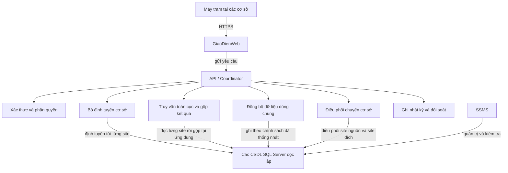

# Đề cương báo cáo đồ án CSDL phân tán

**Tra nhanh:** [Sườn báo cáo](#cấu-trúc-báo-cáo-theo-yêu-cầu-giảng-viên) · [Phân tích/thiết kế](#22-phân-tích-và-thiết-kế) · [Cài đặt vật lý](#3-cài-đặt-vật-lý-thực-tế) · [Mẫu ảnh minh chứng](#mẫu-bảng-quản-lý-ảnh-minh-chứng) · [Đối chiếu bảy tài liệu giảng viên](#tai-lieu-giang-vien).

Căn cứ bảy tài liệu giảng viên ở [bảng đối chiếu](QLTTNN-De-Cuong-Bao-Cao.md#tai-lieu-giang-vien). GV-01 quy định sườn báo cáo; GV-06 yêu cầu lab ít nhất ba SQL Server. Bảng minh chứng cuối tài liệu là mẫu cần điền, không thay kết quả đã lưu trong evidence.

Tài liệu này biến yêu cầu báo cáo của giảng viên thành dàn ý và danh sách minh chứng cho đề tài **Quản lý trung tâm đào tạo ngoại ngữ**. Nội dung nghiệp vụ lấy từ [README chính](../README.md); cấu trúc bảng lấy từ [DATABASE_SCHEMA.md](DATABASE_SCHEMA.md). README/schema là nguồn chuẩn: nếu nhóm đổi nghiệp vụ hoặc phân mảnh, cập nhật hai nguồn đó rồi mới sửa đề cương này.

Đây là hướng dẫn soạn báo cáo và ghi nhận quá trình triển khai. Nhóm đã chọn **SQL Server** làm DBMS, **SSMS** để quản trị, **Next.js** cho frontend và **Django** cho API/backend. Chỗ chưa có kết quả đo, ảnh cài đặt hoặc cấu hình vật lý được đánh dấu để nhóm điền sau; không ghi kế hoạch thành kết quả đã làm.

## Cấu trúc báo cáo theo yêu cầu giảng viên

### Yêu cầu chung bắt buộc trước khi nghiệm thu

Mỗi đề tài có **2–4 site**, triển khai tối thiểu **phân mảnh, replication, transaction và đồng bộ dữ liệu**. Không bắt buộc các nhóm dùng cùng kiểu phân mảnh. Báo cáo phải chứng minh ít nhất **1 phương pháp phân mảnh + 1 phương pháp replication + 1 distributed transaction + 1 tình huống concurrency + 1 distributed query**. Đề tài này dùng 3 site Q1/Q7/TD; site BT trong demo mở rộng là site thứ tư.

Dùng [ma trận YC-01–YC-07 và bài kiểm chứng TC](QLTTNN-Yeu-Cau-Chung-Va-Kiem-Chung.md) để nối thiết kế ở mục 2.2 với kết quả thực tế ở mục 3. Ghi rõ cơ chế, site/bảng, script hoặc phiên chạy, kết quả trước–sau, lỗi/phục hồi và bằng chứng. Không đưa ảnh seed/VPN/Swagger thay cho minh chứng replication/giao dịch phân tán; không bỏ concurrency chỉ vì các nghiệp vụ chạy tuần tự đã đúng.

### Các phần của báo cáo

1. **Đề tài được giao**: tên đề tài và danh sách 5 thành viên theo danh sách giảng viên.
2. **Viết tài liệu**
   - 2.1 Đặt vấn đề
   - 2.2 Phân tích và thiết kế
   - 2.2.1 Phân tích
   - 2.2.2 Thiết kế
3. **Cài đặt vật lý thực tế**
   - 3.1 Mạng VPN/Remote Desktop
   - 3.2 Kết nối giữa server
   - 3.3 Cài hệ quản trị CSDL
   - 3.4 Kiểm tra Agent nếu DBMS có dịch vụ này
   - 3.5 Tạo và kiểm tra liên kết server nếu dùng
   - 3.6 Triển khai và kiểm chứng replication; cấu hình Publication theo phương án/hướng dẫn giảng viên
   - 3.7 Thử quyền, dữ liệu, giao tác và truy vấn

## 2.1. Đặt vấn đề

### Nhu cầu và tầm quan trọng

Trung tâm có nhiều cơ sở, mỗi nơi tiếp nhận học viên, mở lớp, xếp lịch, thu học phí, điểm danh và quản lý điểm. Dữ liệu phát sinh thường xuyên tại từng cơ sở, trong khi admin cần xem tình hình toàn hệ thống và học viên có thể chuyển cơ sở. Nếu các nghiệp vụ này dùng một CSDL chung đặt tại một nơi, mọi truy cập phụ thuộc cùng máy chủ và khó thể hiện dữ liệu phân tán. Nếu tạo các CSDL riêng mà không có quy tắc định tuyến, đồng bộ và phục hồi, dữ liệu các cơ sở lại khó nhất quán và khó tổng hợp.

Đồ án dùng ba CSDL độc lập cho Q1, Q7, TD cùng một lớp điều phối ở ứng dụng. Dữ liệu nghiệp vụ được phân mảnh theo cơ sở; danh mục/tài khoản được nhân bản; truy vấn toàn cục hỏi từng site rồi gộp; chuyển cơ sở là giao dịch nhiều site. Cách tổ chức này giúp dữ liệu nghiệp vụ được quản lý tại nơi phát sinh và trình bày trực tiếp các kỹ thuật CSDL phân tán của môn học.

### Sơ lược dự án và nhiệm vụ chính

Hệ thống hỗ trợ đăng nhập và phân quyền; quản lý học viên, giáo viên, nhân viên; quản lý môn/khóa học; mở lớp, sinh buổi học và quản lý lịch; đăng ký/đổi lớp; thu/hoàn học phí; điểm danh; quản lý điểm; chuyển cơ sở; thống kê toàn cục; quản lý nhật ký; thêm/đóng cơ sở. Danh sách luồng và điều kiện nghiệp vụ chi tiết nằm trong README mục 5 và 8.

### Vì sao cần CSDL phân tán

- Mỗi cơ sở cần lưu dữ liệu riêng của học viên, nhân viên, phòng và lớp tại site của mình.
- Các danh mục và tài khoản cần hiện diện tại mọi cơ sở đang hoạt động.
- Admin cần báo cáo tổng hợp dù dữ liệu nằm ở nhiều CSDL.
- Chuyển học viên cần thay đổi tại site nguồn và site đích; khi sự cố xảy ra phải có thể phục hồi.
- Kiến trúc cần cho phép thêm site mới bằng cấu hình và dữ liệu, không sửa vòng lặp code cố định.

### Vị trí, nhiệm vụ và đối tượng sử dụng

| Vị trí/vai trò | Nhiệm vụ chính | Phạm vi dữ liệu |
|---|---|---|
| Admin Big | Quản lý tài khoản/danh mục/cơ sở; xem báo cáo/nhật ký toàn hệ thống; duyệt hoặc từ chối mọi đề nghị chuyển học viên và retry | Toàn hệ thống theo quyền |
| Admin Small | Quản lý lớp, phòng, lịch, học viên, học phí; xem đề nghị nguồn và đề nghị gửi tới mình; duyệt/từ chối đề nghị đến cơ sở được gán; không tạo đề nghị chuyển | Site được gán |
| Kế toán & Lễ tân | Chỉ xem phòng, lớp/roster, hồ sơ học viên, công nợ và lịch sử chuyển tại nguồn; gửi nhắc phí; xem báo cáo/phiếu thu và thu/hoàn học phí; không ghi phòng/lớp/hồ sơ hoặc đăng ký/xếp lớp | Site được gán |
| Tư vấn & xếp lớp | CRUD hồ sơ học viên tại site được giao nhưng không cấp tài khoản; CRUD phòng; mở lớp/phân công giáo viên/đăng ký/xếp lớp; sửa tên/sĩ số và hủy mềm lớp đủ điều kiện; xem/nhắc công nợ và sửa kế hoạch đóng; tạo đề nghị và xem lịch sử chuyển tại nguồn, không duyệt/từ chối/retry; nhận/phản hồi liên hệ, đăng/sửa/xuất bản bài Blog dùng chung | Nghiệp vụ tại site được gán; Blog ghi mọi site hoạt động |
| Giáo viên | Xem lớp mình dạy, điểm danh, nhập điểm | Các lớp mình dạy |
| Máy trạm tại cơ sở | Giao diện người dùng, gửi yêu cầu tới ứng dụng | Không kết nối tùy tiện sang CSDL site khác |
| Coordinator/ứng dụng | Xác thực, phân quyền, định tuyến, gộp truy vấn, đồng bộ và điều phối giao dịch | Kết nối tới các site theo cấu hình |
| Máy chủ CSDL mỗi site | Lưu cùng bộ bảng; nhận đọc/ghi đúng site và phục vụ cơ chế đồng bộ đã chọn | CSDL riêng của site |

Vai trò chi tiết và chức năng được phép xem [README.md](../README.md), mục 3. Sơ đồ vật lý server cuối cùng phụ thuộc môi trường nhóm triển khai; không tự ghi số máy thật khi nhóm chưa cài đặt.

## 2.2. Phân tích và thiết kế

### 2.2.1. Phân tích

#### Chức năng và tần suất truy cập dự kiến

Do chưa có log vận hành của một trung tâm thật, bảng này là **ước lượng định tính để thiết kế**, không phải số đo thực tế. `Cao` nghĩa là dự kiến phát sinh hàng ngày/nhiều lần trong giờ làm việc; `Trung bình` là theo buổi học/đợt nghiệp vụ; `Thấp` là ít lần nhưng cần độ đúng cao. Sau khi demo, nhóm có thể bổ sung số lần chạy kịch bản và thời gian phản hồi đo được.

| Chức năng/truy vấn | Kiểu | Vị trí gọi | Site được truy cập | Tần suất dự kiến | Bảng đọc/ghi chính |
|---|---|---|---|---|---|
| Đăng nhập bằng mật khẩu/Google/Facebook | `GLOBAL` đối chiếu tài khoản và subject đã liên kết | Máy trạm mọi cơ sở | Các site đang hoạt động; API đối chiếu rồi dựng phiên | Cao (đăng nhập mỗi phiên) | Đọc `TaiKhoan`, gồm `google_subject`/`facebook_subject`; ghi nhật ký đăng nhập an toàn |
| Xem khóa học/lớp còn chỗ | `LOCAL` | Kế toán & Lễ tân/Tư vấn & xếp lớp/quản lý tại cơ sở | Site đang làm việc | Cao | Đọc `KhoaHoc`, `LopHoc`, `HocVien`, `DangKy` |
| Đăng ký khóa học | `LOCAL` | Tư vấn & xếp lớp/quản lý có quyền | Site đang làm việc | Cao theo mùa tuyển sinh | Ghi `DangKy`, `HocPhi`, `LopHoc`, `Logs`; Kế toán & Lễ tân chỉ đọc |
| Đổi lớp | `LOCAL` | Tư vấn & xếp lớp/quản lý có quyền | Site đang làm việc | Trung bình | Ghi `DangKy`, sĩ số `LopHoc`; đọc lịch và học phí; Kế toán & Lễ tân chỉ đọc |
| Mở/sửa/hủy lớp an toàn | `LOCAL` | Tư vấn & xếp lớp/quản lý có quyền | Site sở hữu lớp | Trung bình/theo khóa | Ghi `LopHoc`, `BuoiHoc`, `Logs`; hủy mềm chỉ lớp sắp mở chưa đăng ký và có mọi buổi dự kiến ở tương lai |
| Thu hoặc hoàn học phí | `LOCAL` | Kế toán & Lễ tân/quản lý/admin theo quyền | Site đăng ký | Cao, theo ngày | Ghi `PhieuThu`, cập nhật `HocPhi`, `Logs` |
| Điểm danh | `LOCAL` | Giáo viên | Site lớp/buổi học | Trung bình/cao vào ngày học | Ghi `DiemDanh`, cập nhật `BuoiHoc` |
| Nhập/sửa điểm | `LOCAL` | Giáo viên/admin | Site lớp/đăng ký | Trung bình/theo kỳ | Ghi `Diem`, `Logs` |
| Xem thống kê cơ sở | `LOCAL` | Quản lý/admin | Một site | Trung bình | Đọc `HocVien`, `DangKy`, `HocPhi`, `PhieuThu`, `Diem` |
| Thống kê/tra cứu toàn cục | `GLOBAL` | Admin | Mọi site `hoat_dong` | Thấp–trung bình | Đọc bảng nghiệp vụ tại từng site; Coordinator gộp |
| Xem nhật ký toàn hệ thống | `GLOBAL` | Admin | Mọi site `hoat_dong` | Thấp, chủ yếu kiểm tra/audit | Đọc `Logs` riêng ở từng site và tổng hợp tại API |
| Sửa danh mục/tài khoản/liên kết OAuth | `REPLICATED-WRITE` | Admin hoặc chủ tài khoản đã xác thực theo thao tác | Mọi site `hoat_dong` | Thấp hơn đọc, nhưng cần nhất quán | Ghi `MonHoc`, `KhoaHoc`, `TaiKhoan` (các cột subject), `CoSo` |
| Đề nghị chuyển | `LOCAL` | Tư vấn & xếp lớp tại nguồn | CSDL nguồn | Theo nhu cầu | Ghi `GiaoDichChuyenCoSo` trạng thái `cho_duyet`, sự kiện `de_nghi` |
| Hộp thư/duyệt đề nghị | `GLOBAL` đọc; quyết định ghi cục bộ tại nguồn | Admin Big; Admin Small chỉ với đề nghị gửi tới site mình | Big đọc mọi site; Small đọc các site để lọc đề nghị nguồn/site nhận; ghi CSDL nguồn | Thấp, cần độ đúng cao | Đọc `GiaoDichChuyenCoSo`; ghi quyết định và `LichSuChuyenCoSo` tại nguồn |
| Thực hiện chuyển sau duyệt | `DISTRIBUTED-TX` | Coordinator sau khi Admin Big hoặc Admin Small site nhận duyệt | Site nguồn và site đích | Thấp, cần độ đúng cao | Đọc/ghi `HocVien`, đăng ký/lớp liên quan và lịch sử chuyển; giữ `ma_tai_khoan`, ghi thông báo nhân sự tại đích |

#### Phân quyền

Chép ma trận quyền từ README mục 3 vào báo cáo; không tự suy ra quyền mới. Tóm lược:

| Chức năng | Admin Big | Admin Small | Kế toán & Lễ tân | Tư vấn & xếp lớp | Giáo viên |
|---|:---:|:---:|:---:|:---:|:---:|
| Quản lý tài khoản, cơ sở và môn học chung | ✓ |  |  |  |  |
| Xem/tạo/sửa/xóa khóa học dùng chung theo điều kiện | ✓ |  | ✓ | ✓ |  |
| Tạo đề nghị chuyển từ cơ sở mình |  |  |  | ✓ |  |
| Duyệt/từ chối đề nghị chuyển toàn hệ thống | ✓ |  |  |  |  |
| Duyệt/từ chối đề nghị gửi đến cơ sở mình | ✓ | ✓ |  |  |  |
| Thống kê/nhật ký toàn hệ thống | ✓ |  |  |  |  |
| Thống kê/nhật ký cơ sở | ✓ | ✓ |  |  |  |
| Mở lớp và phân công giáo viên | ✓ | ✓ |  | ✓ |  |
| Quản lý phòng học | ✓ | ✓ |  | ✓ |  |
| Xem hồ sơ học viên, lớp/roster và công nợ | ✓ | ✓ | ✓ | ✓ |  |
| Đăng ký, đổi lớp; sửa/hủy lớp theo điều kiện | ✓ | ✓ |  | ✓ |  |
| Thu/hoàn học phí | ✓ | ✓ | ✓ |  |  |
| Báo cáo tài chính cơ sở | ✓ | ✓ | ✓ |  |  |
| Gửi email nhắc học phí | ✓ | ✓ | ✓ | ✓ |  |
| Xem đề nghị chuyển và công nợ lịch sử tại nguồn | ✓ | ✓ | ✓ | ✓ |  |
| Nhận/phản hồi liên hệ | ✓ | ✓ |  | ✓ |  |
| Đăng/sửa/xuất bản bài Blog dùng chung | ✓ |  |  | ✓ |  |
| Xóa bài hoặc quản lý danh mục Blog | ✓ |  |  |  |  |
| Điểm danh/nhập điểm lớp được dạy | ✓ |  |  |  | ✓ |
| Tự đổi mật khẩu | ✓ | ✓ | ✓ | ✓ | ✓ |

Kiểm tra quyền ở backend trước mọi truy cập; phạm vi cơ sở là một phần của quyền, quyền giáo viên còn phụ thuộc lớp được phân công. Bảng `TaiKhoan.vai_tro` gồm `admin_big`, `nhan_vien`, `giao_vien`, `hoc_vien`; Admin Small được giải từ hồ sơ `Admin.loai_admin`, chức vụ nhân viên ở `NhanVien.chuc_vu`. Portal học viên có source nhưng chưa được duyệt phạm vi môn học.

Không đồng nhất vai trò ứng dụng với tài khoản đăng nhập DBMS. Người dùng cuối đăng nhập ứng dụng; Next.js không giữ thông tin kết nối CSDL. Django dùng tài khoản dịch vụ SQL Server riêng để kết nối các site, chỉ được cấp quyền tối thiểu cần cho ứng dụng. Tài khoản quản trị triển khai và tài khoản Agent/Replication (nếu có) phải tách riêng. Khi cài đặt SQL Server, ghi cụ thể principal, quyền `SELECT`/`INSERT`/`UPDATE`/`DELETE`/`EXECUTE` được cấp trên từng nhóm bảng và cách thu hồi quyền; không dùng tài khoản `sa` hoặc tài khoản quản trị toàn quyền cho kết nối chạy ứng dụng.

Trigger không thay thế phân quyền người dùng. Trigger chỉ nên bảo vệ quy tắc toàn vẹn cục bộ mà CSDL có thể kiểm tra, ví dụ từ chối `UPDATE`/`DELETE` trên các bảng nhật ký append-only. Quyền ai được thu tiền, nhập điểm hay xem dữ liệu cơ sở nào phải được backend kiểm tra theo vai trò và phạm vi cơ sở. Không viết trigger cần truy cập bảng của site khác.

#### Chức năng theo cơ sở triển khai

Các cơ sở Q1, Q7 và TD dùng cùng một bộ chức năng và cấu trúc CSDL; khác nhau ở dữ liệu phân mảnh được lưu tại site. Khi thêm cơ sở mới, chức năng không được phụ thuộc vào mã site viết cứng.

| Vị trí | Nhiệm vụ tại vị trí | Dữ liệu thường đọc/ghi | Phạm vi |
|---|---|---|---|
| Cơ sở Q1, Q7, TD | Kế toán & Lễ tân chỉ xem phòng/lớp/roster/hồ sơ/công nợ và lịch sử chuyển tại nguồn; gửi nhắc phí, xem báo cáo/phiếu thu và thu/hoàn. Tư vấn & xếp lớp CRUD hồ sơ học viên và phòng tại site được giao nhưng không cấp tài khoản, mở/xếp lớp, sửa/hủy lớp an toàn, xem công nợ và sửa kế hoạch đóng; xử lý liên hệ, đăng bài dùng chung. Giáo viên điểm danh/nhập điểm lớp được phân công | Hồ sơ học viên, phòng, lớp, buổi học, đăng ký, học phí, phiếu thu, điểm danh, điểm, nhật ký cơ sở | Nhân viên chỉ thao tác theo quyền tại CSDL được giao; không tự truy cập site khác; Blog bài viết được Coordinator nhân bản tới site hoạt động |
| Admin Big | Quản lý danh mục dùng chung, xem thống kê/nhật ký toàn cục, quản lý vòng đời cơ sở, duyệt/từ chối mọi đề nghị và retry | Bản sao danh mục/tài khoản; hộp thư đọc gộp; quyết định tại CSDL nguồn; dữ liệu nguồn/đích sau khi duyệt | Coordinator định tuyến tới đúng site; chỉ yêu cầu đã duyệt mới chạy module giao dịch phân tán |
| Admin Small | Điều hành site được giao, xem đề nghị nguồn/đến và duyệt/từ chối đề nghị gửi tới site mình; không tạo đề nghị | Dữ liệu nghiệp vụ của site mình; đề nghị tại CSDL nguồn | API tự lấy site từ phiên; chỉ cho quyết định khi cơ sở đích trùng site trong phiên |
| Nhóm vận hành/triển khai | Tạo CSDL, cấu hình kết nối, cấp quyền dịch vụ, kiểm tra backup, đồng bộ và phục hồi | Cấu hình môi trường, trạng thái site, phiên bản dữ liệu dùng chung, nhật ký đồng bộ | Không dùng quyền vận hành để thay quyền nghiệp vụ của người dùng |

Tên Q1/Q7/TD là ba site hiện tại. Trong lược đồ và mã nguồn, tập site được lấy từ `CoSo` có trạng thái `hoat_dong` rồi đối chiếu cấu hình kết nối, không xử lý bằng ba nhánh cố định.

#### Chức năng ở máy trạm, máy chủ và Coordinator

| Tầng/vị trí | Nhận | Thực hiện | Không thực hiện |
|---|---|---|---|
| Máy trạm/Frontend | Form, danh sách, báo cáo | Nhập dữ liệu, gọi API, hiển thị lỗi/thiếu site | Không tự quyết định kết nối CSDL hoặc thay quyền backend |
| Backend/Coordinator | Yêu cầu đã xác thực từ frontend | Kiểm tra quyền, phân loại `LOCAL/GLOBAL/REPLICATED-WRITE/DISTRIBUTED-TX`, chọn site, gộp hoặc điều phối | Không JOIN trực tiếp giữa hai CSDL |
| DB server Q1/Q7/TD | Truy vấn được định tuyến | Thực thi truy vấn trên CSDL độc lập của mình, giữ bảng nhân bản/phân mảnh theo thiết kế | Không chứa dữ liệu nghiệp vụ của site khác để giả làm CSDL chung |
| Tác vụ đồng bộ/đối soát | Yêu cầu ghi chung hoặc kiểm tra phiên bản | Ghi qua một điểm đồng bộ; so `phien_ban`, `cap_nhat_luc` | Không để nhiều module ghi bảng nhân bản theo cách riêng |

Đây là phân rã logic. Frontend tại các cơ sở có thể là cùng một ứng dụng được truy cập qua mạng; Backend/Coordinator là tầng duy nhất chọn kết nối CSDL. Máy chủ ứng dụng và DBMS có thể đặt trên máy khác nhau; sơ đồ vật lý, địa chỉ IP, cổng, tên instance và đường VPN phải điền từ lab thực tế.

#### Phân tích CSDL và ERD

Dùng [ERD trong schema](DATABASE_SCHEMA.md#erd) để trình bày quan hệ; tra [DATABASE_SCHEMA](DATABASE_SCHEMA.md) để lấy cột, khóa và constraint. Sơ đồ chỉ có FK cục bộ; bảng nhân bản được tham chiếu qua bản sao cùng site. DDL cho phép DangKy có 0–1 HocPhi, còn service đăng ký tạo đúng một khoản trong cùng transaction. Không vẽ quan hệ bắt buộc hoặc tên bảng log cũ khác DDL.

Học viên giữ bản lịch sử nguồn sau chuyển; thống kê phải chọn bản hiện hành theo bước Coordinator, không loại bản lịch sử bằng cách xóa hoặc suy ra site hiện tại từ mã.

### 2.2.2. Thiết kế

#### CSDL quan hệ

Thiết kế gồm các bảng sau (bộ cột chi tiết xem trực tiếp schema để tránh sai lệch khi copy):

| Nhóm | Bảng |
|---|---|
| Danh mục/tài khoản nhân bản | `CoSo`, `MonHoc`, `KhoaHoc`, `TaiKhoan`, `DanhMucBlog`, `BaiVietBlog` |
| Hồ sơ/dữ liệu phân mảnh nguyên thủy | `HocVien`, `GiaoVien`, `NhanVien`, `Admin` Small, `PhongHoc`, `LopHoc`, `YeuCauLienHe` |
| Bảng dẫn xuất | `BuoiHoc`, `DangKy`, `DiemDanh`, `HocPhi`, `DotHocPhi`, `PhieuThu`, `Diem` |
| Trạng thái giao dịch và nhật ký cục bộ | `GiaoDichChuyenCoSo`, `LichSuChuyenCoSo`, session/OTP/ledger xác thực, `ThongBao`, `Logs`; bảng SePay theo phạm vi chưa duyệt trong schema |

Danh sách cột logic, khóa chính/ngoại, duy nhất và ý nghĩa nghiệp vụ của từng bảng nằm tại [DATABASE_SCHEMA.md, mục 6](DATABASE_SCHEMA.md#6-chi-tiết-từng-bảng); các quan hệ nằm tại [mục 5](DATABASE_SCHEMA.md#5-các-bảng-liên-quan-với-nhau-thế-nào). Vì nhóm đã chọn SQL Server, khi triển khai schema cần ghi kiểu dữ liệu, độ dài, `NULL/NOT NULL`, giá trị mặc định, `CHECK`, chỉ mục và script tạo bảng phù hợp với SQL Server. Không ghi rằng schema đã cài vật lý nếu chưa có script và kết quả chạy trên từng CSDL site.

Quy tắc khóa và quan hệ quan trọng: không FK xuyên site; `DangKy` nối `HocVien`–`LopHoc` cùng site; một đăng ký có một `HocPhi`; một `HocPhi` có nhiều `PhieuThu`; `DiemDanh` nối buổi học và đăng ký; `Diem` thuộc đăng ký. Tài khoản đăng nhập và email cần duy nhất toàn hệ thống dù bảng tài khoản được nhân bản.

#### Lược đồ phân mảnh, dẫn xuất và nhân bản

Đưa [lược đồ phân mảnh–ánh xạ–định vị](DATABASE_SCHEMA.md#phan-manh) vào mục này: công thức `R_s`, khóa cha–con, tập `S_alloc`/`S_active`, đầy đủ/tái thiết/không giao nhau và bảng cấp phát. Không sao chép công thức thiếu điều kiện khóa ghép hoặc dùng tập site hoạt động để khẳng định đã bao phủ lịch sử site đóng.

MonHoc chỉ ghi Publisher, truyền bất đồng bộ tới Subscriber; các bảng fan-out có ACK riêng. Ghi rõ khoảng trễ và thiếu site, không nhận “ba bản giống nhau tại một thời điểm” là bằng chứng ACID/one-copy serializability. Tài khoản/email kiểm tra duy nhất qua service; không lưu bí mật trong log.

#### Lược đồ ánh xạ và tái thiết toàn cục

| Yêu cầu từ ứng dụng | Ánh xạ site | Cách trả kết quả |
|---|---|---|
| Thao tác nghiệp vụ tại cơ sở `s` (`LOCAL`) | `SiteRouter(s) → connection[s]` | Kết quả của một CSDL; transaction cục bộ |
| Thống kê/tra cứu toàn cục (`GLOBAL`) | Gửi truy vấn cục bộ tới từng `s ∈ S_active` | Coordinator gắn mã site rồi `UNION ALL`/cộng/tổng hợp ở tầng ứng dụng; trả cảnh báo site thiếu |
| Sửa danh mục/tài khoản (`REPLICATED-WRITE`) | Tập đích là mọi site `S_active` | Chỉ báo thành công khi chính sách ghi đủ được xác nhận; failure/recovery theo cơ chế nhóm đã chọn cho Django và SQL Server |
| Đề nghị chuyển (`LOCAL`) | Nguồn lấy từ phiên Tư vấn; service tìm hồ sơ theo slug tại chính nguồn, kiểm tra đang học, công nợ và đề nghị đang mở; đích/lý do từ form được API kiểm tra | Tạo `GiaoDichChuyenCoSo.cho_duyet` và sự kiện `de_nghi` tại nguồn; chưa tạo bản đích |
| Hộp thư/quyết định (`GLOBAL` + ghi cục bộ) | Đọc từng CSDL site; Admin Big xem toàn hệ thống, Admin Small chỉ xem đề nghị nguồn/site nhận; người có quyền quyết định theo vai trò và site đích | Ghi `duyet` hoặc `tu_choi` cùng người/thời điểm/lý do tại nguồn; không lưu bản hộp thư trung tâm |
| Chuyển học viên sau duyệt (`DISTRIBUTED-TX`) | Chỉ đề nghị đã được Admin Big hoặc Admin Small site nhận duyệt; Coordinator điều phối đúng site nguồn và site đích | `GiaoDichChuyenCoSo` làm trạng thái tại nguồn; `LichSuChuyenCoSo` chỉ thêm sự kiện tại site phát sinh; giữ nguyên `ma_tai_khoan`, ghi thông báo tại đích và để Tư vấn xếp lớp/phòng thủ công; phục hồi theo trạng thái đã lưu |

Với bảng phân mảnh ngang, quan hệ toàn cục là hợp các mảnh trong phạm vi site cấp phát. Với `HocVien`, lúc ổn định lọc `dang_hoc`; lúc chuyển/khôi phục phải chọn bản hiện hành theo bước Coordinator để tránh đếm trùng. Không biến tái thiết thành JOIN xuyên CSDL. Thiếu một site phải đánh dấu tổng chưa đầy đủ.

#### Định vị dữ liệu và sơ đồ

Sơ đồ logic là client/server: người dùng ở máy trạm gọi ứng dụng/Coordinator; Coordinator định tuyến đến các DB server độc lập. Sơ đồ vật lý dùng topology đã ghi trong lược đồ định vị: Q1/TD hiện cùng instance Windows, Q7 trên Docker Mac. Mục tiêu là ba instance/máy được phân công; TD chưa chuyển máy nên chưa kết luận cài đặt vật lý đã đủ. Điền IP/port từ lần demo, không dùng địa chỉ giả.

#### Đồng bộ hóa

1. Nguồn chuẩn cho site là bảng `CoSo` nhân bản; Coordinator chọn các dòng `hoat_dong` và đối chiếu cấu hình kết nối.
2. Ghi chung qua writer được phép của từng bảng; tiền kiểm thiếu site thì từ chối trước DML. MonHoc chỉ ghi Publisher, các writer fan-out không được ghi cạnh tranh vào Subscriber.
3. Dùng phiên bản/nội dung để đối soát. SQL Agent truyền MonHoc bất đồng bộ; API retry chỉ đọc xác nhận. Không khẳng định đã có lịch đối soát tự động chung cho mọi bảng.
4. `Logs` ghi audit và ACK đồng bộ theo site, không ghi bí mật. biên nhận Publisher hiện được áp dụng cho thay đổi `MonHoc`; không coi đây là bằng chứng mọi bảng dùng chung đã có replication.
5. Tư vấn tạo đề nghị `cho_duyet` và sự kiện append-only tại CSDL nguồn; Admin Big dùng Global Query đọc hộp thư toàn hệ thống, còn Admin Small chỉ thấy đề nghị nguồn/site nhận và có thể quyết định đề nghị gửi tới site mình. Quyết định được ghi tại nguồn. Chỉ sau khi duyệt mới tạo hồ sơ đích, giữ nguyên tài khoản, đánh dấu bản nguồn `da_chuyen_di`, ghi thông báo nhân sự tại đích và phục hồi tiến về phía trước nếu bị dừng giữa chừng. Tư vấn xếp lớp/phòng thủ công. Không xóa hồ sơ đích đã commit. Global Query thống kê áp dụng quy tắc một hồ sơ hiện hành theo trạng thái/bước. Xem [QLTTNN-Giao-Dich-Phan-Tan.md](QLTTNN-Giao-Dich-Phan-Tan.md) để biết trình tự và các điểm lỗi.

Luồng này dùng các transaction cục bộ tại từng CSDL với Coordinator phục hồi tiến về phía trước. Không mô tả là ACID nguyên tử giữa hai CSDL; báo cáo kết quả kiểm thử theo trạng thái từng site, sự kiện đã ghi, cách retry và quy tắc thống kê khi giao dịch còn `dang_xu_ly`.

SQL Server đã được chọn; **replication và distributed transaction là bắt buộc**. Phương pháp truyền thay đổi và mức bảo đảm giao dịch phải được chốt theo tiêu chí giảng viên, thống nhất với quy tắc ghi đủ site; ghi lựa chọn vào README mục 9 và FS mục 11 rồi cập nhật phần triển khai. Thiết kế Coordinator phục hồi hiện tại không chứng minh ACID nguyên tử xuyên site; nếu cần cơ chế DBMS quản lý thì phải bổ sung và kiểm thử, không tự ghi đã đạt.

### QTLPT và lựa chọn kiến trúc

#### Ngang hàng hay Client/Server

Theo README, đây là kiến trúc **Client/Server có Coordinator**: máy trạm không tự JOIN/ghi nhiều database; Coordinator định tuyến và điều phối. Mỗi site vẫn có DB riêng, không có một DB trung tâm chứa toàn bộ dữ liệu nghiệp vụ. Báo cáo cần phân biệt “Coordinator điều phối” với “gộp dữ liệu vật lý vào một CSDL”.

#### Linked Server và đường đồng bộ

GV-01 mục 3.5 yêu cầu trình bày Linked Server. Nhóm đã có LS_Q7 để đọc dữ liệu Q7 từ Windows; lưu ảnh cấu hình không secret và kết quả đọc từ xa. Thiết kế hiện tại yêu cầu Global Query hỏi mỗi CSDL rồi gộp tại Django; không dùng Linked Server để tạo JOIN xuyên site trong luồng nghiệp vụ. Nếu giảng viên yêu cầu một truy vấn demo chạy qua Linked Server, xác định rõ phạm vi demo và cập nhật README/schema trước khi đổi luồng nghiệp vụ.

#### Publication/Replication và tránh hai cơ chế ghi

YC-03 chọn SQL Server transactional Publication cho MonHoc: Publisher mặc định Q1; API chỉ ghi Publisher, SQL Server chuyển tới Subscriber; Logs tại Publisher chỉ chứng minh commit nguồn. Có ảnh UPDATE/phục hồi Q1 → Q7 do người dùng cung cấp và bằng chứng API views CRUD/retry trên Q1/Q7/TD ngày 20/11/2026; browser end-to-end và outage TD còn thiếu. [Phân vai và bằng chứng](MonHoc-SQL-Replication.md).

Tiền kiểm thiếu site thì từ chối trước ghi; sau commit Publisher có thể phải chờ bản sao. API trả 202 khi chưa đủ và chỉ báo hoàn tất sau đối soát. Đây là xác nhận quan sát bản sao, không phải transaction nguyên tử xuyên DB. Báo cáo ghi cấu hình, độ trễ và kết quả thật, không chỉ ảnh wizard.

## 3. Cài đặt vật lý thực tế

Mỗi bước dưới đây cần ghi: ngày thực hiện, người làm, máy/site, phiên bản/cấu hình, lệnh hoặc thao tác, kết quả, đường dẫn ảnh minh chứng và lỗi đã xử lý. Chỉ điền sau khi thực hiện.

### 3.1. Cài VPN và công cụ hỗ trợ từ xa

- Ghi VPN ZeroTier và kết quả TCP qua VPN. TeamViewer/Remote Desktop chỉ hỗ trợ điều khiển/quan sát, không tự thay đường mạng SQL giữa server.
- Ghi tên máy, người dùng, IP ảo/địa chỉ kết nối, nhóm mạng, kiểm tra ping/port thành công.
- Không chụp/lưu mật khẩu, private key, token hoặc thông tin đăng nhập trong báo cáo/repo.
- Ảnh cần có: mỗi máy đã vào cùng mạng; trạng thái kết nối; kết quả kiểm tra máy A tới máy B.

### 3.2. Tạo đường kết nối giữa server

- Vẽ sơ đồ máy thật: máy trạm, Coordinator, DB server từng site, IP/port và đường mạng.
- Xác minh server đích lắng nghe đúng port; chỉ mở port cần thiết trong firewall.
- Kiểm tra từ máy chạy Django API tới từng SQL Server bằng SSMS hoặc công cụ kết nối phù hợp.
- Bảng ghi nhận: `site | host/VM | DBMS instance | port | từ đâu kiểm tra | kết quả | ảnh`.

### 3.3. Cài hệ quản trị CSDL

Nhóm đã chọn Microsoft SQL Server. Ghi edition/version, instance, authentication, TCP/IP, port, ba CSDL Q1/Q7/TD và script/lệnh giảng viên cung cấp. Dùng SSMS để tạo/kiểm tra từng CSDL; xác nhận Django kết nối riêng tới từng site và Next.js chỉ gọi API. Không ghi rằng cài đặt đã hoàn tất nếu chưa có script chạy và kiểm tra trên từng CSDL.

Ảnh cần có: phiên bản cài đặt; dịch vụ/instance hoạt động; kết nối thành công; từng CSDL site tồn tại độc lập; danh sách bảng hoặc truy vấn chứng minh cùng cấu trúc. Che thông tin xác thực.

### 3.4. Kiểm tra dịch vụ Agent

- Kiểm tra SQL Server Agent nếu phiên bản/edition được cài có dịch vụ này và đồ án cần dùng.
- Ghi service chạy hay dừng, chế độ khởi động, tài khoản chạy service đã được cấu hình theo môi trường lab.
- Nếu replication/job phụ thuộc Agent, chạy một job thử, chụp lịch sử thành công/thất bại.
- Nếu môi trường SQL Server không có Agent hoặc đồ án không dùng Agent, ghi rõ “không áp dụng” và xác nhận với giảng viên phương án thay thế; không giả lập ảnh Agent.

### 3.5. Tạo và kiểm tra Linked Server

- Chỉ áp dụng nếu yêu cầu giảng viên cần Linked Server; SQL Server là DBMS đã chọn.
- Lập bảng ánh xạ server nguồn → server đích; kiểm tra tên, provider, security mapping và test connection.
- Chạy truy vấn đọc thử được giảng viên cho phép, chứng minh kết quả đến từ đúng site.
- Chụp cấu hình đã che user/password và kết quả truy vấn.
- Không dùng Linked Server để JOIN liên site cho nghiệp vụ nếu vẫn giữ thiết kế Coordinator/global query ở README.

### 3.6. Tạo Publication/Replication

Phần này phải có bằng chứng **YC-03 / TC-REP-01** và **YC-07 / TC-SYNC-01**. Nếu phương án đã chốt dùng cơ chế khác Publication, ghi cơ chế đó và minh chứng truyền thay đổi/lỗi/phục hồi; không bỏ phần replication/đồng bộ. Việc thay công cụ được yêu cầu trong hướng dẫn giảng viên cần được thống nhất, không tự coi là miễn bước cài đặt.

- Chốt loại replication, publisher/distributor/subscriber, publication/article và bảng được phép nhân bản.
- Phân biệt bảng nhân bản (`CoSo`, `MonHoc`, `KhoaHoc`, `TaiKhoan`, Blog) với bảng phân mảnh và dẫn xuất. Publication hiện chỉ có MonHoc; không publish toàn bộ schema mặc định.
- Ghi hướng dữ liệu, tần suất, latency quan sát, cách xử lý lỗi và cách kiểm tra bản sao.
- Chụp publication, subscription, trạng thái Agent/job nếu có, và kết quả đối chiếu dữ liệu sau đồng bộ.
- Đối chiếu chính sách từng bảng: MonHoc chỉ DML nguồn, có thể trả 202 sau commit khi chưa đủ bản sao; retry chỉ đọc xác nhận. Không mô tả thành synchronous commit hoặc ghi bù Subscriber.

### 3.7. Thử quyền, nhập/đọc dữ liệu và giao tác

Chạy từng kịch bản trên các CSDL độc lập. Mỗi lần ghi lại trạng thái trước/sau tại từng site, user/role sử dụng, SQL/API đã chạy, kết quả mong đợi, kết quả thật và ảnh. Dùng dữ liệu demo trong DATABASE_SCHEMA, không ghi dữ liệu mẫu vào logic ứng dụng.

| Nhóm thử | Thao tác | Bằng chứng cần thu |
|---|---|---|
| Nhập dữ liệu | Nạp danh mục giống nhau; nạp học viên/lớp riêng tại từng site | Truy vấn từng CSDL và đối chiếu đúng vị trí |
| Đọc cục bộ | Đăng ký/thu học phí/điểm danh ở một site | Chỉ CSDL site đó đổi; quan sát các bảng liên quan cùng cập nhật |
| Global Query | Xem thống kê hoặc tra học viên | Kết quả từng site, phép gộp ở app, trường hợp site thiếu có cảnh báo |
| Phân quyền | Thử mỗi role trên chức năng được phép và bị cấm | Thành công đúng quyền; từ chối quyền sai; có log thất bại |
| Trigger/permission | Tạo role/principal DBMS và quyền tối thiểu; thử trigger cục bộ cho quy tắc được chọn (ví dụ chặn sửa/xóa nhật ký) | User không được cấp quyền bị từ chối; trigger chặn đúng thao tác; backend vẫn kiểm tra vai trò và site. Ghi riêng kết quả từng lớp bảo vệ |
| Ghi nhân bản | Thêm/sửa danh mục khi các site hoạt động; lặp lại khi một site tắt | Bản sao khớp; lần thiếu site không ghi dở hoặc không báo thành công |
| Đề nghị/duyệt chuyển cơ sở | Tư vấn gửi; Admin Big hoặc Admin Small site nhận duyệt/từ chối; kiểm tra quyền và dữ liệu từng site | Admin Small không tạo; đề nghị chờ duyệt vẫn ở nguồn; từ chối không đổi hồ sơ; duyệt đúng site mới kích hoạt chuyển |
| Chuyển sau khi duyệt | Q1→Q7, kiểm tra trạng thái, lớp, lịch sử, học phí/điểm | Bản nguồn `da_chuyen_di`, đích `dang_hoc`, history được giữ, thống kê không đếm trùng |
| Retry/recovery | Từ chối khi đích đóng; mất kết nối trước khi đích commit; dừng app sau khi đích commit; gửi trùng request | Nguồn giữ nguyên trước khi đích commit; sau commit đích thì recovery hoàn tất nguồn; idempotency không tạo hồ sơ/giao dịch trùng |
| Concurrency — TC-CON-01 | Hai phiên độc lập đăng ký hai học viên vào một lớp còn đúng một chỗ, chạy chồng lấp tại vùng kiểm tra/cập nhật | Cách tạo cạnh tranh, cơ chế khóa/cô lập/cập nhật có điều kiện, response hai phiên; một đăng ký/học phí mới, không vượt sĩ số hoặc ghi dở dang |
| Đồng bộ sau lỗi — TC-SYNC-01 | Thử lỗi trước ghi và lỗi giữa các bước ghi bản sao; khôi phục site và retry/đối soát | Kết quả từng site, phiên bản, trạng thái chưa hoàn tất khi thiếu site; sau phục hồi bản sao khớp, không áp dụng trùng |
| Tái thiết mảnh — TC-FRAG-01 | Đọc riêng lớp/đăng ký ở từng site, hợp kết quả tại ứng dụng/công cụ kiểm thử | Mảnh đúng site, cha/con đúng vị trí, đầy đủ, không giao nhau và tái thiết đúng tập lớp logic |
| Nhật ký | Sửa điểm/thu tiền, tìm người thực hiện | Log có cũ/mới và kết quả; không có password/token |

Trigger bảo vệ tính toàn vẹn dữ liệu trong phạm vi một CSDL. Phân quyền chức năng theo vai trò/cơ sở vẫn phải được kiểm tra ở backend; nếu giảng viên yêu cầu trigger phân quyền, báo cáo cần ghi rõ giới hạn, bảng/điều kiện trigger bảo vệ và kết quả thử trực tiếp. Không để trigger tạo ảo giác rằng nó kiểm soát được quyền giữa nhiều CSDL độc lập.

## Mẫu bảng quản lý ảnh minh chứng

| Mã ảnh | Mục | Site/máy | Nội dung chứng minh | Kết quả | File ảnh |
|---|---|---|---|---|---|
| E-3.1-01 | VPN | Điền máy nguồn/đích | Hai máy cùng mạng | Chưa thực hiện | `docs/evidence/...` |
| E-3.3-01 | DBMS | Điền instance | Phiên bản và dịch vụ hoạt động | Chưa thực hiện | `docs/evidence/...` |
| E-3.5-01 | Linked Server | Điền server nguồn/đích | Kết nối thử thành công | Chưa thực hiện/không áp dụng | `docs/evidence/...` |
| E-3.6-01 | Replication — TC-REP-01 | Điền nơi ghi/các bản sao; publisher/subscriber nếu dùng | Truyền thay đổi thật theo phương pháp đã chốt | Chưa kiểm chứng | `docs/evidence/TC-REP-01/...` |
| E-3.6-02 | Đồng bộ — TC-SYNC-01 | Điền site lỗi/phục hồi | Đối soát/retry không trùng, đủ bản sao mới hoàn tất | Chưa kiểm chứng | `docs/evidence/TC-SYNC-01/...` |
| E-3.7-01 | Giao tác | Điền kịch bản/site | Trước-sau, trạng thái nguồn/đích, sự kiện và recovery | Chưa thực hiện | `docs/evidence/...` |
| E-3.7-02 | Concurrency — TC-CON-01 | Điền site và hai phiên | Tranh chỗ cuối, đúng một yêu cầu thành công | Chưa kiểm chứng | `docs/evidence/TC-CON-01/...` |
| E-3.7-03 | Phân mảnh — TC-FRAG-01 | Các site chứa lớp/đăng ký | Đầy đủ, không giao nhau và tái thiết | Chưa kiểm chứng | `docs/evidence/TC-FRAG-01/...` |
| E-3.7-04 | Distributed query — TC-DQ-01 | API và các site đọc | Kết quả từng site, gộp tại API và thiếu site | Chưa kiểm chứng | `docs/evidence/TC-DQ-01/...` |

Đây là mẫu, không khẳng định đã có ảnh/file. Kết quả của YC-01–YC-07 phải có mã TC và người chạy/review; các bài chưa chạy vẫn ghi “Chưa kiểm chứng”. Chỉ ghi “Không áp dụng” cho công cụ cụ thể có lý do được thống nhất, không dùng cho một trong các yêu cầu chung bắt buộc.

## Những thông tin cần điền sau buổi triển khai

- Danh sách năm sinh viên, phân công và lớp học phần.
- SQL Server version/edition, phiên bản Next.js/Django, vị trí máy/VM, IP/port, site nào chạy ở máy nào.
- Tài liệu SQL/lệnh của giảng viên và cách nhóm áp dụng.
- Định lượng tần suất nếu giảng viên yêu cầu con số; hiện bảng truy cập là ước lượng định tính.
- Cấu hình SQL Server và công cụ triển khai theo hướng dẫn giảng viên; phương pháp replication bắt buộc, nơi được phép ghi, hướng truyền và các bản sao.
- Cơ chế durable transaction, retry, đồng bộ và recovery đã chạy thật.
- Cơ chế concurrency và kết quả hai phiên; ma trận đủ năm nội dung chứng minh tối thiểu, topology 2–4 site và đồng bộ dữ liệu.
- Tất cả ảnh, script, output truy vấn và kết quả test giao tác.

---

## Phụ lục. Đối chiếu bảy tài liệu giảng viên

Rà soát ngày **20/11/2026** cho đề tài 10 — Quản lý trung tâm đào tạo ngoại ngữ. Đây là bản diễn giải để nhóm triển khai và viết báo cáo, không thay thế đề bài và không xác nhận những kiểm thử chưa chạy. Giữ stack SQL Server, Django, Next.js và CSDL riêng từng site.

### A. Danh mục tham khảo

Số trang PDF tính từ trang đầu file, kể cả bìa; số slide tính từ slide đầu. Các file gốc do giảng viên gửi được giữ ngoài repo.

| Mã | File giảng viên | Quy mô | Phần áp dụng |
|---|---|---|---|
| GV-01 | `[1] YEU CAU NOI DUNG TRONG CUON BAO CAO.pdf` | 3 trang | Trang 1: phân tích chức năng/tần suất/vị trí, ERD, quan hệ, phân mảnh, ánh xạ, định vị; trang 2: cài VPN, kết nối, DBMS, Agent, Linked Server, Publication, giao tác; trang 3: ứng dụng là phần bonus |
| GV-02 | `[6][1] TIEN HANH TAO PHAN MANH NGANG THEO LUOC DO.pdf` | 7 trang ảnh | Trang 1: lọc ngang bảng cha; trang 3–7: nối bộ lọc qua khóa cha–con. Ví dụ cửa hàng/nhân viên/đơn hàng, không phải schema trung tâm ngoại ngữ |
| GV-03 | `[6][2][1] NHAN BAN (Replication).pptx` | 52 slide | Slide 5–18: nhất quán mạnh/yếu, eager/lazy; 19–27: centralized/distributed; 37: lazy single-master; 49–52: sự cố, ROWAA, quorum |
| GV-04 | `[6][2][2] KIEN TRUC NHAN BAN - HD TV.pdf` | 25 trang | Trang 1–12: Publisher/Distributor/Subscriber, push/pull, snapshot/transactional/merge; 13–25: ví dụ wizard. Giao diện/phiên bản cũ cần đối chiếu với SQL Server đang dùng |
| GV-05 | `[6][3] TICH HOP CSDL (Database Integration).pptx` | 70 slide | Slide 4–8: lược đồ toàn cục/cục bộ, tích hợp logic/vật lý; 10–37: đối sánh, tích hợp, ánh xạ; 39–70: mediator/wrapper, viết lại và tối ưu truy vấn |
| GV-06 | `[6][4]TONG HOP TOM TAT CAI DAT CSDL PT - QUAN LY THUC THI GIAO DICH- SV.pdf` | 73 trang | Trang 1–6: ít nhất ba SQL Server, Agent, phân mảnh, tái thiết, Linked Server/SP; 8–36: cấu hình nhân bản; 37–41: liên kết; 42–70: ví dụ ứng dụng, truy cập theo vị trí và trigger |
| GV-07 | `[5][3] CHUONG 5- CAC MO HINH CSDL HIEN DAI - NoSQL_NewSQL_Polystores.pptx` | 71 slide | Bối cảnh lý thuyết CAP, NoSQL/NewSQL và tích hợp nhiều hệ lưu trữ; slide 35–58 phân biệt NewSQL/polystore. Không phải yêu cầu đổi đồ án sang MongoDB, PolyBase hay kho dữ liệu |

Một số phần GV-06 ghi là bản nháp không công khai. Không đưa các PDF/PPTX, ảnh trích bài giảng hoặc thông tin đăng nhập mẫu vào repository/báo cáo công khai; chỉ dẫn nguồn và diễn giải trong phạm vi đồ án.

Đối chiếu thuật ngữ phiên bản hiện hành: Log Reader Agent theo **database được publish transactional**, không phải một Agent cho mỗi Publication, theo [Microsoft — Agent Security](https://learn.microsoft.com/en-us/sql/relational-databases/replication/agent-security-new-publication-wizard?view=sql-server-ver16). Luồng Log Reader → distribution database → Distribution Agent được mô tả tại [Microsoft — Transactional Replication](https://learn.microsoft.com/en-us/sql/relational-databases/replication/transactional/transactional-replication?view=sql-server-ver16). Không lấy mô tả SQL Server cũ trong bài giảng thay kết quả cấu hình SQL Server 2022 của nhóm.

### B. Điều chỉnh cách áp dụng

| Nội dung tài liệu | Quyết định cho đồ án và giới hạn |
|---|---|
| GV-06 trang 1 nói ít nhất ba SQL Server | Mục tiêu lab cuối: Q1 Quốc Hiếu, Q7 Minh Khôi, TD Minh Đức, mỗi site một instance trên máy được giao. **Ba DB trên một instance chỉ là môi trường phát triển**, chưa đáp ứng bố trí ba server. Hiện đã ghi nhận hai instance: Windows giữ Q1/TD, Mac Docker giữ Q7; TD chưa chuyển máy |
| GV-02 lọc Publication theo bảng cha rồi dẫn xuất bảng con | Dùng lý thuyết phân mảnh cho `LopHoc` → `DangKy` → `HocPhi`/`Diem`. Source hiện định tuyến và chặn sai site bằng CHECK/FK cục bộ; **chưa triển khai Publication lọc/join filter cho các bảng này**. Không dùng Publication không lọc của `MonHoc` làm bằng chứng đã chạy wizard phân mảnh dẫn xuất. Nếu cần demo đúng wizard, làm lab riêng với dữ liệu thử và lưu bằng chứng, không thay cơ chế nghiệp vụ âm thầm |
| GV-03 eager/lazy và primary-copy | `MonHoc` là **lazy/centralized (một nơi ghi)**: commit Q1 trước, SQL Server transactional replication truyền sau. `transactional` là tên loại replication, không đồng nghĩa commit nguyên tử mọi DB hoặc đã đạt one-copy serializability toàn hệ thống |
| GV-04 snapshot/merge/transactional | Đồ án chọn transactional push cho `MonHoc`; không mở ghi cùng lúc ở Subscriber và không gọi đây là merge/multi-master. Các bảng khác giữ chính sách trong schema; không suy ra tất cả đã có Publication |
| GV-05 tích hợp vật lý và tích hợp logic | Global Query của đồ án là tích hợp **logic**: SQL cục bộ → kết quả gắn site → tổng hợp tại Django. Không tạo DB trung tâm chứa toàn bộ hồ sơ/học phí. Có thể giải thích bằng ánh xạ kiểu global-as-view; chưa có bộ viết lại truy vấn Datalog hay optimizer liên hệ quản trị tổng quát |
| GV-06 tên DB/link giống nhau để ví dụ SP trong suốt | Đó là quy ước của ví dụ. Đồ án dùng ánh xạ `site → alias → DB`, giữ `QLTTNN_Q1/Q7/TD`; không đổi tên DB đang chạy. Demo Linked Server đọc từ xa tách khỏi đường gọi API |
| Ví dụ dùng sa, mật khẩu mẫu, Everyone Read/Write hoặc tắt firewall | Không đưa vào cấu hình chạy ứng dụng. Dùng login dịch vụ theo site; quyền Agent/snapshot folder theo tài khoản cần thiết; chỉ mở cổng cần dùng qua mạng VPN. Không sao chép secret từ wizard vào Git |
| Ví dụ trigger chuyển dữ liệu giữa các trạm | Dùng CHECK/FK và trigger append-only hiện có để bảo vệ dữ liệu cục bộ. Không thêm trigger ghi sang Subscriber cạnh tranh với Publication. Quyền ứng dụng kiểm tra tại backend; trigger không thay phân quyền |
| Transaction/concurrency | Chuyển cơ sở dùng Coordinator với transaction cục bộ, phục hồi tiến về phía trước. Chưa phải MSDTC/2PC. Phải kiểm chứng lỗi trước/sau commit đích và hai yêu cầu đăng ký đồng thời; không nhận bằng chứng unit test thay demo nhiều site |

### C. Nối nội dung báo cáo với nguồn kiểm tra

| Mục báo cáo | Nguồn giảng viên | Tài liệu/source của nhóm | Bằng chứng cần lưu |
|---|---|---|---|
| 2.1 Đặt vấn đề | GV-01 trang 1 | README, đề cương | Nhiệm vụ từng cơ sở và nhu cầu dữ liệu dùng chung |
| 2.2.1 Chức năng, vai trò, vị trí/tần suất | GV-01 trang 1; GV-06 khoảng trang 50 | FS, README quyền; bảng tần suất trong đề cương | Ước lượng phải ghi là dự kiến; số đo có thời gian/ngữ cảnh |
| 2.2.2 ERD, quan hệ, khóa | GV-01 trang 1 | [ERD](DATABASE_SCHEMA.md#erd), [schema](DATABASE_SCHEMA.md), `db/01_create_schema.sql` và migration | FK/CHECK đang bật và được kiểm tra dữ liệu; không chỉ có sơ đồ |
| Phân mảnh, ánh xạ, định vị | GV-02; GV-06 trang 1–2 | [Thiết kế phân tán](DATABASE_SCHEMA.md#phan-manh), `db/30_enforce_site_fragment_boundaries.sql` | TC-FRAG-01: tập kỳ vọng, từng mảnh, hợp không thiếu/thừa/trùng, cha–con cùng site |
| 3.1–3.3 VPN/server/DBMS | GV-01 trang 2; GV-06 trang 1 | Hướng dẫn ZeroTier/SQL, DB README | TC-SITE-01: ba instance/máy cuối cùng; edition/version; thử cổng và login dịch vụ |
| 3.4–3.6 Agent, Linked Server, Publication/Subscription | GV-01 trang 2; GV-04; GV-06 trang 8–41 | [MonHoc](MonHoc-SQL-Replication.md) | TC-REP-01/TC-SYNC-01: thay đổi từ nguồn, bản sao, ngắt/khôi phục và bắt kịp; ảnh tạo wizard chưa đủ |
| 3.7 Giao tác/quyền/concurrency | GV-01 trang 2; GV-06 trang 66–70 | [Giao dịch](QLTTNN-Giao-Dich-Phan-Tan.md), service đăng ký/chuyển | TC-DTX-01, TC-CON-01; trạng thái trước–sau và lịch sử còn nguyên |
| 3.7 Truy vấn phân tán | GV-05; GV-06 trang 2–5 | Site Router, `student_counts_by_site`, specs API | TC-DQ-01: đối chiếu từng DB với tổng API, thử mất site và không che thiếu dữ liệu |
| Phần mềm minh họa | GV-01 trang 3 | Next.js/Django, UI spec | Ảnh thao tác web đi kèm dữ liệu DB; phần bonus không thay kiểm chứng DBMS |

### D. Những gì còn phải làm ngoài sửa tài liệu

1. Chuyển TD sang máy Minh Đức, kiểm tra lại schema/login/Agent và cấu hình Subscriber; không xóa bản Windows trước khi có backup và kiểm chứng cutover.
2. Lưu kết quả các script ở [DB verification](../db/README.md#kiem-chung-csdl), ảnh ba máy và bộ dữ liệu thử không chứa thông tin cá nhân thật. Bản Windows TD hiện có không phải bằng chứng máy Minh Đức đã chạy.
3. Chạy TC-FRAG/DTX/CON/DQ theo [bộ YC/TC](QLTTNN-Yeu-Cau-Chung-Va-Kiem-Chung.md); ghi chưa kiểm chứng ở phần còn thiếu. Xem evidence MonHoc để biết phạm vi đã có, không mở rộng kết luận sang mọi bảng.
4. Nếu phải dùng giao dịch ACID do DBMS quản lý, hoặc phân mảnh bằng chính Publication/filter của tài liệu, chốt cơ chế và lab riêng trước khi đổi source. Bộ tài liệu không tự chứng minh đã triển khai hai cơ chế đó.

Không cần đổi stack, sao chép schema hàng không/QLDSV, tạo kho nghiệp vụ trung tâm, hoặc thêm mọi phương pháp replication/quorum trong bài giảng. Chỉ chọn cơ chế phù hợp đề tài và chứng minh đúng mức bảo đảm.
