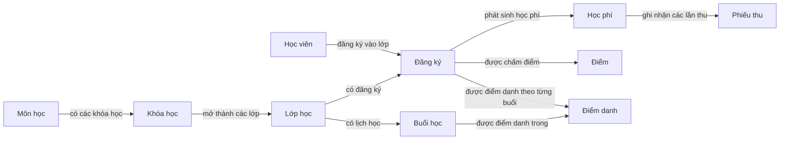

# Mô hình dữ liệu phân tán

Đây là bản giải thích cách đọc dữ liệu theo yêu cầu của [README chính](../README.md). Bảng, cột, kiểu, khóa, ràng buộc và dữ liệu demo chi tiết thuộc [DATABASE_SCHEMA.md](DATABASE_SCHEMA.md), là tài liệu chuẩn cho cấu trúc vật lý. Trước khi sửa schema, đọc cả hai.

## 1. Ba CSDL, một cấu trúc

Đồ án chọn 3 site trong giới hạn **2–4 site**. Yêu cầu môn học gồm ít nhất một phương pháp phân mảnh, một phương pháp replication, một distributed transaction, một tình huống concurrency, một distributed query và đồng bộ dữ liệu. Không bắt buộc mọi nhóm dùng cùng kiểu phân mảnh; nhóm này dùng ngang theo cơ sở và dẫn xuất theo bảng cha. [Bộ YC/TC](QLTTNN-Yeu-Cau-Chung-Va-Kiem-Chung.md) là điều kiện kiểm chứng bắt buộc.

Q1, Q7 và TD có cùng cấu trúc bảng, nhưng không gộp thành một CSDL. Mỗi site giữ phần dữ liệu nghiệp vụ của mình. Một số bảng được nhân bản để site nào cũng dùng được danh mục và tài khoản. Không thêm cột `chi_nhanh` vào một CSDL chung để giả lập phân tán.

## 2. Bản đồ phân mảnh và nhân bản

| Nhóm | Bảng | Quy tắc định vị |
|---|---|---|
| Nhân bản | `CoSo`, `MonHoc`, `KhoaHoc`, `TaiKhoan` (gồm `google_subject`, `facebook_subject`) | Bản sao thống nhất ở mọi site đang `hoat_dong` |
| Phân mảnh ngang nguyên thủy | `HocVien`, `GiaoVien`, `NhanVien`, `PhongHoc`, `LopHoc` | Dựa theo `ma_co_so` của bản ghi |
| Phân mảnh ngang dẫn xuất | `BuoiHoc`, `DangKy`, `DiemDanh`, `HocPhi`, `PhieuThu`, `Diem` | Theo site của bảng cha, không tự định tuyến độc lập |
| Cục bộ | `GiaoDichChuyenCoSo`, `LichSuChuyenCoSo`, `TokenDatLaiMatKhau`, `Logs` | Trạng thái chuyển chỉ tại CSDL nguồn; sự kiện chuyển append-only tại site phát sinh; `Logs` nằm riêng ở từng CSDL, ACK replication `MonHoc` được ghi tại site nhận |

Với bảng dẫn xuất, đọc bảng cha để biết site trước khi thao tác. Ví dụ: xác định site của lớp rồi mới truy cập đăng ký lớp đó. Không tạo foreign key xuyên site.

## 3. Quan hệ chính và các JOIN hợp lệ

Các mũi tên trên biểu diễn quan hệ nghiệp vụ có thể JOIN trong cùng CSDL chứa lớp/đăng ký; chúng không mô tả khóa ngoại xuyên cơ sở. Muốn thống kê hay tra cứu toàn hệ thống, mỗi cơ sở trả phần kết quả của mình cho Coordinator; ứng dụng gộp các phần sau đó. Không gửi một câu SQL chạy xuyên cơ sở.

Xem toàn bộ quan hệ, kể cả `CoSo`, `GiaoVien`, `PhongHoc`, `TaiKhoan`, tại DATABASE_SCHEMA mục 5.

## 4. Khóa và ý nghĩa tiền tố

Mã chính dùng dạng `<SITE>-<LOẠI>-<SỐ THỨ TỰ 6 CHỮ SỐ>`, ví dụ `Q1-HV-000001`. Tiền tố là site tạo mã, không nhất thiết là site hiện tại. `HocVien` là bảng duy nhất có thể chuyển giữa site theo nghiệp vụ. Không parse `Q1` từ mã để chọn kết nối hiện tại.

## 5. Học viên chuyển cơ sở

Điều kiện và kết quả theo README mục 5.5:

1. Admin Small tại cơ sở nguồn tạo đề nghị, nhập cơ sở đích và lý do; API lấy site nguồn từ tài khoản đang đăng nhập.
2. Đề nghị và sự kiện `de_nghi` được ghi tại CSDL nguồn với trạng thái `cho_duyet`. Học viên vẫn đang học ở nguồn; chưa tạo hồ sơ đích.
3. Admin Big xem danh sách bằng Global Query qua các CSDL site riêng rồi duyệt hoặc từ chối. Nếu duyệt, API kiểm tra lại học viên còn đang học, hết nợ, site đích hoạt động và hai site sẵn sàng. Nếu từ chối, lưu người duyệt, thời điểm, lý do và sự kiện tại nguồn; hồ sơ học viên không đổi.
4. Chỉ sau khi được duyệt, Coordinator tạo hồ sơ cùng mã tại site mới trước; sau đó site cũ đánh dấu `da_chuyen_di`, đóng các lớp đang học và cập nhật sĩ số.
5. Giữ điểm, học phí, phiếu thu, điểm danh và lịch sử ở site cũ. Học viên đăng ký lớp mới ở cơ sở mới theo quy trình đăng ký bình thường.
6. Thống kê học viên đang học chỉ tính một bản hiện hành; trong `cho_duyet`, đó là bản nguồn. Khi giao dịch đang chạy, áp dụng quy tắc theo bước trong tài liệu giao dịch phân tán.

`GiaoDichChuyenCoSo` tại nguồn lưu trạng thái hiện tại, bước cuối, khóa chống lặp và lỗi gần nhất; `LichSuChuyenCoSo` chỉ ghi thêm sự kiện tại nguồn/đích, liên kết bằng `ma_chuyen` nhưng không có FK xuyên site. Trước khi đích commit, lỗi dứt điểm có thể kết thúc giao dịch và giữ nguyên nguồn; lỗi tạm thời được retry. Sau khi đích commit, lần chạy lại phải đối chiếu sự kiện tại đích rồi làm nốt phần nguồn, không tạo hồ sơ đích lần hai hoặc xóa hồ sơ đã commit. Chi tiết trình tự và thống kê trong thời gian xử lý nằm ở [QLTTNN-Giao-Dich-Phan-Tan.md](QLTTNN-Giao-Dich-Phan-Tan.md).

## 6. Tính duy nhất tài khoản toàn hệ thống

`TaiKhoan.ten_dang_nhap` và `TaiKhoan.email` phải duy nhất trên toàn hệ thống. Vì bảng này được nhân bản, kiểm tra uniqueness cục bộ trên một CSDL là chưa đủ; lúc tạo tài khoản phải kiểm tra các site có liên quan và từ chối nếu đã tồn tại ở bất kỳ site nào. Quy tắc này thuộc README mục 5.9 và DATABASE_SCHEMA mục 4.

## 7. Nhật ký và bí mật

`Logs` và `LichSuChuyenCoSo` là log/history; không cập nhật trong luồng thông thường. `Logs` chỉ được xóa trong luồng xóa học viên có phạm vi đã được kiểm soát ở schema hiện tại. `GiaoDichChuyenCoSo` là bảng trạng thái, được Coordinator cập nhật và không được nhầm với nhật ký append-only. Ghi hành động thành công cùng giao dịch nghiệp vụ; từ chối quyền hoặc đăng nhập sai vẫn ghi thất bại. Khi sửa dữ liệu, lưu giá trị cũ và mới. Mật khẩu/token chỉ lưu bản băm và tuyệt đối không đưa vào trường nhật ký.

## 8. Quy tắc thay đổi schema

Khi thêm/sửa bảng, cập nhật DATABASE_SCHEMA trước, rồi so lại các luồng README sử dụng bảng đó. Nếu thay đổi tác động nghiệp vụ hoặc phân mảnh, cập nhật README trong cùng thay đổi. Mỗi site phải nhận cùng phiên bản schema. Không sửa trực tiếp riêng một site rồi để cấu trúc lệch.

## 9. Đọc dữ liệu để kiểm chứng yêu cầu chung

| Kịch bản | Dữ liệu cần đối chiếu |
|---|---|
| TC-SITE-01 / TC-FRAG-01 | DB riêng, `LopHoc.ma_co_so`, cha của `DangKy`; hợp danh sách lớp ở ứng dụng phải đầy đủ và không trùng giữa các mảnh |
| TC-REP-01 / TC-SYNC-01 | `MonHoc` và phiên bản tại từng site, trạng thái/sự kiện đồng bộ; phải có thay đổi truyền thật và phục hồi sau lỗi, không chỉ cùng seed |
| TC-DTX-01 | Hồ sơ nguồn/đích, `GiaoDichChuyenCoSo`, sự kiện tại từng site và lịch sử nguồn còn nguyên |
| TC-CON-01 | Hai phiên tranh một chỗ: chỉ một `DangKy`/`HocPhi` mới và sĩ số tăng một; phiên thua không để dữ liệu dở dang |
| TC-DQ-01 | Học viên hiện hành theo trạng thái/bước chuyển, kết quả từng site và tổng tại API; site thiếu phải được báo rõ |

Schema, bản sao và nhật ký chỉ hỗ trợ triển khai. Người chạy phải lưu kết quả theo từng TC; không tự suy ra các yêu cầu đã đạt từ cấu trúc bảng.
