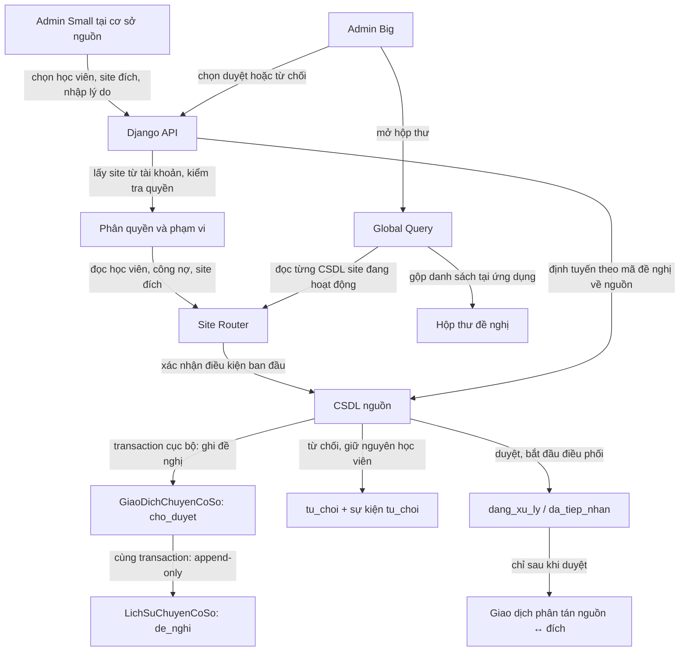

# Đề nghị chuyển cơ sở, duyệt và giao dịch phân tán

Tài liệu này mô tả hai bước riêng của nghiệp vụ chuyển học viên trong [README chính](../README.md) mục 3, 5.5 và 6. Mỗi cơ sở có một CSDL SQL Server độc lập. Django Coordinator định tuyến tới đúng CSDL, đọc nhiều site rồi tổng hợp ở ứng dụng; **không** có CSDL trung tâm để chứa hộp thư hoặc gộp dữ liệu nghiệp vụ.

Luồng có ba kiểu thao tác theo thứ tự:

1. Admin Small tạo đề nghị tại CSDL nguồn: `LOCAL`.
2. Admin Big đọc hộp thư các site: `GLOBAL`; khi quyết định, API ghi trạng thái và sự kiện tại CSDL nguồn bằng một transaction cục bộ.
3. Chỉ đề nghị đã duyệt mới chạy việc chuyển hồ sơ giữa nguồn và đích: `DISTRIBUTED-TX`.

Việc có bước duyệt làm rõ trách nhiệm quản trị, còn tính phân tán được thể hiện bằng dữ liệu nằm ở các CSDL site riêng, hộp thư Global Query và giao dịch Coordinator phối hợp hai CSDL sau khi duyệt.

Đồ án chọn 3 site trong yêu cầu **2–4 site**. [Yêu cầu chung YC-01–YC-07](QLTTNN-Yeu-Cau-Chung-Va-Kiem-Chung.md) bắt buộc có ít nhất một phương pháp phân mảnh, một phương pháp replication, một distributed transaction, một tình huống concurrency, một distributed query và đồng bộ dữ liệu. Tài liệu này phụ trách YC-04 và phần phục hồi YC-03/YC-07; không thay thế kiểm chứng các nội dung còn lại.

**Giới hạn phải ghi khi nghiệm thu:** thiết kế hiện tại phối hợp các transaction cục bộ và phục hồi tiến về phía trước, chưa chứng minh ACID nguyên tử xuyên site. Phải ghi giao thức thực tế và chốt mức bảo đảm đáp ứng tiêu chí distributed transaction của giảng viên. Nếu cần cơ chế DBMS quản lý, triển khai/kiểm thử bổ sung; không bỏ YC-04 hoặc tự ghi đã có MSDTC/2PC.

## 1. Phân biệt các thao tác ghi nhiều site

| Thao tác | Kiểu | Nơi đọc/ghi | Kết quả |
|---|---|---|---|
| Admin Small gửi đề nghị | `LOCAL` | Ghi `GiaoDichChuyenCoSo` và `LichSuChuyenCoSo` tại nguồn | Tạo trạng thái `cho_duyet`; hồ sơ học viên chưa đổi |
| Admin Big xem hộp thư | `GLOBAL` | Đọc từng CSDL site trong phạm vi hệ thống; gộp kết quả tại Django | Danh sách đề nghị; không sao chép đề nghị sang DB tập trung |
| Admin Big duyệt/từ chối | Đọc nhiều site để chọn đề nghị, sau đó ghi tại đúng nguồn | `GLOBAL` để định vị; transaction `LOCAL` tại nguồn để quyết định | Lưu người quyết định, thời điểm, trạng thái và sự kiện |
| Chuyển hồ sơ sau khi duyệt | `DISTRIBUTED-TX` | Chính xác hai CSDL: nguồn và đích | Tạo bản đích, giữ lịch sử ở nguồn, cập nhật nguồn và phục hồi được |

## 2. Ghi dữ liệu dùng chung

Quy trình `REPLICATED-WRITE` vẫn riêng với chuyển học viên:

1. Xác thực Admin Big và kiểm tra quyền.
2. Đọc danh sách cơ sở `hoat_dong`; xác nhận mọi site có cấu hình kết nối và sẵn sàng.
3. Nếu thiếu site: từ chối, không cập nhật site nào.
4. Ghi cùng thay đổi vào các site tham gia.
5. Chỉ trả thành công khi chính sách ghi đủ site đã được thỏa mãn.
6. Ghi `NhatKyDongBo` cho từng site đích và đối soát các bản sao.

Các bước trên là hợp đồng bắt buộc cho replication/đồng bộ, không phải mô tả cơ chế đã triển khai. Nhóm phải chốt phương pháp truyền thay đổi, nơi được phép ghi, phiên bản, tiến trình và ACK từng site (README mục 9). Nếu site lỗi sau bước tiền kiểm và đã có bản sao commit, ghi kết quả từng site, báo chưa hoàn tất và phục hồi/đối soát; không mô tả là không có bản sao nào đổi hoặc rollback toàn hệ thống. TC-REP-01 kiểm tra thay đổi truyền đến bản sao; TC-SYNC-01 kiểm tra lỗi trước ghi, giữa ghi và retry không trùng. Không dùng seed thủ công làm minh chứng replication.

## 3. Vai trò và dữ liệu đề nghị

| Vai trò | Được phép | Không được phép |
|---|---|---|
| Admin Small | Tạo đề nghị từ cơ sở mình phụ trách; xem trạng thái các đề nghị của cơ sở mình | Duyệt/từ chối đề nghị; tự chọn hoặc giả mạo cơ sở nguồn khác |
| Admin Big | Xem hộp thư toàn cục; duyệt hoặc từ chối một đề nghị; xem kết quả và lịch sử | Thay đổi dữ liệu quyết định bằng cách gọi trực tiếp SQL; duyệt khi không kết nối được site nguồn |
| Coordinator trong Django | Xác minh vai trò, định tuyến, kiểm tra quy tắc, ghi quyết định, thực hiện và phục hồi chuyển | Tin mã site do trình duyệt gửi; tạo DB trung tâm; JOIN xuyên site |

Trong schema hiện tại, Admin Big là tài khoản `TaiKhoan.vai_tro = 'admin'` có `ma_co_so IS NULL`. Admin Small là tài khoản `nhan_vien` gắn với site và hồ sơ `NhanVien.chuc_vu = 'quan_ly_co_so'`. API phải kiểm tra tài khoản còn hoạt động, vai trò/chức vụ và phạm vi cơ sở ở mọi endpoint; ẩn nút trên giao diện không phải là phân quyền.

Đề nghị gồm mã học viên, site nguồn, site đích, lý do, tài khoản gửi và thời điểm gửi. API lấy site nguồn từ tài khoản Admin Small, không chấp nhận nguồn do client tự gửi. Một dòng `GiaoDichChuyenCoSo` được tạo tại CSDL nguồn với `trang_thai = 'cho_duyet'`, `buoc_cuoi = 'cho_duyet'`. Sự kiện `de_nghi` được ghi trong `LichSuChuyenCoSo` cùng transaction cục bộ đó.

Khi chờ duyệt, hồ sơ học viên vẫn `dang_hoc` tại nguồn, chưa có bản sao tại đích và tiếp tục được tính ở thống kê nguồn. Các nghiệp vụ bình thường tại nguồn được tiếp tục. Do dữ liệu có thể đổi trong lúc chờ, Admin Big và API phải kiểm tra lại các điều kiện lúc duyệt.

## 4. Trình tự đề nghị và quyết định

### 4.1. Admin Small tạo đề nghị

API thực hiện các kiểm tra sau trước khi ghi:

1. Tài khoản đang hoạt động và là Admin Small của đúng site nguồn.
2. Học viên tồn tại duy nhất tại nguồn và có `HocVien.trang_thai = 'dang_hoc'`.
3. Học viên không còn công nợ đến hạn theo quy tắc học phí đã chốt.
4. Site đích khác site nguồn, đang `hoat_dong`, có cấu hình kết nối hợp lệ.
5. Global Query xác nhận bản `dang_hoc` hiện hành đang ở đúng site Admin Small phụ trách; không tồn tại đề nghị `cho_duyet` hoặc giao dịch `dang_xu_ly` khác tại site hiện hành.

Trong transaction cục bộ tại nguồn, API tạo trạng thái `cho_duyet` cùng sự kiện `de_nghi`. Nếu client gửi lại cùng idempotency key, trả về đề nghị đã tạo thay vì tạo dòng mới. Chỉ trả thành công sau khi cả trạng thái và sự kiện đã commit ở nguồn. Không ghi sang site đích ở giai đoạn này.

### 4.2. Admin Big xem hộp thư

Django lấy danh sách site đang hoạt động từ dữ liệu `CoSo`, đối chiếu cấu hình kết nối, rồi hỏi từng CSDL site để tìm `GiaoDichChuyenCoSo.trang_thai = 'cho_duyet'`. Django tổng hợp các kết quả trong bộ nhớ để trả về UI. Không lưu bản sao hộp thư trong một CSDL khác.

Mỗi dòng trả về cần có mã đề nghị, học viên, nguồn, đích, lý do, người gửi và thời điểm gửi. UI hiển thị site nguồn rõ ràng; API giữ mã site từ kết quả truy vấn và dùng Site Router để mở đúng CSDL khi Big ra quyết định. Nếu một site không truy cập được, trả danh sách kèm trạng thái **chưa đầy đủ**. Không được báo là hộp thư trống/toàn hệ thống đầy đủ khi chưa đọc được hết các site.

### 4.3. Admin Big duyệt hoặc từ chối

Khi quyết định, Django định tuyến về CSDL nguồn theo mã đề nghị, khóa/đọc lại trạng thái và chỉ tiếp tục nếu đề nghị vẫn `cho_duyet`. API không nhận quyết định từ Admin Small. Cập nhật trạng thái, tài khoản quyết định, thời điểm, lý do từ chối (nếu có) và sự kiện phải nằm trong cùng transaction cục bộ tại nguồn.

Trước khi duyệt, kiểm tra lại học viên vẫn đang `dang_hoc` ở nguồn, không có công nợ mới, site đích vẫn hoạt động/có kết nối và không có giao dịch chuyển đang mở. Nếu điều kiện không còn đúng, không bắt đầu chuyển; Admin Big từ chối với lý do cụ thể hoặc để đề nghị chờ xử lý. Khi duyệt hợp lệ, đổi thành `dang_xu_ly`, bước `da_tiep_nhan`, lưu người/thời điểm quyết định và ghi sự kiện `duyet`.

Khi từ chối, đổi thành `tu_choi`, bước `tu_choi`, bắt buộc lưu người/thời điểm và lý do, đồng thời ghi sự kiện `tu_choi`. Hồ sơ học viên không đổi. Đề nghị từ chối vẫn được giữ để tra cứu; một đề nghị mới có mã giao dịch mới có thể được tạo sau đó.

Nếu CSDL nguồn không truy cập được hoặc transaction quyết định chưa commit, API không được báo duyệt/từ chối thành công. Nếu client gửi lại cùng quyết định sau timeout, API đọc trạng thái hiện tại để trả kết quả đã commit hoặc báo xung đột; không ghi lặp sự kiện quyết định.

## 5. Chuyển hồ sơ sau khi duyệt

Chỉ trạng thái `dang_xu_ly` mới được worker chuyển cơ sở xử lý. Các transaction là transaction cục bộ riêng, không tuyên bố atomic ACID xuyên hai CSDL.

1. **Tại nguồn**, tạo trạng thái `dang_xu_ly / da_tiep_nhan` khi Admin Big duyệt; sự kiện `duyet` ghi cùng transaction này.
2. **Tại đích**, trong một transaction cục bộ, tạo `HocVien` cùng mã với trạng thái `dang_hoc` và sự kiện `tao_ho_so_dich`. Kiểm tra `ma_chuyen` để không tạo lặp.
3. **Tại nguồn**, sau khi xác nhận đích đã commit, cập nhật `buoc_cuoi = da_tao_ho_so_dich` và thêm sự kiện `xac_nhan_ho_so_dich`.
4. **Tại nguồn**, trong một transaction cục bộ, đánh dấu học viên `da_chuyen_di`, đóng đăng ký/lớp cũ, cập nhật `buoc_cuoi = da_cap_nhat_nguon`, thêm sự kiện `cap_nhat_ho_so_nguon`.
5. Đối chiếu trạng thái và sự kiện ở cả hai site; tại nguồn đặt `trang_thai = hoan_tat`, `buoc_cuoi = hoan_tat` và thêm sự kiện cuối.

Site đích chỉ nhận hồ sơ học viên; điểm, học phí, phiếu thu, điểm danh và lịch sử cũ ở lại nguồn. Học viên đăng ký lớp mới tại đích bằng luồng `LOCAL`. Không xóa bản nguồn.

Nếu lỗi nghiệp vụ dứt điểm xảy ra trước khi đích commit, có thể kết thúc `that_bai` tại nguồn; học viên vẫn `dang_hoc` ở nguồn và có thể gửi đề nghị mới. Lỗi mạng tạm thời trước khi biết kết quả commit thì giữ `dang_xu_ly` để retry/đối soát. Sau khi đích commit, Coordinator phải phục hồi tiến về phía trước, không xóa hồ sơ đích để giả lập rollback. `that_bai` chỉ hợp lệ trước khi hồ sơ đích commit.

## 6. Trạng thái, nhật ký và ràng buộc đồng thời

### `GiaoDichChuyenCoSo`

| Trạng thái | Bước | Ý nghĩa | Worker chuyển cơ sở |
|---|---|---|---|
| `cho_duyet` | `cho_duyet` | Đề nghị đã lưu ở nguồn; chờ Admin Big; học viên chưa đổi | Không xử lý |
| `dang_xu_ly` | `da_tiep_nhan` | Admin Big đã duyệt; chưa xác nhận hồ sơ đích commit | Có thể retry/tiếp tục |
| `dang_xu_ly` | `da_tao_ho_so_dich` | Đích đã commit; nguồn chưa cập nhật xong | Phục hồi tiến về phía trước |
| `dang_xu_ly` | `da_cap_nhat_nguon` | Nguồn đã đánh dấu `da_chuyen_di`; chờ đối chiếu/kết thúc | Hoàn tất |
| `hoan_tat` | `hoan_tat` | Chuyển đã đối chiếu xong | Không xử lý |
| `tu_choi` | `tu_choi` | Admin Big từ chối; lý do và người quyết định đã được lưu | Không xử lý |
| `that_bai` | `da_tiep_nhan` | Lỗi dứt điểm trước khi đích commit; nguồn vẫn hiện hành | Không xử lý; cho phép đề nghị mới |

Các trường quan trọng gồm mã giao dịch, mã học viên, nguồn/đích, trạng thái/bước, khóa chống lặp, `ma_tai_khoan_de_nghi`, `ly_do_de_nghi`, `ma_tai_khoan_quyet_dinh`, `ngay_quyet_dinh`, `ly_do_tu_choi`, thời điểm, lỗi cuối và `rowversion`. Ràng buộc CSDL buộc trạng thái chờ duyệt chưa có người quyết định; trạng thái từ chối có người quyết định và lý do; trạng thái được duyệt phải có người/thời điểm quyết định.

Cột tính toán `khoa_chong_trung_chuyen` tạo khóa `HV:<ma_hoc_vien>` khi trạng thái là `cho_duyet` hoặc `dang_xu_ly`, và khóa riêng `CC:<ma_chuyen>` cho trạng thái kết thúc. Unique index trên cột này đảm bảo một học viên chỉ có một đề nghị/giao dịch mở trên CSDL nguồn mà không cần filtered index dựa vào cột tính toán. Vì mỗi CSDL riêng không thể đặt unique constraint xuyên site, Coordinator còn phải dùng Global Query xác định site hiện hành trước khi tạo đề nghị; chỉ định tuyến và ghi tại site đó. `rowversion` và kiểm tra trạng thái hiện tại bảo vệ khi hai Admin Big cùng mở một đề nghị; chỉ quyết định đầu tiên được commit.

### `LichSuChuyenCoSo`

Sự kiện append-only, mỗi sự kiện có mã riêng ở site ghi và dùng `ma_chuyen` để tương quan giữa hai CSDL; không có FK xuyên site. Sự kiện tối thiểu:

`de_nghi` · `duyet` · `tu_choi` · `tao_ho_so_dich` · `xac_nhan_ho_so_dich` · `cap_nhat_ho_so_nguon` · `hoan_tat` · `that_bai` · `phuc_hoi`.

`de_nghi`, `duyet`, `tu_choi`, `xac_nhan_ho_so_dich` ghi ở nguồn; `tao_ho_so_dich` ghi ở đích; cập nhật và kết thúc ghi ở nguồn. Role/trigger SQL Server cấm UPDATE/DELETE lịch sử. Không ghi mật khẩu, token hay bí mật kết nối vào `chi_tiet`.

## 7. Thống kê khi đề nghị/chuyển đang mở

Global Query đọc các CSDL site riêng, trạng thái giao dịch ở nguồn và mảnh `HocVien`, sau đó áp dụng quy tắc ở tầng ứng dụng:

| Tình trạng | Học viên được tính là hiện hành |
|---|---|
| `cho_duyet` | Bản nguồn `dang_hoc`; chưa có bản đích |
| `dang_xu_ly` ở bước `da_tiep_nhan` hoặc `da_tao_ho_so_dich` | Bản nguồn; tạm ẩn bản đích nếu đã được tạo |
| `dang_xu_ly` ở bước `da_cap_nhat_nguon` | Bản đích; bản nguồn đã là `da_chuyen_di` |
| `hoan_tat` hoặc không có đề nghị/giao dịch mở | Bản `dang_hoc`; không tính bản `da_chuyen_di` |
| `tu_choi` hoặc `that_bai` | Bản nguồn `dang_hoc`; đề nghị/giao dịch kết thúc không đổi chủ sở hữu |

Nếu không đọc được CSDL nguồn để biết trạng thái giao dịch, thống kê phải báo thiếu dữ liệu, không suy đoán site hiện hành. Trong `cho_duyet`, hoạt động bình thường tại nguồn được phép; trong `dang_xu_ly`, API chặn đăng ký, thu phí và nhập điểm cho học viên đó ở cả hai site đến khi recovery hoàn tất.

## 8. Kịch bản cần kiểm thử

1. Admin Small đúng site tạo đề nghị: có trạng thái `cho_duyet` và sự kiện `de_nghi` tại nguồn; chưa có hồ sơ đích.
2. Admin Small gọi endpoint duyệt hoặc gửi mã site ngoài phạm vi: bị từ chối ở backend và có log phù hợp.
3. Admin Big đọc hộp thư từ nhiều site; khi một site không truy cập được, API/UI báo danh sách chưa đầy đủ.
4. Admin Big duyệt: lưu quyết định ở nguồn, thực hiện chuyển đúng hai site và không đếm trùng.
5. Admin Big từ chối: lưu lý do/sự kiện; hồ sơ học viên vẫn `dang_hoc` ở nguồn.
6. Hai quyết định đồng thời hoặc tạo đề nghị trùng: chỉ một đề nghị/giao dịch mở được chấp nhận; retry cùng idempotency key không tạo bản ghi thứ hai.
7. Điều kiện đổi trong lúc chờ duyệt (phát sinh công nợ, học viên đổi trạng thái, site đích đóng): API không bắt đầu chuyển dựa trên kiểm tra cũ.
8. Đích lỗi trước commit: giữ nguồn và retry hoặc kết thúc `that_bai` theo loại lỗi.
9. Ứng dụng dừng sau khi đích commit: worker đối chiếu sự kiện rồi hoàn tất nguồn, không tạo đích lần hai.

## 9. Trách nhiệm phối hợp nhóm

Các trường hợp 4, 8, 9 ở mục 8 cung cấp bằng chứng cho **TC-DTX-01 / YC-04**; phải lưu trạng thái và sự kiện thật tại cả hai CSDL. Trường hợp 6 là concurrency bổ sung; bài concurrency tối thiểu thống nhất của nhóm là **TC-CON-01 / YC-05** (hai phiên tranh chỗ cuối). Thử riêng replication và đồng bộ theo TC-REP-01/TC-SYNC-01; thành công chuyển cơ sở không chứng minh các bản sao danh mục được đồng bộ.

Đây là tính năng liên nhóm: người phụ trách quyền/API triển khai luồng đề nghị và duyệt; người phụ trách database giữ đúng các trạng thái, index và sự kiện append-only; người phụ trách học viên/đăng ký xử lý dữ liệu tại nguồn/đích; người phụ trách báo cáo kiểm thử Global Query và trạng thái chờ duyệt; người phụ trách kiểm thử thử quyền sai, timeout và retry. Phân công cụ thể ở [QLTTNN-Lam-Viec-Nhom.md](QLTTNN-Lam-Viec-Nhom.md).
