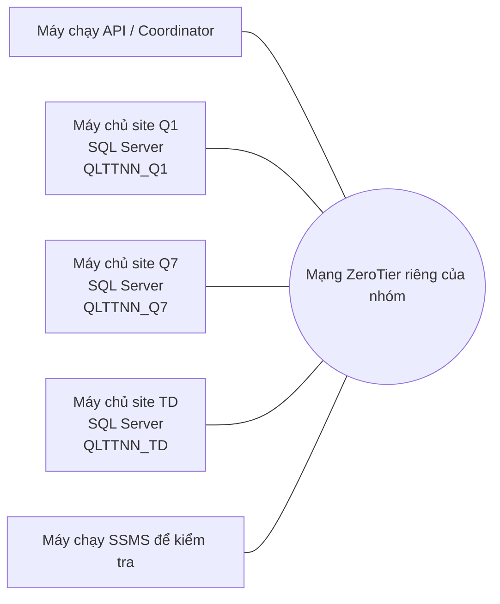

# Hướng dẫn kết nối các máy bằng ZeroTier và SQL Server

> Hướng dẫn hiện dùng ZeroTier. Các địa chỉ mạng là giá trị động, luôn lấy giá trị mới nhất từ ZeroTier Central.
>
> Hướng dẫn này dành cho nhóm triển khai đồ án CSDL phân tán. Làm phần mạng trên từng máy, phần SQL Server trên máy giữ CSDL, rồi thử kết nối từ máy khác.

## 1. Mục đích và giới hạn

ZeroTier tạo một mạng riêng ảo để các máy được nhóm cho phép có thể liên lạc qua mạng. Nó không tự tạo, chia mảnh, nhân bản hoặc đồng bộ CSDL. Mỗi site vẫn phải có SQL Server và CSDL riêng theo thiết kế. Mở được TCP 1433 chỉ chứng minh đường TCP tới máy chủ hoạt động; điều đó chưa chứng minh đăng nhập SQL, quyền, Linked Server, Replication hay giao dịch phân tán đã được cấu hình.

Ba site ban đầu của đồ án là Quận 1 (Q1), Quận 7 (Q7) và Thủ Đức (TD). Mỗi site giữ một CSDL SQL Server riêng. API/Coordinator kết nối riêng tới từng site; không tạo CSDL nghiệp vụ trung tâm để gộp dữ liệu.



## 2. Bảng thông tin mạng của nhóm

Điền bảng này sau khi từng thiết bị đã tham gia và được duyệt. Managed IP của ZeroTier có thể thay đổi nếu cấu hình mạng được sửa; đối chiếu Central trước mỗi lần demo.

| Site/vai trò | Người phụ trách | Tên thiết bị | ZeroTier Node ID | ZeroTier Managed IP | Instance SQL Server | Cổng TCP | CSDL |
|---|---|---|---|---|---|---:|---|
| Q1 |  |  |  |  |  | 1433 hoặc cổng đã chọn | QLTTNN_Q1 |
| Q7 |  |  |  |  |  | 1433 hoặc cổng đã chọn | QLTTNN_Q7 |
| TD |  |  |  |  |  | 1433 hoặc cổng đã chọn | QLTTNN_TD |
| API/Coordinator |  |  |  |  | Không áp dụng | Không áp dụng | Không áp dụng |
| Máy SSMS thành viên |  |  |  |  | Không áp dụng | Không áp dụng | Không áp dụng |

Phân biệt ba giá trị trong Central:

- Network ID: mã 16 ký tự của mạng; tất cả máy muốn tham gia phải dùng cùng mã này.
- Node ID / My Address: định danh của một thiết bị; đây không phải Network ID và cũng không phải địa chỉ IP để kết nối SQL.
- Managed IP / ZT IP: địa chỉ IP mà thiết bị dùng để liên lạc trong mạng ZeroTier. Dùng IP này trong Firewall, Test-NetConnection và SSMS.

Không ghi mật khẩu tài khoản ZeroTier, Windows hay SQL Server vào tài liệu, ảnh báo cáo hoặc Git. Network ID không phải mật khẩu, nhưng không cần đưa vào tài liệu công khai; chia sẻ riêng trong nhóm và duyệt từng thiết bị trong Central.

## 3. Chuẩn bị phần mềm

### 3.1. Trên Windows

1. Tải ZeroTier One từ trang tải chính thức: https://www.zerotier.com/download/.
2. Chạy bộ cài Windows và chấp thuận cài driver mạng nếu Windows hỏi.
3. Xác nhận dịch vụ ZeroTier One đang chạy. Biểu tượng ZeroTier nằm trong khay hệ thống cạnh đồng hồ, có thể nằm sau nút mũi tên hiển thị biểu tượng ẩn.
4. Trên Windows, ZeroTier thường thao tác bằng menu ở khay hệ thống, không phải cửa sổ ứng dụng lớn. Chọn biểu tượng để mở menu mạng.

### 3.2. Trên macOS, gồm cả Mac Intel

1. Tải bộ cài macOS PKG từ https://www.zerotier.com/download/; không tải ứng dụng iPhone/iPad trong App Store.
2. Mở file PKG và làm theo trình cài đặt. Nhập mật khẩu quản trị Mac nếu được yêu cầu.
3. Nếu macOS yêu cầu cho phép cấu hình VPN hoặc phần mềm mạng, chấp thuận trong hộp thoại của hệ thống theo hướng dẫn hiện ra.
4. Biểu tượng ZeroTier nằm trên thanh menu macOS. Ứng dụng cũng thao tác qua menu, không nhất thiết mở thành cửa sổ lớn.
5. Trang tải chính thức hiện liệt kê macOS 10.13 trở lên; nếu máy chạy macOS cũ hơn, kiểm tra yêu cầu tương thích trước khi cài.

App Store trong ảnh nhóm dùng là bản iPhone/iPad và có thể báo không tương thích với Mac Intel. Cần tải bản macOS PKG trực tiếp từ trang chính thức. Tham khảo trang tải ZeroTier: https://www.zerotier.com/download/.

### 3.3. Máy chạy SQL Server

- Máy chứa dữ liệu site phải cài SQL Server Database Engine. SSMS chỉ là công cụ quản trị, không thay thế Database Engine.
- Mỗi máy cần ghi rõ site được giao, instance SQL Server và CSDL site tương ứng.
- Nếu máy mới chỉ có SSMS, cài Database Engine trước khi làm phần cấu hình TCP.
- Lưu thông tin xác thực trong nơi nhóm thống nhất bảo vệ; không đưa bí mật vào repository.

Nếu chưa cài Database Engine, chạy bộ cài SQL Server bằng quyền quản trị Windows, chọn Installation → New SQL Server stand-alone installation, chọn Database Engine Services và cấu hình instance. Thêm tài khoản Windows hiện tại vào nhóm quản trị SQL Server. Chỉ bật SQL Server Authentication nếu nhóm cần dùng; tạo login riêng có mật khẩu mạnh, không dùng sa cho API hoặc thành viên. Sau cài đặt, xác nhận dịch vụ SQL Server ở trạng thái Running và thử kết nối cục bộ bằng SSMS.

## 4. Tạo tổ chức/mạng ZeroTier

Tạo một mạng cho nhóm; không tạo một mạng khác cho từng máy.

1. Đăng nhập Central tại https://central.zerotier.com/ hoặc hoàn tất trang onboarding của ZeroTier.
2. Nếu cần tạo tổ chức, nhập tên nhóm/tổ chức. Tên thư mục có thể bỏ trống.
3. Tạo mạng và đặt tên dễ nhận ra, ví dụ QLTTNN-CSDLPT.
4. Nếu được hỏi chọn gói cho đồ án phi thương mại, kiểm tra điều khoản hiện hành và chọn Personal/Free phù hợp. Trang giá hiện nêu gói Personal miễn phí hỗ trợ tối đa 10 thiết bị, một mạng và một quản trị viên: https://www.zerotier.com/pricing/.
5. Mở trang mạng vừa tạo và sao chép Network ID. Network ID thường gồm 16 ký tự thập lục phân.
6. Chỉ chia sẻ Network ID cho thành viên cần tham gia. Network ID không thay thế bước duyệt thiết bị.

Nếu mạng QLTTNN-CSDLPT đã được tạo, tiếp tục dùng đúng mạng đó và không tạo thêm mạng mới. Network ID hiện tại lấy ở đầu trang chi tiết mạng trong Central.

## 5. Cho máy Windows/macOS tham gia mạng

Làm lần lượt trên máy SQL Server, máy API/Coordinator và máy thành viên cần kiểm tra dữ liệu.

1. Mở menu ZeroTier ở khay hệ thống Windows hoặc thanh menu macOS.
2. Chọn Join New Network… hoặc Join Network.
3. Dán Network ID 16 ký tự của mạng nhóm và chọn Join.
4. Quay lại ZeroTier Central, mở đúng mạng và danh sách Member Devices.
5. Tìm thiết bị vừa xuất hiện, kiểm tra tên/Node ID rồi bật Authorize/đánh dấu trạng thái cho phép. Không duyệt thiết bị lạ.
6. Chờ thiết bị hiện trạng thái được ủy quyền và có Managed IP.
7. Ghi Node ID, tên thiết bị và Managed IP vào bảng mục 2.
8. Lặp lại trên tất cả máy cần kết nối. Mọi thiết bị phải tham gia cùng Network ID.

Không nhập Node ID/My Address vào ô Join New Network. Ô đó cần Network ID của mạng.

### Xác định thiết bị nào là máy SQL Server

Trong Central, tìm đúng Node ID của máy đang chạy SQL Server rồi đọc cột ZT IP/Managed IP trên cùng một dòng. IP đó là địa chỉ đích khi máy khác kết nối SQL Server.

Ví dụ: nếu máy Q1 có Managed IP `<ZT_IP_MAY_SQL>`, máy thành viên có IP `<ZT_IP_MAY_KHACH>` và SQL Server chạy trên máy Q1:

- Máy thành viên kết nối tới máy chủ bằng `<ZT_IP_MAY_SQL>`, cổng 1433.
- Trên Firewall của máy Q1, Remote IP Scope cho phép nguồn `<ZT_IP_MAY_KHACH>`.
- Khi thêm thành viên khác, thêm Managed IP của người đó vào Remote IP Scope nếu họ được phép truy cập.

Đây chỉ là ví dụ. Luôn lấy Managed IP hiện tại trong Central, không giả định IP cố định.

## 6. Kiểm tra hai thiết bị ZeroTier liên lạc

Trước tiên kiểm tra Central cho thấy cả hai thiết bị đã Authorized và có Managed IP. Từ một máy khách khác máy chủ, mở PowerShell/Terminal và thử ping IP ZeroTier của máy chủ:

```powershell
ping <ZT_IP_MAY_SQL>
```

Ping thành công là dấu hiệu ban đầu. Ping thất bại chưa chứng minh VPN hỏng vì Firewall có thể chặn ICMP; tiếp tục kiểm tra TCP ở mục 9.

## 7. Cấu hình SQL Server nhận TCP từ xa

Thực hiện trên từng máy giữ CSDL site.

### 7.1. Xác nhận instance và dịch vụ

1. Mở SQL Server Configuration Manager → SQL Server Services.
2. Tìm đúng Database Engine, ví dụ SQL Server (MSSQLSERVER) cho instance mặc định.
3. Xác nhận trạng thái Running. Nếu có nhiều instance, ghi lại chính xác instance chứa CSDL site.
4. Không nhầm SQL Server Agent với Database Engine. Agent không quyết định việc SSMS kết nối TCP 1433 được hay không.

### 7.2. Bật TCP/IP và đặt cổng cố định

1. Trong Configuration Manager, mở SQL Server Network Configuration → Protocols for <instance đúng>.
2. Nhấp phải TCP/IP → Enable nếu đang Disabled.
3. Mở TCP/IP Properties → Protocol. Đặt Enabled = Yes. Với cấu hình đồ án đơn giản, đặt Listen All = Yes.
4. Mở thẻ IP Addresses, kéo xuống IPAll.
5. Xóa giá trị TCP Dynamic Ports để trống và đặt TCP Port = 1433. Nếu đã chọn cổng khác, ghi lại cổng đó và dùng thống nhất ở Firewall, PowerShell và SSMS.
6. Chọn Apply/OK.
7. Trong SQL Server Services, khởi động lại đúng dịch vụ Database Engine.
8. Xác nhận dịch vụ trở lại Running.

Default instance thường dùng TCP 1433. Với named instance, đặt cổng tĩnh để không phải dựa vào cổng động. Khi kết nối bằng TCP với địa chỉ IP và cổng cụ thể, không cần SQL Server Browser để tìm cổng. Không mở UDP 1434 trừ khi nhóm chủ động kết nối theo tên instance qua Browser.

Tham khảo hướng dẫn Microsoft về [cổng TCP cố định](https://learn.microsoft.com/en-us/sql/database-engine/configure-windows/configure-a-server-to-listen-on-a-specific-tcp-port?view=sql-server-ver17) và [kết nối từ máy khác](https://learn.microsoft.com/en-us/sql/relational-databases/lesson-2-connecting-from-another-computer?view=sql-server-ver17).

### 7.3. SQL Server Authentication khi cần

Máy trong nhóm thường không cùng Windows domain. Nếu Windows Authentication từ máy khác không dùng được, người quản lý SQL Server có thể bật Mixed Mode và tạo login riêng cho thành viên/API:

1. Trong SSMS trên máy chủ, kết nối cục bộ bằng tài khoản quản trị.
2. Nhấp phải tên server → Properties → Security → chọn SQL Server and Windows Authentication mode.
3. Khởi động lại Database Engine.
4. Mở Security → Logins → New Login, tạo login riêng; cấp quyền tối thiểu ở User Mapping cho đúng CSDL site.
5. Không cấp sysadmin để tiện thao tác, không dùng login sa và không đưa mật khẩu vào tài liệu/Git.

Nếu dự án đã có script tạo role và login theo chính sách nhóm, sử dụng đúng script đó thay cho việc tự cấp quyền rộng.

## 8. Tạo Firewall rule cho ZeroTier

Tạo luật mới trên từng máy chủ SQL Server. Không dùng hoặc sửa luật có tên Radmin VPN; tạo luật riêng để dễ kiểm soát và gỡ luật cũ sau khi kết nối mới đã được kiểm thử.

1. Trên máy chủ SQL, mở Start, nhập wf.msc và mở Windows Defender Firewall with Advanced Security.
2. Chọn Inbound Rules → New Rule… → Port.
3. Chọn TCP, nhập Specific local ports là 1433 hoặc cổng SQL cố định đã chọn.
4. Chọn Allow the connection.
5. Chọn profile đang áp dụng cho adapter ZeroTier. Nếu chưa biết profile, có thể chọn các profile cần thiết nhưng bắt buộc giới hạn Remote IP ở bước 8; không để Remote IP mở cho mọi địa chỉ.
6. Đặt tên, ví dụ QLTTNN SQL TCP 1433 - ZeroTier, rồi hoàn tất.
7. Mở Properties của luật mới → Scope.
8. Trong Remote IP address, chọn These IP addresses → Add.
9. Nhập Managed IP hiện tại của từng máy khách/API được phép truy cập SQL Server này. Không nhập IP của máy chủ vào danh sách nguồn trừ khi cần kiểm tra loopback.
10. Kiểm tra lại đúng cổng, IP nguồn và profile; chọn Apply/OK.

Nếu có ba site trên ba máy, cấu hình rule trên từng máy SQL và chỉ thêm các peer cần truy cập tới máy đó. Có thể chọn cả ba Windows profile để tránh sai profile của adapter ảo, nhưng phải giữ Scope giới hạn đúng các Managed IP được phép. Không mở 1433 trên router ra Internet và không tắt Windows Firewall.

Microsoft hướng dẫn tạo Inbound Port Rule cho Database Engine tại [Configure Windows Firewall for Database Engine Access](https://learn.microsoft.com/en-us/sql/database-engine/configure-windows/configure-a-windows-firewall-for-database-engine-access?view=sql-server-ver17).

## 9. Kiểm tra cổng từ máy thành viên

Chạy lệnh này trên máy khách, không phải máy SQL Server. Thay IP/cổng theo bảng mục 2:

```powershell
Test-NetConnection -ComputerName <ZT_IP_MAY_SQL> -Port 1433
```

Trên macOS, mở Terminal và kiểm tra cổng TCP bằng `nc`:

```bash
nc -vz <ZT_IP_MAY_SQL> 1433
```

Thông báo `succeeded` hoặc `open` xác nhận máy Mac mở được kết nối TCP tới cổng đó; nó chưa xác nhận tài khoản SQL hay quyền truy cập database.

Kết quả cần có:

```text
RemoteAddress    : <ZT_IP_MAY_SQL>
RemotePort       : 1433
SourceAddress    : <ZT_IP_MAY_KHACH>
TcpTestSucceeded : True
```

SourceAddress phải là IP ZeroTier của máy đang chạy lệnh; RemoteAddress là IP máy SQL Server. Chạy lệnh trên chính máy chủ tới chính IP của nó chỉ kiểm tra cục bộ, chưa chứng minh máy thành viên truy cập được.

- True: đường TCP mở; tiếp tục thử SSMS. Kết quả này chưa xác nhận login, mật khẩu hoặc quyền CSDL.
- False: kiểm tra Central có cả hai thiết bị Authorized/online; IP đích; SQL service; TCP/IP và cổng; service restart; Windows Firewall; Remote IP Scope có IP nguồn của máy khách.

## 10. Kết nối SSMS từ máy khác

Trên máy khách Windows, mở SSMS → Connect → Database Engine. Nhập Server name theo dạng:

```text
tcp:<ZT_IP_MAY_SQL>,1433
```

Thay `<ZT_IP_MAY_SQL>` bằng Managed IP hiện tại của máy SQL trong ZeroTier Central. SSMS 20 là ứng dụng Windows; trên Mac, dùng `nc` để kiểm tra đường mạng rồi kết nối qua API của dự án hoặc một SQL client tương thích do nhóm thống nhất. Đường TCP mở không đồng nghĩa đăng nhập SQL thành công.

Chọn Authentication đã được cấu hình. Nếu dùng SQL Server Authentication, nhập login do người quản lý máy chủ cấp; không dùng mật khẩu ZeroTier. Sau khi kết nối, chọn đúng database của site, ví dụ QLTTNN_Q1.

Có thể chạy truy vấn chỉ đọc để xác nhận instance và database hiện tại:

```sql
SELECT @@SERVERNAME AS TenMayChu, DB_NAME() AS CSDLHienTai, SYSDATETIME() AS ThoiGianMayChu;
SELECT name, state_desc FROM sys.databases;
```

Lệnh liệt kê database chỉ xem CSDL trên instance vừa kết nối, không tự tìm CSDL trên các site khác. SSMS 20 có thể hiển thị lỗi đăng nhập, quyền hoặc chứng chỉ sau khi TCP đã thành công; đọc thông báo cụ thể, không tắt mã hóa hoặc mở rộng Firewall để xử lý lỗi xác thực.

Tham khảo [kết nối Database Engine bằng SSMS](https://learn.microsoft.com/en-us/sql/ssms/quickstarts/ssms-connect-query-sql-server).

## 11. Đưa ba CSDL đang cùng máy sang các máy site riêng

Nếu hiện QLTTNN_Q1, QLTTNN_Q7 và QLTTNN_TD cùng nằm trên một máy, đây mới là môi trường thử lược đồ/nghiệp vụ; chưa thể hiện ba máy chủ site riêng. Chỉ thực hiện chuyển khi nhóm đã phân công máy cho từng site.

### 11.1. Sao lưu từng database

1. Trong SSMS, nhấp phải QLTTNN_Q1 → Tasks → Back Up.
2. Chọn Full, đặt file tên QLTTNN_Q1_full.bak ở thư mục tạm và chạy sao lưu.
3. Lặp lại riêng cho QLTTNN_Q7 và QLTTNN_TD.
4. Xác nhận mỗi lần backup hoàn tất thành công trước khi chuyển file.

### 11.2. Chuyển và khôi phục

1. Chuyển file backup tới đúng máy site bằng kênh nội bộ được nhóm chấp thuận. Backup có thể chứa dữ liệu cá nhân; không đưa lên Git hoặc repository công khai.
2. Trên máy Q1, mở SSMS cục bộ → nhấp phải Databases → Restore Database → Device → chọn file backup Q1.
3. Xác nhận tên database đích là QLTTNN_Q1. Kiểm tra đường dẫn MDF/LDF trong Files nếu đường dẫn máy nguồn không tồn tại trên máy đích.
4. Lặp lại, đảm bảo Q7 chỉ khôi phục backup QLTTNN_Q7 và TD chỉ khôi phục backup QLTTNN_TD.
5. Refresh Databases và kiểm tra các bảng cốt lõi: HocVien, LopHoc, GiaoVien, MonHoc, DangKy, HocPhi, Diem.
6. Kiểm tra schema đồng nhất giữa các site nhưng dữ liệu nghiệp vụ nằm ở site tương ứng.

Restore tạo bản sao khởi tạo, không phải cơ chế đồng bộ liên tục. Không tạo database trung tâm để gộp dữ liệu các cơ sở.

## 12. Thêm thành viên hoặc thiết bị mới

1. Thành viên cài ZeroTier từ trang chính thức trên Windows hoặc macOS PKG trên Mac.
2. Quản trị mạng chia sẻ Network ID riêng trong nhóm.
3. Thành viên chọn Join New Network và nhập ID.
4. Quản trị viên kiểm tra Node ID/tên thiết bị rồi Authorize đúng thiết bị trong Central.
5. Ghi Managed IP mới vào bảng nhóm.
6. Nếu thành viên cần truy cập SQL, thêm Managed IP của máy khách vào Remote IP Scope trên các máy SQL Server mà họ được phép dùng.
7. Chạy Test-NetConnection từ máy khách và thử SSMS bằng quyền SQL tối thiểu.
8. Khi thành viên rời nhóm, thu hồi quyền thành viên trong Central, gỡ IP khỏi Firewall và thu hồi login SQL liên quan.

## 13. Xử lý lỗi thường gặp

| Triệu chứng | Kiểm tra và xử lý |
|---|---|
| App Store báo ZeroTier không tương thích với Mac | Không dùng ứng dụng iPhone/iPad trong App Store. Tải macOS PKG từ trang chính thức; kiểm tra máy chạy macOS 10.13 trở lên. |
| Không thấy cửa sổ ZeroTier | Trên Windows tìm icon trong khay hệ thống/biểu tượng ẩn; trên Mac tìm icon trên thanh menu. ZeroTier chủ yếu thao tác qua menu, không phải cửa sổ lớn. |
| Menu ghi no networks joined | Máy đã cài nhưng chưa join. Chọn Join New Network và nhập Network ID 16 ký tự. |
| Join xong nhưng chưa kết nối | Trong Central, Authorize đúng thiết bị; chờ thiết bị hiện Managed IP và trạng thái online. |
| Nhầm My Address với Network ID | My Address/Node ID nhận diện thiết bị; Network ID là mã mạng dùng để Join; Managed IP là IP dùng cho kết nối và Firewall. |
| Không nhìn thấy peer | Xác nhận hai máy cùng Network ID, Central đã authorize cả hai, ZeroTier đang chạy và mỗi máy có Managed IP. |
| Ping thất bại | Có thể ICMP bị Firewall chặn. Thử Test-NetConnection tới TCP port SQL; không kết luận VPN hỏng chỉ từ ping. |
| TcpTestSucceeded là False | Kiểm tra máy khách/host đang Online, đúng Managed IP, SQL Server Running, TCP/IP Enabled, đúng port, restart service và luật Firewall có IP nguồn máy khách. |
| TCP thành công nhưng SSMS không đăng nhập | Kiểm tra Authentication, login, Mixed Mode nếu dùng SQL login, User Mapping, quyền database và tên database. TCP thành công không chứng minh quyền SQL. |
| Kết nối được nhưng không thấy database | Kiểm tra đúng IP máy host, instance và database đã được restore tại máy đó. Refresh Databases trong SSMS. |
| Invalid object name khi FROM QLTTNN_Q7 | SQL Server hiểu QLTTNN_Q7 là tên bảng, không phải tên database. Chọn đúng database/bảng. Tên bốn phần chỉ dùng khi cả hai database cùng instance; nếu Q7 ở máy khác, kết nối riêng tới Q7 hoặc để API hỏi site đó. |
| SQL Server Agent không chạy | Agent là dịch vụ riêng. Kiểm tra khi nhóm cần Job hoặc bài Replication; Agent dừng không đồng nghĩa Database Engine không nghe TCP. |
| Một site mất kết nối khi Global Query | API phải báo kết quả không đầy đủ và liệt kê site thiếu; không trả danh sách một phần như dữ liệu toàn hệ thống. |

## 14. Minh chứng cho báo cáo

Chụp ảnh sau khi thao tác thành công. Che mật khẩu, token, thông tin nhạy cảm và dữ liệu cá nhân thật. Mỗi ảnh ghi chú máy, site và thời điểm.

- ZeroTier Central cho thấy các thiết bị cần demo đã được authorize.
- Bảng tên máy, site, Node ID, Managed IP, instance và cổng đã điền.
- SQL Server Configuration Manager cho thấy đúng instance, TCP/IP Enabled và cổng.
- SQL Server Database Engine đang Running; Agent nếu bài thực hành cần.
- Inbound Firewall rule TCP đúng cổng và Remote IP Scope chỉ chứa máy được phép.
- Test-NetConnection chạy từ máy khác có TcpTestSucceeded là True; ảnh thể hiện địa chỉ nguồn khác địa chỉ đích.
- SSMS kết nối từ xa tới từng site và truy vấn xác nhận đúng máy/database.
- Backup/restore từng database site nếu nhóm đã thực sự thực hiện.

Không ghi bước là đã cài, đã kết nối hoặc đã đồng bộ nếu chưa có kết quả kiểm tra tương ứng. VPN, TCP, login SQL, Linked Server/Replication, phân mảnh và giao dịch phân tán là các phần riêng, cần cấu hình và kiểm chứng riêng theo đề cương môn học.

## 15. Checklist trước buổi demo

- [ ] Máy API/Coordinator và các máy SQL cần demo đã tham gia cùng Network ID và được authorize.
- [ ] Từng máy có Managed IP và được ghi đúng vào bảng phân công.
- [ ] Mỗi site có SQL Server Database Engine Running và đúng database site riêng.
- [ ] TCP/IP bật, port cố định được ghi nhận và Database Engine đã restart sau khi đổi cấu hình.
- [ ] Firewall trên từng SQL Server cho phép TCP port cần thiết, giới hạn Remote IP ở các peer ZeroTier được phép.
- [ ] Máy khách chạy Test-NetConnection tới đúng IP/cổng từng host và nhận True.
- [ ] SSMS kết nối được bằng tài khoản phù hợp; không dùng sysadmin cho thao tác thường ngày.
- [ ] API/Coordinator dùng kết nối riêng cho từng site, không dùng một database trung tâm.
- [ ] Ảnh minh chứng không lộ password, token hoặc thông tin cá nhân.
- [ ] Luật Firewall cũ mang tên Radmin đã được rà soát và gỡ nếu không còn cần.

## 16. Tài liệu tham khảo

- [ZeroTier Downloads — Windows và macOS PKG](https://www.zerotier.com/download/)
- [ZeroTier Quickstart — cài đặt, Join Network và Authorize thiết bị](https://docs.zerotier.com/quickstart/)
- [ZeroTier pricing](https://www.zerotier.com/pricing/)
- [Microsoft Learn — kết nối SQL Server từ máy khác](https://learn.microsoft.com/en-us/sql/relational-databases/lesson-2-connecting-from-another-computer?view=sql-server-ver17)
- [Microsoft Learn — cấu hình Windows Firewall cho SQL Server](https://learn.microsoft.com/en-us/sql/database-engine/configure-windows/configure-a-windows-firewall-for-database-engine-access?view=sql-server-ver17)
- [Microsoft Learn — cấu hình cổng TCP cố định](https://learn.microsoft.com/en-us/sql/database-engine/configure-windows/configure-a-server-to-listen-on-a-specific-tcp-port?view=sql-server-ver17)
- [Microsoft Learn — cài SQL Server Database Engine](https://learn.microsoft.com/en-us/sql/database-engine/install-windows/install-sql-server-from-the-installation-wizard-setup?view=sql-server-ver17)
- [Đề cương báo cáo của nhóm](QLTTNN-De-Cuong-Bao-Cao.md)
- [Kiến trúc CSDL phân tán của nhóm](QLTTNN-Kien-Truc.md)
