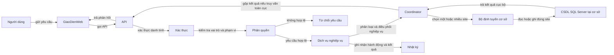

# Hướng dẫn đọc và tổ chức source

Tài liệu này chuyển [README chính](../README.md), mục 2–5 và 11, thành chỉ dẫn cho thành viên bắt đầu làm code. Stack đã chốt là **Next.js frontend**, **Django API/backend** và **SQL Server**; **SSMS** dùng để quản trị/kiểm tra CSDL. Chuyển cơ sở dùng trạng thái tại nguồn, sự kiện append-only và phục hồi tiến về phía trước; nhịp chạy worker phục hồi còn cần cấu hình ở README mục 9. Cơ chế xử lý lỗi cho ghi dữ liệu nhân bản được mô tả riêng ở mục 5.14.

## 1. Luồng một yêu cầu



Thứ tự bắt buộc: xác định người dùng và phạm vi quyền trước khi đọc/ghi; xếp nghiệp vụ vào một trong bốn kiểu; định vị dữ liệu theo schema; chạy giao dịch theo đúng ranh giới; ghi nhật ký theo README mục 4. Một truy vấn không được tự dùng kết nối mặc định rồi vô tình chạm sai cơ sở.

## 2. Trách nhiệm module

| Module logic | Nhiệm vụ | Không được làm |
|---|---|---|
| Xác thực/phân quyền | Đăng nhập, trạng thái tài khoản, vai trò, cơ sở và quyền lớp | Tin vào quyền giao diện gửi lên mà không kiểm tra lại |
| Site Router | Đọc danh sách site hoạt động và ánh xạ sang cấu hình kết nối | Viết cứng vòng lặp ba site hoặc suy ra cơ sở hiện tại từ mã học viên |
| Service nghiệp vụ | Áp dụng quy tắc đăng ký, học phí, điểm, lớp... | Tự triển khai lại logic đồng bộ nhiều site |
| Global Query | Gọi site cần thiết, gắn nguồn kết quả, gộp và ghi nhận site thiếu | JOIN giữa CSDL hoặc che việc một site lỗi |
| Đồng bộ dữ liệu dùng chung | Một điểm vào cho mọi ghi `CoSo`, `MonHoc`, `KhoaHoc`, `TaiKhoan` | Trả thành công khi chưa ghi đủ các site hoạt động |
| Điều phối chuyển cơ sở | Điều phối nguồn/đích, lưu tiến trình và phục hồi | Dùng hai câu ghi rời mà không có theo dõi trạng thái bền vững |
| Audit/log | Ghi người, site, thời điểm, loại hành động, kết quả và thay đổi | Ghi mật khẩu/token hoặc cho phép sửa/xóa log |
| Repository | Thực hiện truy vấn cục bộ với kết nối đã nhận | Tự quyết định site bằng tiền tố mã |

Các nhiệm vụ Coordinator ở bảng trên được thực hiện trong Django API theo README mục 2. Next.js chỉ gọi API; Django mới chọn kết nối SQL Server qua Site Router.

## 3. Cách xử lý từng loại nghiệp vụ

### `LOCAL`

Router chọn đúng một cơ sở. Các thao tác con thuộc cùng nghiệp vụ và cùng CSDL nằm trong một local transaction.

Ví dụ đăng ký lớp: kiểm tra quyền/phạm vi → xác nhận học viên và lớp cùng cơ sở → kiểm tra sĩ số, lịch, đăng ký trùng → tạo `DangKy` và `HocPhi` → tăng sĩ số → ghi nhật ký → commit. Nếu một bước lỗi thì rollback toàn bộ. Học phí phải lấy từ giá áp dụng cho đăng ký mới theo quy tắc trong README; sửa học phí chuẩn sau này không tự đổi khoản đã tạo.

### `GLOBAL`

Gọi từng cơ sở đang hoạt động, thực hiện truy vấn cục bộ tương ứng, sau đó gộp ở ứng dụng. Mỗi phần kết quả cần giữ mã cơ sở nguồn để kiểm tra và trình bày. Nếu site lỗi/timeout, trả kết quả nhận được cùng danh sách site thiếu; giao diện phải đánh dấu dữ liệu chưa đầy đủ. Không biến thiếu dữ liệu thành số 0.

### `REPLICATED-WRITE`

Chỉ service đồng bộ dùng chung được ghi bảng nhân bản. Xác định tất cả site `hoat_dong`; nếu site nào không sẵn sàng thì từ chối trước khi tuyên bố thành công. Thao tác bao gồm tạo/sửa/đóng danh mục, tài khoản, hoặc cập nhật trạng thái site theo luồng README.

Không rải `for each site: UPDATE` trong từng màn hình. Bộ điều phối trong Django phải ghi kết quả mỗi site vào `NhatKyDongBo` và có quy trình xử lý lỗi/đối soát. SQL Server đã được chọn; cơ chế commit đa CSDL và phục hồi còn phải chốt.

### Chuyển cơ sở gồm `LOCAL` → `GLOBAL` → `DISTRIBUTED-TX`

Admin Small chỉ tạo đề nghị tại site mình phụ trách (`LOCAL`). Admin Big đọc hộp thư bằng cách hỏi từng CSDL site rồi gộp ở Django (`GLOBAL`); quyết định được ghi về CSDL nguồn bằng transaction cục bộ. Chỉ khi đề nghị đã được duyệt (`dang_xu_ly`) thì Transfer Coordinator mới phối hợp đúng hai site: nguồn và đích (`DISTRIBUTED-TX`). Chi tiết trạng thái và lỗi ở [QLTTNN-Giao-Dich-Phan-Tan.md](QLTTNN-Giao-Dich-Phan-Tan.md).

## 4. Mã giả cho bốn kiểu thao tác

Đây là hợp đồng logic, không phải mã chạy được. Khi triển khai, đặt Site Router, lớp truy cập SQL Server và ghi nhật ký trong Django; Next.js gọi endpoint tương ứng, không giữ kết nối DB.

### `LOCAL`: đăng ký khóa học

```text
registerStudent(actor, siteCode, studentId, classId):
    authorize(actor, action="enroll", site=siteCode)
    db = router.connectionFor(siteCode)

    try:
        return db.transaction(tx):
            student = students.findForUpdate(tx, studentId)
            class = classes.findForUpdate(tx, classId)
            require(student.ma_co_so == siteCode)
            require(class.ma_co_so == siteCode)
            require(class.si_so_hien_tai < class.si_so_toi_da)
            require(noDuplicateOrScheduleConflict(tx, student, class))

            enrollment = enrollments.insert(tx, student, class)
            tuition = tuition.createFromCurrentCoursePrice(tx, enrollment)
            classes.incrementSeats(tx, class)
            audit.recordInTransaction(tx, actor, "dang_ky_khoa_hoc", enrollment)
            return enrollment, tuition
    on failure:
        rollback all writes in this site
        record denied/failed attempt in the local audit path as required
        never log password or raw reset token
```

Các điều kiện và thay đổi lấy từ README mục 5.1. Cách khóa bản ghi và transaction cụ thể phải phù hợp với SQL Server và cách Django kết nối từng site. Nếu bước tạo học phí hoặc nhật ký lỗi, không để lại đăng ký hay tăng sĩ số một mình. README yêu cầu lớp cùng cơ sở và còn chỗ; nhóm cần thống nhất trước khi code có cho đăng ký muộn vào lớp `dang_hoc` hay không.

Các luồng `LOCAL` khác cũng phải giữ toàn bộ thay đổi cùng site trong một giao dịch:

| Chức năng | Kiểm tra trước ghi | Thay đổi cùng giao dịch |
|---|---|---|
| Đổi lớp | Lớp mới cùng site, cùng khóa, còn chỗ, chưa kết thúc; không trùng lịch | Đổi lớp đăng ký; giảm sĩ số lớp cũ, tăng lớp mới; giữ nguyên học phí đã đóng |
| Thu học phí | Số tiền lớn hơn 0 và không vượt số còn nợ; có quyền thu | Thêm `PhieuThu`; cộng `so_tien_da_dong`; cập nhật trạng thái học phí |
| Hoàn học phí | Chỉ quản lý cơ sở/admin; kiểm tra số đã thu và số đề nghị hoàn | Thêm phiếu hoàn; cập nhật số đã đóng và trạng thái theo README/schema |
| Nhập/sửa điểm | Giáo viên dạy lớp đó (hoặc admin), điểm từ 0 đến 10 | Thêm/sửa điểm và ghi giá trị cũ/mới vào nhật ký |
| Điểm danh | Giáo viên dạy lớp; buổi học không bị hủy; một học viên một trạng thái cho mỗi buổi | Ghi điểm danh, chuyển buổi sang `da_hoc` theo luồng README |
| Mở lớp | Quản lý cơ sở/admin; giáo viên và phòng cùng site; kiểm tra trùng lịch | Tạo lớp và các dòng buổi học trong cùng site |

Mỗi màn hình/API vẫn phải gọi service có kiểm tra quyền; không lấy việc ẩn nút làm kiểm soát truy cập.

### `GLOBAL`: thống kê học viên đang học

```text
countActiveStudents(actor):
    authorize(actor, action="view_global_report")
    sites = router.activeSitesFromReplicatedCoSo()
    replies = queryEachSite(sites, count HocVien where trang_thai == "dang_hoc")
    total = sum(replies.successfulCounts)
    return {
        total,
        countsBySite: replies.successfulCounts,
        unavailableSites: replies.failedSites,
        complete: replies.failedSites is empty
    }
```

Không cộng trạng thái `da_chuyen_di`. Nếu có site lỗi, vẫn có thể trả phần nhận được theo README 5.6, nhưng `complete` phải là `false` và giao diện phải nêu rõ site thiếu. Không thay kết quả thiếu bằng 0.

### `REPLICATED-WRITE`: thêm khóa học

```text
addCourse(actor, course):
    authorize(actor, action="manage_catalog")
    sites = router.activeSitesFromReplicatedCoSo()
    require every active site has connection configuration
    require every active site is ready

    result = sharedDataWriter.writeToAll(sites, course)
    if result is not confirmed successful at every site:
        return failureOrRecoveryState(result); never report success
    return success
```

`sharedDataWriter` là một điểm vào duy nhất, không nằm lặp lại trong `catalogs`, `accounts`, `sites`. Cơ chế commit khi có lỗi giữa chừng chưa chốt; người làm module không được tự thay hợp đồng thành ghi một nơi rồi để nền đồng bộ sau.

Khi ghi `TaiKhoan`, trước khi tạo mới kiểm tra `ten_dang_nhap` và `email` chưa tồn tại ở bất cứ site liên quan nào. Khi đổi mật khẩu, bản mới phải có ở mọi site hoạt động để người dùng đăng nhập từ cơ sở nào cũng được. Quyền reset/khóa tài khoản và các bước xác minh theo README mục 5.8–5.9.

### Đề nghị và duyệt: một site ghi, nhiều site đọc

```text
requestTransfer(actor, studentId, destination, reason, idempotencyKey):
    require actor is active Admin Small
    source = actor.assigned_site                 # derive from server-side identity
    require destination != source
    current = globalQueries.locateCurrentStudent(studentId)
    require current.site == source
    db = router.connectionFor(source)
    return db.transaction(tx):
        student = students.findForUpdate(tx, studentId)
        verify student belongs to source and is dang_hoc
        verify no outstanding tuition and destination is active
        verify no open request/transfer for student at the current source
        request = insertTransfer(status="cho_duyet", step="cho_duyet",
                                 requester=actor, reason=reason,
                                 idempotencyKey=idempotencyKey)
        appendEvent(tx, request, "de_nghi")
        return request

listPendingTransferRequests(actor):
    require actor is active Admin Big
    sites = sitesWithStatus("hoat_dong")
    results = query each site database for status="cho_duyet"
    return mergeAtApplication(results, sitesThatFailed)

decideTransfer(actor, sourceFromInbox, requestId, decision, rejectionReason):
    require actor is active Admin Big
    db = router.connectionFor(sourceFromInbox)
    return db.transaction(tx):
        request = transfers.findForUpdate(tx, requestId)
        require request.co_so_nguon == sourceFromInbox
        require request.status == "cho_duyet"
        if decision == "reject":
            update request to "tu_choi" with actor, time, required reason
            appendEvent(tx, request, "tu_choi")
            return request
        recheck student status, debt, destination status/connectivity,
                and no other open request
        update request to "dang_xu_ly" / "da_tiep_nhan" with actor and time
        appendEvent(tx, request, "duyet")
        return request
```

### `DISTRIBUTED-TX`: chỉ chuyển đề nghị đã duyệt

```text
executeApprovedTransfer(requestId, source, destination):
    tx = loadSourceState(requestId)
    require tx.status == "dang_xu_ly" and tx.step == "da_tiep_nhan"
    require source and destination are ready

    createDestinationStudentAndEvent(tx)      # local destination transaction
    advanceSourceStateAndEvent(tx, "da_tao_ho_so_dich", event="xac_nhan_ho_so_dich")
    markSourceStudentAsTransferred(tx)        # local source transaction
    closeOldEnrollmentsAndUpdateClassCounts(tx)
    advanceSourceStateAndEvent(tx, "da_cap_nhat_nguon")
    verifyBothSitesAndCompleteAtSource(tx)
```

`GiaoDichChuyenCoSo` chỉ lưu tại nguồn; `LichSuChuyenCoSo` append-only và được ghi cùng thao tác cục bộ ở site nơi xảy ra. Worker bỏ qua `cho_duyet` và `tu_choi`, chỉ xử lý `dang_xu_ly`. Nếu đích chưa commit, giữ nguyên nguồn; retry lỗi kết nối hoặc kết thúc `that_bai` khi lỗi nghiệp vụ dứt điểm. Nếu đích đã commit rồi ứng dụng dừng, recovery tìm trạng thái mở ở nguồn, đối chiếu sự kiện có cùng `ma_chuyen` tại đích và làm nốt nguồn. Không tạo hồ sơ đích lần hai, không xóa đích. Dùng `khoa_chong_lap`, unique index trên học viên đang mở và `rowversion` để chặn gửi trùng/cạnh tranh. Đây là điều phối phục hồi tiến về phía trước bằng các transaction cục bộ, không khẳng định ACID nguyên tử xuyên CSDL; Global Query xử lý bản hiện hành theo mục 6 của tài liệu giao dịch phân tán.

## 5. Cấu trúc source gợi ý

```text
frontend/                         Next.js
  app/                             Màn hình/routes frontend
  components/                      Thành phần giao diện
  lib/api/                         Client gọi Django API; không có credential SQL Server

backend/                          Django API và Coordinator
  config/                          Cấu hình Django và biến môi trường
  api/                             Endpoint, xác thực request và định dạng response
  core/
    permissions/                   Vai trò, phạm vi cơ sở/lớp
    sites/                          Site Router và cấu hình kết nối SQL Server
    global_queries/                 Đọc từng site và gộp kết quả
    replication/                    Điểm vào ghi dữ liệu dùng chung
    distributed_tx/                 Chuyển cơ sở, trạng thái và phục hồi
    audit/                           Nhật ký và đối soát
  modules/
    accounts/                       Tài khoản
    catalogs/                       Cơ sở, môn học, khóa học
    students/                       Học viên
    classes/                        Lớp, phòng, buổi học
    enrollments/                    Đăng ký, đổi lớp
    tuition/                        Học phí, phiếu thu
    grades/                         Điểm
    attendance/                     Điểm danh
    reports/                        Thống kê

database/
  sqlserver/                        Script tạo cùng schema trên từng CSDL site
  seed/                             Bộ dữ liệu demo theo site
```

Đây là cấu trúc gợi ý để tránh trộn trách nhiệm, chưa khẳng định các thư mục này đã có trong repo. Next.js chỉ gọi Django API; Django là nơi duy nhất đọc biến kết nối và truy cập SQL Server. Không tạo module chưa cần, nhưng Site Router, Global Query, replicated write và transfer transaction phải có người sở hữu rõ.

## 6. Lỗi và kết quả trả về

Mọi service cần phân biệt ít nhất: lỗi đầu vào/nghiệp vụ (không ghi), không đủ quyền (không ghi và audit thất bại), site không khả dụng, lỗi local transaction (rollback), lỗi một phần giữa các site (trả trạng thái đang xử lý/không xác định cho đến khi phục hồi). Không trả `success` chỉ vì API đã nhận yêu cầu.

Không log mật khẩu/token, kể cả trong exception. Mọi thao tác cần mã yêu cầu để nối nhật ký và hỗ trợ retry; nhóm cần thống nhất định dạng và nơi lưu mã này cùng cơ chế retry/phục hồi của Django và SQL Server.

## 7. Quy tắc cho từng PR

Mỗi thay đổi phải nêu: loại nghiệp vụ; site đọc/ghi; bảng ảnh hưởng; quyền cần kiểm tra; ranh giới transaction; nhật ký; hành vi khi site lỗi; và docs/schema có thay đổi không. Checklist hoàn tất và cách chia người làm ở [QLTTNN-Lam-Viec-Nhom.md](QLTTNN-Lam-Viec-Nhom.md).
