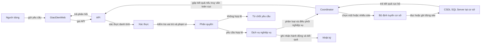

# Kiến trúc, định tuyến site và hướng dẫn source

**Tra nhanh:** [Luồng yêu cầu](#1-luồng-một-yêu-cầu) · [Module](#2-trách-nhiệm-module) · [Kiểu nghiệp vụ](#3-cách-xử-lý-từng-loại-nghiệp-vụ) · [Cấu trúc source](#5-cấu-trúc-source-hiện-có) · [Cấu hình/vòng đời site](#dinh-tuyen-site). Tổng quan dự án xem [README gốc](../README.md).

Tài liệu này giải thích kiến trúc và cách lần theo source cho thành viên. Stack là **Next.js frontend**, **Django REST API/Coordinator** và **SQL Server**; **SSMS** dùng để quản trị/kiểm tra CSDL. Chuyển cơ sở có route retry do Admin Big gọi. Ghi `KhoaHoc` có outbox bền vững và worker `manage.py sync_courses`; `run-local.ps1` khởi động worker cùng API, UI cũng gọi đối soát khi trang mở/đang chờ. Môi trường chạy API bằng cách khác phải giám sát worker riêng. Ghi catalog dùng chung có service riêng cho `MonHoc` và `KhoaHoc`; các nghiệp vụ khác có cơ chế riêng, không giả định đã gom vào một replication service tổng quát.

## 1. Luồng một yêu cầu

Trước khi triển khai, đọc [yêu cầu chung và bộ kịch bản YC/TC](QLTTNN-Yeu-Cau-Chung-Va-Kiem-Chung.md): **2–4 site** (đồ án dùng 3), tối thiểu một phương pháp phân mảnh, một phương pháp replication, một distributed transaction, một tình huống concurrency, một distributed query và đồng bộ dữ liệu. Mỗi nhóm được chọn kiểu phân mảnh phù hợp. Các mã giả dưới đây mô tả ý định, không phải bằng chứng các cơ chế đã chạy.



Thứ tự bắt buộc: xác định người dùng và phạm vi quyền trước khi đọc/ghi; xếp nghiệp vụ vào một trong bốn kiểu; định vị dữ liệu theo schema; chạy giao dịch theo đúng ranh giới; ghi nhật ký theo README mục 4. Một truy vấn không được tự dùng kết nối mặc định rồi vô tình chạm sai cơ sở.

## 2. Trách nhiệm module

| Module logic | Nhiệm vụ | Không được làm |
|---|---|---|
| Xác thực/phân quyền | Đăng nhập, trạng thái tài khoản, vai trò, cơ sở và quyền lớp | Tin vào quyền giao diện gửi lên mà không kiểm tra lại |
| Site Router (`src/api/core/sites/connections.py`) | Ánh xạ site đã xác thực sang alias SQL Server riêng | Viết cứng vòng lặp ba site hoặc suy ra cơ sở hiện tại từ mã học viên |
| Site read fan-out (`src/api/core/sites/fanout.py`) | Chạy truy vấn đọc độc lập với số worker giới hạn, giữ lỗi theo từng site và đóng kết nối worker | Dùng cho ghi nhiều site hoặc biến lỗi site thành kết quả rỗng |
| Service nghiệp vụ (`core/classes/`, `core/academics/`, `core/students/`...) | Áp dụng quy tắc đăng ký, học phí, điểm, lớp và hồ sơ | Tự triển khai lại logic fan-out dùng chung khi nghiệp vụ đã có service điều phối riêng |
| Truy vấn nhiều site | Nằm trong service của nghiệp vụ cần `GLOBAL`; fan-out truy vấn đọc độc lập rồi gộp tại API | JOIN giữa CSDL hoặc che việc một site lỗi; hiện không có package `global_queries/` riêng |
| Catalog dùng chung (`core/catalog/`) | `publisher_subjects.py` ghi `MonHoc` tại Publisher; `course_services.py` ghi `KhoaHoc` qua outbox `course_sync_queue.py` trên `AUTH_SESSION_SITE_CODE`, fan-out và ACK từng site; `POST /admin/courses/sync/` và `sync_courses` worker đối soát hàng đợi | Coi seed là replication, coi hai bảng dùng cùng cơ chế, hoặc giả định worker đã chạy nếu chưa khởi động/giám sát tiến trình |
| Chuyển cơ sở (`core/academics/transfers.py`) | Điều phối transaction cục bộ nguồn/đích, lưu tiến trình và cho Admin Big retry | Gọi là ACID nguyên tử xuyên CSDL hoặc mặc định có worker chạy nền |
| Ghi các bản sao khác | `TaiKhoan` và một số luồng thông báo có service/fan-out riêng; `CoSo` chưa có fan-out runtime đầy đủ | Mặc định có một replication writer chung cho mọi bảng; trạng thái cụ thể xem ma trận triển khai |
| Audit/log | Ghi người, site, thời điểm, loại hành động, kết quả và thay đổi | Ghi mật khẩu/token hoặc cho phép sửa/xóa log |
| Repository | Thực hiện truy vấn cục bộ với kết nối đã nhận | Tự quyết định site bằng tiền tố mã |

Các nhiệm vụ Coordinator hiện được thực hiện trong Django API theo từng nghiệp vụ. Next.js chỉ gọi API; Django mới chọn kết nối SQL Server qua Site Router. Hợp đồng kiến trúc “một điểm vào ghi mọi bảng dùng chung” là nguyên tắc cần hoàn thiện, chưa phải cấu trúc source hiện có.

## 3. Cách xử lý từng loại nghiệp vụ

### `LOCAL`

Router chọn đúng một cơ sở. Các thao tác con thuộc cùng nghiệp vụ và cùng CSDL nằm trong một local transaction.

Ví dụ đăng ký lớp: kiểm tra quyền/phạm vi → xác nhận học viên và lớp cùng cơ sở → kiểm tra sĩ số, lịch, đăng ký trùng → tạo `DangKy` và `HocPhi` → tăng sĩ số → ghi nhật ký → commit. Nếu một bước lỗi thì rollback toàn bộ. Học phí phải lấy từ giá áp dụng cho đăng ký mới theo quy tắc trong README; sửa học phí chuẩn sau này không tự đổi khoản đã tạo.

### `GLOBAL`

Gọi từng cơ sở đang hoạt động, thực hiện truy vấn cục bộ tương ứng, sau đó gộp ở ứng dụng. Mỗi phần kết quả cần giữ mã cơ sở nguồn để kiểm tra và trình bày. Nếu site lỗi/timeout, trả kết quả nhận được cùng danh sách site thiếu; giao diện phải đánh dấu dữ liệu chưa đầy đủ. Không biến thiếu dữ liệu thành số 0.

### `REPLICATED-WRITE`

Chỉ service đồng bộ dùng chung được ghi bảng nhân bản. Xác định tất cả site `hoat_dong`; nếu site nào không sẵn sàng thì từ chối trước khi tuyên bố thành công. Thao tác bao gồm tạo/sửa/đóng danh mục, tài khoản, hoặc cập nhật trạng thái site theo luồng README.

MonHoc chỉ ghi qua `core/catalog/publisher_subjects.py` tại Publisher cấu hình, SQL Server Publication chuyển bản sao; retry API chỉ đối soát. KhoaHoc giữ fan-out và ACK riêng. Không ghi trực tiếp MonHoc ở Subscriber. [Chi tiết](MonHoc-SQL-Replication.md).

### Chuyển cơ sở gồm `LOCAL` → `GLOBAL` → `DISTRIBUTED-TX`

Chỉ Tư vấn & xếp lớp tạo đề nghị tại site mình phụ trách (`LOCAL`); Kế toán & Lễ tân chỉ xem. Admin Big đọc hộp thư toàn cục; Admin Small ở site được giao chỉ thấy đề nghị phát sinh tại site mình hoặc gửi tới site mình (`GLOBAL` đọc có phạm vi, quyết định ghi cục bộ tại nguồn). Admin Big hoặc Admin Small site nhận có thể duyệt/từ chối, còn Admin Small nguồn không thể duyệt vì không phải site đích. Chỉ khi đề nghị đã được duyệt (`dang_xu_ly`) thì Transfer Coordinator mới phối hợp đúng hai site: nguồn và đích (`DISTRIBUTED-TX`). Sau khi hoàn tất, site nhận có thông báo cho nhân viên và Tư vấn chọn lớp/phòng thủ công; hồ sơ đích giữ nguyên tài khoản học viên. Chi tiết trạng thái và lỗi ở [QLTTNN-Giao-Dich-Phan-Tan.md](QLTTNN-Giao-Dich-Phan-Tan.md).

## 4. Mã giả cho bốn kiểu thao tác

Đây là hợp đồng logic, không phải mã chạy được. Khi triển khai, đặt Site Router, lớp truy cập SQL Server và ghi nhật ký trong Django; Next.js gọi endpoint tương ứng, không giữ kết nối DB.

### `LOCAL`: đăng ký khóa học

```text
registerStudent(actor, siteCode, studentId, classId):
    authorize(actor, action="enroll", site=siteCode)
    db = router.connectionFor(siteCode)

    try:
        return db.transaction(tx):
            student = students.findForUpdate(tx, studentId)
            class = classes.findForUpdate(tx, classId)
            require(student.ma_co_so == siteCode)
            require(class.ma_co_so == siteCode)
            require(class.si_so_hien_tai < class.si_so_toi_da)
            require(noDuplicateOrScheduleConflict(tx, student, class))

            enrollment = enrollments.insert(tx, student, class)
            tuition = tuition.createFromCurrentCoursePrice(tx, enrollment)
            classes.incrementSeats(tx, class)
            audit.recordInTransaction(tx, actor, "dang_ky_khoa_hoc", enrollment)
            return enrollment, tuition
    on failure:
        rollback all writes in this site
        record denied/failed attempt in the local audit path as required
        never log password or raw reset token
```

Các điều kiện và thay đổi lấy từ README mục 5.1. Cách khóa bản ghi và transaction cụ thể phải phù hợp với SQL Server và cách Django kết nối từng site. Nếu bước tạo học phí hoặc nhật ký lỗi, không để lại đăng ký hay tăng sĩ số một mình. README yêu cầu lớp cùng cơ sở và còn chỗ; nhóm cần thống nhất trước khi code có cho đăng ký muộn vào lớp `dang_hoc` hay không.

`findForUpdate` trong mã giả là yêu cầu bảo vệ vùng kiểm tra/cập nhật, không khẳng định ORM/backend đang có một API khóa cụ thể. Với YC-05, phải chọn và ghi rõ cách khóa/mức cô lập hoặc cập nhật có điều kiện thực tế trên SQL Server. Chạy TC-CON-01 bằng hai phiên độc lập, hai học viên khác nhau tranh một chỗ; chỉ một yêu cầu thành công, yêu cầu thua không có `DangKy`/`HocPhi` dở dang. Unique đăng ký và nút disabled không thay thế cơ chế này.

Các luồng `LOCAL` khác cũng phải giữ toàn bộ thay đổi cùng site trong một giao dịch:

| Chức năng | Kiểm tra trước ghi | Thay đổi cùng giao dịch |
|---|---|---|
| Đổi lớp | Lớp mới cùng site, cùng khóa, còn chỗ, chưa kết thúc; không trùng lịch | Đổi lớp đăng ký; giảm sĩ số lớp cũ, tăng lớp mới; giữ nguyên học phí đã đóng |
| Thu học phí | Số tiền lớn hơn 0 và không vượt số còn nợ; có quyền thu | Thêm `PhieuThu`; cộng `so_tien_da_dong`; cập nhật trạng thái học phí |
| Hoàn học phí | Chỉ quản lý cơ sở/admin; kiểm tra số đã thu và số đề nghị hoàn | Thêm phiếu hoàn; cập nhật số đã đóng và trạng thái theo README/schema |
| Nhập/sửa điểm | Giáo viên dạy lớp đó (hoặc admin), điểm từ 0 đến 10 | Thêm/sửa điểm và ghi giá trị cũ/mới vào nhật ký |
| Điểm danh | Giáo viên dạy lớp; buổi học không bị hủy; một học viên một trạng thái cho mỗi buổi | Ghi điểm danh, chuyển buổi sang `da_hoc` theo luồng README |
| Mở lớp | Quản lý cơ sở/admin; giáo viên và phòng cùng site; kiểm tra trùng lịch | Tạo lớp và các dòng buổi học trong cùng site |

Mỗi màn hình/API vẫn phải gọi service có kiểm tra quyền; không lấy việc ẩn nút làm kiểm soát truy cập.

### `GLOBAL`: thống kê học viên đang học

```text
countActiveStudents(actor):
    authorize(actor, action="view_global_report")
    sites = router.activeSitesFromReplicatedCoSo()
    replies = queryEachSite(sites, count HocVien where trang_thai == "dang_hoc")
    total = sum(replies.successfulCounts)
    return {
        total,
        countsBySite: replies.successfulCounts,
        unavailableSites: replies.failedSites,
        complete: replies.failedSites is empty
    }
```

Không cộng trạng thái `da_chuyen_di`. Nếu có site lỗi, vẫn có thể trả phần nhận được theo README 5.6, nhưng `complete` phải là `false` và giao diện phải nêu rõ site thiếu. Không thay kết quả thiếu bằng 0.

Phép cộng COUNT trong mã giả chỉ mô tả trường hợp dữ liệu ổn định, không có giao dịch chuyển đang chạy. Khi có chuyển đang mở, phải đọc trạng thái/bước từ nguồn và áp dụng quy tắc bản hiện hành ở mục 7 của [tài liệu giao dịch](QLTTNN-Giao-Dich-Phan-Tan.md) trước khi đếm; thiếu dữ liệu xác định trạng thái thì báo chưa đầy đủ. TC-DQ-01 kiểm tra cả kết quả từng site và dấu vết gộp ở API; TC-DTX-01 kiểm tra tránh đếm trùng trong thời gian phục hồi.

### `REPLICATED-WRITE`: thêm khóa học

```text
addCourse(actor, course):
    authorize(actor, action="manage_catalog")
    sites = router.activeSitesFromReplicatedCoSo()
    require every active site has connection configuration
    require every active site is ready

    result = sharedDataWriter.writeToAll(sites, course)
    if result is not confirmed successful at every site:
        return failureOrRecoveryState(result); never report success
    return success
```

`sharedDataWriter` là mã giả cho trách nhiệm đồng bộ, không phải một class/package đã có. `KhoaHoc` lưu snapshot ý định trong `core/catalog/course_sync_queue.py` tại DB `AUTH_SESSION_SITE_CODE`, sau đó `course_services.py` fan-out theo từng transaction cục bộ và ghi ACK tại từng site. `POST /admin/courses/sync/` tiếp tục thao tác còn chờ; UI gọi khi mở trang và mỗi 10 giây khi có hàng đợi. Tạo/sửa có thể ghi các site đang kết nối; xóa chỉ chạy khi đủ site để kiểm tra `LopHoc`. Thao tác `can_doi_soat` có thể được retry riêng bằng `operation_id` sau khi xử lý nguyên nhân. Nếu site điều phối offline thì không nhận yêu cầu mới. `MonHoc` có writer riêng tại Publisher và SQL Server truyền bất đồng bộ; không áp dụng fan-out để ghi MonHoc vào Subscriber. Không thao tác nào trong hai cơ chế là ACID xuyên CSDL.

YC-03/YC-07 bắt buộc chốt phương pháp truyền thay đổi, lưu tiến trình/ACK, phiên bản và cách retry/đối soát trước khi triển khai. Tiền kiểm mọi site sẵn sàng không loại trừ site lỗi ngay sau đó. Nếu đã có bản sao commit, giữ kết quả từng site và báo chưa hoàn tất đến khi phục hồi; không tự giả định toàn bộ đã rollback. TC-REP-01 chứng minh truyền thay đổi thật; TC-SYNC-01 chứng minh lỗi/phục hồi. Seed ba DB và cấu hình kết nối không thay thế hai bài này.

Khi ghi `TaiKhoan`, trước khi tạo mới kiểm tra `ten_dang_nhap` và `email` chưa tồn tại ở bất cứ site liên quan nào. Khi đổi mật khẩu, bản mới phải có ở mọi site hoạt động để người dùng đăng nhập từ cơ sở nào cũng được. Quyền reset/khóa tài khoản và các bước xác minh theo README mục 5.8–5.9.

### Đề nghị và duyệt: một site ghi, nhiều site đọc

```text
requestTransfer(actor, studentSlug, destination, reason):
    require actor is active Tu van & xep lop
    source = actor.assigned_site                 # derive from server-side identity
    require destination != source
    db = router.connectionFor(source)
    return db.transaction(tx):
        student = students.findBySlugForUpdate(tx, studentSlug, source)
        verify student belongs to source and is dang_hoc
        verify no outstanding tuition and destination is active
        verify no open request/transfer for student at the current source
        request = insertTransfer(status="cho_duyet", step="cho_duyet",
                                 requester=actor, reason=reason)
        appendEvent(tx, request, "de_nghi")
        return request

listPendingTransferRequests(actor):
    require actor is Admin Big or Admin Small
    sites = sitesWithStatus("hoat_dong")
    results = query each site database for status="cho_duyet"
    return mergeAtApplicationAndFilterByRole(results, actor, sitesThatFailed)

decideTransfer(actor, sourceFromInbox, requestId, decision, rejectionReason):
    require actor is active Admin Big or Admin Small
    db = router.connectionFor(sourceFromInbox)
    return db.transaction(tx):
        request = transfers.findForUpdate(tx, requestId)
        require actor is Admin Big or actor.assigned_site == request.destination
        require request.co_so_nguon == sourceFromInbox
        require request.status == "cho_duyet"
        if decision == "reject":
            update request to "tu_choi" with actor, time, required reason
            appendEvent(tx, request, "tu_choi")
            return request
        recheck student status, debt, destination status/connectivity,
                and no other open request
        update request to "dang_xu_ly" / "da_tiep_nhan" with actor and time
        appendEvent(tx, request, "duyet")
        return request
```

### `DISTRIBUTED-TX`: chỉ chuyển đề nghị đã duyệt

```text
executeApprovedTransfer(requestId, source, destination):
    tx = loadSourceState(requestId)
    require tx.status == "dang_xu_ly" and tx.step == "da_tiep_nhan"
    require source and destination are ready

    createDestinationStudentAndEvent(tx)      # local destination transaction
    advanceSourceStateAndEvent(tx, "da_tao_ho_so_dich", event="xac_nhan_ho_so_dich")
    markSourceStudentAsTransferred(tx)        # local source transaction
    closeOldEnrollmentsAndUpdateClassCounts(tx)
    advanceSourceStateAndEvent(tx, "da_cap_nhat_nguon")
    verifyBothSitesAndCompleteAtSource(tx)
```

`GiaoDichChuyenCoSo` chỉ lưu tại nguồn; `LichSuChuyenCoSo` append-only và được ghi cùng thao tác cục bộ ở site nơi xảy ra. Coordinator không bắt đầu với `cho_duyet` hoặc `tu_choi`, chỉ xử lý `dang_xu_ly`; source cho Admin Big gọi route retry. Nếu đích chưa commit, giữ nguyên nguồn; retry lỗi kết nối hoặc kết thúc `that_bai` khi lỗi nghiệp vụ dứt điểm. Sau commit đích, retry đối chiếu sự kiện cùng `ma_chuyen` rồi hoàn tất nguồn, không tạo/xóa đích lần nữa. Source dùng transaction, khóa `UPDLOCK/HOLDLOCK`, khóa điều phối và unique index đề nghị đang mở; DDL có `rowversion` nhưng không khẳng định service đã dùng optimistic compare-and-swap trên cột đó. POST đề nghị chưa nhận Idempotency-Key; đề nghị mở trùng bị từ chối, khác replay theo key. Đây là phục hồi tiến về phía trước, không phải ACID nguyên tử xuyên CSDL; Global Query chọn bản hiện hành theo mục 7 tài liệu giao dịch.

## 5. Cấu trúc source hiện có

```text
src/
├── web/                            Next.js project root
│   └── src/
│       ├── app/                    Route hiện có: public, login, admin, teacher, student
│       ├── components/             Thành phần giao diện theo nghiệp vụ
│       ├── lib/                    API client, auth/session và tiện ích
│       └── styles/                 Style và token giao diện
└── api/                            Django REST API và Coordinator
    ├── config/                     Settings, middleware và root URLs
    └── core/
        ├── auth/                   Đăng nhập, session, tài khoản và reset OTP
        ├── sites/                  Site Router, kết nối SQL Server và bounded read fan-out
        ├── catalog/                Môn/khóa học, đọc và ghi bản sao
        ├── blog/                   API Blog công khai qua Global Query và CMS Admin Big đồng bộ bản sao
        ├── classes/                Lớp, phòng, đăng ký và xếp lớp
        ├── academics/              Lịch, điểm danh, điểm, học phí, chuyển và báo cáo
        ├── students/               Hồ sơ, portal và điều phối xóa học viên
        ├── teachers/               Hồ sơ, trạng thái và phân công giáo viên
        ├── employees/              Hồ sơ nhân viên nghiệp vụ
        ├── notifications/          Thông báo quản trị
        ├── audit/                  Truy vấn Logs theo quyền/site
        └── media/                  Intent/hoàn tất avatar Cloudinary

db/                                 SQL Server schema, seed, verify và migrations
specs/                              Đặc tả API và UI/UX
fs/                                 Functional Specification
docs/                               Schema, kiến trúc, TC và trạng thái triển khai
```

Đây là thư mục thực tế; tên một số trách nhiệm nghiệp vụ gộp chung trong `core/academics/` thay vì tách thành package riêng. Route API hiện có được đăng ký tại `src/api/core/urls.py`. Next.js chỉ gọi Django API; Django là nơi duy nhất đọc biến kết nối và truy cập SQL Server. Source hiện có service replication catalog và điều phối chuyển cơ sở, nhưng chỉ chạy TC trên SQL Server thật mới chứng minh yêu cầu phân tán.

## 6. Lỗi và kết quả trả về

Mọi service cần phân biệt ít nhất: lỗi đầu vào/nghiệp vụ (không ghi), không đủ quyền (không ghi và audit thất bại), site không khả dụng, lỗi local transaction (rollback), lỗi một phần giữa các site (trả trạng thái đang xử lý/không xác định cho đến khi phục hồi). Không trả `success` chỉ vì API đã nhận yêu cầu.

Không log mật khẩu/token, kể cả trong exception. Mọi thao tác cần mã yêu cầu để nối nhật ký và hỗ trợ retry; nhóm cần thống nhất định dạng và nơi lưu mã này cùng cơ chế retry/phục hồi của Django và SQL Server.

## 7. Quy tắc cho từng PR

Mỗi thay đổi phải nêu: loại nghiệp vụ; site đọc/ghi; bảng ảnh hưởng; quyền cần kiểm tra; ranh giới transaction; nhật ký; hành vi khi site lỗi; và docs/schema có thay đổi không. Checklist hoàn tất và cách chia người làm ở [QLTTNN-Lam-Viec-Nhom.md](QLTTNN-Lam-Viec-Nhom.md).

Nếu thay đổi phục vụ YC-01–YC-07, ghi mã YC/TC, bằng chứng thực tế và phần chưa kiểm chứng. Rà đồng thời FS, API và UI để lỗi cạnh tranh/thiếu site/đang phục hồi có cùng ý nghĩa. Transaction cục bộ của đăng ký không thay cho distributed transaction giữa nguồn và đích.


---

<a id="dinh-tuyen-site"></a>

## 8. Cấu hình và vòng đời site

Nguồn xác định site có hai phần:

| Nguồn | Chứa thông tin gì | Quy tắc |
|---|---|---|
| Bảng `CoSo` đã nhân bản | Mã, tên và trạng thái cơ sở | Cơ sở `hoat_dong` nhận truy vấn và tham gia ghi dùng chung |
| Cấu hình kết nối của Coordinator | Mã cơ sở ánh xạ tới địa chỉ và thông tin kết nối CSDL | Bí mật kết nối không lưu trong bảng nghiệp vụ hoặc commit vào repo |

Site Router đối chiếu các cơ sở `hoat_dong` với cấu hình khi service lấy danh sách/kết nối; không khẳng định đã có preflight mọi database ngay lúc khởi động Django. Thiếu cấu hình/kết nối phải được báo theo hợp đồng endpoint (từ chối ghi hoặc trả danh sách chưa đầy đủ), không âm thầm bỏ site. Không lặp ba lần, không viết cứng Q1/Q7/TD trong logic nghiệp vụ.

Trạng thái site:

| Trạng thái | Nhận truy vấn? | Tham gia ghi dùng chung? | Ý nghĩa |
|---|:---:|:---:|---|
| `chuan_bi` | Không | Không | Đang tạo CSDL và chép bản dùng chung |
| `hoat_dong` | Có | Có | Đang vận hành |
| `dong_cua` | Không | Không | Ngừng nhận yêu cầu, vẫn giữ lịch sử |

### 8.1. Thêm hoặc đóng một site

Luồng thêm site theo README 5.14:

1. Tạo CSDL mới với cùng bộ schema; khai báo cấu hình kết nối ở Coordinator.
2. Thêm site ở trạng thái `chuan_bi` vào bảng `CoSo` nhân bản để các site đang chạy biết site mới.
3. Khởi tạo các bản sao dùng chung theo [schema mục 3](DATABASE_SCHEMA.md#3-dữ-liệu-nằm-ở-đâu), gồm danh mục, tài khoản và Blog; riêng `MonHoc` cấu hình Subscriber theo chính sách Publication, không thêm writer trực tiếp. Đối soát dữ liệu/phiên bản trước khi mở site.
4. Chỉ khi đồng nhất mới kích hoạt `hoat_dong` qua ghi nhân bản tới mọi site, bao gồm site mới.
5. Tạo tài khoản quản lý/nhân viên/giáo viên tại cơ sở mới; sau đó site mới nhận dữ liệu nghiệp vụ.

Site `chuan_bi` chưa nhận truy vấn và chưa nằm trong tập ghi đủ. Không đánh dấu hoạt động trước khi chép xong, nếu không thống kê và ghi dùng chung sẽ hỏi một CSDL chưa sẵn sàng. Khi đóng site: xử lý các đề nghị `cho_duyet`/giao dịch `dang_xu_ly`, chuyển học viên đi theo nghiệp vụ chuyển cơ sở, đổi trạng thái thành `dong_cua` qua ghi nhân bản, giữ nguyên dữ liệu và lịch sử.

Không suy ra site hiện tại của học viên từ tiền tố mã. Học viên chuyển site nhưng giữ mã tạo ban đầu; tìm bản `dang_hoc` bằng truy vấn toàn cục.

### 8.2. Trách nhiệm kiểm chứng của các module

- Site Router và repository chịu trách nhiệm YC-01/YC-02: kết nối riêng, truy cập đúng mảnh và cha/con cùng site.
- Module dữ liệu dùng chung chịu trách nhiệm YC-03/YC-07: phương pháp replication cụ thể, ACK/phiên bản, lỗi giữa chừng và đối soát; một điểm vào ghi không đồng nghĩa dùng DB nghiệp vụ trung tâm. Không vừa fan-out ghi từ API vừa để Publication ghi lại cùng bảng.
- Coordinator chuyển cơ sở chịu trách nhiệm YC-04: hai site, trạng thái bền vững, lỗi trước/sau commit và phục hồi. Mức bảo đảm hiện tại là phục hồi tiến về phía trước; nếu tiêu chí giảng viên yêu cầu DBMS quản lý giao dịch, phải chốt cơ chế bổ sung, không gọi thiết kế hiện tại là ACID xuyên site.
- Service đăng ký cùng transaction SQL Server chịu trách nhiệm YC-05: kiểm tra/cập nhật chỗ cuối an toàn trước hai phiên cạnh tranh. Frontend chỉ phản hồi trạng thái xung đột.
- Global Query chịu trách nhiệm YC-06: tổng hợp kết quả đọc tại API, chọn học viên hiện hành và thông báo site thiếu; không giả định snapshot chung giữa các site.

Quyền từng vai trò theo [README tổng mục 3](../README.md#3-ai-được-làm-gì); không duy trì thêm ma trận quyền trùng ở tài liệu kiến trúc. Quyết định chưa chốt và giới hạn giao dịch theo [README mục 9](../README.md#9-stack-và-quyết-định-còn-mở). Bố trí máy và mảnh dữ liệu xem [schema mục 3](DATABASE_SCHEMA.md#3-dữ-liệu-nằm-ở-đâu).
