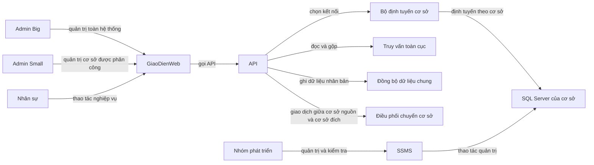

# Kiến trúc hệ thống

Tài liệu này giải thích README chính thành bản đồ kiến trúc dễ tra cứu cho cả nhóm. Các quyết định nghiệp vụ phải theo [README.md](../README.md); định nghĩa bảng phải theo [DATABASE_SCHEMA.md](DATABASE_SCHEMA.md). Nếu hai tài liệu con và README khác nhau, sửa tài liệu con cho khớp README. Nếu README và schema mâu thuẫn, nhóm phải thống nhất rồi cập nhật cả hai.

## 1. Mục tiêu phân tán

Đồ án phải thể hiện nhiều CSDL độc lập, dữ liệu được chia theo cơ sở, dữ liệu dùng chung được nhân bản, truy vấn toàn cục được gộp, và ít nhất một giao dịch ảnh hưởng nhiều site. Đây không phải ứng dụng một CSDL có cột `chi_nhanh`.

Hiện có ba cơ sở: Quận 1 (`Q1`), Quận 7 (`Q7`) và Thủ Đức (`TD`). Mỗi site có một CSDL riêng, cùng cấu trúc bảng nhưng lưu các mảnh dữ liệu khác nhau. Có thể bổ sung site mới như Bình Thạnh (`BT`) mà không phải sửa code nghiệp vụ.

## 2. Sơ đồ thành phần

Mũi tên thể hiện chiều thao tác giữa vai trò, giao diện, API, bộ định tuyến và CSDL. Các trách nhiệm điều phối được thực hiện trong Django API theo README mục 2. Frontend dùng Next.js; mỗi cơ sở có CSDL SQL Server riêng. SSMS dùng cho quản trị và kiểm tra, không nằm trong luồng API của người dùng. Cấu hình triển khai, phiên bản SQL Server và giao thức phục hồi giao dịch vẫn cần nhóm thống nhất ở README mục 9.

## 3. Xác định site và kết nối

Nguồn xác định site có hai phần:

| Nguồn | Chứa thông tin gì | Quy tắc |
|---|---|---|
| Bảng `CoSo` đã nhân bản | Mã, tên và trạng thái cơ sở | Cơ sở `hoat_dong` nhận truy vấn và tham gia ghi dùng chung |
| Cấu hình kết nối của Coordinator | Mã cơ sở ánh xạ tới địa chỉ và thông tin kết nối CSDL | Bí mật kết nối không lưu trong bảng nghiệp vụ hoặc commit vào repo |

Khi khởi động, Coordinator kiểm tra các cơ sở `hoat_dong` có cấu hình kết nối tương ứng. Thiếu cấu hình thì báo lỗi cấu hình và không khởi động luồng nghiệp vụ. Không lặp ba lần, không viết cứng `Q1/Q7/TD`; số site lấy từ dữ liệu và cấu hình.

Trạng thái site:

| Trạng thái | Nhận truy vấn? | Tham gia ghi dùng chung? | Ý nghĩa |
|---|:---:|:---:|---|
| `chuan_bi` | Không | Không | Đang tạo CSDL và chép bản dùng chung |
| `hoat_dong` | Có | Có | Đang vận hành |
| `dong_cua` | Không | Không | Ngừng nhận yêu cầu, vẫn giữ lịch sử |

### Thêm hoặc đóng một site

Luồng thêm site theo README 5.14:

1. Tạo CSDL mới với cùng bộ schema; khai báo cấu hình kết nối ở Coordinator.
2. Thêm site ở trạng thái `chuan_bi` vào bảng `CoSo` nhân bản để các site đang chạy biết site mới.
3. Chép `CoSo`, `MonHoc`, `KhoaHoc`, `TaiKhoan`, `TaiKhoanLienKetOAuth` sang site mới; đối soát phiên bản cho khớp.
4. Chỉ khi đồng nhất mới kích hoạt `hoat_dong` qua ghi nhân bản tới mọi site, bao gồm site mới.
5. Tạo tài khoản quản lý/nhân viên/giáo viên tại cơ sở mới; sau đó site mới nhận dữ liệu nghiệp vụ.

Site `chuan_bi` chưa nhận truy vấn và chưa nằm trong tập ghi đủ. Không đánh dấu hoạt động trước khi chép xong, nếu không thống kê và ghi dùng chung sẽ hỏi một CSDL chưa sẵn sàng. Khi đóng site: xử lý các đề nghị `cho_duyet`/giao dịch `dang_xu_ly`, chuyển học viên đi theo nghiệp vụ chuyển cơ sở, đổi trạng thái thành `dong_cua` qua ghi nhân bản, giữ nguyên dữ liệu và lịch sử.

Không suy ra site hiện tại của học viên từ tiền tố mã. Học viên chuyển site nhưng giữ mã tạo ban đầu; tìm bản `dang_hoc` bằng truy vấn toàn cục.

## 4. Bốn kiểu thao tác và hợp đồng giữa module

| Kiểu | Đọc/ghi ở đâu | Ví dụ | Hành vi khi một site lỗi |
|---|---|---|---|
| `LOCAL` | Một site qua Site Router | Đăng ký, đổi lớp, thu học phí, nhập điểm, mở lớp, điểm danh | Không ghi sang site khác; giao dịch tại site được rollback nếu bước cục bộ thất bại |
| `GLOBAL` | Đọc các site cần thiết; ứng dụng gộp | Thống kê, tra cứu học viên, nhật ký toàn hệ thống | README 5.6 cho phép hiện phần có được kèm cảnh báo site thiếu; không trình bày số đó như tổng đầy đủ |
| `REPLICATED-WRITE` | Ghi bảng dùng chung ở mọi site `hoat_dong` | Tài khoản, liên kết OAuth, môn học, khóa học, trạng thái cơ sở | Thiếu site sẵn sàng thì từ chối; không báo thành công nếu chỉ ghi một phần |
| Đề nghị chuyển | CSDL nguồn | Admin Small tạo đề nghị `cho_duyet` | Học viên chưa chuyển và vẫn ở nguồn |
| Hộp thư/duyệt đề nghị | Đọc các site; ghi quyết định tại nguồn | Admin Big đọc hộp thư, duyệt hoặc từ chối (`GLOBAL` + ghi cục bộ) | Kết quả thiếu site phải được đánh dấu; không có DB trung tâm |
| `DISTRIBUTED-TX` | Hai site nguồn/đích của học viên | Chuyển hồ sơ sau khi được duyệt | Chỉ bắt đầu khi đề nghị `cho_duyet` đã chuyển sang `dang_xu_ly`; phục hồi theo trạng thái đã lưu, xem [giao dịch phân tán](QLTTNN-Giao-Dich-Phan-Tan.md) |

`REPLICATED-WRITE` và `DISTRIBUTED-TX` đều có thể chạm nhiều CSDL, nhưng là hai hợp đồng nghiệp vụ khác nhau. Chúng không được cài đặt rải rác bên trong module học viên, tài khoản hay danh mục.

## 5. Vai trò và ranh giới dữ liệu

| Vai trò | Phạm vi |
|---|---|
| Admin Big | Toàn hệ thống; quản lý tài khoản/danh mục, xem báo cáo và nhật ký toàn cục; duyệt/từ chối đề nghị chuyển |
| Admin Small | Cơ sở được phân công; điều hành nghiệp vụ, tạo đề nghị chuyển ra cơ sở khác và theo dõi đề nghị của cơ sở mình |
| Lễ tân | Cơ sở của mình; hồ sơ học viên, đăng ký, đổi lớp |
| Kế toán | Cơ sở của mình; thu học phí |
| Giáo viên | Lớp mình dạy; nhập điểm và điểm danh |

`TaiKhoan.vai_tro` là `admin`, `nhan_vien`, `giao_vien`; Admin Big dùng tài khoản `admin`, còn Admin Small là `nhan_vien` có `NhanVien.chuc_vu = quan_ly_co_so` và site được gán. Backend kiểm tra đăng nhập, quyền chức năng, phạm vi cơ sở và quyền lớp trước khi đọc/ghi. Với chuyển cơ sở, Admin Small chỉ tạo đề nghị; chỉ Admin Big được quyết định. Ma trận chi tiết ở README mục 3–4.

## 6. Quy tắc liên site

- Không có khóa ngoại vật lý giữa hai CSDL.
- Không viết một câu SQL JOIN qua hai site.
- Cần dữ liệu nhiều nơi: gọi từng site rồi gộp ở ứng dụng.
- Các bảng nghiệp vụ phụ thuộc lớp/đăng ký ở cùng site với cha.
- Đề nghị chuyển nằm tại CSDL nguồn; hộp thư Admin Big đọc các site riêng bằng Global Query. Chỉ đề nghị đã duyệt mới khởi động giao dịch phân tán.
- Chuyển cơ sở chỉ di chuyển trạng thái hồ sơ học viên; không dời lịch sử điểm, học phí, điểm danh hoặc lớp cũ.
- Ghi danh mục/tài khoản đi qua một module đồng bộ duy nhất.

## 7. Các điểm phải thống nhất trước khi code phân tán

README đã chốt SQL Server, Next.js và Django. Nhóm vẫn phải quyết định giao thức xử lý giao dịch nhiều CSDL, retry sau timeout, mã yêu cầu chống xử lý trùng, trạng thái giao dịch bền vững và đối soát sau sự cố. Ghi quyết định ở README mục 9 và cập nhật tài liệu giao dịch. Xem [QLTTNN-Lam-Viec-Nhom.md](QLTTNN-Lam-Viec-Nhom.md) để thống nhất người chịu trách nhiệm quyết định và tích hợp.
