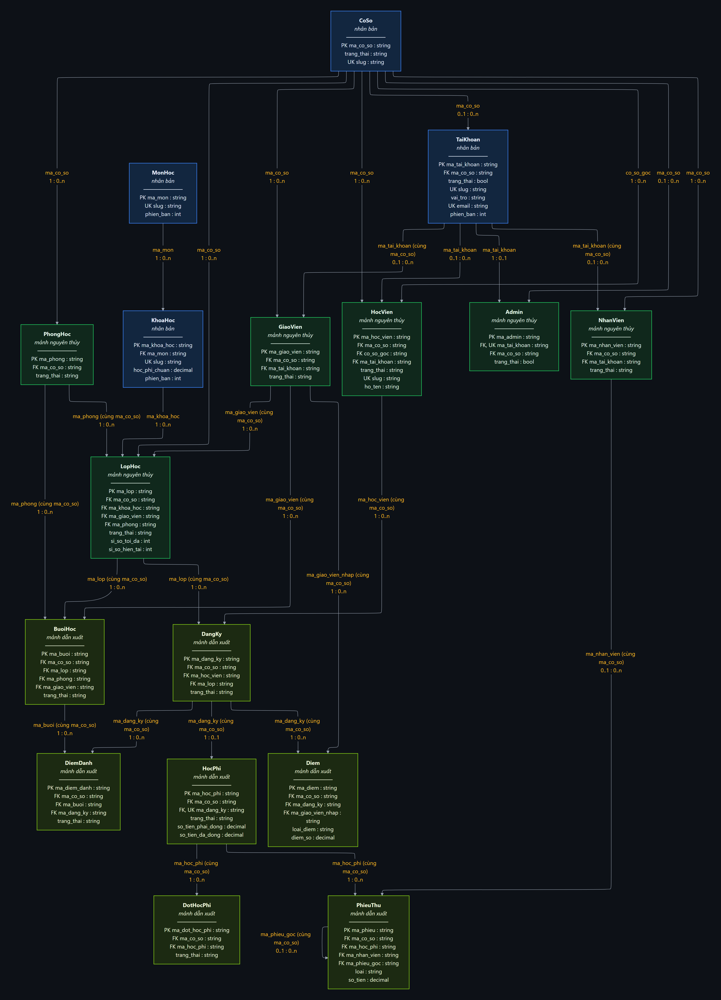
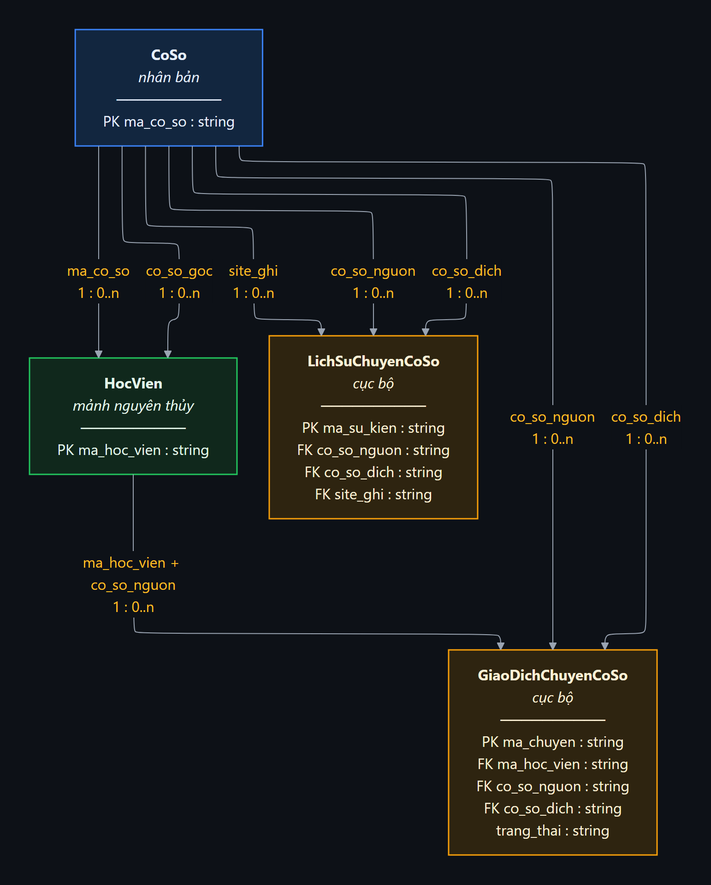
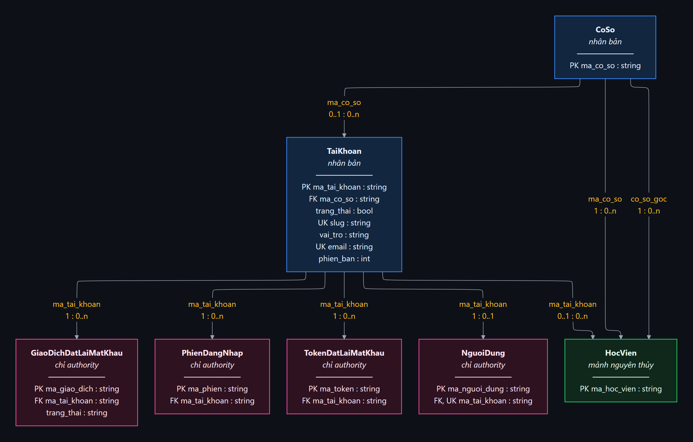
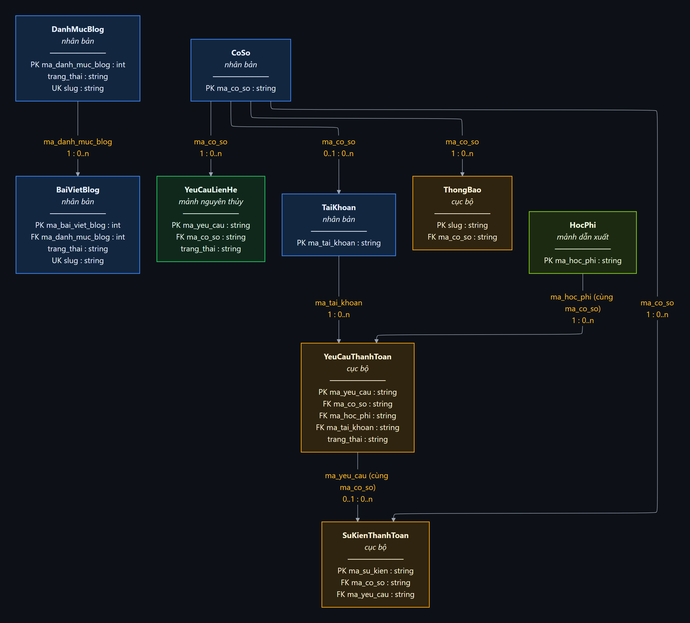
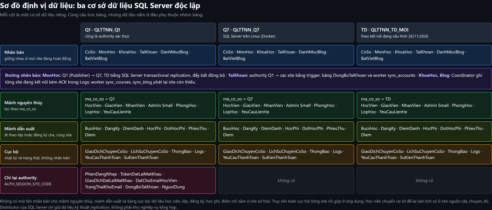
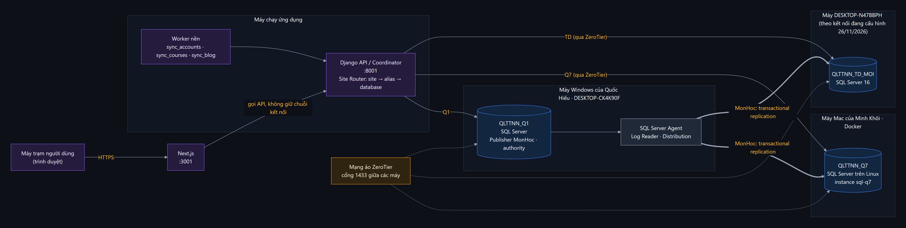

# Sơ đồ ERD, định vị dữ liệu và bố trí máy

Các sơ đồ dùng cho báo cáo (mục 2.2.1, 2.2.2 và 3.2). ERD **sinh tự động từ metadata của cơ sở dữ liệu Q1 thật** (bảng, khóa chính, khóa ngoại, ràng buộc duy nhất), nên không lệch so với schema đang chạy; nguồn `.mmd` và ảnh `.png`/`.svg` nằm ở [diagrams/](diagrams/). Chi tiết cột của từng bảng xem [DATABASE_SCHEMA.md](DATABASE_SCHEMA.md#6-chi-tiết-từng-bảng).

**Cách đọc ERD.** Mỗi khung là một bảng, ghi tên, nhóm phân tán (nhân bản, mảnh nguyên thủy, mảnh dẫn xuất, cục bộ, chỉ authority) và các cột chính: khóa chính (`PK`), khóa ngoại (`FK`), cột duy nhất (`UK`), cột phân mảnh `ma_co_so`, trạng thái và vài cột nghiệp vụ; kiểu dữ liệu rút gọn thành `string`, `int`, `decimal`, `bool`, `datetime`. Màu khung theo nhóm: xanh dương là nhân bản, xanh lá là mảnh nguyên thủy, xanh lá nhạt là mảnh dẫn xuất, vàng là cục bộ, hồng là chỉ authority. **Mũi tên đi từ bảng cha sang bảng con**, đầu nhọn chỉ vào bảng giữ khóa ngoại. Nhãn vàng trên mũi tên gồm cột khóa ngoại và bội số theo dạng `cha : con`: `1 : 0..n` nghĩa là một dòng cha có không hoặc nhiều dòng con; `1 : 0..1` là có không hoặc một; `0..1 : 0..n` là khóa ngoại tùy chọn (có thể để trống). "(cùng ma_co_so)" nghĩa là khóa ngoại ghép, buộc bảng con và bảng cha cùng cơ sở. Ảnh dùng nền tối, chữ sáng.

Sơ đồ phản ánh schema ngày 27/11/2026 (sau migration 47, 48, 49 tại Q1).

## 1. ERD nghiệp vụ tại từng cơ sở



[Nguồn Mermaid](diagrams/erd-nghiep-vu.mmd) · [SVG](diagrams/erd-nghiep-vu.svg)

Điểm cần nói khi trình bày:

- **Chỉ có khóa ngoại trong một cơ sở dữ liệu.** Không có khóa ngoại hay JOIN xuyên cơ sở. Bảng nhân bản (`MonHoc`, `KhoaHoc`, `TaiKhoan`, `CoSo`) được tham chiếu qua bản sao cùng site.
- **Khóa ngoại ghép bảo vệ phân mảnh dẫn xuất.** `DangKy`, `BuoiHoc`, `HocPhi`, `DotHocPhi`, `PhieuThu`, `Diem`, `DiemDanh` nối với cha bằng cặp (mã cha, `ma_co_so`), nên không thể có bản con ở site khác site của cha.
- **`ma_co_so` có thể trống ở hai bảng.** `TaiKhoan.ma_co_so` trống với Admin Big và tài khoản `nguoi_dung`; `Admin.ma_co_so` trống với Admin Big.
- **Đăng ký có 0 hoặc 1 khoản học phí** theo DDL (`HocPhi.ma_dang_ky` duy nhất); service đăng ký luôn tạo đúng một khoản cùng transaction.
- **`PhieuThu` tự tham chiếu** qua `ma_phieu_goc` để phiếu hoàn trỏ về phiếu thu gốc.
- **`HocVien` có hai khóa ngoại tới `CoSo`**: `ma_co_so` (cơ sở hiện tại, dùng để phân mảnh) và `co_so_goc`.

## 2. ERD điều phối, xác thực và dữ liệu phụ trợ

Tách thành ba sơ đồ nhỏ để dễ đọc. Các bảng ngữ cảnh (`CoSo`, `TaiKhoan`, `HocVien`, `HocPhi`) chỉ hiện khóa chính.

### 2.1. Chuyển cơ sở



[Nguồn Mermaid](diagrams/erd-chuyen-co-so.mmd) · [SVG](diagrams/erd-chuyen-co-so.svg)

`GiaoDichChuyenCoSo` chỉ có ở cơ sở dữ liệu nguồn và trỏ tới bản `HocVien`, `CoSo` cùng cơ sở dữ liệu đó. `LichSuChuyenCoSo` là sự kiện chỉ thêm, ghi ở site phát sinh; mã `ma_chuyen` là mã tương quan, **không có khóa ngoại tới giao dịch ở cơ sở dữ liệu khác**.

### 2.2. Tài khoản và xác thực



[Nguồn Mermaid](diagrams/erd-xac-thuc.mmd) · [SVG](diagrams/erd-xac-thuc.svg)

`PhienDangNhap`, `TokenDatLaiMatKhau`, `GiaoDichDatLaiMatKhau` và `NguoiDung` chỉ có ở cơ sở authority (`AUTH_SESSION_SITE_CODE`, hiện Q1). `NguoiDung` (migration 49) là hồ sơ của tài khoản `nguoi_dung`, quan hệ 1–0..1 với `TaiKhoan`, không nhân bản.

### 2.3. Thanh toán, liên hệ, thông báo và Blog



[Nguồn Mermaid](diagrams/erd-phu-tro.mmd) · [SVG](diagrams/erd-phu-tro.svg)

**Không vẽ ba bảng không có khóa ngoại theo thiết kế:** `Logs` (nhật ký chỉ thêm; lưu mã tương quan, không nối khóa ngoại tới mọi đối tượng), `DongBoTaiKhoan` (hàng đợi đồng bộ tài khoản, chỉ authority) và `DatChoEmailHocVien` (thư mục giữ chỗ email dạng băm, chỉ authority). Chúng vẫn được nêu ở sơ đồ định vị.

## 3. Sơ đồ định vị dữ liệu



[Nguồn HTML](diagrams/dinh-vi-du-lieu.html)

Mỗi cột là một cơ sở dữ liệu SQL Server độc lập, mỗi hàng là một nhóm bảng. Cùng cấu trúc ở mọi site nhưng chỉ **nhóm nhân bản** có dữ liệu giống nhau ở cả ba; mảnh nguyên thủy, mảnh dẫn xuất và bảng cục bộ chỉ chứa dữ liệu của site sở hữu; nhóm "chỉ tại authority" chỉ có ở Q1. Hàng thứ hai (màu tím) nêu ba đường nhân bản: SQL Server transactional replication cho `MonHoc`, trigger và hàng đợi cho `TaiKhoan`, ghi từng site kèm ACK cho `KhoaHoc` và Blog. Bảng phân loại đầy đủ nằm ở [DATABASE_SCHEMA.md, mục 3](DATABASE_SCHEMA.md#3-dữ-liệu-nằm-ở-đâu).

## 4. Sơ đồ bố trí máy



[Nguồn Mermaid](diagrams/bo-tri-vat-ly.mmd) · [SVG](diagrams/bo-tri-vat-ly.svg)

`[CẦN XÁC NHẬN]` Bố trí máy lấy từ tài liệu hiện có và kết nối đang cấu hình: Q1 trên máy Windows `DESKTOP-CK4K90F` của Quốc Hiếu (cũng là Publisher của `MonHoc` và authority); Q7 trong Docker trên Mac của Minh Khôi; TD trên máy `DESKTOP-N47BBPH` (database `QLTTNN_TD_MOI`). Nhiều tài liệu cũ vẫn ghi TD cùng máy với Q1. Nhóm cần xác nhận máy nào của ai và sửa [diagrams/bo-tri-vat-ly.mmd](diagrams/bo-tri-vat-ly.mmd) trước khi đưa vào báo cáo. Máy chạy API/worker và vai trò Distributor của Replication chưa được ghi riêng trong sơ đồ.

## 5. Cách vẽ lại khi schema đổi

Từ gốc repo, với Python có `playwright` (Chromium) và kết nối tới Q1:

```powershell
$py = "src/api/.venv/Scripts/python.exe"; $env:PYTHONUTF8 = "1"
& $py docs/diagrams/tools/erd_meta.py          # đọc metadata của Q1 vào $env:TEMP\erd_meta.json (chỉ đọc)
& $py docs/diagrams/tools/gen_erd.py           # sinh các file erd-*.mmd
python docs/diagrams/tools/render_mmd.py       # vẽ .svg và .png từ .mmd (cần mạng để tải thư viện Mermaid và bộ bố cục ELK; ERD dùng dòng `%%elk` đầu file để đi dây vuông góc, ít đường cắt nhau)
python docs/diagrams/tools/render_html.py      # vẽ dinh-vi-du-lieu.png từ HTML
```

`render_mmd.py` và `render_html.py` cần `playwright` của Python hệ thống (không có trong venv của API). Sơ đồ định vị và bố trí máy viết tay: sửa `dinh-vi-du-lieu.html` hoặc `bo-tri-vat-ly.mmd` rồi chạy lại bước vẽ. Chọn bảng và cột hiển thị ở đầu `gen_erd.py`.
