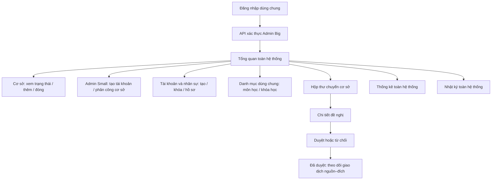
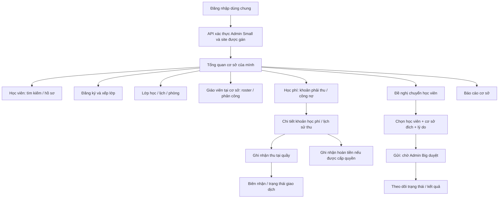
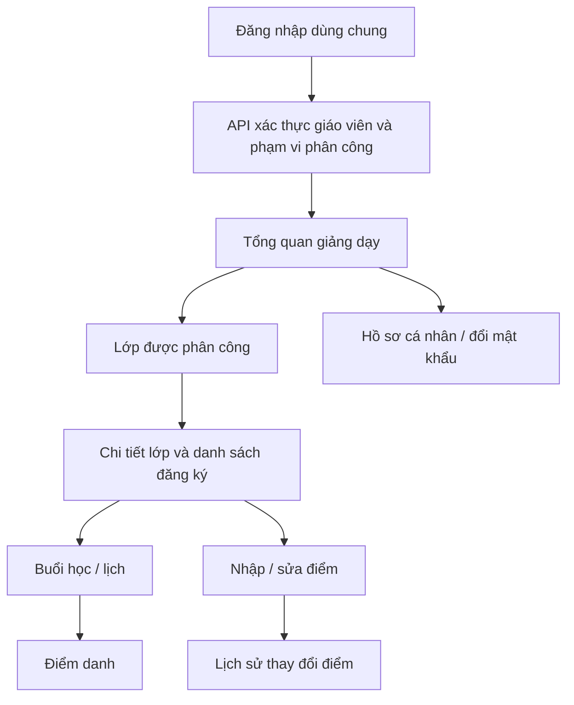
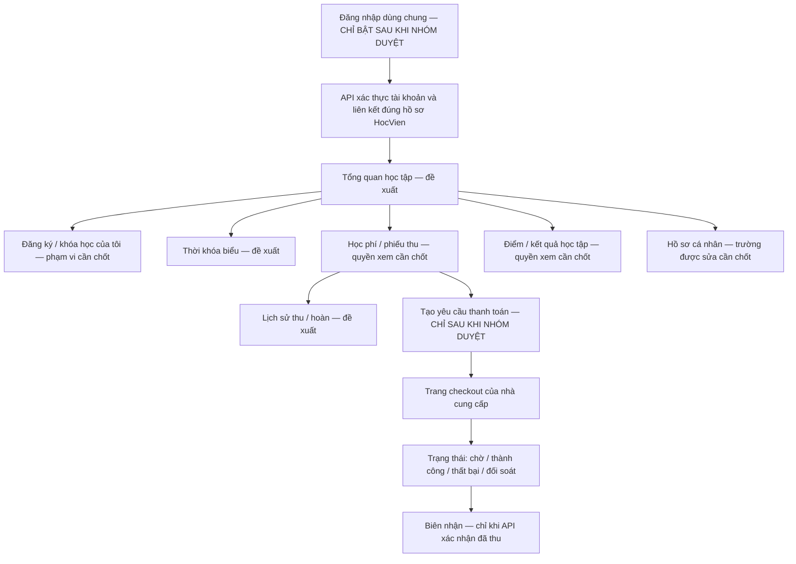

# Đặc tả UI/UX và cấu trúc giao diện

> Trạng thái: Đặc tả yêu cầu trước khi viết giao diện. Tài liệu này chưa có nghĩa là frontend đã được cài đặt hoặc các màn hình đã hoàn thành.

Tài liệu quy định cách chia component, page, section, SCSS, SVG, nội dung trang công khai, đăng nhập/đăng ký dùng chung, khu vực làm việc theo chức vụ, responsive và cách kiểm tra giao diện. Đây là **một ứng dụng frontend**, không phải mỗi chức vụ một website riêng: người dùng vào cùng địa chỉ, dùng cùng màn hình đăng nhập; sau khi API xác thực, giao diện hiển thị đúng trang và thao tác theo quyền được cấp. Hợp đồng request/response thuộc [`api.md`](api.md); nghiệp vụ và kiến trúc phân tán thuộc [`README.md`](../README.md); cấu trúc bảng thuộc [`docs/DATABASE_SCHEMA.md`](../docs/DATABASE_SCHEMA.md).

## 1. Sản phẩm và nội dung

Đây là giao diện cho đồ án **2–4 site**, hiện chọn 3 site Q1/Q7/TD. Yêu cầu chung bắt buộc gồm ít nhất một phương pháp phân mảnh, một phương pháp replication, một distributed transaction, một tình huống concurrency, một distributed query và đồng bộ dữ liệu. Mỗi nhóm được chọn kiểu phân mảnh phù hợp. [YC-01–YC-07 và các bài kiểm chứng](../docs/QLTTNN-Yeu-Cau-Chung-Va-Kiem-Chung.md) áp dụng cùng các trang bên dưới; giao diện hiển thị kết quả do API xác nhận, không tự mô phỏng kết quả phân tán.

| Hạng mục | Quy ước cho dự án |
|---|---|
| Sản phẩm | Trung tâm đào tạo ngoại ngữ, có các khóa học và lớp tại từng cơ sở |
| Thương hiệu | Tên thương hiệu chưa được nhóm cung cấp; trong bản phác thảo dùng `[Tên trung tâm]`, không tự đặt tên |
| Cơ sở ban đầu | Quận 1 (Q1), Quận 7 (Q7), Thủ Đức (TD); danh sách hiển thị lấy từ API, không viết cứng trong giao diện |
| Người xem Web | Khách xem khóa học/cơ sở; người dùng nội bộ cũng truy cập cùng website để đăng nhập |
| Người dùng sau đăng nhập | Admin Big, Admin Small, lễ tân, kế toán, giáo viên; cùng frontend nhưng nội dung và thao tác theo quyền API trả về. Học viên chưa có tài khoản trong phạm vi hiện tại |
| Nỗi băn khoăn dùng cho nội dung | Người học cần so sánh trình độ, lịch và cơ sở để tìm lớp phù hợp; đây là giả định nội dung, không tuyên bố là kết quả khảo sát khách hàng |
| Bằng chứng hiện có | Có ba cơ sở ban đầu theo phạm vi đồ án. Chưa có dữ liệu được xác nhận về số học viên, kết quả thi, tỷ lệ đậu hoặc đánh giá khách hàng |
| Giọng văn | Thực tế, rõ ràng, gần gũi và chuyên nghiệp; câu ngắn, nói việc người học cần làm |

Không dùng các câu sáo rỗng như “Nâng tầm”, “Hàng đầu”, “Đột phá”, “Đồng hành cùng bạn”, “Chinh phục ước mơ”, “Uy tín tạo nên thương hiệu” hoặc văn mẫu trung tâm/bảo hiểm. Không bịa lời chứng thực, điểm số, tỷ lệ thành công, số năm hoạt động, ưu đãi, sĩ số hay số lượng khóa học. Nội dung động phải lấy từ API; thông tin chưa được cung cấp phải ghi `[Cần nhóm xác nhận]` hoặc ẩn khỏi bản phát hành.

## 2. Cấu trúc thư mục component

Component vẫn chia thành hai khu vực chính `web` và `admin`, cùng thư mục `shared` cho phần tái sử dụng. `admin` là vùng làm việc sau đăng nhập cho các vai trò nội bộ, không phải một website Admin tách riêng; bên trong có workspace riêng cho Admin Big, Admin Small và giáo viên. Đăng nhập là luồng chung trước khi biết vai trò nên nằm trong `web/auth`. Workspace học viên chỉ là đề xuất, chưa triển khai cho tới khi nhóm chốt phạm vi tài khoản học viên và cập nhật README, API, schema. Trong từng page, các phần lớn được tách thành section riêng; section phức tạp có thư mục và SCSS riêng.

```text
src/web/src/
├── app/                                  # Khai báo route, gọi page component
├── components/
│   ├── web/
│   │   ├── auth/                           # Cùng một cửa vào đăng nhập/đăng ký cho toàn frontend
│   │   │   ├── login/
│   │   │   │   ├── LoginPage.tsx
│   │   │   │   ├── LoginPage.module.scss
│   │   │   │   └── sections/
│   │   │   │       └── LoginForm/
│   │   │   │           ├── LoginForm.tsx
│   │   │   │           └── LoginForm.module.scss
│   │   │   └── register/
│   │   │       ├── RegisterPage.tsx
│   │   │       ├── RegisterPage.module.scss
│   │   │       └── sections/
│   │   │           └── RegisterForm/
│   │   │               ├── RegisterForm.tsx
│   │   │               └── RegisterForm.module.scss
│   │   ├── home/
│   │   │   ├── HomePage.tsx
│   │   │   ├── HomePage.module.scss
│   │   │   └── sections/
│   │   │       ├── HeroSection/
│   │   │       │   ├── HeroSection.tsx
│   │   │       │   └── HeroSection.module.scss
│   │   │       ├── CourseFinderSection/
│   │   │       ├── BenefitsSection/
│   │   │       ├── CoursePreviewSection/
│   │   │       ├── BranchesSection/
│   │   │       ├── ProofSection/
│   │   │       ├── FAQSection/
│   │   │       └── FinalCTASection/
│   │   ├── courses/
│   │   │   ├── CoursesPage.tsx
│   │   │   └── sections/
│   │   ├── course-detail/
│   │   │   ├── CourseDetailPage.tsx
│   │   │   └── sections/
│   │   └── branches/
│   │       ├── BranchesPage.tsx
│   │       └── sections/
│   ├── admin/
│   │   ├── dashboard/
│   │   ├── students/
│   │   ├── enrollments/
│   │   ├── classes/
│   │   ├── tuition/
│   │   ├── grades/
│   │   ├── transfers/
│   │   ├── reports/
│   │   ├── admins/                          # Admin Big quản lý Admin Small và cơ sở được phân công
│   │   ├── teachers/                        # Admin quản lý hồ sơ/roster và phân công giáo viên
│   │   ├── accounts/                       # Quản lý tài khoản nội bộ theo quyền
│   │   └── workspaces/                     # Vùng sau đăng nhập, cùng frontend và dùng chung shell
│   │       ├── admin-big/                   # Tổng quan và điều hướng toàn hệ thống
│   │       ├── admin-small/                 # Tổng quan và điều hướng site được gán
│   │       ├── teacher/                     # Lớp/buổi được phân công, điểm danh, điểm
│   │       └── student/                     # ĐỀ XUẤT — chỉ tạo sau khi chốt phạm vi tài khoản
│   └── shared/                            # Nút, trường nhập, trạng thái, dialog dùng chung
├── assets/
│   └── icons/                              # SVG viết bằng component code, dùng lại qua import
└── styles/
    ├── _tokens.scss
    └── globals.scss
```

Đây là cấu trúc đích để thống nhất trước khi scaffold frontend. `admin/workspaces/` chứa page shell và điều hướng ban đầu theo vai trò; các page nghiệp vụ như học viên, lớp, học phí, điểm và báo cáo được tái sử dụng từ `admin/` theo quyền API, không nhân đôi theo từng role. Mỗi thư mục page áp dụng cùng quy tắc như `web/home`: có page component, `sections/` cho các khu vực lớn và một file `*.module.scss` cho từng section cần style riêng. Section nhỏ chỉ tách khi có nội dung, trạng thái hoặc hành vi riêng; không tạo component chỉ để bọc một thẻ HTML đơn giản.

Ví dụ cấu trúc một page Admin:

```text
components/admin/transfers/
├── TransfersPage.tsx
├── TransfersPage.module.scss
└── sections/
    ├── TransferPageHeader/
    │   ├── TransferPageHeader.tsx
    │   └── TransferPageHeader.module.scss
    ├── TransferFilters/
    ├── TransferInboxTable/
    ├── TransferRequestForm/
    └── TransferDetail/
```

Route chỉ lắp page component và xử lý ranh giới điều hướng. Component giao diện gọi API qua lớp client/service thống nhất; không truy cập SQL Server hoặc chứa chuỗi kết nối. Dữ liệu nghiệp vụ không được viết cứng trong component.

## 3. Một frontend dùng chung, giao diện thay đổi theo quyền

### 3.1. Trang công khai và xác thực dùng chung

| Page | Sections chính | Mục tiêu |
|---|---|---|
| Đăng nhập | Nhận diện thương hiệu, form tài khoản/mật khẩu, nút tiếp tục với Google/Facebook, hiện/ẩn mật khẩu, quên mật khẩu, lỗi và trạng thái đang gửi | Một trang cho mọi chức vụ; API xác định quyền. OAuth chỉ dùng cho tài khoản nội bộ đã liên kết; không có chọn role hoặc tự đăng ký |
| Quên mật khẩu | Form email/tên đăng nhập, xác nhận đã nhận yêu cầu, giới hạn gửi lại và thông báo chung | Không tiết lộ tài khoản có tồn tại hay không; trạng thái gửi do API trả về |
| Đặt lại mật khẩu | Form mật khẩu mới/xác nhận, tiêu chí hợp lệ, trạng thái token hết hạn/đã dùng/thành công | Token dùng một lần; không lưu/ghi token vào log hoặc analytics |
| Đăng ký tài khoản | Giới thiệu điều kiện đăng ký, form phù hợp với loại tài khoản được nhóm cho phép, trạng thái gửi thành công/chờ xử lý | Cùng frontend và cùng luồng form; API quyết định loại tài khoản/role. Không cho người dùng tự chọn hoặc tự cấp quyền nội bộ |
| Trang chủ | Điều hướng chung có liên kết đăng nhập, Hero, tìm khóa học, vấn đề người học, giải pháp/lợi ích, khóa học đang mở, cơ sở, bằng chứng có thật, FAQ, CTA, footer | Giúp người xem hiểu khóa học và tìm bước tiếp theo trong vài giây; người dùng nội bộ luôn có thể vào cùng trang đăng nhập |
| Danh sách khóa học | Tiêu đề, bộ lọc môn/trình độ/cơ sở, danh sách kết quả, phân trang hoặc tải thêm | So sánh khóa học/lớp đang được API trả về |
| Chi tiết khóa học | Mô tả khóa, trình độ, số buổi, học phí chuẩn, lớp/lịch/cơ sở khả dụng, CTA | Hiểu nội dung và điều kiện trước khi liên hệ hoặc đăng ký theo luồng được nhóm chốt |
| Cơ sở | Danh sách cơ sở, địa chỉ/liên hệ nếu có dữ liệu được duyệt, hướng dẫn xem lớp tại cơ sở | Chọn địa điểm học từ dữ liệu cơ sở đang hoạt động |

**Chính sách đăng ký cần bám theo phạm vi hiện tại trong README:** học viên chưa có tài khoản trong phiên bản này; tài khoản nhân viên/giáo viên do Admin Big tạo và phân quyền. Vì vậy, route đăng ký có thể được thiết kế chung trong cấu trúc frontend nhưng chưa được bật như đăng ký tài khoản công khai cho tới khi nhóm chốt nghiệp vụ, API và schema. Nếu sau này mở đăng ký công khai, API phải xác định rõ loại tài khoản được phép tạo; tuyệt đối không nhận `vai_tro`, chức vụ, cơ sở hoặc phạm vi quyền do trình duyệt tự chọn làm nguồn cấp quyền. CTA công khai mặc định là **“Xem khóa học”** hoặc **“Xem cơ sở”**; mọi CTA dẫn tới thao tác chưa có API phải được đánh dấu chờ thống nhất.

### 3.2. Khu vực làm việc sau đăng nhập

Đây là khu vực trong cùng website, không phải frontend riêng theo chức vụ. Tất cả người dùng nội bộ đi qua cùng màn hình đăng nhập; Django/API xác thực tài khoản rồi trả về ngữ cảnh cần cho giao diện: chức vụ/vai trò, cơ sở được giao (nếu có), phạm vi lớp (nếu là giáo viên) và quyền thao tác. Frontend dùng ngữ cảnh đó để điều hướng tới trang đầu phù hợp và dựng menu theo quyền. Không có dropdown cho người dùng tự chọn chức vụ lúc đăng nhập.

| Page | Sections chính | Quyền và cách lấy dữ liệu |
|---|---|---|
| Trang tổng quan | Tiêu đề/ngữ cảnh cơ sở, công việc cần xử lý, chỉ số nghiệp vụ, cảnh báo site | Admin Big xem toàn hệ thống; Admin Small xem site được gán; các chức vụ khác chỉ thấy thông tin cần cho công việc được giao; thiếu site phải báo rõ |
| Học viên | Tìm kiếm/bộ lọc, danh sách, thông tin hồ sơ, lịch sử liên quan | Site Router định tuyến theo phạm vi; không suy site chỉ từ tiền tố mã |
| Đăng ký và xếp lớp | Chọn học viên/lớp, danh sách đăng ký, chi tiết đăng ký, đổi lớp | `LOCAL`; kiểm tra học viên và lớp cùng cơ sở, chỗ còn lại và trạng thái lớp |
| Học phí và thanh toán | Danh sách khoản phải thu, chi tiết công nợ, ghi nhận thu tại quầy, lịch sử/chi tiết biên nhận, ghi nhận hoàn tiền và trạng thái thanh toán | `LOCAL`; phiếu đã phát sinh không có nút xóa; Admin Small/kế toán chỉ thao tác theo quyền được API cấp |
| Trạng thái thanh toán trực tuyến | Màn hình đang chờ/xác minh/thành công/thất bại/đang đối soát sau khi quay về từ cổng; đường dẫn tới biên nhận nếu đã thu | Chỉ hiển thị trạng thái lấy từ API; không suy ra thành công từ URL redirect. Chỉ bật khi nhóm chốt cổng và quyền tài khoản thanh toán |
| Điểm | Chọn lớp, danh sách học viên, nhập/sửa điểm, lịch sử thay đổi | `LOCAL`; giáo viên chỉ thấy lớp được phân công |
| Chuyển cơ sở | Form đề nghị cho Admin Small; hộp thư/chi tiết/duyệt/từ chối cho Admin Big; theo dõi trạng thái | Đề nghị `LOCAL` ở nguồn, hộp thư `GLOBAL`, giao dịch nguồn-đích chỉ chạy sau duyệt |
| Báo cáo | Bộ lọc theo site/thời gian/trạng thái, bảng hoặc biểu đồ, trạng thái đầy đủ dữ liệu | Admin Small chỉ site mình; Admin Big dùng `GLOBAL` và thấy cảnh báo khi thiếu site; lễ tân/kế toán/giáo viên chỉ thấy báo cáo được cấp |
| Quản lý Admin Small | Danh sách Admin Small theo cơ sở, tạo tài khoản kèm phân công cơ sở, khóa/mở và xem trạng thái phụ trách | Chỉ Admin Big; tài khoản dùng chung theo `REPLICATED-WRITE`, hồ sơ được tạo tại site được phân công. API hiện chưa có thao tác đổi cơ sở sau khi tạo, nên không hiển thị chức năng này. Không cho tạo hoặc tự nâng quyền thành Admin Big |
| Quản lý giáo viên | Danh sách giáo viên, xem hồ sơ/trạng thái, tạo tài khoản và hồ sơ ban đầu, xem/cập nhật phân công lớp/buổi | API mô tả GET danh sách/chi tiết, POST tạo cho Admin Big và PUT phân công cho Admin Big/Admin Small đúng site. Trạng thái chỉ để xem; chưa có endpoint sửa hồ sơ hoặc trạng thái giáo viên. Giáo viên chỉ xem lớp được phân công |
| Tài khoản và phân quyền | Danh sách tài khoản nội bộ, trạng thái, chức vụ và phạm vi được cấp | Admin Big quản lý tài khoản toàn hệ thống; không cho người dùng tự chọn role, site hoặc phạm vi quyền; các thao tác ghi dữ liệu dùng chung tuân theo chính sách đồng bộ |

Hai page **Quản lý Admin Small** và **Quản lý giáo viên** đã có endpoint thiết kế trong `specs/api.md`: Admin Big đọc/tạo Admin Small và khóa/mở tài khoản; đọc hồ sơ giáo viên, tạo giáo viên và phân công lớp/buổi. Admin Small đọc roster/chi tiết giáo viên tại site được giao và cập nhật phân công trong site đó. API hiện chưa có endpoint sửa hồ sơ hoặc trạng thái giáo viên, nên UI chỉ hiển thị các trường này, không đưa nút sửa. Tài khoản dùng chung đi theo `REPLICATED-WRITE`; hồ sơ và phân công thuộc site phải định tuyến tới CSDL site tương ứng. Không JOIN hoặc tạo khóa ngoại xuyên CSDL.

| Chức vụ | Trang/thao tác được thể hiện trên cùng frontend |
|---|---|
| Admin Big | Khu vực quản trị toàn hệ thống: tạo/khóa và phân công Admin Small; khởi tạo tài khoản, phân công hồ sơ giáo viên; quản lý cơ sở/danh mục; thống kê toàn cục; duyệt/từ chối đề nghị chuyển cơ sở |
| Admin Small | Khu vực quản trị site được giao: quản lý roster giáo viên và phân công tại site theo quyền API; nghiệp vụ cơ sở; tạo đề nghị chuyển học viên và theo dõi đề nghị; không tự tạo Admin Big, không duyệt đề nghị và không truy cập site khác |
| Lễ tân | Hồ sơ học viên, đăng ký khóa học, xếp/đổi lớp trong một site được giao |
| Kế toán | Học phí, phiếu thu/hoàn và công nợ trong một site được giao |
| Giáo viên | Các lớp/buổi được phân công; điểm danh và nhập/sửa điểm theo quyền |
| Học viên | Chưa đăng nhập trong phạm vi hiện tại theo README; chỉ bổ sung màn hình học viên sau khi nhóm thống nhất lại phạm vi |

Các chức vụ dùng chung shell, điều hướng, biểu mẫu và component khi phù hợp; menu và nội dung được dựng theo quyền API trả về. Ẩn nút hoặc chặn route ở frontend chỉ cải thiện trải nghiệm, không thay thế việc Django/API kiểm tra quyền ở mọi request. Nếu người dùng mở URL không thuộc quyền, hiển thị trang “Bạn không có quyền truy cập” và đường quay về trang được phép; nếu phiên hết hạn, yêu cầu đăng nhập lại.

### 3.3. Sơ đồ trang riêng theo vai trò

Các sơ đồ dưới đây mô tả **trang và luồng điều hướng trên cùng một frontend**. Route minh họa (`/portal/...`) chỉ là quy ước UI để nhóm dễ chia page, chưa phải endpoint API và có thể đổi khi cấu hình `app/`. Sau cùng một lần đăng nhập, API trả vai trò/chức vụ, site và phạm vi dữ liệu; frontend tự đưa người dùng đến trang đầu phù hợp. Người dùng không tự chọn vai trò hoặc cơ sở để vượt quyền.

#### Admin Big — quản trị toàn hệ thống

Admin Big không bị giới hạn vào một cơ sở. Những thao tác ghi vẫn phải đi đúng kiểu phân tán: dữ liệu danh mục/tài khoản dùng chung qua `REPLICATED-WRITE`; hồ sơ nhân sự cục bộ ghi vào site được chọn; báo cáo và hộp thư đề nghị đọc từng site qua `GLOBAL`; chỉ sau khi duyệt đề nghị mới chạy `DISTRIBUTED-TX`.



| Page Admin Big | Nội dung / hành động | Truy cập dữ liệu và giới hạn |
|---|---|---|
| Tổng quan | Tình trạng site, việc chờ xử lý, số liệu tổng hợp và cảnh báo kết quả thiếu site | `GLOBAL`; API hỏi các CSDL site riêng rồi gộp tại tầng ứng dụng |
| Cơ sở | Xem trạng thái; luồng thêm/đóng cơ sở theo quy trình vận hành | Thông tin `CoSo` dùng chung; cấu hình kết nối không hiển thị bí mật ra trình duyệt |
| Admin Small | Tạo/khóa tài khoản và phân công người quản lý vào cơ sở | `TaiKhoan` qua `REPLICATED-WRITE`; hồ sơ `NhanVien` tại CSDL site được giao; không cấp quyền Admin Big từ màn hình này |
| Tài khoản và nhân sự | Tạo tài khoản nội bộ; tạo hồ sơ nhân viên/giáo viên tại cơ sở; xem trạng thái | Ghi tài khoản dùng chung qua `REPLICATED-WRITE`, hồ sơ làm việc qua `LOCAL` tới site đích; không để tài khoản hoạt động nếu hồ sơ/phạm vi cần thiết chưa được tạo |
| Danh mục dùng chung | Quản lý môn học và khóa học | `REPLICATED-WRITE`; chỉ báo thành công khi chính sách đồng bộ tới các site hoạt động được thỏa mãn |
| Hộp thư chuyển cơ sở | Lọc đề nghị, xem chi tiết, duyệt hoặc từ chối, theo dõi kết quả | Hộp thư `GLOBAL`; quyết định được ghi về CSDL nguồn; chuyển học viên chỉ bắt đầu sau khi duyệt |
| Báo cáo / nhật ký | Lọc và xem thống kê hoặc sự kiện theo cơ sở/thời gian | `GLOBAL`; phải hiển thị site không truy cập được và đánh dấu kết quả chưa đầy đủ |

#### Admin Small — quản lý một cơ sở được phân công

Admin Small là tài khoản `nhan_vien` có `NhanVien.chuc_vu = quan_ly_co_so` và một `ma_co_so` được cấp. Đây không phải vai trò mới trong `TaiKhoan.vai_tro`. Mọi thao tác nghiệp vụ thường ngày chỉ dùng CSDL của cơ sở đó; Admin Small **không** xem/sửa site khác, không quản lý danh mục toàn hệ thống và không duyệt đề nghị chuyển cơ sở.



| Page Admin Small | Nội dung / hành động | Truy cập dữ liệu và giới hạn |
|---|---|---|
| Tổng quan cơ sở | Công việc chờ xử lý và số liệu site được gán | `LOCAL`; site lấy từ phiên/quyền API, không tin site do trình duyệt tự gửi |
| Học viên | Tìm kiếm, hồ sơ và lịch sử nghiệp vụ của học viên tại site | `LOCAL`; không đoán site từ tiền tố mã, không tra cứu trái phạm vi |
| Đăng ký và xếp lớp | Tạo đăng ký, xếp/đổi lớp hợp lệ | `LOCAL`; học viên và lớp phải cùng site |
| Lớp học / lịch | Quản lý lớp, lịch, phòng và sĩ số trong cơ sở | `LOCAL`; kiểm tra giáo viên/phòng/lịch cùng site, không tham chiếu khóa ngoại site khác |
| Giáo viên tại cơ sở | Xem roster/chi tiết và phân công lớp/buổi trong phạm vi cơ sở | `LOCAL`; `GET /api/v1/admin/teachers` và `GET /api/v1/admin/teachers/{ma_giao_vien}` đọc hồ sơ; `PUT /api/v1/admin/teachers/{ma_giao_vien}/assignments` cập nhật phân công cho người có quyền đúng site. Chưa có API sửa hồ sơ/trạng thái nên các trường đó chỉ để xem |
| Học phí và thanh toán | Danh sách công nợ, chi tiết khoản phí, ghi nhận thu tại quầy, biên nhận, lịch sử thu/hoàn; trạng thái chờ nếu có cổng online | `LOCAL`; quyền thu/hoàn do API cấp; không xóa phiếu thu; không xác nhận thanh toán online từ redirect |
| Đề nghị chuyển cơ sở | Tạo yêu cầu tại site nguồn, xem yêu cầu và trạng thái | Tạo `LOCAL` ở nguồn; API có thể dùng `GLOBAL` để xác định bản `dang_hoc`; Admin Small không có nút duyệt/từ chối |
| Báo cáo / nhật ký | Xem số liệu và sự kiện phát sinh tại cơ sở | `LOCAL`; không gộp site khác bằng truy vấn xuyên CSDL |

#### Giáo viên — lớp và buổi được phân công

Giáo viên dùng chung frontend và đăng nhập như các vai trò khác. API chỉ trả những lớp/buổi được phân công cho tài khoản; thay đổi điểm danh hoặc điểm luôn được kiểm tra lại phía API. Giáo viên không quản lý tài khoản, nhân sự, học phí hoặc dữ liệu cơ sở khác.



| Page giáo viên | Nội dung / hành động | Truy cập dữ liệu và giới hạn |
|---|---|---|
| Tổng quan giảng dạy | Lịch buổi sắp tới, lớp được giao và việc cần hoàn tất | `LOCAL`; chỉ lớp/buổi nằm trong phạm vi phân công |
| Lớp được phân công | Danh sách lớp, lịch, danh sách học viên có đăng ký hợp lệ | `LOCAL`; không tìm tự do học viên ở mọi site |
| Buổi học / điểm danh | Xem buổi, ghi hoặc sửa trạng thái điểm danh | `LOCAL`; chỉ buổi thuộc lớp được phân công; sửa phải có nhật ký |
| Điểm | Nhập/sửa điểm theo loại điểm hợp lệ, xem lịch sử | `LOCAL`; API xác minh giáo viên, lớp, đăng ký và loại điểm trước khi ghi |
| Hồ sơ cá nhân | Xem thông tin tài khoản/hồ sơ; đổi mật khẩu theo luồng xác thực chung | Chỉ trường được phép; không tự đổi vai trò, cơ sở hay phạm vi phân công |

#### Học viên — sơ đồ đề xuất, chưa thuộc phạm vi tài khoản hiện tại

README và schema hiện hành quy định học viên **chưa có tài khoản đăng nhập**; bảng `TaiKhoan` hiện có vai trò `admin`, `nhan_vien`, `giao_vien`, còn `HocVien` chưa có liên kết tài khoản. Vì vậy sơ đồ dưới đây chỉ giúp nhóm hình dung một phương án nếu muốn mở portal học viên; nó **không khẳng định có đăng nhập/đăng ký học viên, không phải yêu cầu API đang được chốt và chưa được triển khai**.



| Phần cần nhóm quyết định trước khi bật portal học viên | Câu hỏi phải chốt và cập nhật |
|---|---|
| Có cấp tài khoản không? | Chọn rõ có/không; nếu có, xác định ai tạo/kích hoạt tài khoản và cách xác minh học viên |
| Liên kết tài khoản với `HocVien` | Chốt khóa liên kết duy nhất và vòng đời liên kết; cập nhật ERD/schema, ràng buộc và quy tắc chuyển cơ sở. Không chỉ dựa vào email/tiền tố mã để đoán hồ sơ |
| Vai trò và quyền | Chốt có thêm giá trị vai trò học viên hay dùng mô hình khác; không tự thêm vào `TaiKhoan.vai_tro` khi chưa duyệt |
| Tính năng portal | Chốt học viên chỉ xem điểm/lịch/học phí hay được đăng ký, thanh toán online, xem/nhận biên nhận, cập nhật hồ sơ; đặc tả quyền và luồng lỗi cho từng tính năng |
| Phân tán | Chốt cách tìm đúng hồ sơ hiện hành sau khi chuyển cơ sở, CSDL lưu liên kết tài khoản và dữ liệu được phép đọc; không tạo DB trung tâm hoặc JOIN xuyên site |
| Hợp đồng và triển khai | Cập nhật đồng bộ `README.md`, `docs/DATABASE_SCHEMA.md`, `specs/api.md` và tài liệu UI; bổ sung kiểm thử phân quyền, chuyển cơ sở, đăng nhập và dữ liệu thiếu site trước khi đánh dấu sẵn sàng |

### 3.4. Luồng đăng nhập, đăng ký và phân quyền giao diện

1. Mọi chức vụ mở cùng route đăng nhập; trang có thể dùng tên đăng nhập/mật khẩu hoặc nút Google/Facebook khi API đã triển khai và cấu hình OAuth. Frontend không hỏi người dùng muốn vào vai trò nào.
2. Với OAuth, frontend điều hướng trình duyệt tới API start endpoint; backend quản lý state/nonce, callback, kiểm tra provider subject và liên kết tài khoản. Frontend không nhận hay lưu provider access token. API chỉ chấp nhận tài khoản nội bộ đã được Admin Big tạo và người dùng đã tự liên kết khi đăng nhập vào tài khoản đó; không tự tạo tài khoản, không tự liên kết qua email.
3. API xác thực trạng thái hoạt động và quyền; mật khẩu không được lưu ở trình duyệt hoặc ghi ra log. API là nơi quyết định vai trò, chức vụ, site và phạm vi lớp.
4. Sau đăng nhập thành công, frontend gọi `GET /auth/me`, đọc ngữ cảnh phiên do API trả về rồi mở trang tổng quan phù hợp. Admin Big thấy menu toàn hệ thống; Admin Small thấy menu site được giao; lễ tân, kế toán và giáo viên thấy menu theo nhiệm vụ.
5. Các API nghiệp vụ vẫn phải kiểm tra quyền và site ở phía máy chủ. Frontend không được dùng giá trị site từ URL/local storage để cấp quyền hoặc truy vấn thẳng cơ sở dữ liệu.
6. Đăng xuất kết thúc phiên phía server rồi xóa cookie. OAuth lỗi, danh tính chưa liên kết, tài khoản bị khóa và site không đủ dữ liệu hiển thị thông báo chung, không tiết lộ tài khoản có tồn tại hay không. Đăng ký công khai vẫn tắt.
7. Admin Big tạo Admin Small/giáo viên bằng email công việc và cơ sở được giao; không nhập hoặc gửi mật khẩu thay người nhận. Khi API kích hoạt tài khoản sẵn sàng, người nhận mở liên kết một lần trong `/auth/activate` để tự đặt mật khẩu. Người quên mật khẩu yêu cầu email liên kết tại `/auth/forgot-password`, rồi tự nhập mật khẩu mới ở `/auth/reset-password`; giao diện không hiển thị việc email có tồn tại hay không. Liên kết reset mặc định hết hạn sau 15 phút.

Khi API chưa bật OAuth, không hiển thị nút giả hoặc làm nút chỉ chuyển trang. Nếu thiết kế cần thể hiện trước, đặt trạng thái chưa khả dụng kèm ghi chú nội bộ trong prototype; chỉ bật control khi endpoint, OAuth app, callback URL, cấu hình cookie và test API đều sẵn sàng. Các nút dùng logo provider chính thức: kiểm tra `assets/icons` và thư viện hiện có trước; nếu thiếu mới thêm SVG logo theo quy định thương hiệu, không tự vẽ lại logo.

### 3.5. Section dự kiến bên trong từng page

Mỗi section lớn nằm trong thư mục riêng bên trong page, tối thiểu gồm component và `*.module.scss`. Tên dưới đây là cấu trúc ban đầu để nhóm chia việc; có thể gộp/tách khi thiết kế chi tiết nhưng không được đưa toàn bộ màn hình vào một file lớn.

| Page | Section folders dự kiến |
|---|---|
| Web — Login | `LoginIntro`, `LoginForm`, `ForgotPasswordLink`, `AuthFeedback` |
| Web — Forgot password | `ForgotPasswordIntro`, `ForgotPasswordForm`, `RequestSentState`, `AuthFeedback` |
| Web — Reset password | `ResetPasswordForm`, `PasswordRules`, `ResetSuccessState`, `ExpiredTokenState` |
| Web — Register (đang tắt) | `RegisterIntro`, `RegisterForm`, `RegistrationNotice`, `AuthFeedback` |
| Web — Trang chủ | `HeroSection`, `CourseFinderSection`, `BenefitsSection`, `CoursePreviewSection`, `BranchesSection`, `ProofSection`, `FAQSection`, `FinalCTASection` |
| Web — Courses | `CoursePageHeader`, `CourseFilters`, `CourseResults`, `CoursePagination`, `CourseEmptyState` |
| Web — Course detail | `CourseOverview`, `CourseFacts`, `AvailableClasses`, `CourseCTA` |
| Web — Branches | `BranchPageHeader`, `BranchList`, `BranchContact`, `BranchMap` (chỉ khi có địa chỉ/toạ độ đã xác minh) |
| Admin — Dashboard | `DashboardHeader`, `SiteSummary`, `PendingTasks`, `OperationalAlerts` |
| Admin Big — Dashboard | `DashboardHeader`, `GlobalSiteSummary`, `TransferInboxSummary`, `GlobalTasks`, `IncompleteSiteAlert` |
| Admin Small — Dashboard | `DashboardHeader`, `AssignedSiteSummary`, `LocalTasks`, `SiteAlerts` |
| Admin — Students | `StudentPageHeader`, `StudentFilters`, `StudentTable`, `StudentProfile`, `StudentEmptyState` |
| Admin — Enrollments | `EnrollmentFilters`, `EnrollmentTable`, `EnrollmentForm`, `EnrollmentDetail` |
| Admin — Classes | `ClassFilters`, `ClassTable`, `ClassAssignmentForm`, `ClassCapacity` |
| Admin — Tuition list | `TuitionPageHeader`, `TuitionFilters`, `TuitionTable`, `OutstandingBalanceSummary`, `TuitionEmptyState` |
| Admin — Tuition detail | `StudentFeeSummary`, `AmountBreakdown`, `PaymentHistory`, `PaymentStatusTimeline`, `TuitionActions` |
| Admin — Collect payment | `CollectPaymentForm`, `PaymentMethodFields`, `AmountDueNotice`, `SubmissionState`, `ReceiptSuccessPanel` |
| Admin — Receipt detail | `ReceiptHeader`, `ReceiptAmountBreakdown`, `ReceiptAuditDetails`, `PrintReceiptAction` |
| Admin — Refund | `RefundForm`, `RefundReasonField`, `RefundPermissionNotice`, `RefundStatusPanel` |
| Shared — Payment return/status | `PaymentPendingState`, `PaymentSuccessState`, `PaymentFailureState`, `PaymentReconciliationState`, `RetryOrReturnAction` |
| Admin — Grades | `GradeClassPicker`, `StudentGradeTable`, `GradeEditor`, `GradeChangeHistory` |
| Admin — Transfers | `TransferRequestForm`, `TransferInbox`, `TransferFilters`, `TransferDetail`, `TransferDecision` |
| Admin — Reports | `ReportFilters`, `StudentSummary`, `StudentResults`, `IncompleteSiteNotice` |
| Admin — Admin Small | `AdminList`, `AdminForm`, `SiteAssignment`, `AdminStatus`, `AdminDetail` |
| Admin — Teachers | `TeacherPageHeader`, `TeacherFilters`, `TeacherTable`, `TeacherProfile`, `TeacherClassAssignments`, `TeacherEmptyState` |
| Admin — Account management | `AccountPageHeader`, `AccountFilters`, `AccountTable`, `AccountForm`, `RoleAndSiteAssignment` |
| Giáo viên — Dashboard | `TeacherWelcome`, `UpcomingSessions`, `AssignedClasses`, `TeachingTasks` |
| Giáo viên — Classes | `AssignedClassFilters`, `AssignedClassList`, `ClassDetail`, `EnrolledStudents` |
| Giáo viên — Attendance | `SessionPicker`, `AttendanceRoster`, `AttendanceEditor`, `AttendanceHistory` |
| Giáo viên — Grades | `GradeClassPicker`, `StudentGradeTable`, `GradeEditor`, `GradeChangeHistory` |
| Học viên — Portal đề xuất, chỉ sau khi duyệt phạm vi | `StudentWelcome`, `MyEnrollments`, `MySchedule`, `MyTuition`, `PaymentHistory`, `PaymentStart`, `PaymentStatus`, `MyReceipts`, `MyGrades`, `StudentProfile` |
| Shared — System pages | `AccessDeniedPage`, `NotFoundPage`, `ServiceUnavailablePage`, `SessionExpiredState`, `GlobalPartialResultNotice` |

Nếu một section chỉ là một tiêu đề hoặc đoạn text không có style/hành vi riêng thì không cần tách thêm component. Các mẫu loading/empty/error dùng chung nên import từ `components/shared`, nhưng nội dung phải nói đúng nghiệp vụ của page.

### 3.6. Danh mục page và route cần thiết

Danh mục dưới đây làm rõ page nào cần thiết kế để không gộp nhiều nghiệp vụ vào một màn hình chung. Route là quy ước UI minh họa, không phải API endpoint. Các page nghiệp vụ nội bộ dùng chung shell và chỉ hiện theo quyền API. Page học viên và thanh toán online là **đề xuất có điều kiện**, chưa bật cho tới khi nhóm duyệt tài khoản học viên, schema/API và nhà cung cấp thanh toán.

#### Trang công khai và xác thực

| Route minh họa | Page | Nội dung chính | Trạng thái/phụ thuộc |
|---|---|---|---|
| `/` | Trang chủ | Hero, tìm khóa học, lợi ích, khóa học, cơ sở, FAQ và CTA | Thiết kế trong phạm vi Web |
| `/courses` | Danh sách khóa học | Tìm kiếm, lọc, sắp xếp allowlist, phân trang, loading/empty/error | Cần API danh mục công khai |
| `/courses/[courseId]` | Chi tiết khóa học | Mô tả, trình độ, học phí chuẩn, lớp và lịch khả dụng | Cần API danh mục công khai |
| `/branches` | Danh sách cơ sở | Cơ sở đang hoạt động, địa chỉ/liên hệ đã xác minh | Cần dữ liệu công khai từ API |
| `/auth/login` | Đăng nhập dùng chung | Form mật khẩu, nút Google/Facebook khi API bật, lỗi chung, giới hạn gửi, loading, quên mật khẩu | Dùng chung mọi chức vụ; OAuth không tự đăng ký hoặc tự chọn role |
| `/auth/activate` | Kích hoạt tài khoản nội bộ | Kiểm tra liên kết mời, nhập mật khẩu mới/xác nhận, trạng thái hết hạn/đã dùng/thành công | Chỉ mở từ liên kết mời dùng một lần; chưa triển khai cho tới khi API và schema có token kích hoạt |
| `/auth/forgot-password` | Quên mật khẩu | Nhập email/tài khoản, trạng thái gửi; không tiết lộ tài khoản tồn tại | Cần API reset mật khẩu |
| `/auth/reset-password` | Đặt lại mật khẩu | Mật khẩu mới, xác nhận, token hợp lệ/hết hạn/đã dùng | Mở từ liên kết một lần gửi qua email; token mặc định hết hạn sau 15 phút; cần API reset mật khẩu |
| `/auth/register` | Đăng ký | Không hiển thị hoặc giữ trang thông báo chưa mở | Tắt cho tới khi nhóm duyệt đăng ký công khai và schema/API phù hợp |
| `/portal/account/security` | Phương thức đăng nhập | Trạng thái liên kết Google/Facebook, bắt xác thực lại trước khi thêm/gỡ, trạng thái đồng bộ | Chỉ mở khi API triển khai endpoint link/unlink; dữ liệu liên kết được nhân bản ở các CSDL site |

#### Admin Big — các trang toàn hệ thống

| Route minh họa | Page | Nội dung chính |
|---|---|---|
| `/portal/admin-big/dashboard` | Tổng quan toàn hệ thống | Site hoạt động/mất kết nối, việc chờ duyệt, số liệu tổng hợp có cờ thiếu site |
| `/portal/admin-big/sites` và `/portal/admin-big/sites/[siteCode]` | Danh sách/chi tiết cơ sở | Trạng thái, thông tin cơ sở, tình trạng kết nối; thêm/đóng cơ sở theo quy trình |
| `/portal/admin-big/admins` và `/portal/admin-big/admins/[accountId]` | Quản lý Admin Small | Tạo tài khoản kèm phân công cơ sở, khóa/mở và xem trạng thái; API chưa hỗ trợ đổi site sau khi tạo, không cấp Admin Big |
| `/portal/admin-big/teachers` và `/portal/admin-big/teachers/[teacherId]` | Quản lý giáo viên | Xem hồ sơ/trạng thái, tạo tài khoản/hồ sơ ban đầu và phân công lớp/buổi; trạng thái chỉ để xem vì API chưa có endpoint cập nhật trạng thái |
| `/portal/admin-big/accounts` và `/portal/admin-big/accounts/[accountId]` | Tài khoản nội bộ | Tìm tài khoản, trạng thái, chức vụ/phạm vi; không hiển thị hash hoặc thông tin bí mật |
| `/portal/admin-big/catalog/subjects` | Quản lý môn học | Danh sách, tạo/sửa/đóng môn học dùng chung |
| `/portal/admin-big/catalog/courses` | Quản lý khóa học | Danh sách, nội dung, học phí chuẩn, tạo/sửa/đóng; xác nhận phạm vi nhân bản |
| `/portal/admin-big/transfers` và `/portal/admin-big/transfers/[transferId]` | Hộp thư/chi tiết chuyển cơ sở | Lọc yêu cầu, xem hồ sơ nguồn/đích, duyệt/từ chối, theo dõi phục hồi |
| `/portal/admin-big/reports` | Báo cáo toàn hệ thống | Lọc theo cơ sở/khoảng ngày, có thống kê học phí/thu/hoàn theo site, kết quả từng site và cảnh báo kết quả chưa đủ |
| `/portal/admin-big/audit-logs` | Nhật ký toàn hệ thống | Tìm sự kiện theo người dùng/site/thời gian; không lộ secret hoặc dữ liệu xác thực |

#### Admin Small, lễ tân và kế toán — các trang tại cơ sở

Các page dưới đây nằm trong workspace cơ sở. Admin Small chỉ thấy và thao tác đúng quyền tại site được gán; lễ tân và kế toán dùng cùng page nhưng chỉ thấy thao tác API cho phép.

| Route minh họa | Page | Nội dung chính |
|---|---|---|
| `/portal/admin-small/dashboard` | Tổng quan cơ sở | Việc cần xử lý, lịch trong ngày, công nợ/đăng ký và cảnh báo cục bộ |
| `/portal/admin-small/students` và `/portal/admin-small/students/new` | Danh sách/tạo học viên | Tìm kiếm, lọc, phân trang, tạo hồ sơ; site lấy từ phiên |
| `/portal/admin-small/students/[studentId]` | Chi tiết hồ sơ học viên | Thông tin, đăng ký, lịch sử học tập và trạng thái chuyển; không xóa lịch sử |
| `/portal/admin-small/enrollments` và `/portal/admin-small/enrollments/new` | Danh sách/tạo đăng ký | Chọn học viên/lớp, kiểm tra cùng site, chỗ trống và khoản học phí phát sinh |
| `/portal/admin-small/enrollments/[enrollmentId]` | Chi tiết đăng ký/xếp lớp | Trạng thái, lớp hiện tại, đổi lớp hợp lệ, liên kết tới khoản học phí |
| `/portal/admin-small/classes` và `/portal/admin-small/classes/[classId]` | Danh sách/chi tiết lớp | Lịch, phòng, giáo viên, sức chứa, danh sách đăng ký và buổi học |
| `/portal/admin-small/teachers` và `/portal/admin-small/teachers/[teacherId]` | Roster/phân công giáo viên | Xem hồ sơ cục bộ và cập nhật lớp/buổi được giao trong site; không sửa hồ sơ/trạng thái giáo viên |
| `/portal/admin-small/tuition` | Danh sách học phí/công nợ | Tìm theo học viên/trạng thái, số phải đóng/đã đóng/còn nợ, lọc và phân trang |
| `/portal/admin-small/tuition/[tuitionId]` | Chi tiết khoản học phí | Phép tính số phải đóng, lịch sử thu/hoàn, trạng thái và các thao tác được cấp quyền |
| `/portal/admin-small/tuition/[tuitionId]/collect` | Ghi nhận thanh toán tại quầy | Số tiền còn nợ, phương thức, xác nhận thu; idempotency/loading/error; không tự xác nhận chuyển khoản chưa kiểm tra |
| `/portal/admin-small/receipts` | Lịch sử biên nhận | Tìm theo học viên, ngày, mã phiếu, trạng thái thu/hoàn; lọc và phân trang |
| `/portal/admin-small/receipts/[receiptId]` | Chi tiết/in biên nhận | Mã phiếu, thời gian giờ Việt Nam, người thu, số tiền, phương thức và khoản học phí liên quan |
| `/portal/admin-small/receipts/[receiptId]/refund` | Hoàn tiền | Form ghi nhận hoàn cho người có quyền API, gửi `ma_phieu_goc`, lý do và số tiền; giữ phiếu gốc, tạo phiếu hoàn riêng. API hiện chưa có luồng đề nghị/duyệt nên không hiển thị nút duyệt |
| `/portal/admin-small/transfers/new` | Tạo đề nghị chuyển | Chọn học viên, cơ sở đích, lý do; trạng thái chờ Admin Big duyệt |
| `/portal/admin-small/transfers/[transferId]` | Theo dõi đề nghị chuyển | Người đề nghị, quyết định, trạng thái giao dịch và kết quả phục hồi; không có nút duyệt |
| `/portal/admin-small/reports` | Báo cáo cơ sở | Học viên, lớp, công nợ và thu/hoàn trong site được gán |

#### Giáo viên — các trang giảng dạy

| Route minh họa | Page | Nội dung chính |
|---|---|---|
| `/portal/teacher/dashboard` | Tổng quan giảng dạy | Buổi sắp tới, lớp được giao, việc cần hoàn tất |
| `/portal/teacher/classes` và `/portal/teacher/classes/[classId]` | Lớp được phân công | Lịch, roster học viên đang đăng ký, chi tiết lớp trong phạm vi được giao |
| `/portal/teacher/sessions/[sessionId]` | Chi tiết buổi học | Thời gian giờ Việt Nam, trạng thái buổi, danh sách học viên |
| `/portal/teacher/sessions/[sessionId]/attendance` | Điểm danh | Roster, đánh dấu/sửa điểm danh, xác nhận lưu và lịch sử |
| `/portal/teacher/classes/[classId]/grades` | Nhập/xem điểm | Chọn loại điểm, nhập điểm hợp lệ, lưu theo lớp được giao |
| `/portal/teacher/classes/[classId]/grades/history` | Lịch sử chỉnh sửa điểm | Điểm cũ/mới, người sửa, thời điểm và lý do nếu có |
| `/portal/teacher/profile` | Hồ sơ cá nhân | Thông tin được phép xem, đổi mật khẩu qua luồng xác thực chung |

#### Học viên — page đề xuất, chưa bật

Các page này chỉ được mở khi nhóm chốt tài khoản học viên, liên kết tài khoản–`HocVien`, quyền xem dữ liệu sau chuyển cơ sở và cập nhật API/schema. API hiện chỉ đề xuất portal học viên đọc dữ liệu; các trang tạo yêu cầu thanh toán là phần mở rộng chưa có quyền trong hợp đồng API hiện tại. Nếu chưa duyệt và cập nhật cả hai tài liệu, không tạo route có thể truy cập hoặc nút thanh toán cho học viên.

| Route minh họa | Page | Nội dung khi được duyệt |
|---|---|---|
| `/portal/student/dashboard` | Tổng quan học tập | Lớp hiện hành, lịch sắp tới, thông báo và khoản còn phải đóng |
| `/portal/student/enrollments` | Khóa học/lớp của tôi | Đăng ký hiện hành, trạng thái, lớp và cơ sở |
| `/portal/student/schedule` | Thời khóa biểu | Buổi học theo ngày/tuần, giờ `Asia/Ho_Chi_Minh` |
| `/portal/student/tuition` | Học phí của tôi | Số phải đóng/đã đóng/còn nợ, lịch sử phiếu thu/hoàn |
| `/portal/student/tuition/[tuitionId]/pay` | Bắt đầu thanh toán | Hiển thị số tiền API tính; chuyển tới checkout được nhà cung cấp lưu trữ; không nhập/lưu dữ liệu thẻ trong website |
| `/portal/payments/[paymentRequestId]` | Trạng thái thanh toán | Đang chờ, đang xác minh, thành công, thất bại, đã hủy hoặc đang đối soát; trạng thái luôn lấy lại từ API sau reload; chỉ hiện “Yêu cầu hủy” khi trạng thái/quyền cho phép |
| `/portal/student/receipts` và `/portal/student/receipts/[receiptId]` | Lịch sử/chi tiết biên nhận của tôi | Chỉ xem/in phiếu thu đã được API xác nhận |
| `/portal/student/grades` và `/portal/student/profile` | Điểm/hồ sơ cá nhân | Chỉ mở theo quyền đã được nhóm chốt |

#### Trang hệ thống dùng chung

| Route minh họa | Page/trạng thái | Hành vi |
|---|---|---|
| `/403` | Không có quyền | Nêu lý do chung, quay về trang hợp lệ; không làm lộ site/bản ghi ngoài quyền |
| `/404` | Không tìm thấy | Không phân biệt tài nguyên ngoài phạm vi với dữ liệu nhạy cảm |
| `/503` | Site/API tạm thời không khả dụng | Nêu rõ dữ liệu nào chưa tải; cho thử lại an toàn, không tự gửi lại thao tác thu tiền |
| `/portal/payments/[paymentRequestId]` | Kết quả quay về từ cổng | Page dùng chung; URL cổng không được coi là bằng chứng đã thu, phải gọi API lấy trạng thái |

Trang thanh toán nội bộ và trang checkout/return không phải cùng một chức năng: nhân viên ghi nhận tiền đã xác minh tại quầy; trang online chỉ tạo yêu cầu, chuyển sang checkout của nhà cung cấp và đọc lại trạng thái API. Khi trạng thái là `can_doi_soat`, giao diện phải khóa nút thanh toán lại và hướng dẫn người dùng chờ xác minh, không hiện thất bại giả.

## 4. Nội dung và bố cục trang chủ

### Thông điệp đang dùng làm bản nháp

- **Hook:** “Chưa rõ nên bắt đầu với lớp ngoại ngữ nào?”
- **Câu hỗ trợ:** “Xem khóa học theo trình độ, lịch học và cơ sở. Chọn thông tin phù hợp rồi mới quyết định bước tiếp theo.”
- **CTA chính:** “Xem khóa học” → trang danh sách khóa học.
- **CTA phụ:** “Chọn cơ sở” → danh sách cơ sở.
- **Problem:** Người học cần biết lớp có đúng trình độ, lịch và địa điểm phù hợp trước khi đăng ký. Trình bày như nhu cầu phổ biến, không khẳng định đây là kết quả khảo sát.
- **Solution:** Cho phép xem khóa học/lớp theo môn, trình độ, lịch và cơ sở — chỉ bật bộ lọc khi API có dữ liệu tương ứng.
- **Benefits:** Người xem so sánh được nội dung, số buổi, học phí chuẩn và lớp đang mở trước khi liên hệ; không hứa tiết kiệm một số giờ hoặc đảm bảo kết quả học tập.
- **Proof:** Dùng dữ liệu thật được phép công khai như khóa học và cơ sở đang hoạt động. Chỉ dùng đánh giá học viên, kết quả thi hoặc con số khi nhóm cung cấp nguồn và xác nhận quyền sử dụng.
- **CTA cuối:** “Tìm khóa học phù hợp” hoặc “Xem cơ sở”; không dùng CTA đăng ký trực tuyến nếu luồng đó chưa được API hỗ trợ.

Tên trung tâm, địa chỉ, hotline, học phí đang áp dụng, ưu đãi, ảnh lớp học và lời nhận xét chưa được xác nhận trong tài liệu dự án. Không tự điền giá trị giả; dùng nội dung chờ duyệt hoặc lấy dữ liệu từ API.

### Thứ tự section và visual gợi ý

| Section | Nội dung cần đọc nhanh | Visual gợi ý |
|---|---|---|
| Hero / Hook | Nêu ngay băn khoăn chọn lớp; CTA “Xem khóa học” và “Chọn cơ sở” | Bố cục lệch nhẹ: headline lớn một phía, phía còn lại là khối tìm khóa học/lịch/cơ sở; dùng ảnh thật đã được duyệt nếu có |
| Tìm khóa học | Chọn môn, trình độ, cơ sở hoặc lịch theo dữ liệu API | Bộ lọc gọn, ưu tiên thao tác; không cần biến thành dãy thẻ đồng đều |
| Vấn đề người học | Nêu các tiêu chí khó so sánh: lớp, lịch, cơ sở, học phí | Typography và khoảng trắng; tránh stock photo minh họa cảm xúc giả |
| Giải pháp / lợi ích | Giải thích cách xem thông tin trước khi chọn lớp | Một luồng ngắn hoặc ví dụ giao diện thật; chỉ mô tả tính năng có trong API |
| Khóa học đang mở | Hiển thị khóa/lớp, trình độ, lịch, cơ sở, học phí được phép công khai | Danh sách có phân cấp; có thể làm nổi bật một nhóm nội dung thay vì các card giống nhau |
| Cơ sở | Q1, Q7, TD và địa chỉ/liên hệ khi dữ liệu đã được xác minh | Bản đồ hoặc ảnh cơ sở thật; không đặt điểm giả trên bản đồ |
| Bằng chứng | Lời nhận xét hoặc số liệu có nguồn, ngày và quyền sử dụng | Trích dẫn có người/nguồn thật; nếu chưa có bằng chứng, ẩn section hoặc thay bằng thông tin khóa học/cơ sở đã xác minh |
| FAQ | Trả lời câu hỏi về trình độ, lịch, học phí, cơ sở theo dữ liệu đã chốt | Accordion có trạng thái mở/đóng rõ ràng |
| CTA cuối và footer | Nhắc lại hành động kế tiếp, địa chỉ/liên hệ đã xác minh | Bố cục gọn, không lặp banner khuyến mãi không có dữ liệu |

### Bản nội dung đề xuất cho trang chủ

Đây là bản nháp theo bối cảnh trung tâm ngoại ngữ, không phải nội dung đã được thương hiệu duyệt. Chỉ đưa các trường động lên trang khi API trả về và nhóm xác nhận được phép công khai.

| Section | Nội dung copy đề xuất | CTA / visual |
|---|---|---|
| Hero | **Tiêu đề:** “Tìm lớp ngoại ngữ hợp với trình độ và thời gian của bạn.” **Mô tả:** “Xem khóa học, số buổi, lịch học và cơ sở trước khi chọn lớp.” | “Xem khóa học” và “Chọn cơ sở”. Visual: headline lớn, cạnh đó là bộ lọc khóa học; không dùng ảnh stock làm bằng chứng |
| Vấn đề | **Tiêu đề:** “Chọn lớp cần nhiều hơn một cái tên khóa học.” **Mô tả:** “Trình độ, số buổi, lịch và địa điểm đều ảnh hưởng đến việc chọn lớp. Hãy xem các thông tin đó trước khi quyết định.” | Typography và khoảng trắng; không dùng câu khẳng định đây là khảo sát thực tế |
| Giải pháp | **Tiêu đề:** “Đặt thông tin quan trọng cạnh nhau.” **Mô tả:** “Xem môn học, trình độ, số buổi và các lớp theo cơ sở trên cùng một nơi.” | Visual: một danh sách khóa học/lớp thật do API trả về; nếu API chưa có bộ lọc thì không mô phỏng bộ lọc hoạt động |
| Lợi ích | **Trình độ:** “Biết khóa học dành cho cấp độ nào.” **Lịch và cơ sở:** “So thời gian học với địa điểm trước khi chọn.” **Học phí:** “Xem học phí chuẩn trước khi tìm hiểu bước tiếp theo.” | Dùng ba khối nội dung có kích thước/phân cấp khác nhau, không lặp ba card giống hệt nhau. Chỉ hiển thị học phí và lịch được API xác nhận |
| Khóa học | **Tiêu đề:** “Các khóa học đang được mở.” **Mô tả:** “Xem trình độ, số buổi và lớp hiện có theo cơ sở.” | Visual: một nội dung nổi bật kèm danh sách phụ. Chỉ coi lớp là đang mở khi trạng thái từ API cho phép đăng ký |
| Cơ sở | **Tiêu đề:** “Chọn nơi học phù hợp với lịch của bạn.” **Mô tả:** “Xem các cơ sở đang hoạt động và lớp được mở tại từng nơi.” | Visual: danh sách/vị trí theo dữ liệu thật của `CoSo`; không giả lập địa chỉ hoặc bản đồ |
| Bằng chứng | **Tiêu đề:** “Thông tin để bạn tự đối chiếu.” **Mô tả:** “Xem trình độ, số buổi, lịch và học phí chuẩn của khóa học trước khi chọn.” | Đây là nội dung thay thế an toàn khi chưa có review. Chỉ thay bằng lời nhận xét/kết quả thật khi có nguồn, ngày và quyền sử dụng |
| FAQ | **Tiêu đề:** “Cần biết thêm trước khi chọn lớp?” **Câu hỏi gợi ý:** “Khóa học dành cho trình độ nào?”, “Lịch học và cơ sở được xem ở đâu?”, “Học phí hiển thị là học phí nào?” | Accordion; câu trả lời phải khớp dữ liệu/schema và API đã thống nhất |
| CTA cuối | **Tiêu đề:** “Bắt đầu từ khóa học bạn đang tìm.” **Mô tả:** “Xem danh sách khóa học và chọn cơ sở để kiểm tra các lớp hiện có.” | Nút “Xem khóa học”. Footer dùng tên, địa chỉ, điện thoại và giờ làm việc đã được nhóm xác minh |

Không dùng “Social Proof” giả để lấp chỗ trống. Khi nhóm chưa có đánh giá hoặc số liệu có thể kiểm chứng, section chỉ trình bày thông tin khóa học/cơ sở ở trên; không đặt tên mục là “Học viên nói gì” nếu chưa có lời nhận xét thật.

### Hướng bố cục

Thiết kế có bất đối xứng nhẹ và khoảng thở lớn: hero ưu tiên headline và công cụ tìm lớp; phần khóa học có thể dùng danh sách biên tập hoặc một mục nổi bật kèm danh sách phụ. Không xếp mọi section thành cùng một lưới card. Căn lề trái cho nội dung chính, dùng độ rộng dòng dễ đọc; chỉ căn giữa cho CTA ngắn hoặc thông báo cần tập trung.

## 5. Hệ thống màu, chữ và thư viện giao diện

### Màu và typography

Giới hạn **ba màu gốc** cho toàn sản phẩm; dùng độ đậm/opacity của chính ba màu này để tạo phân cấp, không thêm các màu trang trí khác:

| Token đề xuất | Mã màu | Dùng cho |
|---|---|---|
| `ink` | `#1D2926` | Chữ chính, đường viền cần tương phản, biểu tượng |
| `paper` | `#F6F5F0` | Nền tổng thể và bề mặt sáng |
| `petrol` | `#2C746B` | CTA, liên kết, trạng thái đang chọn và điểm nhấn |

Đây là palette đề xuất để bắt đầu, có thể đổi mã trước khi chốt theme nhưng vẫn giữ giới hạn ba màu. Trạng thái lỗi/cảnh báo/thành công không chỉ dựa vào màu: phải có icon, nhãn và thông báo chữ. Theme Ant Design cần override màu mặc định để không tự thêm xanh dương/đỏ/xanh lá ngoài palette.

Dùng sans-serif gọn như **Inter** với fallback `system-ui, sans-serif`; ưu tiên font tự lưu hoặc cơ chế tối ưu của framework, không chặn render để tải font từ dịch vụ bên ngoài. Phân cấp chữ rõ: tiêu đề editorial lớn, tiêu đề section, nội dung, nhãn/trợ giúp. Admin ưu tiên khả năng quét bảng và biểu mẫu hơn kích thước headline.

### Ant Design, Tailwind và SCSS

- Dùng Ant Design cho thành phần có hành vi/phức tạp như Form, Select, Table, Drawer, Modal, Pagination và thông báo; cấu hình theme để đồng nhất palette, radius, chiều cao control và focus state.
- SCSS Modules là nguồn style chính: mỗi page/section/component có `*.module.scss`; token chung nằm ở `styles/_tokens.scss`, style nền và reset ở `styles/globals.scss`.
- Tailwind được phép dùng cho tiện ích cấu trúc đơn giản khi cần. Không lặp chuỗi utility class dài ở nhiều nơi; không style cùng một thuộc tính bằng cả Tailwind và SCSS. Tách biến thể thành component hoặc class SCSS có tên nghĩa.
- Component tái sử dụng gồm nhóm phù hợp như `Button`, `FormField`, `PageHeader`, `SiteBadge`, `LoadingState`, `EmptyState`, `ErrorState`, `ConfirmDialog` và trạng thái thiếu dữ liệu toàn cục. Không tạo abstraction chung nếu Web và Admin thật sự có hành vi khác nhau.
- Tránh import toàn bộ thư viện icon hoặc thư viện nặng nếu chỉ dùng vài thành phần; chỉ nạp component cần thiết và chia tải theo route khi phù hợp.

## 6. Quy tắc SVG và icon viết bằng code

Thư mục đích là `src/web/src/assets/icons/`. Icon custom được viết thành component code render inline `<svg>` (ví dụ `SearchIcon.tsx`) và export qua `index.ts`; section gọi icon bằng import, không chép lại path SVG trong từng page.

**Trước khi thêm icon mới, bắt buộc kiểm tra theo thứ tự:**

1. Từ root repository, tìm file SVG: `rg --files -g "*.svg" .`; đồng thời tìm component icon hiện có trong source và `src/web/src/assets/icons/` nếu thư mục đó đã được tạo.
2. Tìm tên hoặc mục đích icon trong barrel `index.ts` và các component dùng chung.
3. Nếu icon đã có, import và dùng lại; không tạo thêm file hay bản sao mới.
4. Nếu chưa có, kiểm tra icon tương đương trong bộ icon Ant Design đang dùng; chỉ tạo SVG custom khi bộ hiện có không phù hợp.
5. SVG custom phải dùng `currentColor`, có kích thước/viewBox rõ ràng và xử lý truy cập: icon trang trí dùng `aria-hidden="true"`; icon mang ý nghĩa cần nhãn phù hợp.

Không tạo logo, ảnh cơ sở hoặc minh họa giả bằng SVG. Thương hiệu và ảnh thật chỉ thêm khi nhóm cung cấp/duyệt nguồn.

## 7. Responsive mobile-first

Viết style từ màn hình nhỏ lên; breakpoint cụ thể có thể điều chỉnh khi có code nhưng phải kiểm tra tối thiểu các viewport sau:

| Viewport | Mục tiêu kiểm tra |
|---|---|
| `375 × 812` | Mobile chính: không tràn ngang; CTA, form, menu và nội dung dùng được bằng chạm |
| `768 × 1024` | Tablet: cột và điều hướng chuyển trạng thái hợp lý |
| `1024 × 768` | Desktop nhỏ: Admin và bảng không che mất thao tác chính |
| `1440 × 900` | Desktop mục tiêu: bố cục có khoảng thở, không kéo dòng chữ quá dài |

Mobile: navigation Web thu gọn thành menu/drawer; Admin sidebar thành drawer hoặc nav thu gọn; form xếp dọc; nút thao tác có vùng chạm đủ lớn. Bảng Admin phải giữ các cột thiết yếu, cho phép cuộn ngang bên trong vùng bảng hoặc dùng layout hàng thay thế; không làm toàn trang tràn ngang. Desktop: dùng max-width cho nội dung, chia cột khi có lợi cho việc so sánh và giữ khoảng trắng. Kiểm tra thêm chiều rộng trung gian để phát hiện breakpoint gãy.

## 8. Trạng thái và tương tác

Mỗi nút, liên kết, item điều hướng, bộ lọc và thành phần có thể thao tác phải có trạng thái phù hợp:

| Trạng thái | Yêu cầu |
|---|---|
| `hover` | Có phản hồi nhẹ với thiết bị trỏ; không dùng hover làm cách duy nhất để thấy hành động |
| `active` | Nhấn xuống có phản hồi tức thì và không gây dịch chuyển layout |
| `focus-visible` | Viền/đánh dấu rõ khi dùng bàn phím, tương phản đủ với nền |
| `loading` | Nút/section có trạng thái chờ; chặn gửi lặp nhưng giữ dữ liệu form |
| `empty` | Nêu dữ liệu đang trống vì lý do gì và gợi ý thao tác tiếp theo |
| `error` | Thông báo lỗi cụ thể, đặt gần vùng bị ảnh hưởng, có hành động thử lại khi phù hợp |
| `disabled` | Nêu lý do không thể thao tác nếu lý do không hiển nhiên |
| `partial` | Với `GLOBAL`, hiển thị rõ site thiếu và dữ liệu chưa đầy đủ; không giả làm empty hoặc success toàn phần |

Animation chỉ dùng để giải thích kết quả thao tác: mở/đóng menu, accordion, drawer, xác nhận lưu hoặc trạng thái đang xử lý. Thời lượng chuyển trạng thái thường `120–180 ms`; tránh animation lặp tự động, parallax nặng và chuyển động làm người dùng chờ. Tôn trọng `prefers-reduced-motion`; trạng thái vẫn phải hiểu được khi tắt animation.

### 8.1. Trạng thái giao diện phục vụ kiểm chứng môn học

| Trang/luồng đã có trong phạm vi | Trạng thái phải thể hiện từ API | Liên kết kiểm chứng |
|---|---|---|
| Danh sách lớp, học viên và đăng ký | Hiện tên cơ sở/phạm vi đang xem; Admin Small chỉ thao tác tại cơ sở được giao; không lấy site từ tiền tố mã học viên | YC-01/YC-02, TC-SITE-01 và TC-FRAG-01 |
| Danh mục môn/khóa học của Admin Big | Đang lưu, hoàn tất hoặc chưa đồng bộ đủ; khi API chưa xác nhận đủ bản sao, thông báo “Thay đổi chưa hoàn tất đồng bộ” và cho xem/kiểm tra lại trạng thái theo quyền | YC-03/YC-07, TC-REP-01 và TC-SYNC-01 |
| Tạo đề nghị và chi tiết chuyển cơ sở | Phân biệt chờ duyệt, bị từ chối, đang chuyển/phục hồi và hoàn tất; reload đọc lại tiến trình; không hiển thị “Chuyển thành công” chỉ vì đã duyệt | YC-04, TC-DTX-01 |
| Form đăng ký lớp của Admin Small/lễ tân | Khi người khác lấy chỗ cuối, hiển thị “Lớp đã hết chỗ. Hãy chọn lớp khác.” theo lỗi API; giữ học viên đang chọn, tải lại sĩ số và cho chọn lớp khác. Không tự retry thao tác đăng ký | YC-05, TC-CON-01 |
| Báo cáo học viên của Admin Big | Tổng đầy đủ khác với kết quả một phần; nêu cơ sở chưa phản hồi, cho đọc lại; không trình bày dữ liệu thiếu thành 0 | YC-06, TC-DQ-01 |

Copy lỗi phải khớp trạng thái API đã chốt. Dùng màn hình/section nghiệp vụ hiện có; không cần tạo trang kỹ thuật riêng để giả lập các tiêu chí này. Việc khóa nút chỉ chống gửi lặp trong một giao diện, không thay thế kiểm soát concurrency tại API/DB. Replication và đồng bộ có thể cùng cơ chế; UI chỉ hiển thị hoàn tất theo xác nhận của server.

## 9. Tốc độ và ngân sách hiệu năng

Đo bằng millisecond khi phù hợp; đây là mục tiêu nghiệm thu, không phải cam kết trước khi có build và phép đo. Theo ngưỡng Core Web Vitals hiện được web.dev công bố, mục tiêu tại percentile 75, đo riêng mobile và desktop: **LCP ≤ 2500 ms**, **INP ≤ 200 ms**, **CLS ≤ 0.1** ([web.dev — Web Vitals](https://web.dev/articles/vitals)).

- Phản hồi trực quan cho thao tác bắt đầu ngay; trạng thái loading không đợi đến khi request kết thúc mới xuất hiện.
- Animation tương tác theo mục 8 dùng thời lượng tính bằng `ms`; không khóa luồng chính bằng animation dài.
- Ảnh dưới màn hình đầu được lazy-load; ảnh hero có kích thước/responsive source và không lazy-load nếu đó là nội dung LCP. Ưu tiên ảnh đã nén và định dạng phù hợp.
- Không nạp font, icon pack, component hoặc script không dùng. Tách tải theo route/page khi thư viện Admin không cần ở Web.
- Không dùng video nền, ảnh stock nặng, hiệu ứng blur lớn hoặc shadow dày làm trang chậm/khó đọc.
- Đánh giá bằng Lighthouse/DevTools sau khi có app chạy; ghi viewport, môi trường, số đo và điểm chưa đạt. Không tuyên bố “nhanh” nếu chưa đo.

## 10. Kiểm tra giao diện trước khi hoàn tất một page

Kiểm tra ngay khi làm từng page/section, không đợi hoàn tất toàn bộ sản phẩm:

1. Chạy lint, kiểm tra kiểu và build bằng script thực tế trong frontend; xử lý lỗi trước khi chuyển page tiếp theo.
2. Chạy ứng dụng và mở từng route; kiểm tra console, lỗi request, lỗi ảnh/SVG, trạng thái 404 và import sai.
3. Chụp và rà giao diện tại `375 × 812`, `768 × 1024`, `1024 × 768`, `1440 × 900`; xác nhận không tràn ngang, che nút, cắt chữ hoặc đè modal/drawer.
4. Kiểm tra bằng chuột, bàn phím và thao tác chạm: `hover`, `active`, `focus-visible`, loading, empty, lỗi, disabled và kết quả `GLOBAL` thiếu site.
5. Kiểm tra form sai/hợp lệ, gửi lặp, API lỗi và đổi kích thước trong khi drawer/modal đang mở.
6. Kiểm tra `prefers-reduced-motion`, độ tương phản, nhãn form, alt text và tên truy cập của icon/nút.
7. Đo hiệu năng theo mục 9 và ghi kết quả. Chỉ đánh dấu page hoàn tất khi có kết quả kiểm tra và ảnh chụp các viewport chính.
8. Với trang liên quan YC-01–YC-07, chạy trạng thái ở mục 8.1 cùng API/DB kiểm thử. Dùng hai phiên độc lập cho tranh chỗ cuối, thử reload lúc chuyển đang xử lý và đọc báo cáo khi một site lỗi; đối chiếu dữ liệu sau thao tác. Chỉ hai tab mở mà không có yêu cầu cạnh tranh thực sự chưa chứng minh concurrency.

Không thay API bằng dữ liệu giả viết cứng trong giao diện hoàn thiện. Dữ liệu fixture chỉ dùng trong bài test cô lập, phải được phân biệt với dữ liệu ứng dụng thật.

## 11. Tiêu chí hoàn tất

- Component tuân thủ cây thư mục `web`/`admin`; section lớn có component và SCSS riêng; phần dùng chung được tái sử dụng đúng nơi.
- Nội dung trang chủ bám giọng văn thực tế; không dùng từ cấm, số liệu hoặc bằng chứng xã hội chưa được xác minh.
- Palette không quá ba màu gốc; Ant Design được theme lại; SCSS Modules nhất quán, không có Tailwind class lặp dài và vô nghĩa.
- Icon được tìm trong assets/bộ icon trước khi thêm; nếu đã có thì import lại, không nhân bản.
- Page hoạt động ở mobile `375px` và desktop `1440px`, có kiểm tra tablet và kích thước trung gian.
- Tương tác có hover/active/focus/loading/empty/error khi phù hợp; animation ngắn và tôn trọng reduced-motion.
- Lint/typecheck/build và kiểm tra giao diện/performance có kết quả được ghi lại; không còn lỗi console, overflow hoặc lỗi hiển thị đã biết.
- Các luồng phân tán liên quan có bằng chứng API/DB và UI khớp trạng thái thật; không đánh dấu đạt yêu cầu chung chỉ bằng ảnh giao diện, dữ liệu fixture hoặc kết quả mock.
